# Data inventory

Everything the project uses, what it's for, and whether it's in hand yet.

| # | Dataset | Level | Gives you | Status | Link |
|---|---|---|---|---|---|
| 1 | CDC VSRR provisional overdose deaths, national + state | state × month | Death trend (12-month-ending totals), by drug indicator | **Downloaded** via `fetch_data.py`. National series extracted to `data/processed/us_<tag>_series.csv` by `analyze_real.py` | https://data.cdc.gov/api/views/xkb8-kh2a/rows.csv?accessType=DOWNLOAD |
| 2 | CDC VSRR provisional overdose deaths, county | county × year/period | The "location" layer, FIPS-coded. **All-drug only**; FIPS lacks leading zeros | **Downloaded** | https://data.cdc.gov/api/views/gb4e-yj24/rows.csv?accessType=DOWNLOAD |
| 3 | NSDUH 2023 public-use microdata | individual | Use, misuse, depression, treatment, demographics. **No geography** | **Downloaded** (Stata; the SAS bundle is CPORT .stc, unreadable without SAS) | https://www.samhsa.gov/data/system/files/media-puf-file/nsduh-2023-ds0001-bndl-data-stata_v2.zip |
| 3b | NSDUH 2023 codebook | n/a | Variable definitions | **Downloaded** | https://www.samhsa.gov/data/system/files/media-puf-file/nsduh-2023-ds0001-info-codebook_v2.pdf |
| 3c | NSDUH other years (incl. 2024) | individual | More years for trend | Pick files here | https://www.samhsa.gov/data/data-we-collect/nsduh-national-survey-drug-use-and-health/datafiles |
| 4 | CDC/ATSDR Social Vulnerability Index 2022, county | county | Poverty, unemployment, education, housing, etc. (the SES/deprivation covariates) | **Downloaded**: official CSV https://svi.cdc.gov/Documents/Data/2022/csv/states_counties/SVI_2022_US_county.csv. Polygons optional via ArcGIS mirror (`--only svi_2022_arcgis_geo`) | Docs: https://www.atsdr.cdc.gov/place-health/media/pdfs/2024/10/SVI2022Documentation.pdf |
| 5 | NSDUH published opioid-misuse % (2021–24: 3.2, 3.0, [3.0–3.1 range], 2.7) | national | Quick use-vs-death comparison | Hard-coded in `analyze_real.py`, from SAMHSA annual reports. 2023 now left missing (published as a range); values not re-verified | https://www.samhsa.gov/data/ |
| 6 | FBI Crime Data Explorer | agency/county | Crime covariate (optional) | Needs a free API key; not fetched | https://cde.ucr.cjis.gov |

## Gaps worth closing first (from the demo caveats)

- **Opioid-specific deaths.** Done at the national level: `analyze_real.py --indicator "Opioids (T40.0-T40.4,T40.6)" --tag opioids`. The county file has no drug split.
- **True monthly counts.** Dataset 1 is 12-month-ending. If you want single-month deaths, check CDC's other provisional files or CDC WONDER (manual query export, final data lags ~1 year).
- **Join key.** Datasets 2 and 4 both key on county FIPS; zero-pad dataset 2's FIPS to 5 characters, dedupe the two duplicated Virginia FIPS, and crosswalk Connecticut (legacy counties vs 2022 planning regions). See `data/DATA_PROFILE.md`. NSDUH cannot be joined to geography. Keep it as a separate individual-level model (don't merge the two levels into one regression).

## Pulling it

```
python fetch_data.py            # all automatic sources into data/raw/ + MANIFEST.json (sha256 per file)
python fetch_data.py --only cdc_state cdc_county
```

Then `unzip -o data/raw/nsduh_2023_puf_stata.zip -d data/raw/nsduh_2023` and `python -m src.profile_data`.

## Data layer (raw -> Parquet -> dbt -> analysis)

```mermaid
flowchart LR
    subgraph raw["data/raw/ (downloads, git-ignored, never modified)"]
        R1["CDC national/state CSV"]
        R2["CDC county CSV"]
        R3["SVI 2022 county CSV"]
        R4["NSDUH 2021-2024 .dta"]
        R5["NSDUH 2024 .dta"]
    end
    subgraph interim["data/interim/ (Parquet)"]
        I["cdc_state, cdc_county, svi_county,<br/>nsduh_2021_2024, nsduh_2024,<br/>nsduh_value_labels + MANIFEST"]
    end
    subgraph wh["data/warehouse/overdose.duckdb (dbt)"]
        S["staging views<br/>stg_cdc_state, stg_cdc_county(_all),<br/>stg_svi, stg_nsduh(_2024), stg_nsduh_value_labels"]
        M["marts<br/>state_deaths_long, national_deaths_monthly,<br/>county_deaths_svi, county_fips_audit,<br/>nsduh_respondent, nsduh_value_labels"]
    end
    subgraph out["analysis"]
        A["analyze_real.py, src/nsduh_estimates.py,<br/>src/step_a..d.py"]
        O["outputs/ + data/processed/"]
        RES["results/RESULTS.md"]
    end
    raw -- "src/ingest.py<br/>(pandera checks)" --> interim
    interim -- "dbt build<br/>(73 data tests)" --> S --> M
    M -- "src/warehouse.py (SQL)" --> A --> O -- "src/build_results.py" --> RES
```



| Layer | Where | Built by | Checks |
|---|---|---|---|
| raw | `data/raw/` (git-ignored, never modified) | `fetch_data.py` | sha256 in `data/raw/MANIFEST.json` |
| interim | `data/interim/*.parquet` (git-ignored) | `python -m src.ingest` | pandera schemas (`src/schemas.py`); rows + sha256 in `data/interim/MANIFEST.json` |
| staging | DuckDB views `stg_*` | `dbt build` | dbt tests in `dbt/models/staging/schema.yml` |
| marts | DuckDB tables | `dbt build` | dbt tests in `dbt/models/marts/schema.yml` + `dbt/tests/*.sql` |

Marts (what the analysis reads):

| Mart | Grain | Notes |
|---|---|---|
| `state_deaths_long` | state x indicator x month (complete grid) | `is_row_missing` (no row in the file, e.g. Louisiana has no drug-specific rows) and `is_data_value_missing` (blank, e.g. Florida's drug-specific months); nothing imputed |
| `national_deaths_monthly` | indicator x month, `state = 'US'` | subset of the above |
| `county_deaths_svi` | county x month | FIPS zero-padded; Virginia duplicate rows collapsed; `is_suppressed` with `deaths_reported` NULL and bounds [1, 9] (never 0); inner join to SVI 2022 |
| `county_fips_audit` | one row per issue | counties lost in the CDC-SVI join (CT legacy counties, AK 02261 / 02063 / 02066, CT planning regions) and the duplicate-FIPS rows |
| `nsduh_respondent` | respondent x year (2021-2024) | design variables, demographics, SAMHSA recodes, comparable `OPI_MISUSE` / `OPI_OUD`; -9 = NULL. Individual level: never join to area marts |
| `nsduh_value_labels` | variable x code | Stata value labels |
| `population_annual` | nation / state / county x year (2020-2025) | Census July 1 resident population; nation = 50 states + DC |
| `wonder_deaths_monthly` | series x month | CDC WONDER true monthly counts (manual exports); final / provisional / partial flags; each series' query parameters |

See README.md "Extension points" for where NFLIS-Drug or TEDS-A would plug in.
