# Overdose-Addiction

[](https://github.com/seangee9008/Overdose-Addiction/actions/workflows/ci.yml)

UCLA Statistics 199 directed research project (faculty sponsor: Prof. Dave Zes).

**Question:** is addiction itself declining in the United States, or only overdose mortality?

This repository holds the data pipeline and exploratory analysis tooling. It currently:

- downloads the raw public datasets with checksums,
- profiles what those files actually contain,
- fits 0/1/2-break piecewise-linear trends to CDC national overdose death series
  (all-drug or any drug-specific indicator), and
- compares national death trends with published NSDUH opioid-misuse percentages, indexed to 2021.

It does not contain conclusions. Results so far are exploratory, with the known caveats below.

## Known caveats

1. The CDC VSRR series (state and county files) are **12-month-ending totals**, not monthly counts;
   a month-to-month difference is D_t - D_(t-12), not D_t.
2. NSDUH opioid misuse (self-reported, mostly prescription pain relievers) and opioid deaths on death
   certificates (mostly illicitly made fentanyl, T40.4) measure different behaviors in different
   populations; a household survey also misses many people at highest risk.
3. SAMHSA redefined its 2024 opioid misuse / OUD variables and calls them not comparable with
   2021-2023; the comparable 2021-2023 definitions are rebuilt from codebook components (`src/nsduh.py`).
4. No confounders are controlled.
5. County file: all-drug only (no opioid split), about half of cells suppressed (1-9 deaths), FIPS
   without leading zeros, two Virginia FIPS duplicated each month, and Connecticut legacy counties that
   do not match SVI 2022 planning regions. See `data/DATA_PROFILE.md`.

Ground rules: real data only (nothing estimated or filled in), every number labelled with its source,
and individual-level (NSDUH) and area-level (CDC county + SVI) analyses kept separate.

## How the pipeline fits together

```mermaid
flowchart LR
    subgraph raw["data/raw/ (downloads, git-ignored, never modified)"]
        R1["CDC national/state CSV"]
        R2["CDC county CSV"]
        R3["SVI 2022 county CSV"]
        R4["NSDUH 2021-2024 .dta"]
        R5["NSDUH 2024 .dta"]
    end
    subgraph interim["data/interim/ (Parquet)"]
        I["cdc_state, cdc_county, svi_county,<br/>nsduh_2021_2024, nsduh_2024,<br/>nsduh_value_labels + MANIFEST"]
    end
    subgraph wh["data/warehouse/overdose.duckdb (dbt)"]
        S["staging views<br/>stg_cdc_state, stg_cdc_county(_all),<br/>stg_svi, stg_nsduh(_2024), stg_nsduh_value_labels"]
        M["marts<br/>state_deaths_long, national_deaths_monthly,<br/>county_deaths_svi, county_fips_audit,<br/>nsduh_respondent, nsduh_value_labels"]
    end
    subgraph out["analysis"]
        A["analyze_real.py, src/nsduh_estimates.py,<br/>src/step_a..d.py"]
        O["outputs/ + data/processed/"]
        RES["results/RESULTS.md"]
    end
    raw -- "src/ingest.py<br/>(pandera checks)" --> interim
    interim -- "dbt build<br/>(73 data tests)" --> S --> M
    M -- "src/warehouse.py (SQL)" --> A --> O -- "src/build_results.py" --> RES
```



- **Parquet** is a compressed, typed table format; `data/interim/` holds validated Parquet copies of the
  raw files (read with exactly the settings the analysis always used, plus `src_row` = raw row order).
- **pandera** schemas (`src/schemas.py`) check every raw table on the way in; a violation stops the run
  and names the file and column.
- **DuckDB** is a database that lives in one file and runs inside Python. **dbt** builds it: each
  `dbt/models/**/*.sql` file is one view or table, dbt works out the build order from `ref()`s, and
  `schema.yml` files declare the tests. `make docs` generates the lineage graph
  (`dbt docs serve --project-dir dbt --profiles-dir dbt` to browse it).
- Individual-level (NSDUH) and area-level (CDC county + SVI) marts are separate and never joined.

## Reproduce from a clean clone

Requires Python 3.12, [uv](https://docs.astral.sh/uv/), `make` and `unzip`; R with the `survey` package
is optional (Step C cross-check).

```bash
git clone https://github.com/seangee9008/Overdose-Addiction.git
cd Overdose-Addiction
uv venv --python 3.12
uv pip install -r requirements.lock            # exact versions (requirements.txt = unpinned list)

# 1. download raw data into data/raw/ (+ MANIFEST.json with sha256), then unzip the NSDUH bundles
.venv/bin/python fetch_data.py
unzip -o data/raw/nsduh_2021_2024_concat_puf_stata.zip -d data/raw/nsduh_2021_2024
unzip -o data/raw/nsduh_2024_puf_stata.zip -d data/raw/nsduh_2024
unzip -o data/raw/nsduh_2023_puf_stata.zip -d data/raw/nsduh_2023   # only for profile_data / notebook

# 2. CDC WONDER monthly counts are a MANUAL export (no download URL): see "CDC WONDER export" below,
#    and save each export as data/raw/wonder/<series_name>.csv (or .txt)

# 3. everything else
make all        # = make data (ingest + dbt build) -> make results -> make robustness -> make test
```

### CDC WONDER export (manual)

wonder.cdc.gov -> Provisional Mortality Statistics -> Group By: **Month**; under "Select underlying cause
of death" choose Drug/Alcohol Induced Causes. The export currently in use (`wonder_drug_induced_monthly`)
selected **"Drug-induced causes"** (all drugs). For opioid-specific counts, select the four "Drug poisonings
(overdose)" entries and, under "Select multiple cause of death" (MCD - ICD-10 Codes), T40.0-T40.4 and T40.6.
Tick Export Results / Show Zero Values / Show Suppressed Values. The ingester records each file's
"Query Parameters" in the `wonder_deaths_monthly` mart, so every series documents its own definition.

`make test` includes `tests/test_golden.py`, which checks every number in `outputs/` and
`data/processed/` against `tests/golden/golden_results.json` exactly. Other targets: `make data`,
`make results`, `make lint`, `make docs`, `make ci` (lint + dbt build + pytest on the synthetic
fixtures in `tests/fixtures/raw/`, as GitHub Actions does), `make clean`.

If a conda environment is active, the Makefile still uses `.venv/bin/python`; override with
`make all PY=python DBT=dbt`. Docker: see the comments at the top of `Dockerfile`
(`docker build -t overdose-pipeline .`).

### What each analysis step writes

| Command (in `make results`) | Step | Writes |
|---|---|---|
| `analyze_real.py` (all-drug and `--tag opioids`) | break-point fits | `data/processed/us_<tag>_series.csv`, `outputs/<tag>_*` |
| `python -m src.nsduh_estimates` | Step 1: NSDUH weighted % with SEs/CIs | `outputs/nsduh_*` |
| `python -m src.step_a` | deaths vs NSDUH measures | `outputs/step_a_*` |
| `python -m src.step_b` | block-bootstrap break inference | `outputs/step_b_*` |
| `python -m src.step_c` | survey-weighted logistic regression (+ R check) | `outputs/step_c_*` |
| `python -m src.step_d` | county change by SVI quartile | `outputs/step_d_*` |
| `python -m src.build_results` | collects everything | `results/RESULTS.md` |
| `python -m src.step_r` (`make robustness`) | Phase 4a robustness checks R1-R6 + decision-rule summary | `outputs/robustness/*` |

`python -m src.profile_data` (writes `data/DATA_PROFILE.md`) and the notebook are exploratory; the
notebook's CDC sections read the warehouse, so run `make data` first.

## Data sources

| Source | Level | File in `data/raw/` | URL |
|---|---|---|---|
| CDC/NCHS VSRR Provisional Drug Overdose Death Counts, national + state (12-month-ending, 12 drug indicators, 2015-01 onward) | state × month | `cdc_vsrr_overdose_national_state.csv` | https://data.cdc.gov/api/views/xkb8-kh2a/rows.csv?accessType=DOWNLOAD |
| CDC/NCHS VSRR provisional county overdose deaths (12-month-ending, all-drug only, 2020-01 onward) | county × month | `cdc_vsrr_overdose_county.csv` | https://data.cdc.gov/api/views/gb4e-yj24/rows.csv?accessType=DOWNLOAD |
| SAMHSA NSDUH 2023 public-use file, Stata format (no geography) | individual | `nsduh_2023_puf_stata.zip` | https://www.samhsa.gov/data/system/files/media-puf-file/nsduh-2023-ds0001-bndl-data-stata_v2.zip |
| SAMHSA NSDUH combined 2021–2024 public-use file, Stata (+ codebook) | individual | `nsduh_2021_2024_concat_puf_stata.zip` | https://www.samhsa.gov/data/system/files/media-puf-file/NSDUH-2021_2024-DS0001-bndl-data-stata_v1.zip |
| SAMHSA NSDUH 2024 single-year public-use file, Stata (+ codebook) | individual | `nsduh_2024_puf_stata.zip` | https://www.samhsa.gov/data/system/files/media-puf-file/NSDUH-2024-DS0001-bndl-data-stata_v1.zip |
| NSDUH 2023 codebook | — | `nsduh_2023_codebook.pdf` | https://www.samhsa.gov/data/system/files/media-puf-file/nsduh-2023-ds0001-info-codebook_v2.pdf |
| CDC/ATSDR Social Vulnerability Index 2022, county | county | `svi_2022_us_county.csv` | https://svi.cdc.gov/Documents/Data/2022/csv/states_counties/SVI_2022_US_county.csv |
| SVI 2022 county polygons (ArcGIS mirror, opt-in: `--only svi_2022_arcgis_geo`) | county | `svi_2022_county.geojson` | ArcGIS Online layer `SVI2022_US_county` |
| NSDUH published past-year opioid misuse %, 2021–2024 | national | hard-coded in `analyze_real.py` | SAMHSA NSDUH annual reports |
| Census Population Estimates, Vintage 2025 (states + counties, July 1, 2020–2025) | state / county × year | `census_co_est2025_alldata.csv` | https://www2.census.gov/programs-surveys/popest/datasets/2020-2025/counties/totals/co-est2025-alldata.csv |
| CDC WONDER Provisional Mortality, monthly counts (manual export) | national × month | `wonder/<series>.csv` | https://wonder.cdc.gov/mcd-icd10-provisional.html |

See [DATA.md](DATA.md) for the inventory and join keys, and [data/DATA_PROFILE.md](data/DATA_PROFILE.md)
for what the downloaded files actually contain (row counts, indicators, date ranges, join-key issues).

NSDUH (individual-level) and CDC county + SVI (area-level) are analysed separately and never
combined in one model.

## Robustness (Phase 4a)

`make robustness` re-estimates the headline findings under alternative choices (start years, death rates vs
counts, three variance methods, county model and suppression handling, provisional months, break timing on
true monthly counts, alternative death definitions). The decision rule for "holds / partially / no" was
fixed before the checks were run; the verdicts, every variant and both figures are in the Robustness
section of `results/RESULTS.md`. **`results/FINDINGS.md`** (generated) is the findings ledger: one row per
finding with its verdict, the claim the data currently support, key evidence and the main caveat. The methods are validated on simulated data with planted truths
(`tests/test_robustness_sims.py`; set `ROBUST_SIMS` to change the number of simulations).
Robustness numbers have their own exact-match snapshot (`tests/golden/robustness_golden.json`).

## Layout

```
fetch_data.py analyze_real.py Makefile Dockerfile requirements.txt requirements.lock ruff.toml pytest.ini
src/        ingest.py, schemas.py, warehouse.py           data layer (raw -> Parquet, checks, SQL access)
            cdc.py, nsduh.py                              loaders (read the marts)
            breaks.py, survey.py, survey_glm.py, count_models.py   estimators
            nsduh_estimates.py, step_a.py ... step_d.py, build_results.py, profile_data.py
dbt/        dbt_project.yml, profiles.yml, models/{staging,marts}, tests/
R/          step_c_svyglm.R (cross-check)
tests/      unit + data-layer tests, golden/ (snapshot), fixtures/raw/ (SYNTHETIC, for CI)
results/    RESULTS.md (generated)
notebooks/  exploratory notebook
data/raw/        downloads (git-ignored)      data/interim/   Parquet (git-ignored)
data/warehouse/  DuckDB file (git-ignored)    data/processed/ small derived series (committed)
outputs/         charts, CSVs, JSON summaries (committed)
.github/workflows/ci.yml   CI on synthetic fixtures
```

## Extension points (later phases)

New sources plug in at the same four places; nothing in the analysis changes:

1. **Download:** add an entry to `FILES` in `fetch_data.py` (URL + file name; checksum goes to the manifest).
2. **Ingest + checks:** add a reader to `SOURCES` / `read_source()` in `src/ingest.py` and a pandera schema
   to `src/schemas.py` (required columns, code sets, ranges, geography key format).
3. **dbt:** add the table to `dbt/models/sources.yml`, a `stg_<source>.sql` that types and cleans it,
   and a mart at the right level, with tests in `schema.yml`.
4. **Analysis:** read the new mart with `src.warehouse.query()`.

- **NFLIS-Drug (DEA lab reports of seized drugs, a drug-supply measure):** area x period, so it belongs
  with the area-level marts. Add a `stg_nflis` model and a state x period mart that can sit beside
  `state_deaths_long`. As a supply measure it must not be used as a control when estimating policy effects
  that act through supply (mediator rule).
- **TEDS-A (SAMHSA treatment admissions):** admission-level records with state geography. Keep a separate
  admission-level staging model, and build any state-level aggregates as their own mart; never join
  admissions to `nsduh_respondent` (different units, different people).
- Forecasting / substitution work should read `state_deaths_long` (complete grid with explicit missing
  flags) rather than re-deriving series, so missing months stay visible.
