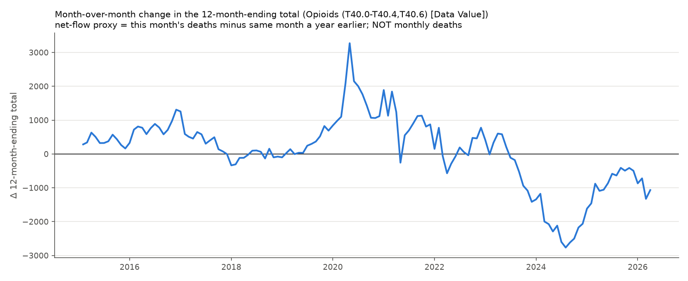
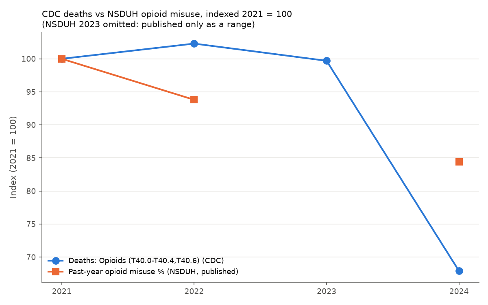

# Results

Generated by `python -m src.build_results` from the files in `outputs/`. Every number below comes from a file in `outputs/`; each table lists its source. This file contains no interpretation.

## Raw data files (`data/raw/MANIFEST.json`)

| source | file | sha256 | fetched |
|---|---|---|---|
| cdc_county | cdc_vsrr_overdose_county.csv | 167f73734f908d05... | 2026-10-10 |
| cdc_state | cdc_vsrr_overdose_national_state.csv | f44a22e9f3883974... | 2026-10-10 |
| nsduh_2021_2024 | nsduh_2021_2024_concat_puf_stata.zip | f2688342e6b65b5f... | 2026-10-23 |
| nsduh_2021_2024_codebook | nsduh_2021_2024_concat_codebook.pdf | e3f93058e459480e... | 2026-10-23 |
| nsduh_2023 | nsduh_2023_puf_stata.zip | bc97698a215f5a45... | 2026-10-10 |
| nsduh_2023_codebook | nsduh_2023_codebook.pdf | b19c158bc8542cbf... | 2026-10-10 |
| nsduh_2024 | nsduh_2024_puf_stata.zip | eb49c9549b216cb8... | 2026-10-23 |
| nsduh_2024_codebook | nsduh_2024_codebook.pdf | c70a7fdb5e7889d3... | 2026-10-23 |
| svi_2022 | svi_2022_us_county.csv | bc47d244153e359d... | 2026-10-10 |
| svi_2022_arcgis_geo | svi_2022_county.geojson | 69c906a3a56eab32... | 2026-10-10 |

## CDC national death series: break-point fits

Produced by `analyze_real.py`. Values are 12-month-ending totals.

| series | indicator | value_col | months | range | break_1 | break_2 | one_break | sse_0 | sse_1 | sse_2 | peak | latest | pct_below_peak |
|---|---|---|---|---|---|---|---|---|---|---|---|---|---|
| all_drug | Number of Drug Overdose Deaths | Data Value | 136 | 2015-01 to 2026-04 | 2020-07 | 2023-05 | 2023-08 | 29,717,659,852 | 3,748,162,961 | 1,531,261,249 | 111,466 (2023-06) | 65,726 (2026-04) | 41 |
| opioids | Opioids (T40.0-T40.4,T40.6) | Data Value | 136 | 2015-01 to 2026-04 | 2020-07 | 2023-06 | 2023-07 | 25,943,664,297 | 2,620,278,855 | 1,006,399,771 | 84,972 (2023-06) | 41,031 (2026-04) | 52 |


Sources:

- `source`: CDC/NCHS VSRR Provisional Drug Overdose Death Counts (data.cdc.gov xkb8-kh2a), file data/raw/cdc_vsrr_overdose_national_state.csv, State='US', Indicator='Number of Drug Overdose Deaths', column='Data Value'; 12-month-ending totals
- `source`: CDC/NCHS VSRR Provisional Drug Overdose Death Counts (data.cdc.gov xkb8-kh2a), file data/raw/cdc_vsrr_overdose_national_state.csv, State='US', Indicator='Opioids (T40.0-T40.4,T40.6)', column='Data Value'; 12-month-ending totals


**all_drug / breakpoints**


**all_drug / netflow_proxy**


**all_drug / vs_nsduh**


**opioids / breakpoints**


**opioids / netflow_proxy**




**opioids / vs_nsduh**




Note: the `*_vs_nsduh` charts use hand-entered published NSDUH figures (see `nsduh_source` in the JSON); Step A below replaces them with microdata estimates.

## Step 1: NSDUH 2021-2024 weighted estimates

Produced by `src/nsduh_estimates.py`. Percent of people aged 12+, design-based SE and 95% CI (logit), `rse` = SE / estimate.

### Respondents with data, by variable and year

| variable | label | 2021 | 2022 | 2023 | 2024 |
|---|---|---|---|---|---|
| OPI_MISUSE | Opioid misuse, past year (heroin use or Rx pain-reliever misuse; 2021-23 definition) | 58,034 | 59,069 | 56,705 | 58,633 |
| OPI_OUD | Opioid use disorder, past year (heroin or Rx pain-reliever use disorder; 2021-23 definition) | 58,034 | 59,069 | 56,705 | 58,633 |
| HERYR | Heroin use, past year | 58,034 | 59,069 | 56,705 | 58,633 |
| PNRNMYR | Rx pain-reliever misuse, past year | 58,034 | 59,069 | 56,705 | 58,633 |
| OPINMYR | Opioid misuse, past year (heroin use or Rx pain-reliever misuse) | 58,034 | 59,069 | 56,705 | 0 |
| UD5OPIANY | Opioid use disorder, past year (DSM-5) | 58,034 | 59,069 | 56,705 | 0 |
| ANALWT2_C1 |  | 58,034 | 59,069 | 56,705 | 58,633 |
| VESTR_C |  | 58,034 | 59,069 | 56,705 | 58,633 |
| VEREP |  | 58,034 | 59,069 | 56,705 | 58,633 |
| CATAG3 |  | 58,034 | 59,069 | 56,705 | 58,633 |
| IRSEX |  | 58,034 | 59,069 | 56,705 | 58,633 |


### National, by year

| variable | year | pct | se | ci_low | ci_high | n | rse | low_precision |
|---|---|---|---|---|---|---|---|---|
| OPI_MISUSE | 2021 | 3.394 | 0.151 | 3.102 | 3.711 | 58,034 | 0.045 | False |
| OPI_MISUSE | 2022 | 3.143 | 0.141 | 2.873 | 3.438 | 59,069 | 0.045 | False |
| OPI_MISUSE | 2023 | 3.185 | 0.139 | 2.917 | 3.477 | 56,705 | 0.044 | False |
| OPI_MISUSE | 2024 | 2.772 | 0.103 | 2.573 | 2.985 | 58,633 | 0.037 | False |
| OPI_OUD | 2021 | 2.004 | 0.120 | 1.778 | 2.260 | 58,034 | 0.060 | False |
| OPI_OUD | 2022 | 2.181 | 0.161 | 1.881 | 2.529 | 59,069 | 0.074 | False |
| OPI_OUD | 2023 | 2.025 | 0.116 | 1.804 | 2.272 | 56,705 | 0.057 | False |
| OPI_OUD | 2024 | 1.779 | 0.119 | 1.555 | 2.035 | 58,633 | 0.067 | False |
| HERYR | 2021 | 0.385 | 0.059 | 0.284 | 0.523 | 58,034 | 0.152 | False |
| HERYR | 2022 | 0.358 | 0.051 | 0.269 | 0.475 | 59,069 | 0.141 | False |
| HERYR | 2023 | 0.237 | 0.030 | 0.184 | 0.306 | 56,705 | 0.127 | False |
| HERYR | 2024 | 0.194 | 0.029 | 0.144 | 0.260 | 58,633 | 0.148 | False |
| PNRNMYR | 2021 | 3.208 | 0.146 | 2.927 | 3.516 | 58,034 | 0.046 | False |
| PNRNMYR | 2022 | 2.966 | 0.131 | 2.714 | 3.241 | 59,069 | 0.044 | False |
| PNRNMYR | 2023 | 3.076 | 0.140 | 2.808 | 3.369 | 56,705 | 0.045 | False |
| PNRNMYR | 2024 | 2.697 | 0.102 | 2.501 | 2.909 | 58,633 | 0.038 | False |
| OPINMYR | 2021 | 3.394 | 0.151 | 3.102 | 3.711 | 58,034 | 0.045 | False |
| OPINMYR | 2022 | 3.143 | 0.141 | 2.873 | 3.438 | 59,069 | 0.045 | False |
| OPINMYR | 2023 | 3.185 | 0.139 | 2.917 | 3.477 | 56,705 | 0.044 | False |
| UD5OPIANY | 2021 | 2.004 | 0.120 | 1.778 | 2.260 | 58,034 | 0.060 | False |
| UD5OPIANY | 2022 | 2.181 | 0.161 | 1.881 | 2.529 | 59,069 | 0.074 | False |
| UD5OPIANY | 2023 | 2.025 | 0.116 | 1.804 | 2.272 | 56,705 | 0.057 | False |


### By year and age group (`CATAG3`)

| variable | year | level | pct | se | ci_low | ci_high | n | rse | low_precision |
|---|---|---|---|---|---|---|---|---|---|
| OPI_MISUSE | 2021 | 1 - 12-17 Years Old | 2.144 | 0.213 | 1.755 | 2.618 | 10,743 | 0.100 | False |
| OPI_MISUSE | 2021 | 2 - 18-25 Years Old | 3.164 | 0.265 | 2.673 | 3.742 | 13,979 | 0.084 | False |
| OPI_MISUSE | 2021 | 3 - 26-34 Years Old | 4.944 | 0.415 | 4.174 | 5.848 | 9588 | 0.084 | False |
| OPI_MISUSE | 2021 | 4 - 35-49 Years Old | 3.794 | 0.242 | 3.338 | 4.310 | 12,561 | 0.064 | False |
| OPI_MISUSE | 2021 | 5 - 50 or Older | 2.996 | 0.299 | 2.451 | 3.657 | 11,163 | 0.100 | False |
| OPI_MISUSE | 2022 | 1 - 12-17 Years Old | 1.685 | 0.161 | 1.390 | 2.042 | 11,969 | 0.096 | False |
| OPI_MISUSE | 2022 | 2 - 18-25 Years Old | 3.084 | 0.260 | 2.602 | 3.653 | 14,307 | 0.084 | False |
| OPI_MISUSE | 2022 | 3 - 26-34 Years Old | 4.365 | 0.317 | 3.771 | 5.049 | 9645 | 0.073 | False |
| OPI_MISUSE | 2022 | 4 - 35-49 Years Old | 4.375 | 0.375 | 3.681 | 5.193 | 12,588 | 0.086 | False |
| OPI_MISUSE | 2022 | 5 - 50 or Older | 2.413 | 0.192 | 2.056 | 2.830 | 10,560 | 0.080 | False |
| OPI_MISUSE | 2023 | 1 - 12-17 Years Old | 2.280 | 0.231 | 1.860 | 2.792 | 11,572 | 0.101 | False |
| OPI_MISUSE | 2023 | 2 - 18-25 Years Old | 2.663 | 0.218 | 2.259 | 3.137 | 13,587 | 0.082 | False |
| OPI_MISUSE | 2023 | 3 - 26-34 Years Old | 4.079 | 0.316 | 3.489 | 4.764 | 9171 | 0.078 | False |
| OPI_MISUSE | 2023 | 4 - 35-49 Years Old | 4.128 | 0.265 | 3.627 | 4.695 | 12,355 | 0.064 | False |
| OPI_MISUSE | 2023 | 5 - 50 or Older | 2.721 | 0.231 | 2.293 | 3.226 | 10,020 | 0.085 | False |
| OPI_MISUSE | 2024 | 1 - 12-17 Years Old | 1.642 | 0.179 | 1.319 | 2.043 | 11,334 | 0.109 | False |
| OPI_MISUSE | 2024 | 2 - 18-25 Years Old | 2.778 | 0.232 | 2.348 | 3.285 | 14,136 | 0.084 | False |
| OPI_MISUSE | 2024 | 3 - 26-34 Years Old | 2.828 | 0.214 | 2.428 | 3.290 | 9621 | 0.076 | False |
| OPI_MISUSE | 2024 | 4 - 35-49 Years Old | 3.958 | 0.230 | 3.521 | 4.447 | 12,845 | 0.058 | False |
| OPI_MISUSE | 2024 | 5 - 50 or Older | 2.351 | 0.231 | 1.929 | 2.863 | 10,697 | 0.098 | False |
| OPI_OUD | 2021 | 1 - 12-17 Years Old | 1.101 | 0.194 | 0.773 | 1.567 | 10,743 | 0.176 | False |
| OPI_OUD | 2021 | 2 - 18-25 Years Old | 1.258 | 0.172 | 0.955 | 1.654 | 13,979 | 0.137 | False |
| OPI_OUD | 2021 | 3 - 26-34 Years Old | 2.028 | 0.298 | 1.509 | 2.720 | 9588 | 0.147 | False |
| OPI_OUD | 2021 | 4 - 35-49 Years Old | 2.316 | 0.210 | 1.929 | 2.778 | 12,561 | 0.091 | False |
| OPI_OUD | 2021 | 5 - 50 or Older | 2.243 | 0.230 | 1.826 | 2.754 | 11,163 | 0.102 | False |
| OPI_OUD | 2022 | 1 - 12-17 Years Old | 0.951 | 0.118 | 0.742 | 1.220 | 11,969 | 0.124 | False |
| OPI_OUD | 2022 | 2 - 18-25 Years Old | 1.173 | 0.142 | 0.919 | 1.496 | 14,307 | 0.121 | False |
| OPI_OUD | 2022 | 3 - 26-34 Years Old | 1.989 | 0.314 | 1.447 | 2.728 | 9645 | 0.158 | False |
| OPI_OUD | 2022 | 4 - 35-49 Years Old | 2.776 | 0.294 | 2.243 | 3.431 | 12,588 | 0.106 | False |
| OPI_OUD | 2022 | 5 - 50 or Older | 2.496 | 0.250 | 2.041 | 3.049 | 10,560 | 0.100 | False |
| OPI_OUD | 2023 | 1 - 12-17 Years Old | 1.321 | 0.161 | 1.034 | 1.686 | 11,572 | 0.122 | False |
| OPI_OUD | 2023 | 2 - 18-25 Years Old | 1.180 | 0.101 | 0.993 | 1.402 | 13,587 | 0.086 | False |
| OPI_OUD | 2023 | 3 - 26-34 Years Old | 1.816 | 0.221 | 1.421 | 2.319 | 9171 | 0.122 | False |
| OPI_OUD | 2023 | 4 - 35-49 Years Old | 2.339 | 0.208 | 1.956 | 2.795 | 12,355 | 0.089 | False |
| OPI_OUD | 2023 | 5 - 50 or Older | 2.320 | 0.246 | 1.875 | 2.869 | 10,020 | 0.106 | False |
| OPI_OUD | 2024 | 1 - 12-17 Years Old | 1.178 | 0.128 | 0.947 | 1.465 | 11,334 | 0.109 | False |
| OPI_OUD | 2024 | 2 - 18-25 Years Old | 1.113 | 0.147 | 0.853 | 1.451 | 14,136 | 0.132 | False |
| OPI_OUD | 2024 | 3 - 26-34 Years Old | 1.425 | 0.179 | 1.107 | 1.832 | 9621 | 0.125 | False |
| OPI_OUD | 2024 | 4 - 35-49 Years Old | 2.017 | 0.170 | 1.702 | 2.389 | 12,845 | 0.084 | False |
| OPI_OUD | 2024 | 5 - 50 or Older | 2.091 | 0.233 | 1.671 | 2.615 | 10,697 | 0.112 | False |
| HERYR | 2021 | 1 - 12-17 Years Old | 0.002 | 0.002 | 0.000 | 0.012 | 10,743 | 0.959 | False |
| HERYR | 2021 | 2 - 18-25 Years Old | 0.230 | 0.068 | 0.128 | 0.415 | 13,979 | 0.293 | False |
| HERYR | 2021 | 3 - 26-34 Years Old | 0.656 | 0.162 | 0.399 | 1.076 | 9588 | 0.247 | False |
| HERYR | 2021 | 4 - 35-49 Years Old | 0.535 | 0.106 | 0.360 | 0.795 | 12,561 | 0.197 | False |
| HERYR | 2021 | 5 - 50 or Older | 0.343 | 0.112 | 0.178 | 0.660 | 11,163 | 0.326 | False |
| HERYR | 2022 | 1 - 12-17 Years Old | 0.011 | 0.009 | 0.002 | 0.057 | 11,969 | 0.823 | False |
| HERYR | 2022 | 2 - 18-25 Years Old | 0.134 | 0.037 | 0.077 | 0.233 | 14,307 | 0.276 | False |
| HERYR | 2022 | 3 - 26-34 Years Old | 0.482 | 0.111 | 0.303 | 0.765 | 9645 | 0.231 | False |
| HERYR | 2022 | 4 - 35-49 Years Old | 0.794 | 0.126 | 0.578 | 1.092 | 12,588 | 0.159 | False |
| HERYR | 2022 | 5 - 50 or Older | 0.227 | 0.064 | 0.129 | 0.398 | 10,560 | 0.281 | False |
| HERYR | 2023 | 1 - 12-17 Years Old | 0.014 | 0.014 | 0.002 | 0.105 | 11,572 | 1.002 | False |
| HERYR | 2023 | 2 - 18-25 Years Old | 0.074 | 0.026 | 0.036 | 0.152 | 13,587 | 0.356 | False |
| HERYR | 2023 | 3 - 26-34 Years Old | 0.370 | 0.097 | 0.218 | 0.628 | 9171 | 0.263 | False |
| HERYR | 2023 | 4 - 35-49 Years Old | 0.596 | 0.099 | 0.427 | 0.832 | 12,355 | 0.166 | False |
| HERYR | 2023 | 5 - 50 or Older | 0.094 | 0.042 | 0.039 | 0.231 | 10,020 | 0.446 | False |
| HERYR | 2024 | 1 - 12-17 Years Old | 0.038 | 0.023 | 0.011 | 0.130 | 11,334 | 0.618 | False |
| HERYR | 2024 | 2 - 18-25 Years Old | 0.170 | 0.033 | 0.115 | 0.250 | 14,136 | 0.193 | False |
| HERYR | 2024 | 3 - 26-34 Years Old | 0.209 | 0.055 | 0.124 | 0.354 | 9621 | 0.262 | False |
| HERYR | 2024 | 4 - 35-49 Years Old | 0.401 | 0.066 | 0.289 | 0.557 | 12,845 | 0.163 | False |
| HERYR | 2024 | 5 - 50 or Older | 0.116 | 0.049 | 0.050 | 0.271 | 10,697 | 0.421 | False |
| PNRNMYR | 2021 | 1 - 12-17 Years Old | 2.144 | 0.213 | 1.755 | 2.618 | 10,743 | 0.100 | False |
| PNRNMYR | 2021 | 2 - 18-25 Years Old | 3.103 | 0.264 | 2.615 | 3.678 | 13,979 | 0.085 | False |
| PNRNMYR | 2021 | 3 - 26-34 Years Old | 4.711 | 0.420 | 3.936 | 5.631 | 9588 | 0.089 | False |
| PNRNMYR | 2021 | 4 - 35-49 Years Old | 3.519 | 0.234 | 3.079 | 4.020 | 12,561 | 0.066 | False |
| PNRNMYR | 2021 | 5 - 50 or Older | 2.797 | 0.285 | 2.279 | 3.429 | 11,163 | 0.102 | False |
| PNRNMYR | 2022 | 1 - 12-17 Years Old | 1.685 | 0.161 | 1.390 | 2.042 | 11,969 | 0.096 | False |
| PNRNMYR | 2022 | 2 - 18-25 Years Old | 3.040 | 0.258 | 2.563 | 3.604 | 14,307 | 0.085 | False |
| PNRNMYR | 2022 | 3 - 26-34 Years Old | 4.168 | 0.317 | 3.576 | 4.854 | 9645 | 0.076 | False |
| PNRNMYR | 2022 | 4 - 35-49 Years Old | 4.005 | 0.363 | 3.336 | 4.801 | 12,588 | 0.091 | False |
| PNRNMYR | 2022 | 5 - 50 or Older | 2.268 | 0.179 | 1.934 | 2.657 | 10,560 | 0.079 | False |
| PNRNMYR | 2023 | 1 - 12-17 Years Old | 2.266 | 0.230 | 1.847 | 2.778 | 11,572 | 0.102 | False |
| PNRNMYR | 2023 | 2 - 18-25 Years Old | 2.653 | 0.218 | 2.248 | 3.128 | 13,587 | 0.082 | False |
| PNRNMYR | 2023 | 3 - 26-34 Years Old | 3.949 | 0.320 | 3.354 | 4.645 | 9171 | 0.081 | False |
| PNRNMYR | 2023 | 4 - 35-49 Years Old | 3.820 | 0.247 | 3.354 | 4.349 | 12,355 | 0.065 | False |
| PNRNMYR | 2023 | 5 - 50 or Older | 2.678 | 0.231 | 2.251 | 3.183 | 10,020 | 0.086 | False |
| PNRNMYR | 2024 | 1 - 12-17 Years Old | 1.622 | 0.179 | 1.299 | 2.023 | 11,334 | 0.110 | False |
| PNRNMYR | 2024 | 2 - 18-25 Years Old | 2.682 | 0.235 | 2.248 | 3.197 | 14,136 | 0.088 | False |
| PNRNMYR | 2024 | 3 - 26-34 Years Old | 2.754 | 0.216 | 2.351 | 3.223 | 9621 | 0.079 | False |
| PNRNMYR | 2024 | 4 - 35-49 Years Old | 3.810 | 0.245 | 3.348 | 4.334 | 12,845 | 0.064 | False |
| PNRNMYR | 2024 | 5 - 50 or Older | 2.311 | 0.230 | 1.892 | 2.821 | 10,697 | 0.099 | False |
| OPINMYR | 2021 | 1 - 12-17 Years Old | 2.144 | 0.213 | 1.755 | 2.618 | 10,743 | 0.100 | False |
| OPINMYR | 2021 | 2 - 18-25 Years Old | 3.164 | 0.265 | 2.673 | 3.742 | 13,979 | 0.084 | False |
| OPINMYR | 2021 | 3 - 26-34 Years Old | 4.944 | 0.415 | 4.174 | 5.848 | 9588 | 0.084 | False |
| OPINMYR | 2021 | 4 - 35-49 Years Old | 3.794 | 0.242 | 3.338 | 4.310 | 12,561 | 0.064 | False |
| OPINMYR | 2021 | 5 - 50 or Older | 2.996 | 0.299 | 2.451 | 3.657 | 11,163 | 0.100 | False |
| OPINMYR | 2022 | 1 - 12-17 Years Old | 1.685 | 0.161 | 1.390 | 2.042 | 11,969 | 0.096 | False |
| OPINMYR | 2022 | 2 - 18-25 Years Old | 3.084 | 0.260 | 2.602 | 3.653 | 14,307 | 0.084 | False |
| OPINMYR | 2022 | 3 - 26-34 Years Old | 4.365 | 0.317 | 3.771 | 5.049 | 9645 | 0.073 | False |
| OPINMYR | 2022 | 4 - 35-49 Years Old | 4.375 | 0.375 | 3.681 | 5.193 | 12,588 | 0.086 | False |
| OPINMYR | 2022 | 5 - 50 or Older | 2.413 | 0.192 | 2.056 | 2.830 | 10,560 | 0.080 | False |
| OPINMYR | 2023 | 1 - 12-17 Years Old | 2.280 | 0.231 | 1.860 | 2.792 | 11,572 | 0.101 | False |
| OPINMYR | 2023 | 2 - 18-25 Years Old | 2.663 | 0.218 | 2.259 | 3.137 | 13,587 | 0.082 | False |
| OPINMYR | 2023 | 3 - 26-34 Years Old | 4.079 | 0.316 | 3.489 | 4.764 | 9171 | 0.078 | False |
| OPINMYR | 2023 | 4 - 35-49 Years Old | 4.128 | 0.265 | 3.627 | 4.695 | 12,355 | 0.064 | False |
| OPINMYR | 2023 | 5 - 50 or Older | 2.721 | 0.231 | 2.293 | 3.226 | 10,020 | 0.085 | False |
| UD5OPIANY | 2021 | 1 - 12-17 Years Old | 1.101 | 0.194 | 0.773 | 1.567 | 10,743 | 0.176 | False |
| UD5OPIANY | 2021 | 2 - 18-25 Years Old | 1.258 | 0.172 | 0.955 | 1.654 | 13,979 | 0.137 | False |
| UD5OPIANY | 2021 | 3 - 26-34 Years Old | 2.028 | 0.298 | 1.509 | 2.720 | 9588 | 0.147 | False |
| UD5OPIANY | 2021 | 4 - 35-49 Years Old | 2.316 | 0.210 | 1.929 | 2.778 | 12,561 | 0.091 | False |
| UD5OPIANY | 2021 | 5 - 50 or Older | 2.243 | 0.230 | 1.826 | 2.754 | 11,163 | 0.102 | False |
| UD5OPIANY | 2022 | 1 - 12-17 Years Old | 0.951 | 0.118 | 0.742 | 1.220 | 11,969 | 0.124 | False |
| UD5OPIANY | 2022 | 2 - 18-25 Years Old | 1.173 | 0.142 | 0.919 | 1.496 | 14,307 | 0.121 | False |
| UD5OPIANY | 2022 | 3 - 26-34 Years Old | 1.989 | 0.314 | 1.447 | 2.728 | 9645 | 0.158 | False |
| UD5OPIANY | 2022 | 4 - 35-49 Years Old | 2.776 | 0.294 | 2.243 | 3.431 | 12,588 | 0.106 | False |
| UD5OPIANY | 2022 | 5 - 50 or Older | 2.496 | 0.250 | 2.041 | 3.049 | 10,560 | 0.100 | False |
| UD5OPIANY | 2023 | 1 - 12-17 Years Old | 1.321 | 0.161 | 1.034 | 1.686 | 11,572 | 0.122 | False |
| UD5OPIANY | 2023 | 2 - 18-25 Years Old | 1.180 | 0.101 | 0.993 | 1.402 | 13,587 | 0.086 | False |
| UD5OPIANY | 2023 | 3 - 26-34 Years Old | 1.816 | 0.221 | 1.421 | 2.319 | 9171 | 0.122 | False |
| UD5OPIANY | 2023 | 4 - 35-49 Years Old | 2.339 | 0.208 | 1.956 | 2.795 | 12,355 | 0.089 | False |
| UD5OPIANY | 2023 | 5 - 50 or Older | 2.320 | 0.246 | 1.875 | 2.869 | 10,020 | 0.106 | False |


### By year and sex (`IRSEX`)

| variable | year | level | pct | se | ci_low | ci_high | n | rse | low_precision |
|---|---|---|---|---|---|---|---|---|---|
| OPI_MISUSE | 2021 | 1 - Male | 3.525 | 0.272 | 3.018 | 4.114 | 26,391 | 0.077 | False |
| OPI_MISUSE | 2021 | 2 - Female | 3.268 | 0.197 | 2.895 | 3.687 | 31,643 | 0.060 | False |
| OPI_MISUSE | 2022 | 1 - Male | 3.384 | 0.212 | 2.984 | 3.836 | 27,047 | 0.063 | False |
| OPI_MISUSE | 2022 | 2 - Female | 2.912 | 0.160 | 2.608 | 3.250 | 32,022 | 0.055 | False |
| OPI_MISUSE | 2023 | 1 - Male | 3.325 | 0.211 | 2.926 | 3.776 | 26,145 | 0.064 | False |
| OPI_MISUSE | 2023 | 2 - Female | 3.051 | 0.166 | 2.736 | 3.403 | 30,560 | 0.054 | False |
| OPI_MISUSE | 2024 | 1 - Male | 2.915 | 0.152 | 2.625 | 3.237 | 27,102 | 0.052 | False |
| OPI_MISUSE | 2024 | 2 - Female | 2.634 | 0.126 | 2.393 | 2.899 | 31,531 | 0.048 | False |
| OPI_OUD | 2021 | 1 - Male | 1.959 | 0.179 | 1.630 | 2.352 | 26,391 | 0.091 | False |
| OPI_OUD | 2021 | 2 - Female | 2.048 | 0.170 | 1.733 | 2.420 | 31,643 | 0.083 | False |
| OPI_OUD | 2022 | 1 - Male | 2.208 | 0.237 | 1.779 | 2.738 | 27,047 | 0.107 | False |
| OPI_OUD | 2022 | 2 - Female | 2.156 | 0.163 | 1.853 | 2.508 | 32,022 | 0.075 | False |
| OPI_OUD | 2023 | 1 - Male | 1.927 | 0.151 | 1.645 | 2.255 | 26,145 | 0.079 | False |
| OPI_OUD | 2023 | 2 - Female | 2.118 | 0.146 | 1.845 | 2.431 | 30,560 | 0.069 | False |
| OPI_OUD | 2024 | 1 - Male | 1.701 | 0.184 | 1.369 | 2.113 | 27,102 | 0.108 | False |
| OPI_OUD | 2024 | 2 - Female | 1.853 | 0.161 | 1.556 | 2.205 | 31,531 | 0.087 | False |
| HERYR | 2021 | 1 - Male | 0.492 | 0.107 | 0.318 | 0.762 | 26,391 | 0.218 | False |
| HERYR | 2021 | 2 - Female | 0.283 | 0.049 | 0.200 | 0.401 | 31,643 | 0.173 | False |
| HERYR | 2022 | 1 - Male | 0.484 | 0.076 | 0.353 | 0.664 | 27,047 | 0.158 | False |
| HERYR | 2022 | 2 - Female | 0.236 | 0.055 | 0.148 | 0.376 | 32,022 | 0.232 | False |
| HERYR | 2023 | 1 - Male | 0.252 | 0.045 | 0.177 | 0.360 | 26,145 | 0.177 | False |
| HERYR | 2023 | 2 - Female | 0.223 | 0.040 | 0.155 | 0.320 | 30,560 | 0.180 | False |
| HERYR | 2024 | 1 - Male | 0.232 | 0.063 | 0.134 | 0.402 | 27,102 | 0.273 | False |
| HERYR | 2024 | 2 - Female | 0.157 | 0.024 | 0.114 | 0.214 | 31,531 | 0.156 | False |
| PNRNMYR | 2021 | 1 - Male | 3.283 | 0.247 | 2.821 | 3.817 | 26,391 | 0.075 | False |
| PNRNMYR | 2021 | 2 - Female | 3.137 | 0.191 | 2.775 | 3.544 | 31,643 | 0.061 | False |
| PNRNMYR | 2022 | 1 - Male | 3.154 | 0.195 | 2.784 | 3.571 | 27,047 | 0.062 | False |
| PNRNMYR | 2022 | 2 - Female | 2.786 | 0.150 | 2.499 | 3.104 | 32,022 | 0.054 | False |
| PNRNMYR | 2023 | 1 - Male | 3.194 | 0.207 | 2.804 | 3.636 | 26,145 | 0.065 | False |
| PNRNMYR | 2023 | 2 - Female | 2.964 | 0.163 | 2.653 | 3.311 | 30,560 | 0.055 | False |
| PNRNMYR | 2024 | 1 - Male | 2.830 | 0.145 | 2.553 | 3.135 | 27,102 | 0.051 | False |
| PNRNMYR | 2024 | 2 - Female | 2.571 | 0.128 | 2.326 | 2.841 | 31,531 | 0.050 | False |
| OPINMYR | 2021 | 1 - Male | 3.525 | 0.272 | 3.018 | 4.114 | 26,391 | 0.077 | False |
| OPINMYR | 2021 | 2 - Female | 3.268 | 0.197 | 2.895 | 3.687 | 31,643 | 0.060 | False |
| OPINMYR | 2022 | 1 - Male | 3.384 | 0.212 | 2.984 | 3.836 | 27,047 | 0.063 | False |
| OPINMYR | 2022 | 2 - Female | 2.912 | 0.160 | 2.608 | 3.250 | 32,022 | 0.055 | False |
| OPINMYR | 2023 | 1 - Male | 3.325 | 0.211 | 2.926 | 3.776 | 26,145 | 0.064 | False |
| OPINMYR | 2023 | 2 - Female | 3.051 | 0.166 | 2.736 | 3.403 | 30,560 | 0.054 | False |
| UD5OPIANY | 2021 | 1 - Male | 1.959 | 0.179 | 1.630 | 2.352 | 26,391 | 0.091 | False |
| UD5OPIANY | 2021 | 2 - Female | 2.048 | 0.170 | 1.733 | 2.420 | 31,643 | 0.083 | False |
| UD5OPIANY | 2022 | 1 - Male | 2.208 | 0.237 | 1.779 | 2.738 | 27,047 | 0.107 | False |
| UD5OPIANY | 2022 | 2 - Female | 2.156 | 0.163 | 1.853 | 2.508 | 32,022 | 0.075 | False |
| UD5OPIANY | 2023 | 1 - Male | 1.927 | 0.151 | 1.645 | 2.255 | 26,145 | 0.079 | False |
| UD5OPIANY | 2023 | 2 - Female | 2.118 | 0.146 | 1.845 | 2.431 | 30,560 | 0.069 | False |


### Validation against previously hand-entered published figures

| year | variable | ours_pct | published | abs_gap_pp |
|---|---|---|---|---|
| 2021 | OPI_MISUSE | 3.39 | 3.2 | 0.19 |
| 2021 | PNRNMYR | 3.21 | 3.2 | 0.01 |
| 2022 | OPI_MISUSE | 3.14 | 3.0 | 0.14 |
| 2022 | PNRNMYR | 2.97 | 3.0 | 0.03 |
| 2023 | OPI_MISUSE | 3.18 | (3.0, 3.1) | 0.08 |
| 2023 | PNRNMYR | 3.08 | (3.0, 3.1) | 0.00 |
| 2024 | OPI_MISUSE | 2.77 | 2.7 | 0.07 |
| 2024 | PNRNMYR | 2.70 | 2.7 | 0.00 |


Sources:

- `published_source`: SAMHSA NSDUH reports, hand-entered in analyze_real.py (not re-verified)


Sources:

- `source`: NSDUH 2021-2024 combined PUF (data/raw/nsduh_2021_2024/NSDUH_2021_2024.dta; 2024 OPI_OUD uses data/raw/nsduh_2024/NSDUH_2024.dta), weight ANALWT2_C1, strata VESTR_C, PSU VEREP, df=50; Taylor linearization

## Step A: opioid deaths vs NSDUH opioid measures, 2021-2024

Produced by `src/step_a.py`.

> **Reminder:** NSDUH mostly captures prescription pain-reliever (pill) misuse, while opioid overdose deaths are mostly illicitly made fentanyl (synthetic opioids, T40.4). The two series measure different behaviors in different populations; a household survey also misses many people at highest risk (e.g. unhoused, incarcerated).

### Method (from the script)

```
* Each change is a log ratio, L = ln(value_2024 / value_2021); % change = 100*(e^L - 1).
  * NSDUH log ratios and their SEs come from survey.contrast(): Taylor linearization of
    ln(p_2024) - ln(p_2021) on the shared NSDUH design (VESTR_C/VEREP), so the covariance between
    years that share PSUs is included. 50 design degrees of freedom.
  * Deaths are a complete count (not a sample), so the main test treats the deaths log ratio as
    fixed. Sensitivity: add Poisson count variance 1/D_2021 + 1/D_2024.
  * Test statistic: t = (L_nsduh - L_deaths) / SE, compared to t(50). Three measures are tested;
    p-values are not adjusted for multiple comparisons.
  * No measure is designated as "addiction"; all three are reported side by side.
```


### Levels and index (2021 = 100)

| measure | year | value | index | index_ci_low | index_ci_high | value_se |
|---|---|---|---|---|---|---|
| deaths | 2021 | 80,997.000 | 100.000 |  |  |  |
| deaths | 2022 | 82,851.000 | 102.289 |  |  |  |
| deaths | 2023 | 80,719.000 | 99.657 |  |  |  |
| deaths | 2024 | 55,007.000 | 67.912 |  |  |  |
| OPI_MISUSE | 2021 | 3.393 | 100.000 | 100.000 | 100.000 | 0.151 |
| OPI_MISUSE | 2022 | 3.143 | 92.624 | 81.358 | 105.450 | 0.141 |
| OPI_MISUSE | 2023 | 3.185 | 93.858 | 81.798 | 107.694 | 0.139 |
| OPI_MISUSE | 2024 | 2.772 | 81.679 | 72.010 | 92.646 | 0.102 |
| OPI_OUD | 2021 | 2.005 | 100.000 | 100.000 | 100.000 | 0.120 |
| OPI_OUD | 2022 | 2.182 | 108.832 | 90.820 | 130.415 | 0.161 |
| OPI_OUD | 2023 | 2.025 | 101.009 | 85.718 | 119.028 | 0.116 |
| OPI_OUD | 2024 | 1.779 | 88.739 | 74.098 | 106.273 | 0.119 |
| HERYR | 2021 | 0.385 | 100.000 | 100.000 | 100.000 | 0.059 |
| HERYR | 2022 | 0.358 | 92.865 | 60.086 | 143.528 | 0.051 |
| HERYR | 2023 | 0.237 | 61.575 | 40.572 | 93.450 | 0.030 |
| HERYR | 2024 | 0.194 | 50.252 | 32.330 | 78.111 | 0.029 |


### Tests: 2021 -> 2024 change in each NSDUH measure vs change in deaths

| measure | nsduh_pct_2021 | nsduh_pct_2024 | nsduh_pct_change | nsduh_pct_change_ci_low | nsduh_pct_change_ci_high | nsduh_change_pvalue_vs_zero | deaths_2021 | deaths_2024 | deaths_pct_change | difference_in_log_ratios | difference_ci_low | difference_ci_high | p_deaths_fixed | p_deaths_poisson | deaths_per_case_ratio_2024_vs_2021 | df |
|---|---|---|---|---|---|---|---|---|---|---|---|---|---|---|---|---|
| OPI_MISUSE | 3.3935 | 2.7718 | -18.3212 | -27.9899 | -7.3543 | 0.0022 | 80,997 | 55,007 | -32.0876 | 0.1846 | 0.0586 | 0.3106 | 0.0049 | 0.0051 | 0.8315 | 50 |
| OPI_OUD | 2.0045 | 1.7787 | -11.2614 | -25.9024 | 6.2726 | 0.1893 | 80,997 | 55,007 | -32.0876 | 0.2675 | 0.0872 | 0.4478 | 0.0044 | 0.0045 | 0.7653 | 50 |
| HERYR | 0.3854 | 0.1937 | -49.7477 | -67.6705 | -21.8887 | 0.0029 | 80,997 | 55,007 | -32.0876 | -0.3012 | -0.7422 | 0.1399 | 0.1764 | 0.1765 | 1.3514 | 50 |


### Context: what each source mostly measures

| item | year | value_pct | se |
|---|---|---|---|
| Share of opioid overdose deaths involving synthetic opioids (T40.4) | 2021 | 87.83 |  |
| Share of opioid overdose deaths involving synthetic opioids (T40.4) | 2024 | 88.47 |  |
| Share of NSDUH opioid misusers who misused Rx pain relievers but did not use heroin | 2021 | 88.64 | 1.65 |
| Share of NSDUH opioid misusers who misused Rx pain relievers but did not use heroin | 2024 | 93.01 | 1.00 |
| Past-year use of illegally made fentanyl, people 12+ (IMFYR; not asked in 2021) | 2022 | 0.23 | 0.03 |
| Past-year use of illegally made fentanyl, people 12+ (IMFYR; not asked in 2021) | 2023 | 0.23 | 0.03 |
| Past-year use of illegally made fentanyl, people 12+ (IMFYR; not asked in 2021) | 2024 | 0.25 | 0.03 |


Sources:

- `source`: CDC VSRR xkb8-kh2a, US, 'Opioids (T40.0-T40.4,T40.6)', Data Value, Dec 12-month-ending (= calendar year)
- `source`: NSDUH 2021-2024 combined PUF (+2024 single-year PUF for OUD), ANALWT2_C1, VESTR_C/VEREP, df=50

- `nsduh_source`: NSDUH 2021-2024 combined PUF (+2024 single-year PUF for OUD), ANALWT2_C1, VESTR_C/VEREP, df=50
- `deaths_source`: CDC VSRR xkb8-kh2a, US, 'Opioids (T40.0-T40.4,T40.6)', Data Value, Dec 12-month-ending (= calendar year)

- `source`: CDC VSRR xkb8-kh2a, US, Dec 12-month-ending: 'Synthetic opioids, excl. methadone (T40.4)' / 'Opioids (T40.0-T40.4,T40.6)'; categories overlap (multiple drugs per death)
- `source`: NSDUH 2021-2024 combined PUF (+2024 single-year PUF for OUD), ANALWT2_C1, VESTR_C/VEREP, df=50; PNRNMYR=1 & HERYR=0 among OPI_MISUSE=1
- `source`: NSDUH 2021-2024 combined PUF, IMFYR, ANALWT2_C1, VESTR_C/VEREP
