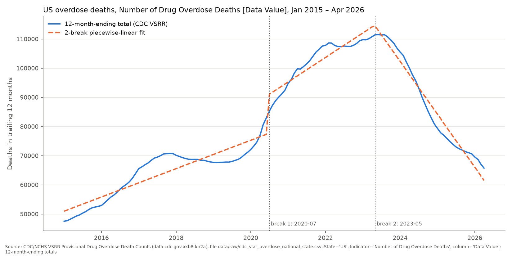
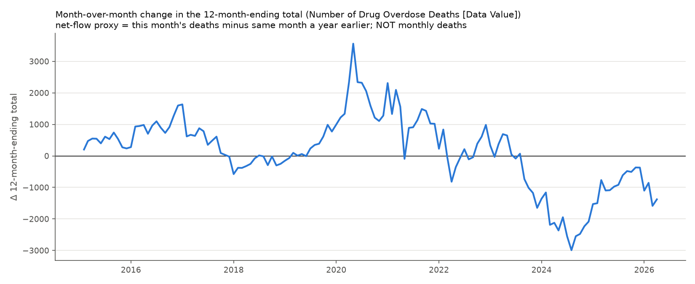
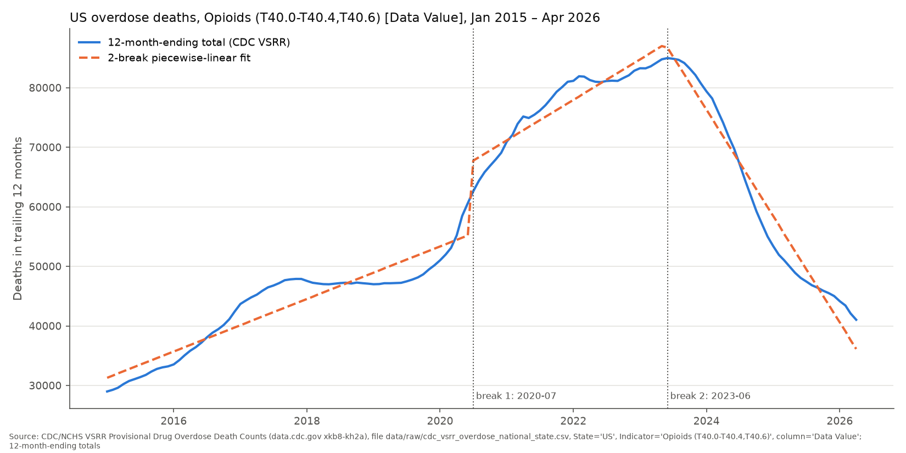
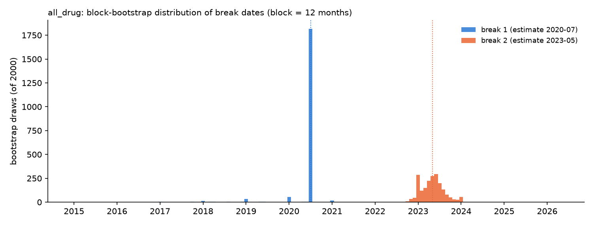
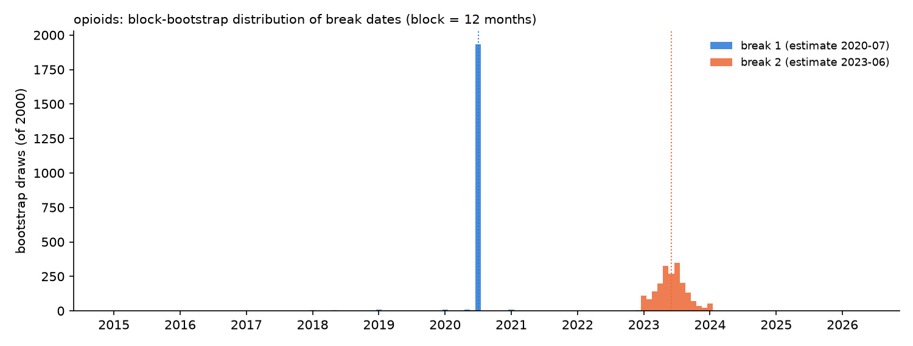
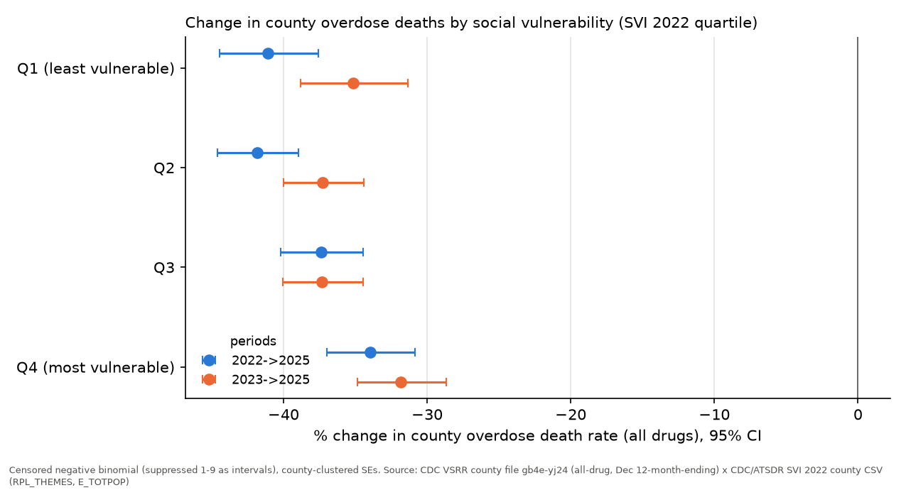
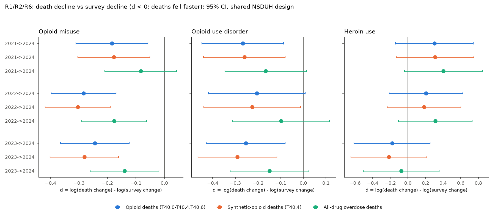
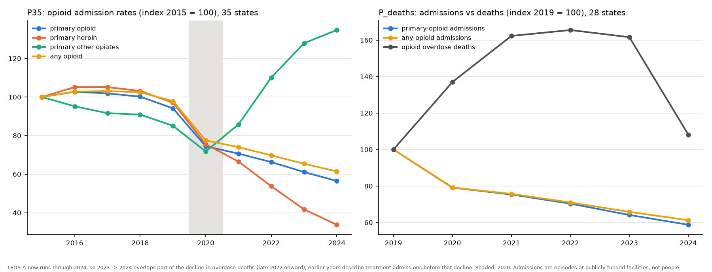
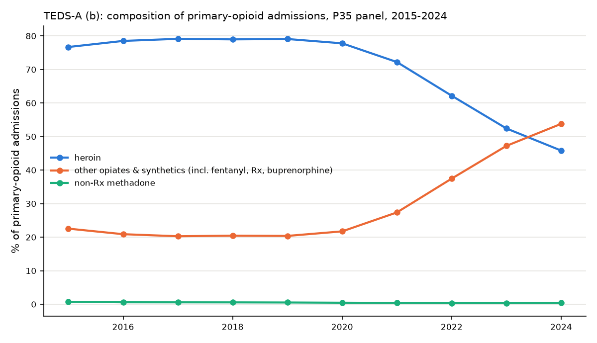
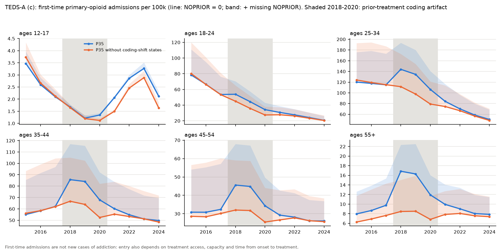

# Results

Generated by `python -m src.build_results` from the files in `outputs/`. Every number below comes from a file in `outputs/`; each table lists its source. This file contains no interpretation.

## Raw data files (`data/raw/MANIFEST.json`)

| source | file | sha256 | fetched |
|---|---|---|---|
| cdc_county | cdc_vsrr_overdose_county.csv | 167f73734f908d05... | 2026-10-10 |
| cdc_state | cdc_vsrr_overdose_national_state.csv | f44a22e9f3883974... | 2026-10-10 |
| census_pop | census_co_est2025_alldata.csv | 4f5a499d851e2cb4... | 2026-11-03 |
| census_state_asr_2010_2020 | census_sc_est2020int_alldata5.csv | 0928173245d117ac... | 2026-11-06 |
| census_state_asr_2020_2025 | census_sc_est2025_alldata5.csv | 49fdbf325ea23d20... | 2026-11-06 |
| nsduh_2021_2024 | nsduh_2021_2024_concat_puf_stata.zip | f2688342e6b65b5f... | 2026-10-23 |
| nsduh_2021_2024_codebook | nsduh_2021_2024_concat_codebook.pdf | e3f93058e459480e... | 2026-10-23 |
| nsduh_2023 | nsduh_2023_puf_stata.zip | bc97698a215f5a45... | 2026-10-10 |
| nsduh_2023_codebook | nsduh_2023_codebook.pdf | b19c158bc8542cbf... | 2026-10-10 |
| nsduh_2024 | nsduh_2024_puf_stata.zip | eb49c9549b216cb8... | 2026-10-23 |
| nsduh_2024_codebook | nsduh_2024_codebook.pdf | c70a7fdb5e7889d3... | 2026-10-23 |
| svi_2022 | svi_2022_us_county.csv | bc47d244153e359d... | 2026-10-10 |
| svi_2022_arcgis_geo | svi_2022_county.geojson | 69c906a3a56eab32... | 2026-10-10 |
| teds_a_2006_2023 | teds_a_2006_2023_csv.zip | 8a5d573350711e45... | 2026-11-06 |
| teds_a_2006_2023_codebook | teds_a_2006_2023_codebook.pdf | 904bcf0adc00dce3... | 2026-11-06 |
| teds_a_2024 | teds_a_2024_csv.zip | 659c92c2e1e334bd... | 2026-11-09 |
| teds_a_2024_codebook | teds_a_2024_codebook.pdf | 0aed7b78db7ed35b... | 2026-11-09 |

## CDC national death series: break-point fits

Produced by `analyze_real.py`. Values are 12-month-ending totals.

| series | indicator | value_col | months | range | break_1 | break_2 | one_break | sse_0 | sse_1 | sse_2 | peak | latest | pct_below_peak |
|---|---|---|---|---|---|---|---|---|---|---|---|---|---|
| all_drug | Number of Drug Overdose Deaths | Data Value | 136 | 2015-01 to 2026-04 | 2020-07 | 2023-05 | 2023-08 | 29,717,659,852 | 3,748,162,961 | 1,531,261,249 | 111,466 (2023-06) | 65,726 (2026-04) | 41 |
| opioids | Opioids (T40.0-T40.4,T40.6) | Data Value | 136 | 2015-01 to 2026-04 | 2020-07 | 2023-06 | 2023-07 | 25,943,664,297 | 2,620,278,855 | 1,006,399,771 | 84,972 (2023-06) | 41,031 (2026-04) | 52 |


Sources:

- `source`: CDC/NCHS VSRR Provisional Drug Overdose Death Counts (data.cdc.gov xkb8-kh2a), file data/raw/cdc_vsrr_overdose_national_state.csv, State='US', Indicator='Number of Drug Overdose Deaths', column='Data Value'; 12-month-ending totals
- `source`: CDC/NCHS VSRR Provisional Drug Overdose Death Counts (data.cdc.gov xkb8-kh2a), file data/raw/cdc_vsrr_overdose_national_state.csv, State='US', Indicator='Opioids (T40.0-T40.4,T40.6)', column='Data Value'; 12-month-ending totals


**all_drug / breakpoints**




**all_drug / netflow_proxy**




**all_drug / vs_nsduh**


**opioids / breakpoints**




**opioids / netflow_proxy**


**opioids / vs_nsduh**


Note: the `*_vs_nsduh` charts use hand-entered published NSDUH figures (see `nsduh_source` in the JSON); Step A below replaces them with microdata estimates.

## Step 1: NSDUH 2021-2024 weighted estimates

Produced by `src/nsduh_estimates.py`. Percent of people aged 12+, design-based SE and 95% CI (logit), `rse` = SE / estimate.

### Respondents with data, by variable and year

| variable | label | 2021 | 2022 | 2023 | 2024 |
|---|---|---|---|---|---|
| OPI_MISUSE | Opioid misuse, past year (heroin use or Rx pain-reliever misuse; 2021-23 definition) | 58,034 | 59,069 | 56,705 | 58,633 |
| OPI_OUD | Opioid use disorder, past year (heroin or Rx pain-reliever use disorder; 2021-23 definition) | 58,034 | 59,069 | 56,705 | 58,633 |
| HERYR | Heroin use, past year | 58,034 | 59,069 | 56,705 | 58,633 |
| PNRNMYR | Rx pain-reliever misuse, past year | 58,034 | 59,069 | 56,705 | 58,633 |
| OPINMYR | Opioid misuse, past year (heroin use or Rx pain-reliever misuse) | 58,034 | 59,069 | 56,705 | 0 |
| UD5OPIANY | Opioid use disorder, past year (DSM-5) | 58,034 | 59,069 | 56,705 | 0 |
| ANALWT2_C1 |  | 58,034 | 59,069 | 56,705 | 58,633 |
| VESTR_C |  | 58,034 | 59,069 | 56,705 | 58,633 |
| VEREP |  | 58,034 | 59,069 | 56,705 | 58,633 |
| CATAG3 |  | 58,034 | 59,069 | 56,705 | 58,633 |
| IRSEX |  | 58,034 | 59,069 | 56,705 | 58,633 |


### National, by year

| variable | year | pct | se | ci_low | ci_high | n | rse | low_precision |
|---|---|---|---|---|---|---|---|---|
| OPI_MISUSE | 2021 | 3.394 | 0.151 | 3.102 | 3.711 | 58,034 | 0.045 | False |
| OPI_MISUSE | 2022 | 3.143 | 0.141 | 2.873 | 3.438 | 59,069 | 0.045 | False |
| OPI_MISUSE | 2023 | 3.185 | 0.139 | 2.917 | 3.477 | 56,705 | 0.044 | False |
| OPI_MISUSE | 2024 | 2.772 | 0.103 | 2.573 | 2.985 | 58,633 | 0.037 | False |
| OPI_OUD | 2021 | 2.004 | 0.120 | 1.778 | 2.260 | 58,034 | 0.060 | False |
| OPI_OUD | 2022 | 2.181 | 0.161 | 1.881 | 2.529 | 59,069 | 0.074 | False |
| OPI_OUD | 2023 | 2.025 | 0.116 | 1.804 | 2.272 | 56,705 | 0.057 | False |
| OPI_OUD | 2024 | 1.779 | 0.119 | 1.555 | 2.035 | 58,633 | 0.067 | False |
| HERYR | 2021 | 0.385 | 0.059 | 0.284 | 0.523 | 58,034 | 0.152 | False |
| HERYR | 2022 | 0.358 | 0.051 | 0.269 | 0.475 | 59,069 | 0.141 | False |
| HERYR | 2023 | 0.237 | 0.030 | 0.184 | 0.306 | 56,705 | 0.127 | False |
| HERYR | 2024 | 0.194 | 0.029 | 0.144 | 0.260 | 58,633 | 0.148 | False |
| PNRNMYR | 2021 | 3.208 | 0.146 | 2.927 | 3.516 | 58,034 | 0.046 | False |
| PNRNMYR | 2022 | 2.966 | 0.131 | 2.714 | 3.241 | 59,069 | 0.044 | False |
| PNRNMYR | 2023 | 3.076 | 0.140 | 2.808 | 3.369 | 56,705 | 0.045 | False |
| PNRNMYR | 2024 | 2.697 | 0.102 | 2.501 | 2.909 | 58,633 | 0.038 | False |
| OPINMYR | 2021 | 3.394 | 0.151 | 3.102 | 3.711 | 58,034 | 0.045 | False |
| OPINMYR | 2022 | 3.143 | 0.141 | 2.873 | 3.438 | 59,069 | 0.045 | False |
| OPINMYR | 2023 | 3.185 | 0.139 | 2.917 | 3.477 | 56,705 | 0.044 | False |
| UD5OPIANY | 2021 | 2.004 | 0.120 | 1.778 | 2.260 | 58,034 | 0.060 | False |
| UD5OPIANY | 2022 | 2.181 | 0.161 | 1.881 | 2.529 | 59,069 | 0.074 | False |
| UD5OPIANY | 2023 | 2.025 | 0.116 | 1.804 | 2.272 | 56,705 | 0.057 | False |


### By year and age group (`CATAG3`)

| variable | year | level | pct | se | ci_low | ci_high | n | rse | low_precision |
|---|---|---|---|---|---|---|---|---|---|
| OPI_MISUSE | 2021 | 1 - 12-17 Years Old | 2.144 | 0.213 | 1.755 | 2.618 | 10,743 | 0.100 | False |
| OPI_MISUSE | 2021 | 2 - 18-25 Years Old | 3.164 | 0.265 | 2.673 | 3.742 | 13,979 | 0.084 | False |
| OPI_MISUSE | 2021 | 3 - 26-34 Years Old | 4.944 | 0.415 | 4.174 | 5.848 | 9588 | 0.084 | False |
| OPI_MISUSE | 2021 | 4 - 35-49 Years Old | 3.794 | 0.242 | 3.338 | 4.310 | 12,561 | 0.064 | False |
| OPI_MISUSE | 2021 | 5 - 50 or Older | 2.996 | 0.299 | 2.451 | 3.657 | 11,163 | 0.100 | False |
| OPI_MISUSE | 2022 | 1 - 12-17 Years Old | 1.685 | 0.161 | 1.390 | 2.042 | 11,969 | 0.096 | False |
| OPI_MISUSE | 2022 | 2 - 18-25 Years Old | 3.084 | 0.260 | 2.602 | 3.653 | 14,307 | 0.084 | False |
| OPI_MISUSE | 2022 | 3 - 26-34 Years Old | 4.365 | 0.317 | 3.771 | 5.049 | 9645 | 0.073 | False |
| OPI_MISUSE | 2022 | 4 - 35-49 Years Old | 4.375 | 0.375 | 3.681 | 5.193 | 12,588 | 0.086 | False |
| OPI_MISUSE | 2022 | 5 - 50 or Older | 2.413 | 0.192 | 2.056 | 2.830 | 10,560 | 0.080 | False |
| OPI_MISUSE | 2023 | 1 - 12-17 Years Old | 2.280 | 0.231 | 1.860 | 2.792 | 11,572 | 0.101 | False |
| OPI_MISUSE | 2023 | 2 - 18-25 Years Old | 2.663 | 0.218 | 2.259 | 3.137 | 13,587 | 0.082 | False |
| OPI_MISUSE | 2023 | 3 - 26-34 Years Old | 4.079 | 0.316 | 3.489 | 4.764 | 9171 | 0.078 | False |
| OPI_MISUSE | 2023 | 4 - 35-49 Years Old | 4.128 | 0.265 | 3.627 | 4.695 | 12,355 | 0.064 | False |
| OPI_MISUSE | 2023 | 5 - 50 or Older | 2.721 | 0.231 | 2.293 | 3.226 | 10,020 | 0.085 | False |
| OPI_MISUSE | 2024 | 1 - 12-17 Years Old | 1.642 | 0.179 | 1.319 | 2.043 | 11,334 | 0.109 | False |
| OPI_MISUSE | 2024 | 2 - 18-25 Years Old | 2.778 | 0.232 | 2.348 | 3.285 | 14,136 | 0.084 | False |
| OPI_MISUSE | 2024 | 3 - 26-34 Years Old | 2.828 | 0.214 | 2.428 | 3.290 | 9621 | 0.076 | False |
| OPI_MISUSE | 2024 | 4 - 35-49 Years Old | 3.958 | 0.230 | 3.521 | 4.447 | 12,845 | 0.058 | False |
| OPI_MISUSE | 2024 | 5 - 50 or Older | 2.351 | 0.231 | 1.929 | 2.863 | 10,697 | 0.098 | False |
| OPI_OUD | 2021 | 1 - 12-17 Years Old | 1.101 | 0.194 | 0.773 | 1.567 | 10,743 | 0.176 | False |
| OPI_OUD | 2021 | 2 - 18-25 Years Old | 1.258 | 0.172 | 0.955 | 1.654 | 13,979 | 0.137 | False |
| OPI_OUD | 2021 | 3 - 26-34 Years Old | 2.028 | 0.298 | 1.509 | 2.720 | 9588 | 0.147 | False |
| OPI_OUD | 2021 | 4 - 35-49 Years Old | 2.316 | 0.210 | 1.929 | 2.778 | 12,561 | 0.091 | False |
| OPI_OUD | 2021 | 5 - 50 or Older | 2.243 | 0.230 | 1.826 | 2.754 | 11,163 | 0.102 | False |
| OPI_OUD | 2022 | 1 - 12-17 Years Old | 0.951 | 0.118 | 0.742 | 1.220 | 11,969 | 0.124 | False |
| OPI_OUD | 2022 | 2 - 18-25 Years Old | 1.173 | 0.142 | 0.919 | 1.496 | 14,307 | 0.121 | False |
| OPI_OUD | 2022 | 3 - 26-34 Years Old | 1.989 | 0.314 | 1.447 | 2.728 | 9645 | 0.158 | False |
| OPI_OUD | 2022 | 4 - 35-49 Years Old | 2.776 | 0.294 | 2.243 | 3.431 | 12,588 | 0.106 | False |
| OPI_OUD | 2022 | 5 - 50 or Older | 2.496 | 0.250 | 2.041 | 3.049 | 10,560 | 0.100 | False |
| OPI_OUD | 2023 | 1 - 12-17 Years Old | 1.321 | 0.161 | 1.034 | 1.686 | 11,572 | 0.122 | False |
| OPI_OUD | 2023 | 2 - 18-25 Years Old | 1.180 | 0.101 | 0.993 | 1.402 | 13,587 | 0.086 | False |
| OPI_OUD | 2023 | 3 - 26-34 Years Old | 1.816 | 0.221 | 1.421 | 2.319 | 9171 | 0.122 | False |
| OPI_OUD | 2023 | 4 - 35-49 Years Old | 2.339 | 0.208 | 1.956 | 2.795 | 12,355 | 0.089 | False |
| OPI_OUD | 2023 | 5 - 50 or Older | 2.320 | 0.246 | 1.875 | 2.869 | 10,020 | 0.106 | False |
| OPI_OUD | 2024 | 1 - 12-17 Years Old | 1.178 | 0.128 | 0.947 | 1.465 | 11,334 | 0.109 | False |
| OPI_OUD | 2024 | 2 - 18-25 Years Old | 1.113 | 0.147 | 0.853 | 1.451 | 14,136 | 0.132 | False |
| OPI_OUD | 2024 | 3 - 26-34 Years Old | 1.425 | 0.179 | 1.107 | 1.832 | 9621 | 0.125 | False |
| OPI_OUD | 2024 | 4 - 35-49 Years Old | 2.017 | 0.170 | 1.702 | 2.389 | 12,845 | 0.084 | False |
| OPI_OUD | 2024 | 5 - 50 or Older | 2.091 | 0.233 | 1.671 | 2.615 | 10,697 | 0.112 | False |
| HERYR | 2021 | 1 - 12-17 Years Old | 0.002 | 0.002 | 0.000 | 0.012 | 10,743 | 0.959 | False |
| HERYR | 2021 | 2 - 18-25 Years Old | 0.230 | 0.068 | 0.128 | 0.415 | 13,979 | 0.293 | False |
| HERYR | 2021 | 3 - 26-34 Years Old | 0.656 | 0.162 | 0.399 | 1.076 | 9588 | 0.247 | False |
| HERYR | 2021 | 4 - 35-49 Years Old | 0.535 | 0.106 | 0.360 | 0.795 | 12,561 | 0.197 | False |
| HERYR | 2021 | 5 - 50 or Older | 0.343 | 0.112 | 0.178 | 0.660 | 11,163 | 0.326 | False |
| HERYR | 2022 | 1 - 12-17 Years Old | 0.011 | 0.009 | 0.002 | 0.057 | 11,969 | 0.823 | False |
| HERYR | 2022 | 2 - 18-25 Years Old | 0.134 | 0.037 | 0.077 | 0.233 | 14,307 | 0.276 | False |
| HERYR | 2022 | 3 - 26-34 Years Old | 0.482 | 0.111 | 0.303 | 0.765 | 9645 | 0.231 | False |
| HERYR | 2022 | 4 - 35-49 Years Old | 0.794 | 0.126 | 0.578 | 1.092 | 12,588 | 0.159 | False |
| HERYR | 2022 | 5 - 50 or Older | 0.227 | 0.064 | 0.129 | 0.398 | 10,560 | 0.281 | False |
| HERYR | 2023 | 1 - 12-17 Years Old | 0.014 | 0.014 | 0.002 | 0.105 | 11,572 | 1.002 | False |
| HERYR | 2023 | 2 - 18-25 Years Old | 0.074 | 0.026 | 0.036 | 0.152 | 13,587 | 0.356 | False |
| HERYR | 2023 | 3 - 26-34 Years Old | 0.370 | 0.097 | 0.218 | 0.628 | 9171 | 0.263 | False |
| HERYR | 2023 | 4 - 35-49 Years Old | 0.596 | 0.099 | 0.427 | 0.832 | 12,355 | 0.166 | False |
| HERYR | 2023 | 5 - 50 or Older | 0.094 | 0.042 | 0.039 | 0.231 | 10,020 | 0.446 | False |
| HERYR | 2024 | 1 - 12-17 Years Old | 0.038 | 0.023 | 0.011 | 0.130 | 11,334 | 0.618 | False |
| HERYR | 2024 | 2 - 18-25 Years Old | 0.170 | 0.033 | 0.115 | 0.250 | 14,136 | 0.193 | False |
| HERYR | 2024 | 3 - 26-34 Years Old | 0.209 | 0.055 | 0.124 | 0.354 | 9621 | 0.262 | False |
| HERYR | 2024 | 4 - 35-49 Years Old | 0.401 | 0.066 | 0.289 | 0.557 | 12,845 | 0.163 | False |
| HERYR | 2024 | 5 - 50 or Older | 0.116 | 0.049 | 0.050 | 0.271 | 10,697 | 0.421 | False |
| PNRNMYR | 2021 | 1 - 12-17 Years Old | 2.144 | 0.213 | 1.755 | 2.618 | 10,743 | 0.100 | False |
| PNRNMYR | 2021 | 2 - 18-25 Years Old | 3.103 | 0.264 | 2.615 | 3.678 | 13,979 | 0.085 | False |
| PNRNMYR | 2021 | 3 - 26-34 Years Old | 4.711 | 0.420 | 3.936 | 5.631 | 9588 | 0.089 | False |
| PNRNMYR | 2021 | 4 - 35-49 Years Old | 3.519 | 0.234 | 3.079 | 4.020 | 12,561 | 0.066 | False |
| PNRNMYR | 2021 | 5 - 50 or Older | 2.797 | 0.285 | 2.279 | 3.429 | 11,163 | 0.102 | False |
| PNRNMYR | 2022 | 1 - 12-17 Years Old | 1.685 | 0.161 | 1.390 | 2.042 | 11,969 | 0.096 | False |
| PNRNMYR | 2022 | 2 - 18-25 Years Old | 3.040 | 0.258 | 2.563 | 3.604 | 14,307 | 0.085 | False |
| PNRNMYR | 2022 | 3 - 26-34 Years Old | 4.168 | 0.317 | 3.576 | 4.854 | 9645 | 0.076 | False |
| PNRNMYR | 2022 | 4 - 35-49 Years Old | 4.005 | 0.363 | 3.336 | 4.801 | 12,588 | 0.091 | False |
| PNRNMYR | 2022 | 5 - 50 or Older | 2.268 | 0.179 | 1.934 | 2.657 | 10,560 | 0.079 | False |
| PNRNMYR | 2023 | 1 - 12-17 Years Old | 2.266 | 0.230 | 1.847 | 2.778 | 11,572 | 0.102 | False |
| PNRNMYR | 2023 | 2 - 18-25 Years Old | 2.653 | 0.218 | 2.248 | 3.128 | 13,587 | 0.082 | False |
| PNRNMYR | 2023 | 3 - 26-34 Years Old | 3.949 | 0.320 | 3.354 | 4.645 | 9171 | 0.081 | False |
| PNRNMYR | 2023 | 4 - 35-49 Years Old | 3.820 | 0.247 | 3.354 | 4.349 | 12,355 | 0.065 | False |
| PNRNMYR | 2023 | 5 - 50 or Older | 2.678 | 0.231 | 2.251 | 3.183 | 10,020 | 0.086 | False |
| PNRNMYR | 2024 | 1 - 12-17 Years Old | 1.622 | 0.179 | 1.299 | 2.023 | 11,334 | 0.110 | False |
| PNRNMYR | 2024 | 2 - 18-25 Years Old | 2.682 | 0.235 | 2.248 | 3.197 | 14,136 | 0.088 | False |
| PNRNMYR | 2024 | 3 - 26-34 Years Old | 2.754 | 0.216 | 2.351 | 3.223 | 9621 | 0.079 | False |
| PNRNMYR | 2024 | 4 - 35-49 Years Old | 3.810 | 0.245 | 3.348 | 4.334 | 12,845 | 0.064 | False |
| PNRNMYR | 2024 | 5 - 50 or Older | 2.311 | 0.230 | 1.892 | 2.821 | 10,697 | 0.099 | False |
| OPINMYR | 2021 | 1 - 12-17 Years Old | 2.144 | 0.213 | 1.755 | 2.618 | 10,743 | 0.100 | False |
| OPINMYR | 2021 | 2 - 18-25 Years Old | 3.164 | 0.265 | 2.673 | 3.742 | 13,979 | 0.084 | False |
| OPINMYR | 2021 | 3 - 26-34 Years Old | 4.944 | 0.415 | 4.174 | 5.848 | 9588 | 0.084 | False |
| OPINMYR | 2021 | 4 - 35-49 Years Old | 3.794 | 0.242 | 3.338 | 4.310 | 12,561 | 0.064 | False |
| OPINMYR | 2021 | 5 - 50 or Older | 2.996 | 0.299 | 2.451 | 3.657 | 11,163 | 0.100 | False |
| OPINMYR | 2022 | 1 - 12-17 Years Old | 1.685 | 0.161 | 1.390 | 2.042 | 11,969 | 0.096 | False |
| OPINMYR | 2022 | 2 - 18-25 Years Old | 3.084 | 0.260 | 2.602 | 3.653 | 14,307 | 0.084 | False |
| OPINMYR | 2022 | 3 - 26-34 Years Old | 4.365 | 0.317 | 3.771 | 5.049 | 9645 | 0.073 | False |
| OPINMYR | 2022 | 4 - 35-49 Years Old | 4.375 | 0.375 | 3.681 | 5.193 | 12,588 | 0.086 | False |
| OPINMYR | 2022 | 5 - 50 or Older | 2.413 | 0.192 | 2.056 | 2.830 | 10,560 | 0.080 | False |
| OPINMYR | 2023 | 1 - 12-17 Years Old | 2.280 | 0.231 | 1.860 | 2.792 | 11,572 | 0.101 | False |
| OPINMYR | 2023 | 2 - 18-25 Years Old | 2.663 | 0.218 | 2.259 | 3.137 | 13,587 | 0.082 | False |
| OPINMYR | 2023 | 3 - 26-34 Years Old | 4.079 | 0.316 | 3.489 | 4.764 | 9171 | 0.078 | False |
| OPINMYR | 2023 | 4 - 35-49 Years Old | 4.128 | 0.265 | 3.627 | 4.695 | 12,355 | 0.064 | False |
| OPINMYR | 2023 | 5 - 50 or Older | 2.721 | 0.231 | 2.293 | 3.226 | 10,020 | 0.085 | False |
| UD5OPIANY | 2021 | 1 - 12-17 Years Old | 1.101 | 0.194 | 0.773 | 1.567 | 10,743 | 0.176 | False |
| UD5OPIANY | 2021 | 2 - 18-25 Years Old | 1.258 | 0.172 | 0.955 | 1.654 | 13,979 | 0.137 | False |
| UD5OPIANY | 2021 | 3 - 26-34 Years Old | 2.028 | 0.298 | 1.509 | 2.720 | 9588 | 0.147 | False |
| UD5OPIANY | 2021 | 4 - 35-49 Years Old | 2.316 | 0.210 | 1.929 | 2.778 | 12,561 | 0.091 | False |
| UD5OPIANY | 2021 | 5 - 50 or Older | 2.243 | 0.230 | 1.826 | 2.754 | 11,163 | 0.102 | False |
| UD5OPIANY | 2022 | 1 - 12-17 Years Old | 0.951 | 0.118 | 0.742 | 1.220 | 11,969 | 0.124 | False |
| UD5OPIANY | 2022 | 2 - 18-25 Years Old | 1.173 | 0.142 | 0.919 | 1.496 | 14,307 | 0.121 | False |
| UD5OPIANY | 2022 | 3 - 26-34 Years Old | 1.989 | 0.314 | 1.447 | 2.728 | 9645 | 0.158 | False |
| UD5OPIANY | 2022 | 4 - 35-49 Years Old | 2.776 | 0.294 | 2.243 | 3.431 | 12,588 | 0.106 | False |
| UD5OPIANY | 2022 | 5 - 50 or Older | 2.496 | 0.250 | 2.041 | 3.049 | 10,560 | 0.100 | False |
| UD5OPIANY | 2023 | 1 - 12-17 Years Old | 1.321 | 0.161 | 1.034 | 1.686 | 11,572 | 0.122 | False |
| UD5OPIANY | 2023 | 2 - 18-25 Years Old | 1.180 | 0.101 | 0.993 | 1.402 | 13,587 | 0.086 | False |
| UD5OPIANY | 2023 | 3 - 26-34 Years Old | 1.816 | 0.221 | 1.421 | 2.319 | 9171 | 0.122 | False |
| UD5OPIANY | 2023 | 4 - 35-49 Years Old | 2.339 | 0.208 | 1.956 | 2.795 | 12,355 | 0.089 | False |
| UD5OPIANY | 2023 | 5 - 50 or Older | 2.320 | 0.246 | 1.875 | 2.869 | 10,020 | 0.106 | False |


### By year and sex (`IRSEX`)

| variable | year | level | pct | se | ci_low | ci_high | n | rse | low_precision |
|---|---|---|---|---|---|---|---|---|---|
| OPI_MISUSE | 2021 | 1 - Male | 3.525 | 0.272 | 3.018 | 4.114 | 26,391 | 0.077 | False |
| OPI_MISUSE | 2021 | 2 - Female | 3.268 | 0.197 | 2.895 | 3.687 | 31,643 | 0.060 | False |
| OPI_MISUSE | 2022 | 1 - Male | 3.384 | 0.212 | 2.984 | 3.836 | 27,047 | 0.063 | False |
| OPI_MISUSE | 2022 | 2 - Female | 2.912 | 0.160 | 2.608 | 3.250 | 32,022 | 0.055 | False |
| OPI_MISUSE | 2023 | 1 - Male | 3.325 | 0.211 | 2.926 | 3.776 | 26,145 | 0.064 | False |
| OPI_MISUSE | 2023 | 2 - Female | 3.051 | 0.166 | 2.736 | 3.403 | 30,560 | 0.054 | False |
| OPI_MISUSE | 2024 | 1 - Male | 2.915 | 0.152 | 2.625 | 3.237 | 27,102 | 0.052 | False |
| OPI_MISUSE | 2024 | 2 - Female | 2.634 | 0.126 | 2.393 | 2.899 | 31,531 | 0.048 | False |
| OPI_OUD | 2021 | 1 - Male | 1.959 | 0.179 | 1.630 | 2.352 | 26,391 | 0.091 | False |
| OPI_OUD | 2021 | 2 - Female | 2.048 | 0.170 | 1.733 | 2.420 | 31,643 | 0.083 | False |
| OPI_OUD | 2022 | 1 - Male | 2.208 | 0.237 | 1.779 | 2.738 | 27,047 | 0.107 | False |
| OPI_OUD | 2022 | 2 - Female | 2.156 | 0.163 | 1.853 | 2.508 | 32,022 | 0.075 | False |
| OPI_OUD | 2023 | 1 - Male | 1.927 | 0.151 | 1.645 | 2.255 | 26,145 | 0.079 | False |
| OPI_OUD | 2023 | 2 - Female | 2.118 | 0.146 | 1.845 | 2.431 | 30,560 | 0.069 | False |
| OPI_OUD | 2024 | 1 - Male | 1.701 | 0.184 | 1.369 | 2.113 | 27,102 | 0.108 | False |
| OPI_OUD | 2024 | 2 - Female | 1.853 | 0.161 | 1.556 | 2.205 | 31,531 | 0.087 | False |
| HERYR | 2021 | 1 - Male | 0.492 | 0.107 | 0.318 | 0.762 | 26,391 | 0.218 | False |
| HERYR | 2021 | 2 - Female | 0.283 | 0.049 | 0.200 | 0.401 | 31,643 | 0.173 | False |
| HERYR | 2022 | 1 - Male | 0.484 | 0.076 | 0.353 | 0.664 | 27,047 | 0.158 | False |
| HERYR | 2022 | 2 - Female | 0.236 | 0.055 | 0.148 | 0.376 | 32,022 | 0.232 | False |
| HERYR | 2023 | 1 - Male | 0.252 | 0.045 | 0.177 | 0.360 | 26,145 | 0.177 | False |
| HERYR | 2023 | 2 - Female | 0.223 | 0.040 | 0.155 | 0.320 | 30,560 | 0.180 | False |
| HERYR | 2024 | 1 - Male | 0.232 | 0.063 | 0.134 | 0.402 | 27,102 | 0.273 | False |
| HERYR | 2024 | 2 - Female | 0.157 | 0.024 | 0.114 | 0.214 | 31,531 | 0.156 | False |
| PNRNMYR | 2021 | 1 - Male | 3.283 | 0.247 | 2.821 | 3.817 | 26,391 | 0.075 | False |
| PNRNMYR | 2021 | 2 - Female | 3.137 | 0.191 | 2.775 | 3.544 | 31,643 | 0.061 | False |
| PNRNMYR | 2022 | 1 - Male | 3.154 | 0.195 | 2.784 | 3.571 | 27,047 | 0.062 | False |
| PNRNMYR | 2022 | 2 - Female | 2.786 | 0.150 | 2.499 | 3.104 | 32,022 | 0.054 | False |
| PNRNMYR | 2023 | 1 - Male | 3.194 | 0.207 | 2.804 | 3.636 | 26,145 | 0.065 | False |
| PNRNMYR | 2023 | 2 - Female | 2.964 | 0.163 | 2.653 | 3.311 | 30,560 | 0.055 | False |
| PNRNMYR | 2024 | 1 - Male | 2.830 | 0.145 | 2.553 | 3.135 | 27,102 | 0.051 | False |
| PNRNMYR | 2024 | 2 - Female | 2.571 | 0.128 | 2.326 | 2.841 | 31,531 | 0.050 | False |
| OPINMYR | 2021 | 1 - Male | 3.525 | 0.272 | 3.018 | 4.114 | 26,391 | 0.077 | False |
| OPINMYR | 2021 | 2 - Female | 3.268 | 0.197 | 2.895 | 3.687 | 31,643 | 0.060 | False |
| OPINMYR | 2022 | 1 - Male | 3.384 | 0.212 | 2.984 | 3.836 | 27,047 | 0.063 | False |
| OPINMYR | 2022 | 2 - Female | 2.912 | 0.160 | 2.608 | 3.250 | 32,022 | 0.055 | False |
| OPINMYR | 2023 | 1 - Male | 3.325 | 0.211 | 2.926 | 3.776 | 26,145 | 0.064 | False |
| OPINMYR | 2023 | 2 - Female | 3.051 | 0.166 | 2.736 | 3.403 | 30,560 | 0.054 | False |
| UD5OPIANY | 2021 | 1 - Male | 1.959 | 0.179 | 1.630 | 2.352 | 26,391 | 0.091 | False |
| UD5OPIANY | 2021 | 2 - Female | 2.048 | 0.170 | 1.733 | 2.420 | 31,643 | 0.083 | False |
| UD5OPIANY | 2022 | 1 - Male | 2.208 | 0.237 | 1.779 | 2.738 | 27,047 | 0.107 | False |
| UD5OPIANY | 2022 | 2 - Female | 2.156 | 0.163 | 1.853 | 2.508 | 32,022 | 0.075 | False |
| UD5OPIANY | 2023 | 1 - Male | 1.927 | 0.151 | 1.645 | 2.255 | 26,145 | 0.079 | False |
| UD5OPIANY | 2023 | 2 - Female | 2.118 | 0.146 | 1.845 | 2.431 | 30,560 | 0.069 | False |


### Validation against previously hand-entered published figures

| year | variable | ours_pct | published | abs_gap_pp |
|---|---|---|---|---|
| 2021 | OPI_MISUSE | 3.39 | 3.2 | 0.19 |
| 2021 | PNRNMYR | 3.21 | 3.2 | 0.01 |
| 2022 | OPI_MISUSE | 3.14 | 3.0 | 0.14 |
| 2022 | PNRNMYR | 2.97 | 3.0 | 0.03 |
| 2023 | OPI_MISUSE | 3.18 | (3.0, 3.1) | 0.08 |
| 2023 | PNRNMYR | 3.08 | (3.0, 3.1) | 0.00 |
| 2024 | OPI_MISUSE | 2.77 | 2.7 | 0.07 |
| 2024 | PNRNMYR | 2.70 | 2.7 | 0.00 |


Sources:

- `published_source`: SAMHSA NSDUH reports, hand-entered in analyze_real.py (not re-verified)


Sources:

- `source`: NSDUH 2021-2024 combined PUF (data/raw/nsduh_2021_2024/NSDUH_2021_2024.dta; 2024 OPI_OUD uses data/raw/nsduh_2024/NSDUH_2024.dta), weight ANALWT2_C1, strata VESTR_C, PSU VEREP, df=50; Taylor linearization

## Step A: opioid deaths vs NSDUH opioid measures, 2021-2024

> Robustness status (from `results/FINDINGS.md`): F1-misuse: **holds**; F1-OUD: **partial**; F2: **not distinguishable**. Read these estimates together with the ledger.

Produced by `src/step_a.py`.

> **Reminder:** NSDUH mostly captures prescription pain-reliever (pill) misuse, while opioid overdose deaths are mostly illicitly made fentanyl (synthetic opioids, T40.4). The two series measure different behaviors in different populations; a household survey also misses many people at highest risk (e.g. unhoused, incarcerated).

### Method (from the script)

```
* Each change is a log ratio, L = ln(value_2024 / value_2021); % change = 100*(e^L - 1).
  * NSDUH log ratios and their SEs come from survey.contrast(): Taylor linearization of
    ln(p_2024) - ln(p_2021) on the shared NSDUH design (VESTR_C/VEREP), so the covariance between
    years that share PSUs is included. 50 design degrees of freedom.
  * Deaths are a complete count (not a sample), so the main test treats the deaths log ratio as
    fixed. Sensitivity: add Poisson count variance 1/D_2021 + 1/D_2024.
  * Test statistic: t = (L_nsduh - L_deaths) / SE, compared to t(50). Three measures are tested;
    p-values are not adjusted for multiple comparisons.
  * No measure is designated as "addiction"; all three are reported side by side.
```


### Levels and index (2021 = 100)

| measure | year | value | index | index_ci_low | index_ci_high | value_se |
|---|---|---|---|---|---|---|
| deaths | 2021 | 80,997.000 | 100.000 |  |  |  |
| deaths | 2022 | 82,851.000 | 102.289 |  |  |  |
| deaths | 2023 | 80,719.000 | 99.657 |  |  |  |
| deaths | 2024 | 55,007.000 | 67.912 |  |  |  |
| OPI_MISUSE | 2021 | 3.393 | 100.000 | 100.000 | 100.000 | 0.151 |
| OPI_MISUSE | 2022 | 3.143 | 92.624 | 81.358 | 105.450 | 0.141 |
| OPI_MISUSE | 2023 | 3.185 | 93.858 | 81.798 | 107.694 | 0.139 |
| OPI_MISUSE | 2024 | 2.772 | 81.679 | 72.010 | 92.646 | 0.102 |
| OPI_OUD | 2021 | 2.005 | 100.000 | 100.000 | 100.000 | 0.120 |
| OPI_OUD | 2022 | 2.182 | 108.832 | 90.820 | 130.415 | 0.161 |
| OPI_OUD | 2023 | 2.025 | 101.009 | 85.718 | 119.028 | 0.116 |
| OPI_OUD | 2024 | 1.779 | 88.739 | 74.098 | 106.273 | 0.119 |
| HERYR | 2021 | 0.385 | 100.000 | 100.000 | 100.000 | 0.059 |
| HERYR | 2022 | 0.358 | 92.865 | 60.086 | 143.528 | 0.051 |
| HERYR | 2023 | 0.237 | 61.575 | 40.572 | 93.450 | 0.030 |
| HERYR | 2024 | 0.194 | 50.252 | 32.330 | 78.111 | 0.029 |


### Tests: 2021 -> 2024 change in each NSDUH measure vs change in deaths

| measure | nsduh_pct_2021 | nsduh_pct_2024 | nsduh_pct_change | nsduh_pct_change_ci_low | nsduh_pct_change_ci_high | nsduh_change_pvalue_vs_zero | deaths_2021 | deaths_2024 | deaths_pct_change | difference_in_log_ratios | difference_ci_low | difference_ci_high | p_deaths_fixed | p_deaths_poisson | deaths_per_case_ratio_2024_vs_2021 | df |
|---|---|---|---|---|---|---|---|---|---|---|---|---|---|---|---|---|
| OPI_MISUSE | 3.3935 | 2.7718 | -18.3212 | -27.9899 | -7.3543 | 0.0022 | 80,997 | 55,007 | -32.0876 | 0.1846 | 0.0586 | 0.3106 | 0.0049 | 0.0051 | 0.8315 | 50 |
| OPI_OUD | 2.0045 | 1.7787 | -11.2614 | -25.9024 | 6.2726 | 0.1893 | 80,997 | 55,007 | -32.0876 | 0.2675 | 0.0872 | 0.4478 | 0.0044 | 0.0045 | 0.7653 | 50 |
| HERYR | 0.3854 | 0.1937 | -49.7477 | -67.6705 | -21.8887 | 0.0029 | 80,997 | 55,007 | -32.0876 | -0.3012 | -0.7422 | 0.1399 | 0.1764 | 0.1765 | 1.3514 | 50 |


### Context: what each source mostly measures

| item | year | value_pct | se |
|---|---|---|---|
| Share of opioid overdose deaths involving synthetic opioids (T40.4) | 2021 | 87.83 |  |
| Share of opioid overdose deaths involving synthetic opioids (T40.4) | 2024 | 88.47 |  |
| Share of NSDUH opioid misusers who misused Rx pain relievers but did not use heroin | 2021 | 88.64 | 1.65 |
| Share of NSDUH opioid misusers who misused Rx pain relievers but did not use heroin | 2024 | 93.01 | 1.00 |
| Past-year use of illegally made fentanyl, people 12+ (IMFYR; not asked in 2021) | 2022 | 0.23 | 0.03 |
| Past-year use of illegally made fentanyl, people 12+ (IMFYR; not asked in 2021) | 2023 | 0.23 | 0.03 |
| Past-year use of illegally made fentanyl, people 12+ (IMFYR; not asked in 2021) | 2024 | 0.25 | 0.03 |


Sources:

- `source`: CDC VSRR xkb8-kh2a, US, 'Opioids (T40.0-T40.4,T40.6)', Data Value, Dec 12-month-ending (= calendar year)
- `source`: NSDUH 2021-2024 combined PUF (+2024 single-year PUF for OUD), ANALWT2_C1, VESTR_C/VEREP, df=50

- `nsduh_source`: NSDUH 2021-2024 combined PUF (+2024 single-year PUF for OUD), ANALWT2_C1, VESTR_C/VEREP, df=50
- `deaths_source`: CDC VSRR xkb8-kh2a, US, 'Opioids (T40.0-T40.4,T40.6)', Data Value, Dec 12-month-ending (= calendar year)

- `source`: CDC VSRR xkb8-kh2a, US, Dec 12-month-ending: 'Synthetic opioids, excl. methadone (T40.4)' / 'Opioids (T40.0-T40.4,T40.6)'; categories overlap (multiple drugs per death)
- `source`: NSDUH 2021-2024 combined PUF (+2024 single-year PUF for OUD), ANALWT2_C1, VESTR_C/VEREP, df=50; PNRNMYR=1 & HERYR=0 among OPI_MISUSE=1
- `source`: NSDUH 2021-2024 combined PUF, IMFYR, ANALWT2_C1, VESTR_C/VEREP

## Step B: break-point inference (moving block bootstrap)

> Robustness status (from `results/FINDINGS.md`): F3a: **partial**; F3b: **fails**. Read these estimates together with the ledger.

Produced by `src/step_b.py`. B = 2000 resamples per test, seed 20261023, minimum segment 12 months, block lengths [12, 6, 24] (first = main analysis).

### Method (from the script)

```
moving block bootstrap (MBB) of residuals.
  * Resample residuals in contiguous blocks of L months (main L = 12, the length of the overlap
    window; sensitivity L = 6 and 24), so the autocorrelation inside a block is preserved.
  * Model comparison (2 vs 1 break, 1 vs 0 breaks): statistic F = (SSE_simple - SSE_complex) / SSE_complex.
    Null distribution: fit the simpler model, add block-resampled residuals of that fit to its
    fitted values, refit both models, recompute F. p = (1 + #{F* >= F_obs}) / (B + 1).
    (Under "0 breaks" the residuals still contain the trend changes, which inflates the null noise and
    makes that test conservative.)
  * Break-date confidence intervals: add block-resampled residuals of the 2-break fit to its fitted
    values, re-estimate both break dates, take the 2.5% / 97.5% percentiles.
  * Naive BIC (independent-errors assumption) is reported for reference only.

Caveat for reading break dates: a sudden change in monthly deaths at month m shows up in a
12-month rolling total as a bend spread over months m..m+11, so a break date in this series
can lag the underlying change by up to about a year.
```

### Model comparison (bootstrap p-values)

| series | block_len | B | F_2vs1 | p_2vs1 | F_1vs0 | p_1vs0 |
|---|---|---|---|---|---|---|
| all_drug | 12 | 2000 | 1.4478 | 0.0645 | 6.9286 | 0.0005 |
| all_drug | 6 | 2000 | 1.4478 | 0.0035 | 6.9286 | 0.0005 |
| all_drug | 24 | 2000 | 1.4478 | 0.2169 | 6.9286 | 0.0020 |
| opioids | 12 | 2000 | 1.6036 | 0.0415 | 8.9011 | 0.0005 |
| opioids | 6 | 2000 | 1.6036 | 0.0015 | 8.9011 | 0.0005 |
| opioids | 24 | 2000 | 1.6036 | 0.1394 | 8.9011 | 0.0030 |


### Break dates with 95% bootstrap intervals

| series | block_len | B | break | estimate | ci_low | ci_high | ci_width_months | share_within_3_months |
|---|---|---|---|---|---|---|---|---|
| all_drug | 12 | 2000 | break_1 | 2020-07 | 2018-12 | 2020-07 | 19 | 0.912 |
| all_drug | 12 | 2000 | break_2 | 2023-05 | 2022-12 | 2024-01 | 13 | 0.694 |
| all_drug | 6 | 2000 | break_1 | 2020-07 | 2018-07 | 2020-07 | 24 | 0.892 |
| all_drug | 6 | 2000 | break_2 | 2023-05 | 2022-12 | 2023-12 | 12 | 0.735 |
| all_drug | 24 | 2000 | break_1 | 2020-07 | 2017-09 | 2020-07 | 34 | 0.872 |
| all_drug | 24 | 2000 | break_2 | 2023-05 | 2022-11 | 2023-11 | 12 | 0.664 |
| opioids | 12 | 2000 | break_1 | 2020-07 | 2020-05 | 2020-07 | 2 | 0.974 |
| opioids | 12 | 2000 | break_2 | 2023-06 | 2023-01 | 2024-01 | 12 | 0.809 |
| opioids | 6 | 2000 | break_1 | 2020-07 | 2019-07 | 2020-07 | 12 | 0.952 |
| opioids | 6 | 2000 | break_2 | 2023-06 | 2023-01 | 2023-12 | 11 | 0.841 |
| opioids | 24 | 2000 | break_1 | 2020-07 | 2019-01 | 2020-07 | 18 | 0.962 |
| opioids | 24 | 2000 | break_2 | 2023-06 | 2023-01 | 2023-11 | 10 | 0.798 |


### Naive BIC (assumes independent errors; reference only)

| series | model | sse | params | bic_naive |
|---|---|---|---|---|
| all_drug | 0 breaks | 29,717,659,852 | 2 | 2,621.3 |
| all_drug | 1 break | 3,748,162,961 | 5 | 2,354.5 |
| all_drug | 2 breaks | 1,531,261,249 | 8 | 2,247.5 |
| opioids | 0 breaks | 25,943,664,297 | 2 | 2,602.9 |
| opioids | 1 break | 2,620,278,855 | 5 | 2,305.8 |
| opioids | 2 breaks | 1,006,399,771 | 8 | 2,190.4 |


Sources:

- `source`: CDC VSRR xkb8-kh2a, US, 'Number of Drug Overdose Deaths', Data Value, 12-month-ending, 2015-01 to 2026-04
- `source`: CDC VSRR xkb8-kh2a, US, 'Opioids (T40.0-T40.4,T40.6)', Data Value, 12-month-ending, 2015-01 to 2026-04





## Step C: survey-weighted logistic regression (NSDUH only)

> Robustness status (from `results/FINDINGS.md`): F4: **holds**. Read these estimates together with the ledger.

Produced by `src/step_c.py` (models: `src/survey_glm.py`; R cross-check: `R/step_c_svyglm.R`). Crude = outcome ~ year; adjusted = + age group, sex, race/ethnicity. Reference: 2021, 12-17, male, NH White. Odds ratios with 95% CI.

### Year effects (odds ratio vs 2021), crude vs adjusted

| outcome | year_vs_2021 | crude_or | crude_ci_low | crude_ci_high | crude_p | adjusted_or | adjusted_ci_low | adjusted_ci_high | adjusted_p | log_or_change_from_adjustment |
|---|---|---|---|---|---|---|---|---|---|---|
| OPI_MISUSE | 2022 | 0.9238 | 0.8078 | 1.0566 | 0.2413 | 0.9246 | 0.8080 | 1.0579 | 0.2454 | 0.0008 |
| OPI_MISUSE | 2023 | 0.9366 | 0.8122 | 1.0799 | 0.3592 | 0.9369 | 0.8116 | 1.0815 | 0.3631 | 0.0004 |
| OPI_MISUSE | 2024 | 0.8116 | 0.7124 | 0.9245 | 0.0023 | 0.8106 | 0.7097 | 0.9258 | 0.0028 | -0.0012 |
| OPI_OUD | 2022 | 1.0903 | 0.9060 | 1.3120 | 0.3524 | 1.0934 | 0.9076 | 1.3172 | 0.3374 | 0.0029 |
| OPI_OUD | 2023 | 1.0103 | 0.8542 | 1.1949 | 0.9027 | 1.0119 | 0.8537 | 1.1995 | 0.8885 | 0.0016 |
| OPI_OUD | 2024 | 0.8853 | 0.7365 | 1.0643 | 0.1896 | 0.8867 | 0.7356 | 1.0687 | 0.1996 | 0.0015 |
| HERYR | 2022 | 0.9284 | 0.5993 | 1.4382 | 0.7343 | 0.9290 | 0.5980 | 1.4433 | 0.7367 | 0.0007 |
| HERYR | 2023 | 0.6148 | 0.4043 | 0.9350 | 0.0239 | 0.6164 | 0.4048 | 0.9386 | 0.0253 | 0.0025 |
| HERYR | 2024 | 0.5016 | 0.3220 | 0.7812 | 0.0030 | 0.5015 | 0.3209 | 0.7837 | 0.0034 | -0.0002 |


### Demographic composition, 2021 vs 2024 (weighted %)

| variable | level | pct_2021 | pct_2024 | se_2021 | se_2024 | pct_point_change |
|---|---|---|---|---|---|---|
| CATAG3 | 1 - 12-17 Years Old | 9.30 | 9.00 | 0.19 | 0.15 | -0.29 |
| CATAG3 | 2 - 18-25 Years Old | 11.96 | 12.12 | 0.28 | 0.23 | 0.17 |
| CATAG3 | 3 - 26-34 Years Old | 14.35 | 14.22 | 0.30 | 0.29 | -0.13 |
| CATAG3 | 4 - 35-49 Years Old | 22.20 | 22.71 | 0.39 | 0.35 | 0.50 |
| CATAG3 | 5 - 50 or Older | 42.19 | 41.95 | 0.54 | 0.50 | -0.24 |
| IRSEX | 1 - Male | 48.87 | 48.92 | 0.35 | 0.38 | 0.05 |
| IRSEX | 2 - Female | 51.13 | 51.08 | 0.35 | 0.38 | -0.05 |
| NEWRACE2 | 1 - NonHisp White | 61.14 | 59.20 | 0.88 | 0.57 | -1.95 |
| NEWRACE2 | 2 - NonHisp Black/Afr Am | 12.20 | 12.23 | 0.41 | 0.31 | 0.03 |
| NEWRACE2 | 3 - NonHisp Native Am/AK Native | 0.64 | 0.49 | 0.07 | 0.04 | -0.15 |
| NEWRACE2 | 4 - NonHisp Native HI/Other Pac Isl | 0.45 | 0.42 | 0.08 | 0.06 | -0.03 |
| NEWRACE2 | 5 - NonHisp Asian | 5.80 | 6.39 | 0.25 | 0.27 | 0.59 |
| NEWRACE2 | 6 - NonHisp more than one race | 1.98 | 2.32 | 0.12 | 0.10 | 0.34 |
| NEWRACE2 | 7 - Hispanic | 17.79 | 18.95 | 0.76 | 0.51 | 1.17 |


### Hand-calculation check (crude 2024 coefficient)

| outcome | p_2021 | p_2024 | coef_hand | se_hand | coef_model | se_model | abs_diff_coef | abs_diff_se |
|---|---|---|---|---|---|---|---|---|
| OPI_MISUSE | 0.033935 | 0.027718 | -0.208791 | 0.064755 | -0.208791 | 0.064755 | 0.000000 | 0.000000 |
| OPI_OUD | 0.020045 | 0.017787 | -0.121776 | 0.091491 | -0.121776 | 0.091491 | 0.000000 | 0.000000 |
| HERYR | 0.003854 | 0.001937 | -0.690036 | 0.220243 | -0.690036 | 0.220243 | 0.000000 | 0.000000 |


### Cross-check against R survey::svyglm

| outcome | model | n_terms | max_abs_diff_coef | max_rel_diff_se | df_python | df_r |
|---|---|---|---|---|---|---|
| HERYR | adjusted | 15.0000000000 | 0.0000000038 | 0.0000015338 | 36.0000000000 | 36.0000000000 |
| HERYR | crude | 4.0000000000 | 0.0000000571 | 0.0000000277 | 47.0000000000 | 47.0000000000 |
| OPI_MISUSE | adjusted | 15.0000000000 | 0.0000000216 | 0.0000111775 | 36.0000000000 | 36.0000000000 |
| OPI_MISUSE | crude | 4.0000000000 | 0.0000000000 | 0.0000000000 | 47.0000000000 | 47.0000000000 |
| OPI_OUD | adjusted | 15.0000000000 | 0.0000000000 | 0.0000006807 | 36.0000000000 | 36.0000000000 |
| OPI_OUD | crude | 4.0000000000 | 0.0000000010 | 0.0000000006 | 47.0000000000 | 47.0000000000 |


### All coefficients

| outcome | model | term | coef | se | t | p | ci_low | ci_high | odds_ratio | or_ci_low | or_ci_high | df |
|---|---|---|---|---|---|---|---|---|---|---|---|---|
| OPI_MISUSE | crude | (Intercept) | -3.3488 | 0.0462 | -72.4884 | 0.0000 | -3.4417 | -3.2558 | 0.0351 | 0.0320 | 0.0385 | 47 |
| OPI_MISUSE | crude | YEAR[2022] | -0.0792 | 0.0668 | -1.1866 | 0.2413 | -0.2135 | 0.0551 | 0.9238 | 0.8078 | 1.0566 | 47 |
| OPI_MISUSE | crude | YEAR[2023] | -0.0655 | 0.0708 | -0.9259 | 0.3592 | -0.2080 | 0.0769 | 0.9366 | 0.8122 | 1.0799 | 47 |
| OPI_MISUSE | crude | YEAR[2024] | -0.2088 | 0.0648 | -3.2243 | 0.0023 | -0.3391 | -0.0785 | 0.8116 | 0.7124 | 0.9245 | 47 |
| OPI_MISUSE | adjusted | (Intercept) | -3.7948 | 0.0740 | -51.2760 | 0.0000 | -3.9449 | -3.6447 | 0.0225 | 0.0194 | 0.0261 | 36 |
| OPI_MISUSE | adjusted | YEAR[2022] | -0.0784 | 0.0664 | -1.1809 | 0.2454 | -0.2131 | 0.0563 | 0.9246 | 0.8080 | 1.0579 | 36 |
| OPI_MISUSE | adjusted | YEAR[2023] | -0.0652 | 0.0708 | -0.9212 | 0.3631 | -0.2087 | 0.0783 | 0.9369 | 0.8116 | 1.0815 | 36 |
| OPI_MISUSE | adjusted | YEAR[2024] | -0.2100 | 0.0655 | -3.2051 | 0.0028 | -0.3429 | -0.0771 | 0.8106 | 0.7097 | 0.9258 | 36 |
| OPI_MISUSE | adjusted | CATAG3[2] | 0.4298 | 0.0699 | 6.1498 | 0.0000 | 0.2881 | 0.5716 | 1.5370 | 1.3339 | 1.7710 | 36 |
| OPI_MISUSE | adjusted | CATAG3[3] | 0.7727 | 0.0700 | 11.0430 | 0.0000 | 0.6307 | 0.9146 | 2.1655 | 1.8790 | 2.4957 | 36 |
| OPI_MISUSE | adjusted | CATAG3[4] | 0.7865 | 0.0695 | 11.3241 | 0.0000 | 0.6456 | 0.9273 | 2.1956 | 1.9072 | 2.5277 | 36 |
| OPI_MISUSE | adjusted | CATAG3[5] | 0.3219 | 0.0765 | 4.2100 | 0.0002 | 0.1669 | 0.4770 | 1.3798 | 1.1816 | 1.6113 | 36 |
| OPI_MISUSE | adjusted | IRSEX[2] | -0.1024 | 0.0453 | -2.2575 | 0.0301 | -0.1943 | -0.0104 | 0.9027 | 0.8234 | 0.9897 | 36 |
| OPI_MISUSE | adjusted | NEWRACE2[2] | 0.1046 | 0.0656 | 1.5949 | 0.1195 | -0.0284 | 0.2376 | 1.1103 | 0.9720 | 1.2682 | 36 |
| OPI_MISUSE | adjusted | NEWRACE2[3] | 0.4732 | 0.1670 | 2.8341 | 0.0075 | 0.1346 | 0.8118 | 1.6051 | 1.1440 | 2.2519 | 36 |
| OPI_MISUSE | adjusted | NEWRACE2[4] | 0.2998 | 0.3199 | 0.9372 | 0.3549 | -0.3489 | 0.9485 | 1.3496 | 0.7054 | 2.5819 | 36 |
| OPI_MISUSE | adjusted | NEWRACE2[5] | -0.7060 | 0.1104 | -6.3940 | 0.0000 | -0.9299 | -0.4820 | 0.4936 | 0.3946 | 0.6175 | 36 |
| OPI_MISUSE | adjusted | NEWRACE2[6] | 0.4493 | 0.1064 | 4.2230 | 0.0002 | 0.2335 | 0.6651 | 1.5672 | 1.2630 | 1.9446 | 36 |
| OPI_MISUSE | adjusted | NEWRACE2[7] | -0.0250 | 0.0662 | -0.3779 | 0.7077 | -0.1593 | 0.1093 | 0.9753 | 0.8528 | 1.1154 | 36 |
| OPI_OUD | crude | (Intercept) | -3.8895 | 0.0609 | -63.8285 | 0.0000 | -4.0121 | -3.7670 | 0.0205 | 0.0181 | 0.0231 | 47 |
| OPI_OUD | crude | YEAR[2022] | 0.0864 | 0.0920 | 0.9394 | 0.3524 | -0.0987 | 0.2716 | 1.0903 | 0.9060 | 1.3120 | 47 |
| OPI_OUD | crude | YEAR[2023] | 0.0102 | 0.0834 | 0.1229 | 0.9027 | -0.1575 | 0.1780 | 1.0103 | 0.8542 | 1.1949 | 47 |
| OPI_OUD | crude | YEAR[2024] | -0.1218 | 0.0915 | -1.3310 | 0.1896 | -0.3058 | 0.0623 | 0.8853 | 0.7365 | 1.0643 | 47 |
| OPI_OUD | adjusted | (Intercept) | -4.4983 | 0.1035 | -43.4526 | 0.0000 | -4.7082 | -4.2883 | 0.0111 | 0.0090 | 0.0137 | 36 |
| OPI_OUD | adjusted | YEAR[2022] | 0.0893 | 0.0918 | 0.9723 | 0.3374 | -0.0970 | 0.2755 | 1.0934 | 0.9076 | 1.3172 | 36 |
| OPI_OUD | adjusted | YEAR[2023] | 0.0118 | 0.0838 | 0.1412 | 0.8885 | -0.1582 | 0.1819 | 1.0119 | 0.8537 | 1.1995 | 36 |
| OPI_OUD | adjusted | YEAR[2024] | -0.1203 | 0.0921 | -1.3067 | 0.1996 | -0.3070 | 0.0664 | 0.8867 | 0.7356 | 1.0687 | 36 |
| OPI_OUD | adjusted | CATAG3[2] | 0.0423 | 0.0809 | 0.5236 | 0.6038 | -0.1216 | 0.2063 | 1.0432 | 0.8855 | 1.2291 | 36 |
| OPI_OUD | adjusted | CATAG3[3] | 0.4804 | 0.1112 | 4.3192 | 0.0001 | 0.2548 | 0.7059 | 1.6166 | 1.2902 | 2.0257 | 36 |
| OPI_OUD | adjusted | CATAG3[4] | 0.7586 | 0.0964 | 7.8674 | 0.0000 | 0.5630 | 0.9541 | 2.1353 | 1.7560 | 2.5964 | 36 |
| OPI_OUD | adjusted | CATAG3[5] | 0.7175 | 0.0982 | 7.3106 | 0.0000 | 0.5185 | 0.9166 | 2.0494 | 1.6795 | 2.5008 | 36 |
| OPI_OUD | adjusted | IRSEX[2] | 0.0389 | 0.0550 | 0.7075 | 0.4838 | -0.0726 | 0.1504 | 1.0397 | 0.9300 | 1.1623 | 36 |
| OPI_OUD | adjusted | NEWRACE2[2] | 0.1188 | 0.0866 | 1.3707 | 0.1790 | -0.0570 | 0.2945 | 1.1261 | 0.9446 | 1.3424 | 36 |
| OPI_OUD | adjusted | NEWRACE2[3] | 0.7734 | 0.2429 | 3.1838 | 0.0030 | 0.2808 | 1.2661 | 2.1672 | 1.3241 | 3.5470 | 36 |
| OPI_OUD | adjusted | NEWRACE2[4] | 0.9048 | 0.5034 | 1.7975 | 0.0806 | -0.1160 | 1.9257 | 2.4715 | 0.8904 | 6.8598 | 36 |
| OPI_OUD | adjusted | NEWRACE2[5] | -0.4787 | 0.1964 | -2.4378 | 0.0198 | -0.8770 | -0.0804 | 0.6196 | 0.4160 | 0.9227 | 36 |
| OPI_OUD | adjusted | NEWRACE2[6] | 0.3693 | 0.1691 | 2.1837 | 0.0356 | 0.0263 | 0.7123 | 1.4467 | 1.0267 | 2.0386 | 36 |
| OPI_OUD | adjusted | NEWRACE2[7] | -0.0347 | 0.0951 | -0.3647 | 0.7175 | -0.2275 | 0.1581 | 0.9659 | 0.7965 | 1.1713 | 36 |
| HERYR | crude | (Intercept) | -5.5549 | 0.1525 | -36.4223 | 0.0000 | -5.8617 | -5.2480 | 0.0039 | 0.0028 | 0.0053 | 47 |
| HERYR | crude | YEAR[2022] | -0.0743 | 0.2176 | -0.3415 | 0.7343 | -0.5120 | 0.3634 | 0.9284 | 0.5993 | 1.4382 | 47 |
| HERYR | crude | YEAR[2023] | -0.4864 | 0.2084 | -2.3343 | 0.0239 | -0.9056 | -0.0672 | 0.6148 | 0.4043 | 0.9350 | 47 |
| HERYR | crude | YEAR[2024] | -0.6900 | 0.2202 | -3.1331 | 0.0030 | -1.1331 | -0.2470 | 0.5016 | 0.3220 | 0.7812 | 47 |
| HERYR | adjusted | (Intercept) | -8.0961 | 0.4958 | -16.3289 | 0.0000 | -9.1017 | -7.0906 | 0.0003 | 0.0001 | 0.0008 | 36 |
| HERYR | adjusted | YEAR[2022] | -0.0736 | 0.2172 | -0.3388 | 0.7367 | -0.5141 | 0.3670 | 0.9290 | 0.5980 | 1.4433 | 36 |
| HERYR | adjusted | YEAR[2023] | -0.4839 | 0.2074 | -2.3334 | 0.0253 | -0.9045 | -0.0633 | 0.6164 | 0.4048 | 0.9386 | 36 |
| HERYR | adjusted | YEAR[2024] | -0.6902 | 0.2201 | -3.1354 | 0.0034 | -1.1366 | -0.2438 | 0.5015 | 0.3209 | 0.7837 | 36 |
| HERYR | adjusted | CATAG3[2] | 2.2489 | 0.4470 | 5.0309 | 0.0000 | 1.3423 | 3.1554 | 9.4769 | 3.8278 | 23.4629 | 36 |
| HERYR | adjusted | CATAG3[3] | 3.2895 | 0.4877 | 6.7445 | 0.0000 | 2.3004 | 4.2787 | 26.8298 | 9.9777 | 72.1449 | 36 |
| HERYR | adjusted | CATAG3[4] | 3.6062 | 0.4397 | 8.2023 | 0.0000 | 2.7145 | 4.4979 | 36.8264 | 15.0977 | 89.8273 | 36 |
| HERYR | adjusted | CATAG3[5] | 2.4500 | 0.4441 | 5.5174 | 0.0000 | 1.5494 | 3.3506 | 11.5886 | 4.7089 | 28.5199 | 36 |
| HERYR | adjusted | IRSEX[2] | -0.4766 | 0.1470 | -3.2418 | 0.0026 | -0.7748 | -0.1784 | 0.6209 | 0.4608 | 0.8366 | 36 |
| HERYR | adjusted | NEWRACE2[2] | -0.2905 | 0.2699 | -1.0762 | 0.2890 | -0.8379 | 0.2569 | 0.7479 | 0.4326 | 1.2929 | 36 |
| HERYR | adjusted | NEWRACE2[3] | 0.8460 | 0.3628 | 2.3316 | 0.0254 | 0.1101 | 1.5818 | 2.3302 | 1.1164 | 4.8639 | 36 |
| HERYR | adjusted | NEWRACE2[4] | 1.2029 | 0.5622 | 2.1396 | 0.0392 | 0.0627 | 2.3430 | 3.3296 | 1.0647 | 10.4129 | 36 |
| HERYR | adjusted | NEWRACE2[5] | -1.5775 | 0.4310 | -3.6599 | 0.0008 | -2.4516 | -0.7033 | 0.2065 | 0.0862 | 0.4949 | 36 |
| HERYR | adjusted | NEWRACE2[6] | 0.6323 | 0.2090 | 3.0250 | 0.0046 | 0.2084 | 1.0562 | 1.8819 | 1.2317 | 2.8754 | 36 |
| HERYR | adjusted | NEWRACE2[7] | -0.5954 | 0.2355 | -2.5284 | 0.0160 | -1.0730 | -0.1178 | 0.5514 | 0.3420 | 0.8889 | 36 |


Sources:

- `source`: NSDUH 2021-2024 combined PUF (+2024 single-year PUF for OUD), ANALWT2_C1, VESTR_C/VEREP; survey-weighted logistic regression, linearization SEs


### R svyglm coefficients (raw)

| outcome | model | term | coef_r | se_r | df_r |
|---|---|---|---|---|---|
| OPI_MISUSE | crude | (Intercept) | -3.348773 | 0.046197 | 47 |
| OPI_MISUSE | crude | YEAR[2022] | -0.079210 | 0.066751 | 47 |
| OPI_MISUSE | crude | YEAR[2023] | -0.065548 | 0.070797 | 47 |
| OPI_MISUSE | crude | YEAR[2024] | -0.208791 | 0.064755 | 47 |
| OPI_MISUSE | adjusted | (Intercept) | -3.794787 | 0.074007 | 36 |
| OPI_MISUSE | adjusted | YEAR[2022] | -0.078436 | 0.066419 | 36 |
| OPI_MISUSE | adjusted | YEAR[2023] | -0.065193 | 0.070771 | 36 |
| OPI_MISUSE | adjusted | YEAR[2024] | -0.209982 | 0.065515 | 36 |
| OPI_MISUSE | adjusted | CATAG3[2] | 0.429822 | 0.069893 | 36 |
| OPI_MISUSE | adjusted | CATAG3[3] | 0.772651 | 0.069967 | 36 |
| OPI_MISUSE | adjusted | CATAG3[4] | 0.786470 | 0.069451 | 36 |
| OPI_MISUSE | adjusted | CATAG3[5] | 0.321938 | 0.076469 | 36 |
| OPI_MISUSE | adjusted | IRSEX[2] | -0.102352 | 0.045339 | 36 |
| OPI_MISUSE | adjusted | NEWRACE2[2] | 0.104587 | 0.065576 | 36 |
| OPI_MISUSE | adjusted | NEWRACE2[3] | 0.473168 | 0.166953 | 36 |
| OPI_MISUSE | adjusted | NEWRACE2[4] | 0.299790 | 0.319869 | 36 |
| OPI_MISUSE | adjusted | NEWRACE2[5] | -0.705951 | 0.110409 | 36 |
| OPI_MISUSE | adjusted | NEWRACE2[6] | 0.449300 | 0.106392 | 36 |
| OPI_MISUSE | adjusted | NEWRACE2[7] | -0.025018 | 0.066203 | 36 |
| OPI_OUD | crude | (Intercept) | -3.889548 | 0.060937 | 47 |
| OPI_OUD | crude | YEAR[2022] | 0.086438 | 0.092019 | 47 |
| OPI_OUD | crude | YEAR[2023] | 0.010247 | 0.083406 | 47 |
| OPI_OUD | crude | YEAR[2024] | -0.121776 | 0.091491 | 47 |
| OPI_OUD | adjusted | (Intercept) | -4.498261 | 0.103521 | 36 |
| OPI_OUD | adjusted | YEAR[2022] | 0.089289 | 0.091830 | 36 |
| OPI_OUD | adjusted | YEAR[2023] | 0.011834 | 0.083842 | 36 |
| OPI_OUD | adjusted | YEAR[2024] | -0.120301 | 0.092068 | 36 |
| OPI_OUD | adjusted | CATAG3[2] | 0.042334 | 0.080854 | 36 |
| OPI_OUD | adjusted | CATAG3[3] | 0.480350 | 0.111212 | 36 |
| OPI_OUD | adjusted | CATAG3[4] | 0.758588 | 0.096422 | 36 |
| OPI_OUD | adjusted | CATAG3[5] | 0.717549 | 0.098152 | 36 |
| OPI_OUD | adjusted | IRSEX[2] | 0.038903 | 0.054985 | 36 |
| OPI_OUD | adjusted | NEWRACE2[2] | 0.118758 | 0.086640 | 36 |
| OPI_OUD | adjusted | NEWRACE2[3] | 0.773431 | 0.242927 | 36 |
| OPI_OUD | adjusted | NEWRACE2[4] | 0.904819 | 0.503362 | 36 |
| OPI_OUD | adjusted | NEWRACE2[5] | -0.478704 | 0.196370 | 36 |
| OPI_OUD | adjusted | NEWRACE2[6] | 0.369297 | 0.169118 | 36 |
| OPI_OUD | adjusted | NEWRACE2[7] | -0.034674 | 0.095074 | 36 |
| HERYR | crude | (Intercept) | -5.554855 | 0.152512 | 47 |
| HERYR | crude | YEAR[2022] | -0.074294 | 0.217571 | 47 |
| HERYR | crude | YEAR[2023] | -0.486400 | 0.208370 | 47 |
| HERYR | crude | YEAR[2024] | -0.690036 | 0.220243 | 47 |
| HERYR | adjusted | (Intercept) | -8.096122 | 0.495814 | 36 |
| HERYR | adjusted | YEAR[2022] | -0.073593 | 0.217223 | 36 |
| HERYR | adjusted | YEAR[2023] | -0.483883 | 0.207370 | 36 |
| HERYR | adjusted | YEAR[2024] | -0.690199 | 0.220128 | 36 |
| HERYR | adjusted | CATAG3[2] | 2.248853 | 0.447004 | 36 |
| HERYR | adjusted | CATAG3[3] | 3.289513 | 0.487730 | 36 |
| HERYR | adjusted | CATAG3[4] | 3.606216 | 0.439660 | 36 |
| HERYR | adjusted | CATAG3[5] | 2.450023 | 0.444052 | 36 |
| HERYR | adjusted | IRSEX[2] | -0.476605 | 0.147018 | 36 |
| HERYR | adjusted | NEWRACE2[2] | -0.290486 | 0.269910 | 36 |
| HERYR | adjusted | NEWRACE2[3] | 0.845975 | 0.362832 | 36 |
| HERYR | adjusted | NEWRACE2[4] | 1.202858 | 0.562196 | 36 |
| HERYR | adjusted | NEWRACE2[5] | -1.577457 | 0.431006 | 36 |
| HERYR | adjusted | NEWRACE2[6] | 0.632274 | 0.209016 | 36 |
| HERYR | adjusted | NEWRACE2[7] | -0.595378 | 0.235479 | 36 |

## Step D: county change in overdose deaths by social vulnerability (CDC county + SVI only)

> Robustness status (from `results/FINDINGS.md`): F5: **fails**. Read these estimates together with the ledger.

Produced by `src/step_d.py` (model: `src/count_models.py`).

> All-drug deaths (county file has no opioid split). Area-level associations only; they do not describe individuals (ecological fallacy).

### Model (from the script)

```
negative binomial, interval-censored for suppressed cells (src/count_models.py):
  log E[deaths] = log(pop) + b0 + g*1[2025] + sum_q a_q*1[SVI quartile q] + sum_q d_q*1[2025]*1[quartile q]
  Quartiles of RPL_THEMES (Q1 = least vulnerable, reference). The 2025-vs-base rate ratio in
  quartile q is exp(g + d_q); d_q compares that change with Q1. Joint Wald test of all d_q = 0.
  SEs clustered by county (each county appears in both periods).
For transparency, the same model is also fit with suppressed cells (a) set to 0 and (b) dropped.
```



### Change in death rate by SVI quartile (rate ratio end vs base)

| quartile | counties | change_rate_ratio | ci_low | ci_high | pct_change | analysis | suppressed_handling | periods |
|---|---|---|---|---|---|---|---|---|
| Q1 (least vulnerable) | 784 | 0.589 | 0.555 | 0.624 | -41.102 | main | censored | 2022->2025 |
| Q2 | 783 | 0.582 | 0.554 | 0.611 | -41.845 | main | censored | 2022->2025 |
| Q3 | 781 | 0.626 | 0.598 | 0.655 | -37.386 | main | censored | 2022->2025 |
| Q4 (most vulnerable) | 785 | 0.660 | 0.630 | 0.692 | -33.986 | main | censored | 2022->2025 |
| Q1 (least vulnerable) | 784 | 0.450 | 0.406 | 0.499 | -54.996 | main | zero | 2022->2025 |
| Q2 | 783 | 0.442 | 0.405 | 0.483 | -55.771 | main | zero | 2022->2025 |
| Q3 | 781 | 0.523 | 0.483 | 0.566 | -47.727 | main | zero | 2022->2025 |
| Q4 (most vulnerable) | 785 | 0.555 | 0.512 | 0.600 | -44.549 | main | zero | 2022->2025 |
| Q1 (least vulnerable) | 392 | 0.550 | 0.514 | 0.588 | -45.036 | main | drop | 2022->2025 |
| Q2 | 378 | 0.570 | 0.539 | 0.603 | -43.027 | main | drop | 2022->2025 |
| Q3 | 372 | 0.589 | 0.556 | 0.623 | -41.114 | main | drop | 2022->2025 |
| Q4 (most vulnerable) | 363 | 0.627 | 0.591 | 0.664 | -37.349 | main | drop | 2022->2025 |
| Q1 (least vulnerable) | 784 | 0.648 | 0.612 | 0.687 | -35.172 | sensitivity | censored | 2023->2025 |
| Q2 | 783 | 0.627 | 0.600 | 0.656 | -37.284 | sensitivity | censored | 2023->2025 |
| Q3 | 781 | 0.627 | 0.599 | 0.655 | -37.326 | sensitivity | censored | 2023->2025 |
| Q4 (most vulnerable) | 785 | 0.682 | 0.651 | 0.713 | -31.834 | sensitivity | censored | 2023->2025 |


### Model information (Wald test: does the change differ across quartiles?)

| analysis | suppressed_handling | periods | base | end | suppressed | wald_interactions | wald_df | wald_p | loglik | alpha | n | n_censored | clusters | converged |
|---|---|---|---|---|---|---|---|---|---|---|---|---|---|---|
| main | censored | 2022->2025 | 2022 | 2025 | censored | 16.4957 | 3 | 0.0009 | -12,150.3015 | 0.2586 | 6266 | 3039 | 3133 | True |
| main | zero | 2022->2025 | 2022 | 2025 | zero | 19.1895 | 3 | 0.0002 | -14,715.5603 | 3.8635 | 6266 | 0 | 3133 | True |
| main | drop | 2022->2025 | 2022 | 2025 | drop | 9.3949 | 3 | 0.0245 | -10,973.8239 | 0.2708 | 3227 | 0 | 2012 | True |
| sensitivity | censored | 2023->2025 | 2023 | 2025 | censored | 8.7843 | 3 | 0.0323 | -12,008.9177 | 0.2481 | 6266 | 3052 | 3133 | True |


### Counties: cleaning and join

| item | value |
|---|---|
| cdc_fips_after_padding_and_dedup | 3142 |
| virginia_duplicate_rows_collapsed | [{"FIPS": "51005", "ST_ABBREV": "VA", "COUNTYNAME": "Alleghany"}, {"FIPS": "51005", "ST_ABBREV": "VA", "COUNTYNAME": "Clifton Forge (city)"}, {"FIPS": "51019", "ST_ABBREV": "VA", "COUNTYNAME": "Bedford (city)"}, {"FIPS": "51019", "ST_ABBREV": "VA", "COUNTYNAME": "Bedford"}] |
| counties_in_analysis | 3133 |
| cdc_counties_lost_in_join | 9 |
| svi_counties_unmatched | 11 |


#### Counties lost in the CDC-SVI join

| side | FIPS | ST_ABBREV | name |
|---|---|---|---|
| CDC county file, no SVI match | 2261 | AK | Valdez-Cordova (CA) |
| CDC county file, no SVI match | 9001 | CT | Fairfield |
| CDC county file, no SVI match | 9003 | CT | Hartford |
| CDC county file, no SVI match | 9005 | CT | Litchfield |
| CDC county file, no SVI match | 9007 | CT | Middlesex |
| CDC county file, no SVI match | 9009 | CT | New Haven |
| CDC county file, no SVI match | 9011 | CT | New London |
| CDC county file, no SVI match | 9013 | CT | Tolland |
| CDC county file, no SVI match | 9015 | CT | Windham |
| SVI, no CDC match | 2063 | AK | Chugach Census Area, Alaska |
| SVI, no CDC match | 2066 | AK | Copper River Census Area, Alaska |
| SVI, no CDC match | 9110 | CT | Capitol Planning Region, Connecticut |
| SVI, no CDC match | 9120 | CT | Greater Bridgeport Planning Region, Connecticut |
| SVI, no CDC match | 9130 | CT | Lower Connecticut River Valley Planning Region, Connecticut |
| SVI, no CDC match | 9140 | CT | Naugatuck Valley Planning Region, Connecticut |
| SVI, no CDC match | 9150 | CT | Northeastern Connecticut Planning Region, Connecticut |
| SVI, no CDC match | 9160 | CT | Northwest Hills Planning Region, Connecticut |
| SVI, no CDC match | 9170 | CT | South Central Connecticut Planning Region, Connecticut |
| SVI, no CDC match | 9180 | CT | Southeastern Connecticut Planning Region, Connecticut |
| SVI, no CDC match | 9190 | CT | Western Connecticut Planning Region, Connecticut |


### Descriptive totals by quartile and year (bounds: suppressed cells counted as 1 and as 9)

| quartile | Year | counties | population | zero_cells | suppressed_cells | deaths_exact_sum | deaths_total_lower | deaths_total_upper | rate_per_100k_lower | rate_per_100k_upper |
|---|---|---|---|---|---|---|---|---|---|---|
| Q1 (least vulnerable) | 2020 | 784.0 | 46,599,117 | 210.0 | 354.0 | 9,247.0 | 9,601.0 | 12,433.0 | 20.6 | 26.7 |
| Q1 (least vulnerable) | 2021 | 784.0 | 46,599,117 | 210.0 | 340.0 | 9,877.0 | 10,217.0 | 12,937.0 | 21.9 | 27.8 |
| Q1 (least vulnerable) | 2022 | 784.0 | 46,599,117 | 214.0 | 341.0 | 9,651.0 | 9,992.0 | 12,720.0 | 21.4 | 27.3 |
| Q1 (least vulnerable) | 2023 | 784.0 | 46,599,117 | 210.0 | 354.0 | 8,552.0 | 8,906.0 | 11,738.0 | 19.1 | 25.2 |
| Q1 (least vulnerable) | 2024 | 784.0 | 46,599,117 | 224.0 | 385.0 | 6,004.0 | 6,389.0 | 9,469.0 | 13.7 | 20.3 |
| Q1 (least vulnerable) | 2025 | 784.0 | 46,599,117 | 235.0 | 392.0 | 4,980.0 | 5,372.0 | 8,508.0 | 11.5 | 18.3 |
| Q2 | 2020 | 783.0 | 75,355,061 | 115.0 | 356.0 | 18,435.0 | 18,791.0 | 21,639.0 | 24.9 | 28.7 |
| Q2 | 2021 | 783.0 | 75,355,061 | 101.0 | 329.0 | 21,424.0 | 21,753.0 | 24,385.0 | 28.9 | 32.4 |
| Q2 | 2022 | 783.0 | 75,355,061 | 103.0 | 323.0 | 21,365.0 | 21,688.0 | 24,272.0 | 28.8 | 32.2 |
| Q2 | 2023 | 783.0 | 75,355,061 | 108.0 | 331.0 | 21,014.0 | 21,345.0 | 23,993.0 | 28.3 | 31.8 |
| Q2 | 2024 | 783.0 | 75,355,061 | 137.0 | 359.0 | 15,275.0 | 15,634.0 | 18,506.0 | 20.7 | 24.6 |
| Q2 | 2025 | 783.0 | 75,355,061 | 127.0 | 405.0 | 12,921.0 | 13,326.0 | 16,566.0 | 17.7 | 22.0 |
| Q3 | 2020 | 781.0 | 91,114,978 | 70.0 | 385.0 | 26,680.0 | 27,065.0 | 30,145.0 | 29.7 | 33.1 |
| Q3 | 2021 | 781.0 | 91,114,978 | 59.0 | 354.0 | 31,989.0 | 32,343.0 | 35,175.0 | 35.5 | 38.6 |
| Q3 | 2022 | 781.0 | 91,114,978 | 61.0 | 367.0 | 31,944.0 | 32,311.0 | 35,247.0 | 35.5 | 38.7 |
| Q3 | 2023 | 781.0 | 91,114,978 | 53.0 | 367.0 | 31,382.0 | 31,749.0 | 34,685.0 | 34.8 | 38.1 |
| Q3 | 2024 | 781.0 | 91,114,978 | 70.0 | 392.0 | 23,263.0 | 23,655.0 | 26,791.0 | 26.0 | 29.4 |
| Q3 | 2025 | 781.0 | 91,114,978 | 83.0 | 409.0 | 19,773.0 | 20,182.0 | 23,454.0 | 22.2 | 25.7 |
| Q4 (most vulnerable) | 2020 | 785.0 | 114,407,506 | 83.0 | 409.0 | 30,524.0 | 30,933.0 | 34,205.0 | 27.0 | 29.9 |
| Q4 (most vulnerable) | 2021 | 785.0 | 114,407,506 | 76.0 | 375.0 | 36,537.0 | 36,912.0 | 39,912.0 | 32.3 | 34.9 |
| Q4 (most vulnerable) | 2022 | 785.0 | 114,407,506 | 58.0 | 380.0 | 38,041.0 | 38,421.0 | 41,461.0 | 33.6 | 36.2 |
| Q4 (most vulnerable) | 2023 | 785.0 | 114,407,506 | 66.0 | 372.0 | 37,425.0 | 37,797.0 | 40,773.0 | 33.0 | 35.6 |
| Q4 (most vulnerable) | 2024 | 785.0 | 114,407,506 | 78.0 | 399.0 | 28,181.0 | 28,580.0 | 31,772.0 | 25.0 | 27.8 |
| Q4 (most vulnerable) | 2025 | 785.0 | 114,407,506 | 81.0 | 422.0 | 24,308.0 | 24,730.0 | 28,106.0 | 21.6 | 24.6 |


### All coefficients

| term | coef | se | z | p | ci_low | ci_high | rate_ratio | rr_ci_low | rr_ci_high | analysis | suppressed_handling | periods |
|---|---|---|---|---|---|---|---|---|---|---|---|---|
| (Intercept) | -8.4288 | 0.0284 | -297.0711 | 0.0000 | -8.4844 | -8.3731 | 0.0002 | 0.0002 | 0.0002 | main | censored | 2022->2025 |
| year_2025 | -0.5294 | 0.0299 | -17.7257 | 0.0000 | -0.5879 | -0.4708 | 0.5890 | 0.5555 | 0.6245 | main | censored | 2022->2025 |
| SVI_Q2 | 0.3516 | 0.0377 | 9.3214 | 0.0000 | 0.2777 | 0.4256 | 1.4214 | 1.3201 | 1.5305 | main | censored | 2022->2025 |
| SVI_Q3 | 0.4657 | 0.0375 | 12.4086 | 0.0000 | 0.3921 | 0.5392 | 1.5931 | 1.4801 | 1.7147 | main | censored | 2022->2025 |
| SVI_Q4 | 0.4557 | 0.0389 | 11.7120 | 0.0000 | 0.3795 | 0.5320 | 1.5773 | 1.4615 | 1.7023 | main | censored | 2022->2025 |
| year_2025:SVI_Q2 | -0.0127 | 0.0389 | -0.3266 | 0.7440 | -0.0889 | 0.0635 | 0.9874 | 0.9149 | 1.0656 | main | censored | 2022->2025 |
| year_2025:SVI_Q3 | 0.0612 | 0.0378 | 1.6170 | 0.1059 | -0.0130 | 0.1353 | 1.0631 | 0.9871 | 1.1449 | main | censored | 2022->2025 |
| year_2025:SVI_Q4 | 0.1141 | 0.0381 | 2.9904 | 0.0028 | 0.0393 | 0.1888 | 1.1208 | 1.0401 | 1.2078 | main | censored | 2022->2025 |
| log_alpha | -1.3524 | 0.0438 | -30.8490 | 0.0000 | -1.4383 | -1.2665 | 0.2586 | 0.2373 | 0.2818 | main | censored | 2022->2025 |
| (Intercept) | -9.1905 | 0.0550 | -166.9580 | 0.0000 | -9.2984 | -9.0826 | 0.0001 | 0.0001 | 0.0001 | main | zero | 2022->2025 |
| year_2025 | -0.7984 | 0.0524 | -15.2266 | 0.0000 | -0.9012 | -0.6956 | 0.4500 | 0.4061 | 0.4988 | main | zero | 2022->2025 |
| SVI_Q2 | 0.6204 | 0.0693 | 8.9506 | 0.0000 | 0.4845 | 0.7563 | 1.8597 | 1.6234 | 2.1303 | main | zero | 2022->2025 |
| SVI_Q3 | 0.7246 | 0.0707 | 10.2538 | 0.0000 | 0.5861 | 0.8631 | 2.0640 | 1.7970 | 2.3706 | main | zero | 2022->2025 |
| SVI_Q4 | 0.6911 | 0.0714 | 9.6817 | 0.0000 | 0.5512 | 0.8310 | 1.9958 | 1.7353 | 2.2955 | main | zero | 2022->2025 |
| year_2025:SVI_Q2 | -0.0174 | 0.0691 | -0.2514 | 0.8015 | -0.1528 | 0.1180 | 0.9828 | 0.8583 | 1.1253 | main | zero | 2022->2025 |
| year_2025:SVI_Q3 | 0.1497 | 0.0663 | 2.2570 | 0.0240 | 0.0197 | 0.2797 | 1.1615 | 1.0199 | 1.3228 | main | zero | 2022->2025 |
| year_2025:SVI_Q4 | 0.2087 | 0.0660 | 3.1625 | 0.0016 | 0.0794 | 0.3381 | 1.2321 | 1.0826 | 1.4023 | main | zero | 2022->2025 |
| log_alpha | 1.3516 | 0.0408 | 33.1092 | 0.0000 | 1.2716 | 1.4316 | 3.8635 | 3.5664 | 4.1853 | main | zero | 2022->2025 |
| (Intercept) | -8.3859 | 0.0340 | -246.4122 | 0.0000 | -8.4526 | -8.3192 | 0.0002 | 0.0002 | 0.0002 | main | drop | 2022->2025 |
| year_2025 | -0.5985 | 0.0346 | -17.2778 | 0.0000 | -0.6664 | -0.5306 | 0.5496 | 0.5136 | 0.5883 | main | drop | 2022->2025 |
| SVI_Q2 | 0.4037 | 0.0438 | 9.2174 | 0.0000 | 0.3179 | 0.4896 | 1.4974 | 1.3742 | 1.6316 | main | drop | 2022->2025 |
| SVI_Q3 | 0.5698 | 0.0442 | 12.8912 | 0.0000 | 0.4832 | 0.6564 | 1.7679 | 1.6212 | 1.9279 | main | drop | 2022->2025 |
| SVI_Q4 | 0.5632 | 0.0458 | 12.2897 | 0.0000 | 0.4734 | 0.6530 | 1.7562 | 1.6054 | 1.9213 | main | drop | 2022->2025 |
| year_2025:SVI_Q2 | 0.0359 | 0.0448 | 0.8009 | 0.4232 | -0.0519 | 0.1237 | 1.0365 | 0.9494 | 1.1317 | main | drop | 2022->2025 |
| year_2025:SVI_Q3 | 0.0689 | 0.0451 | 1.5264 | 0.1269 | -0.0196 | 0.1574 | 1.0713 | 0.9806 | 1.1705 | main | drop | 2022->2025 |
| year_2025:SVI_Q4 | 0.1309 | 0.0457 | 2.8620 | 0.0042 | 0.0413 | 0.2205 | 1.1399 | 1.0421 | 1.2468 | main | drop | 2022->2025 |
| log_alpha | -1.3063 | 0.0558 | -23.4228 | 0.0000 | -1.4156 | -1.1970 | 0.2708 | 0.2428 | 0.3021 | main | drop | 2022->2025 |
| (Intercept) | -8.5232 | 0.0265 | -321.6003 | 0.0000 | -8.5751 | -8.4712 | 0.0002 | 0.0002 | 0.0002 | sensitivity | censored | 2023->2025 |
| year_2025 | -0.4334 | 0.0294 | -14.7667 | 0.0000 | -0.4910 | -0.3759 | 0.6483 | 0.6120 | 0.6867 | sensitivity | censored | 2023->2025 |
| SVI_Q2 | 0.3720 | 0.0363 | 10.2363 | 0.0000 | 0.3008 | 0.4433 | 1.4507 | 1.3509 | 1.5578 | sensitivity | censored | 2023->2025 |
| SVI_Q3 | 0.5605 | 0.0366 | 15.3177 | 0.0000 | 0.4888 | 0.6322 | 1.7516 | 1.6303 | 1.8818 | sensitivity | censored | 2023->2025 |
| SVI_Q4 | 0.5195 | 0.0376 | 13.8155 | 0.0000 | 0.4458 | 0.5932 | 1.6813 | 1.5618 | 1.8099 | sensitivity | censored | 2023->2025 |
| year_2025:SVI_Q2 | -0.0331 | 0.0371 | -0.8917 | 0.3725 | -0.1059 | 0.0397 | 0.9674 | 0.8995 | 1.0405 | sensitivity | censored | 2023->2025 |
| year_2025:SVI_Q3 | -0.0338 | 0.0371 | -0.9099 | 0.3629 | -0.1065 | 0.0390 | 0.9668 | 0.8989 | 1.0398 | sensitivity | censored | 2023->2025 |
| year_2025:SVI_Q4 | 0.0502 | 0.0374 | 1.3425 | 0.1794 | -0.0231 | 0.1235 | 1.0515 | 0.9772 | 1.1315 | sensitivity | censored | 2023->2025 |
| log_alpha | -1.3938 | 0.0470 | -29.6808 | 0.0000 | -1.4859 | -1.3018 | 0.2481 | 0.2263 | 0.2720 | sensitivity | censored | 2023->2025 |


Sources:

- `source`: CDC VSRR county file gb4e-yj24 (all-drug, Dec 12-month-ending) x CDC/ATSDR SVI 2022 county CSV (RPL_THEMES, E_TOTPOP)

## Robustness (Phase 4a)

Produced by `src/step_r.py` (`make robustness`). Each finding is re-estimated under alternative choices; the decision rule below was fixed before any check was run. Wording is descriptive: 'holds' means the pre-set rule is met, not that the finding is true.

### Decision rule (set in advance)

| finding | rule |
|---|---|
| F1 (opioid misuse) | d < 0 in every variant; 95% CI excludes 0 in the main specification and in >= 75% of variants; Holm-adjusted p < 0.05 in the main specification. 'partially' if signs hold but CI criterion fails; 'no' if any sign flips. |
| F1 (OUD) | d < 0 in every variant; 95% CI excludes 0 in the main specification and in >= 75% of variants; Holm-adjusted p < 0.05 in the main specification. 'partially' if signs hold but CI criterion fails; 'no' if any sign flips. |
| F2 (heroin) | 95% CI for d includes 0 in the main specification and in >= 75% of variants ('partially' if 50-75%; 'no' if the main CI excludes 0). |
| F3a (2023 break) | 1 break beats 0 at p < 0.05 by every method AND every break-date CI overlaps calendar 2023 ('partially' if significant everywhere but some CI does not overlap 2023; 'no' if not significant by the main method). |
| F3b (2020 break not robust) | '2020 break not robust' holds if 2 breaks vs 1 gives p >= 0.05 by the corrected method (true monthly counts); 'no' if p < 0.05. |
| F5 (SVI gap) | Q4/Q1 gap ratio > 1 in every variant; 95% CI excludes 1 in the main specification and in >= 75% of variants ('partially' if signs hold but CI criterion fails; 'no' if any sign flips). |
| F4 (within-group decline) | abs(adjusted log-OR - crude log-OR) <= 0.05 for the start-year -> 2024 contrast in every measure x start year (adjustment for age, sex, race/ethnicity moves the year odds ratio by less than about 5%): 'holds'; <= 0.05 in >= 75%: 'partial'; otherwise 'fails'. Written before the F4 re-test was run. |


### Summary

| finding | original | n_variants | holds | notes |
|---|---|---|---|---|
| F1 (opioid misuse) | d = -0.185 (-0.311, -0.058), p = 0.0051 | 71 | yes | d<0 in 72/72; CI excludes 0 in 65/71 variants (92%); main Holm p = 0.0136 |
| F1 (OUD) | d = -0.267 (-0.448, -0.087), p = 0.0045 | 71 | partially | d<0 in 72/72; CI excludes 0 in 52/71 variants (73%); main Holm p = 0.0136 |
| F2 (heroin) | d = 0.301 (-0.140, 0.742), p = 0.1765 | 71 | yes | CI includes 0 in 71/71 variants (100%); sign of d: 48 positive, 24 negative |
| F3a (2023 break) | Step B (B=2000): opioids 1 vs 0 p = 0.0005, all-drug 0.0005; re-run reference here (B=1000): 0.0010 | 25 | partially | 1 vs 0 significant in 26/26 rows; break-date CI overlaps 2023 in 18/20 rows with a CI. Annual rows map a bend at year Y to a change during Y+1. |
| F3b (2020 break not robust) | Step B (B=2000): 2 vs 1 p = 0.0645 (all-drug), 0.0415 (opioids) | 10 | no | corrected method (true monthly counts, all-drug drug-induced): 2 vs 1 p = 0.0100, earlier break 2020-07, 2023-01; earlier break CI 2020-05 to 2021-05; rolling series: p >= 0.05 in 4/8 variants. Opioid-specific monthly counts not yet available. |
| F5 (SVI gap) | gap ratio = 1.121 (1.040, 1.208) | 16 | no | gap > 1 in 15/17; CI excludes 1 in 11/16 variants (69%). Sign flips: suppressed set to 9 (no censoring), bound: gap minimised (Q4 base=9,end=1; others base=1,end=9). Baseline-adjusted variants excluded (not comparable). |
| F4 (within-group decline) | Step C: adjustment moved the 2024-vs-2021 log-OR by <= 0.003 | 9 | yes | /adjusted - crude log-OR/ <= 0.05 in 9/9 measure x start-year contrasts; max shift 0.0027 |


### Per-variant results

`sign_ok`: F1 d < 0, F3a 1-vs-0 significant, F5 gap > 1. `ci_criterion_met`: F1 CI excludes 0, F2 CI includes 0, F3a break-date CI overlaps 2023, F3b p >= 0.05, F5 CI excludes 1.

| finding | variant | estimate_95ci | p | p_holm | sign_ok | ci_criterion_met |
|---|---|---|---|---|---|---|
| F1 (opioid misuse) | MAIN: opioids; start 2021; count; shared_design | -0.185 (-0.311, -0.058) | 0.0051 | 0.0136 | True | True |
| F1 (opioid misuse) | opioids; start 2021; count; independent_years | -0.185 (-0.302, -0.068) | 0.0026 | 0.0078 | True | True |
| F1 (opioid misuse) | opioids; start 2021; count; rao_wu_bootstrap | -0.185 (-0.314, -0.056) | 0.0060 | 0.0137 | True | True |
| F1 (opioid misuse) | opioids; start 2021; rate_per_100k; shared_design | -0.208 (-0.335, -0.082) | 0.0018 | 0.0053 | True | True |
| F1 (opioid misuse) | opioids; start 2021; rate_per_100k; independent_years | -0.208 (-0.325, -0.091) | 0.0008 | 0.0024 | True | True |
| F1 (opioid misuse) | opioids; start 2021; rate_per_100k; rao_wu_bootstrap | -0.208 (-0.337, -0.079) | 0.0021 | 0.0064 | True | True |
| F1 (opioid misuse) | opioids; start 2022; count; shared_design | -0.284 (-0.398, -0.170) | 0.0000 | 0.0000 | True | True |
| F1 (opioid misuse) | opioids; start 2022; count; independent_years | -0.284 (-0.401, -0.167) | 0.0000 | 0.0000 | True | True |
| F1 (opioid misuse) | opioids; start 2022; count; rao_wu_bootstrap | -0.284 (-0.398, -0.169) | 0.0000 | 0.0000 | True | True |
| F1 (opioid misuse) | opioids; start 2022; rate_per_100k; shared_design | -0.302 (-0.416, -0.187) | 0.0000 | 0.0000 | True | True |
| F1 (opioid misuse) | opioids; start 2022; rate_per_100k; independent_years | -0.302 (-0.419, -0.185) | 0.0000 | 0.0000 | True | True |
| F1 (opioid misuse) | opioids; start 2022; rate_per_100k; rao_wu_bootstrap | -0.302 (-0.416, -0.187) | 0.0000 | 0.0000 | True | True |
| F1 (opioid misuse) | opioids; start 2023; count; shared_design | -0.245 (-0.365, -0.124) | 0.0002 | 0.0005 | True | True |
| F1 (opioid misuse) | opioids; start 2023; count; independent_years | -0.245 (-0.360, -0.129) | 0.0001 | 0.0003 | True | True |
| F1 (opioid misuse) | opioids; start 2023; count; rao_wu_bootstrap | -0.245 (-0.367, -0.122) | 0.0002 | 0.0006 | True | True |
| F1 (opioid misuse) | opioids; start 2023; rate_per_100k; shared_design | -0.254 (-0.375, -0.133) | 0.0001 | 0.0003 | True | True |
| F1 (opioid misuse) | opioids; start 2023; rate_per_100k; independent_years | -0.254 (-0.370, -0.139) | 0.0001 | 0.0002 | True | True |
| F1 (opioid misuse) | opioids; start 2023; rate_per_100k; rao_wu_bootstrap | -0.254 (-0.377, -0.132) | 0.0001 | 0.0004 | True | True |
| F1 (opioid misuse) | synthetic_opioids; start 2021; count; shared_design | -0.177 (-0.304, -0.051) | 0.0069 | 0.0169 | True | True |
| F1 (opioid misuse) | synthetic_opioids; start 2021; count; independent_years | -0.177 (-0.294, -0.060) | 0.0037 | 0.0111 | True | True |
| F1 (opioid misuse) | synthetic_opioids; start 2021; count; rao_wu_bootstrap | -0.177 (-0.307, -0.048) | 0.0081 | 0.0170 | True | True |
| F1 (opioid misuse) | synthetic_opioids; start 2021; rate_per_100k; shared_design | -0.201 (-0.327, -0.074) | 0.0025 | 0.0074 | True | True |
| F1 (opioid misuse) | synthetic_opioids; start 2021; rate_per_100k; independent_years | -0.201 (-0.318, -0.084) | 0.0012 | 0.0035 | True | True |
| F1 (opioid misuse) | synthetic_opioids; start 2021; rate_per_100k; rao_wu_bootstrap | -0.201 (-0.330, -0.072) | 0.0029 | 0.0082 | True | True |
| F1 (opioid misuse) | synthetic_opioids; start 2022; count; shared_design | -0.305 (-0.419, -0.190) | 0.0000 | 0.0000 | True | True |
| F1 (opioid misuse) | synthetic_opioids; start 2022; count; independent_years | -0.305 (-0.422, -0.187) | 0.0000 | 0.0000 | True | True |
| F1 (opioid misuse) | synthetic_opioids; start 2022; count; rao_wu_bootstrap | -0.305 (-0.419, -0.190) | 0.0000 | 0.0000 | True | True |
| F1 (opioid misuse) | synthetic_opioids; start 2022; rate_per_100k; shared_design | -0.322 (-0.437, -0.208) | 0.0000 | 0.0000 | True | True |
| F1 (opioid misuse) | synthetic_opioids; start 2022; rate_per_100k; independent_years | -0.322 (-0.440, -0.205) | 0.0000 | 0.0000 | True | True |
| F1 (opioid misuse) | synthetic_opioids; start 2022; rate_per_100k; rao_wu_bootstrap | -0.322 (-0.437, -0.208) | 0.0000 | 0.0000 | True | True |
| F1 (opioid misuse) | synthetic_opioids; start 2023; count; shared_design | -0.281 (-0.402, -0.161) | 0.0000 | 0.0001 | True | True |
| F1 (opioid misuse) | synthetic_opioids; start 2023; count; independent_years | -0.281 (-0.397, -0.166) | 0.0000 | 0.0000 | True | True |
| F1 (opioid misuse) | synthetic_opioids; start 2023; count; rao_wu_bootstrap | -0.281 (-0.404, -0.159) | 0.0000 | 0.0001 | True | True |
| F1 (opioid misuse) | synthetic_opioids; start 2023; rate_per_100k; shared_design | -0.291 (-0.412, -0.170) | 0.0000 | 0.0000 | True | True |
| F1 (opioid misuse) | synthetic_opioids; start 2023; rate_per_100k; independent_years | -0.291 (-0.407, -0.175) | 0.0000 | 0.0000 | True | True |
| F1 (opioid misuse) | synthetic_opioids; start 2023; rate_per_100k; rao_wu_bootstrap | -0.291 (-0.414, -0.168) | 0.0000 | 0.0000 | True | True |
| F1 (opioid misuse) | all_drug; start 2021; count; shared_design | -0.083 (-0.209, 0.043) | 0.1926 | 0.2123 | True | False |
| F1 (opioid misuse) | all_drug; start 2021; count; independent_years | -0.083 (-0.200, 0.034) | 0.1593 | 0.1896 | True | False |
| F1 (opioid misuse) | all_drug; start 2021; count; rao_wu_bootstrap | -0.083 (-0.212, 0.046) | 0.2014 | 0.2131 | True | False |
| F1 (opioid misuse) | all_drug; start 2021; rate_per_100k; shared_design | -0.107 (-0.233, 0.020) | 0.0963 | 0.1810 | True | False |
| F1 (opioid misuse) | all_drug; start 2021; rate_per_100k; independent_years | -0.107 (-0.223, 0.010) | 0.0727 | 0.1455 | True | False |
| F1 (opioid misuse) | all_drug; start 2021; rate_per_100k; rao_wu_bootstrap | -0.107 (-0.235, 0.022) | 0.1030 | 0.1963 | True | False |
| F1 (opioid misuse) | all_drug; start 2022; count; shared_design | -0.177 (-0.291, -0.063) | 0.0031 | 0.0092 | True | True |
| F1 (opioid misuse) | all_drug; start 2022; count; independent_years | -0.177 (-0.294, -0.060) | 0.0038 | 0.0115 | True | True |
| F1 (opioid misuse) | all_drug; start 2022; count; rao_wu_bootstrap | -0.177 (-0.291, -0.062) | 0.0032 | 0.0095 | True | True |
| F1 (opioid misuse) | all_drug; start 2022; rate_per_100k; shared_design | -0.194 (-0.308, -0.080) | 0.0012 | 0.0037 | True | True |
| F1 (opioid misuse) | all_drug; start 2022; rate_per_100k; independent_years | -0.194 (-0.311, -0.078) | 0.0016 | 0.0048 | True | True |
| F1 (opioid misuse) | all_drug; start 2022; rate_per_100k; rao_wu_bootstrap | -0.194 (-0.309, -0.080) | 0.0013 | 0.0038 | True | True |
| F1 (opioid misuse) | all_drug; start 2023; count; shared_design | -0.140 (-0.261, -0.019) | 0.0237 | 0.0711 | True | True |
| F1 (opioid misuse) | all_drug; start 2023; count; independent_years | -0.140 (-0.255, -0.025) | 0.0185 | 0.0554 | True | True |
| F1 (opioid misuse) | all_drug; start 2023; count; rao_wu_bootstrap | -0.140 (-0.262, -0.018) | 0.0258 | 0.0774 | True | True |
| F1 (opioid misuse) | all_drug; start 2023; rate_per_100k; shared_design | -0.150 (-0.270, -0.029) | 0.0160 | 0.0480 | True | True |
| F1 (opioid misuse) | all_drug; start 2023; rate_per_100k; independent_years | -0.150 (-0.265, -0.034) | 0.0121 | 0.0364 | True | True |
| F1 (opioid misuse) | all_drug; start 2023; rate_per_100k; rao_wu_bootstrap | -0.150 (-0.272, -0.027) | 0.0176 | 0.0528 | True | True |
| F1 (opioid misuse) | opioids_predicted_value; start 2021; count; shared_design | -0.188 (-0.314, -0.061) | 0.0044 | 0.0122 | True | True |
| F1 (opioid misuse) | opioids_predicted_value; start 2021; count; independent_years | -0.188 (-0.305, -0.071) | 0.0022 | 0.0066 | True | True |
| F1 (opioid misuse) | opioids_predicted_value; start 2021; count; rao_wu_bootstrap | -0.188 (-0.317, -0.059) | 0.0052 | 0.0123 | True | True |
| F1 (opioid misuse) | opioids_predicted_value; start 2021; rate_per_100k; shared_design | -0.211 (-0.338, -0.085) | 0.0015 | 0.0045 | True | True |
| F1 (opioid misuse) | opioids_predicted_value; start 2021; rate_per_100k; independent_years | -0.211 (-0.328, -0.095) | 0.0007 | 0.0020 | True | True |
| F1 (opioid misuse) | opioids_predicted_value; start 2021; rate_per_100k; rao_wu_bootstrap | -0.211 (-0.341, -0.082) | 0.0018 | 0.0055 | True | True |
| F1 (opioid misuse) | opioids_predicted_value; start 2022; count; shared_design | -0.287 (-0.401, -0.173) | 0.0000 | 0.0000 | True | True |
| F1 (opioid misuse) | opioids_predicted_value; start 2022; count; independent_years | -0.287 (-0.404, -0.170) | 0.0000 | 0.0000 | True | True |
| F1 (opioid misuse) | opioids_predicted_value; start 2022; count; rao_wu_bootstrap | -0.287 (-0.402, -0.173) | 0.0000 | 0.0000 | True | True |
| F1 (opioid misuse) | opioids_predicted_value; start 2022; rate_per_100k; shared_design | -0.305 (-0.419, -0.191) | 0.0000 | 0.0000 | True | True |
| F1 (opioid misuse) | opioids_predicted_value; start 2022; rate_per_100k; independent_years | -0.305 (-0.422, -0.188) | 0.0000 | 0.0000 | True | True |
| F1 (opioid misuse) | opioids_predicted_value; start 2022; rate_per_100k; rao_wu_bootstrap | -0.305 (-0.419, -0.190) | 0.0000 | 0.0000 | True | True |
| F1 (opioid misuse) | opioids_predicted_value; start 2023; count; shared_design | -0.249 (-0.370, -0.128) | 0.0001 | 0.0004 | True | True |
| F1 (opioid misuse) | opioids_predicted_value; start 2023; count; independent_years | -0.249 (-0.365, -0.133) | 0.0001 | 0.0002 | True | True |
| F1 (opioid misuse) | opioids_predicted_value; start 2023; count; rao_wu_bootstrap | -0.249 (-0.371, -0.126) | 0.0002 | 0.0005 | True | True |
| F1 (opioid misuse) | opioids_predicted_value; start 2023; rate_per_100k; shared_design | -0.259 (-0.379, -0.138) | 0.0001 | 0.0002 | True | True |
| F1 (opioid misuse) | opioids_predicted_value; start 2023; rate_per_100k; independent_years | -0.259 (-0.374, -0.143) | 0.0000 | 0.0001 | True | True |
| F1 (opioid misuse) | opioids_predicted_value; start 2023; rate_per_100k; rao_wu_bootstrap | -0.259 (-0.381, -0.136) | 0.0001 | 0.0003 | True | True |
| F1 (OUD) | MAIN: opioids; start 2021; count; shared_design | -0.267 (-0.448, -0.087) | 0.0045 | 0.0136 | True | True |
| F1 (OUD) | opioids; start 2021; count; independent_years | -0.267 (-0.448, -0.087) | 0.0045 | 0.0090 | True | True |
| F1 (OUD) | opioids; start 2021; count; rao_wu_bootstrap | -0.267 (-0.448, -0.087) | 0.0046 | 0.0137 | True | True |
| F1 (OUD) | opioids; start 2021; rate_per_100k; shared_design | -0.291 (-0.472, -0.110) | 0.0022 | 0.0053 | True | True |
| F1 (OUD) | opioids; start 2021; rate_per_100k; independent_years | -0.291 (-0.472, -0.110) | 0.0022 | 0.0043 | True | True |
| F1 (OUD) | opioids; start 2021; rate_per_100k; rao_wu_bootstrap | -0.291 (-0.472, -0.110) | 0.0022 | 0.0064 | True | True |
| F1 (OUD) | opioids; start 2022; count; shared_design | -0.205 (-0.419, 0.008) | 0.0591 | 0.1183 | True | False |
| F1 (OUD) | opioids; start 2022; count; independent_years | -0.205 (-0.406, -0.005) | 0.0445 | 0.0891 | True | True |
| F1 (OUD) | opioids; start 2022; count; rao_wu_bootstrap | -0.205 (-0.416, 0.005) | 0.0556 | 0.1112 | True | False |
| F1 (OUD) | opioids; start 2022; rate_per_100k; shared_design | -0.223 (-0.437, -0.010) | 0.0409 | 0.0818 | True | True |
| F1 (OUD) | opioids; start 2022; rate_per_100k; independent_years | -0.223 (-0.424, -0.023) | 0.0296 | 0.0592 | True | True |
| F1 (OUD) | opioids; start 2022; rate_per_100k; rao_wu_bootstrap | -0.223 (-0.434, -0.013) | 0.0381 | 0.0762 | True | True |
| F1 (OUD) | opioids; start 2023; count; shared_design | -0.254 (-0.428, -0.080) | 0.0051 | 0.0101 | True | True |
| F1 (OUD) | opioids; start 2023; count; independent_years | -0.254 (-0.432, -0.076) | 0.0059 | 0.0119 | True | True |
| F1 (OUD) | opioids; start 2023; count; rao_wu_bootstrap | -0.254 (-0.428, -0.080) | 0.0050 | 0.0101 | True | True |
| F1 (OUD) | opioids; start 2023; rate_per_100k; shared_design | -0.264 (-0.438, -0.090) | 0.0037 | 0.0074 | True | True |
| F1 (OUD) | opioids; start 2023; rate_per_100k; independent_years | -0.264 (-0.441, -0.086) | 0.0044 | 0.0088 | True | True |
| F1 (OUD) | opioids; start 2023; rate_per_100k; rao_wu_bootstrap | -0.264 (-0.437, -0.090) | 0.0037 | 0.0074 | True | True |
| F1 (OUD) | synthetic_opioids; start 2021; count; shared_design | -0.260 (-0.441, -0.080) | 0.0056 | 0.0169 | True | True |
| F1 (OUD) | synthetic_opioids; start 2021; count; independent_years | -0.260 (-0.441, -0.080) | 0.0056 | 0.0112 | True | True |
| F1 (OUD) | synthetic_opioids; start 2021; count; rao_wu_bootstrap | -0.260 (-0.441, -0.079) | 0.0057 | 0.0170 | True | True |
| F1 (OUD) | synthetic_opioids; start 2021; rate_per_100k; shared_design | -0.284 (-0.465, -0.103) | 0.0027 | 0.0074 | True | True |
| F1 (OUD) | synthetic_opioids; start 2021; rate_per_100k; independent_years | -0.284 (-0.464, -0.103) | 0.0027 | 0.0054 | True | True |
| F1 (OUD) | synthetic_opioids; start 2021; rate_per_100k; rao_wu_bootstrap | -0.284 (-0.465, -0.103) | 0.0027 | 0.0082 | True | True |
| F1 (OUD) | synthetic_opioids; start 2022; count; shared_design | -0.226 (-0.440, -0.012) | 0.0385 | 0.0770 | True | True |
| F1 (OUD) | synthetic_opioids; start 2022; count; independent_years | -0.226 (-0.426, -0.026) | 0.0277 | 0.0553 | True | True |
| F1 (OUD) | synthetic_opioids; start 2022; count; rao_wu_bootstrap | -0.226 (-0.437, -0.016) | 0.0358 | 0.0716 | True | True |
| F1 (OUD) | synthetic_opioids; start 2022; rate_per_100k; shared_design | -0.244 (-0.458, -0.030) | 0.0261 | 0.0522 | True | True |
| F1 (OUD) | synthetic_opioids; start 2022; rate_per_100k; independent_years | -0.244 (-0.444, -0.044) | 0.0180 | 0.0359 | True | True |
| F1 (OUD) | synthetic_opioids; start 2022; rate_per_100k; rao_wu_bootstrap | -0.244 (-0.455, -0.033) | 0.0240 | 0.0481 | True | True |
| F1 (OUD) | synthetic_opioids; start 2023; count; shared_design | -0.291 (-0.465, -0.117) | 0.0015 | 0.0030 | True | True |
| F1 (OUD) | synthetic_opioids; start 2023; count; independent_years | -0.291 (-0.468, -0.113) | 0.0018 | 0.0037 | True | True |
| F1 (OUD) | synthetic_opioids; start 2023; count; rao_wu_bootstrap | -0.291 (-0.465, -0.117) | 0.0015 | 0.0030 | True | True |
| F1 (OUD) | synthetic_opioids; start 2023; rate_per_100k; shared_design | -0.300 (-0.474, -0.127) | 0.0011 | 0.0022 | True | True |
| F1 (OUD) | synthetic_opioids; start 2023; rate_per_100k; independent_years | -0.300 (-0.478, -0.123) | 0.0013 | 0.0027 | True | True |
| F1 (OUD) | synthetic_opioids; start 2023; rate_per_100k; rao_wu_bootstrap | -0.300 (-0.474, -0.127) | 0.0011 | 0.0022 | True | True |
| F1 (OUD) | all_drug; start 2021; count; shared_design | -0.166 (-0.347, 0.015) | 0.0708 | 0.2123 | True | False |
| F1 (OUD) | all_drug; start 2021; count; independent_years | -0.166 (-0.346, 0.015) | 0.0707 | 0.1896 | True | False |
| F1 (OUD) | all_drug; start 2021; count; rao_wu_bootstrap | -0.166 (-0.347, 0.015) | 0.0710 | 0.2131 | True | False |
| F1 (OUD) | all_drug; start 2021; rate_per_100k; shared_design | -0.189 (-0.370, -0.009) | 0.0401 | 0.1202 | True | True |
| F1 (OUD) | all_drug; start 2021; rate_per_100k; independent_years | -0.189 (-0.370, -0.009) | 0.0400 | 0.1200 | True | True |
| F1 (OUD) | all_drug; start 2021; rate_per_100k; rao_wu_bootstrap | -0.189 (-0.370, -0.009) | 0.0403 | 0.1208 | True | True |
| F1 (OUD) | all_drug; start 2022; count; shared_design | -0.098 (-0.312, 0.115) | 0.3598 | 0.3598 | True | False |
| F1 (OUD) | all_drug; start 2022; count; independent_years | -0.098 (-0.298, 0.102) | 0.3287 | 0.3287 | True | False |
| F1 (OUD) | all_drug; start 2022; count; rao_wu_bootstrap | -0.098 (-0.309, 0.112) | 0.3527 | 0.3527 | True | False |
| F1 (OUD) | all_drug; start 2022; rate_per_100k; shared_design | -0.116 (-0.330, 0.098) | 0.2801 | 0.3295 | True | False |
| F1 (OUD) | all_drug; start 2022; rate_per_100k; independent_years | -0.116 (-0.316, 0.084) | 0.2494 | 0.3138 | True | False |
| F1 (OUD) | all_drug; start 2022; rate_per_100k; rao_wu_bootstrap | -0.116 (-0.327, 0.094) | 0.2731 | 0.3537 | True | False |
| F1 (OUD) | all_drug; start 2023; count; shared_design | -0.149 (-0.323, 0.024) | 0.0903 | 0.1806 | True | False |
| F1 (OUD) | all_drug; start 2023; count; independent_years | -0.149 (-0.327, 0.028) | 0.0968 | 0.1937 | True | False |
| F1 (OUD) | all_drug; start 2023; count; rao_wu_bootstrap | -0.149 (-0.323, 0.024) | 0.0902 | 0.1804 | True | False |
| F1 (OUD) | all_drug; start 2023; rate_per_100k; shared_design | -0.159 (-0.333, 0.015) | 0.0720 | 0.1440 | True | False |
| F1 (OUD) | all_drug; start 2023; rate_per_100k; independent_years | -0.159 (-0.337, 0.018) | 0.0778 | 0.1555 | True | False |
| F1 (OUD) | all_drug; start 2023; rate_per_100k; rao_wu_bootstrap | -0.159 (-0.333, 0.015) | 0.0719 | 0.1438 | True | False |
| F1 (OUD) | opioids_predicted_value; start 2021; count; shared_design | -0.271 (-0.452, -0.090) | 0.0041 | 0.0122 | True | True |
| F1 (OUD) | opioids_predicted_value; start 2021; count; independent_years | -0.271 (-0.451, -0.090) | 0.0041 | 0.0081 | True | True |
| F1 (OUD) | opioids_predicted_value; start 2021; count; rao_wu_bootstrap | -0.271 (-0.452, -0.090) | 0.0041 | 0.0123 | True | True |
| F1 (OUD) | opioids_predicted_value; start 2021; rate_per_100k; shared_design | -0.294 (-0.475, -0.114) | 0.0019 | 0.0045 | True | True |
| F1 (OUD) | opioids_predicted_value; start 2021; rate_per_100k; independent_years | -0.294 (-0.475, -0.114) | 0.0019 | 0.0039 | True | True |
| F1 (OUD) | opioids_predicted_value; start 2021; rate_per_100k; rao_wu_bootstrap | -0.294 (-0.475, -0.114) | 0.0020 | 0.0055 | True | True |
| F1 (OUD) | opioids_predicted_value; start 2022; count; shared_design | -0.209 (-0.422, 0.005) | 0.0554 | 0.1108 | True | False |
| F1 (OUD) | opioids_predicted_value; start 2022; count; independent_years | -0.209 (-0.409, -0.008) | 0.0414 | 0.0828 | True | True |
| F1 (OUD) | opioids_predicted_value; start 2022; count; rao_wu_bootstrap | -0.209 (-0.419, 0.002) | 0.0520 | 0.1040 | True | False |
| F1 (OUD) | opioids_predicted_value; start 2022; rate_per_100k; shared_design | -0.227 (-0.440, -0.013) | 0.0382 | 0.0764 | True | True |
| F1 (OUD) | opioids_predicted_value; start 2022; rate_per_100k; independent_years | -0.227 (-0.427, -0.026) | 0.0274 | 0.0548 | True | True |
| F1 (OUD) | opioids_predicted_value; start 2022; rate_per_100k; rao_wu_bootstrap | -0.227 (-0.437, -0.016) | 0.0355 | 0.0710 | True | True |
| F1 (OUD) | opioids_predicted_value; start 2023; count; shared_design | -0.258 (-0.432, -0.084) | 0.0044 | 0.0088 | True | True |
| F1 (OUD) | opioids_predicted_value; start 2023; count; independent_years | -0.258 (-0.436, -0.081) | 0.0052 | 0.0104 | True | True |
| F1 (OUD) | opioids_predicted_value; start 2023; count; rao_wu_bootstrap | -0.258 (-0.432, -0.085) | 0.0044 | 0.0088 | True | True |
| F1 (OUD) | opioids_predicted_value; start 2023; rate_per_100k; shared_design | -0.268 (-0.442, -0.094) | 0.0032 | 0.0064 | True | True |
| F1 (OUD) | opioids_predicted_value; start 2023; rate_per_100k; independent_years | -0.268 (-0.446, -0.090) | 0.0038 | 0.0077 | True | True |
| F1 (OUD) | opioids_predicted_value; start 2023; rate_per_100k; rao_wu_bootstrap | -0.268 (-0.442, -0.094) | 0.0032 | 0.0064 | True | True |
| F2 (heroin) | MAIN: opioids; start 2021; count; shared_design | 0.301 (-0.140, 0.742) | 0.1765 | 0.1765 |  | True |
| F2 (heroin) | opioids; start 2021; count; independent_years | 0.301 (-0.125, 0.727) | 0.1615 | 0.1615 |  | True |
| F2 (heroin) | opioids; start 2021; count; rao_wu_bootstrap | 0.301 (-0.151, 0.753) | 0.1868 | 0.1868 |  | True |
| F2 (heroin) | opioids; start 2021; rate_per_100k; shared_design | 0.278 (-0.164, 0.719) | 0.2121 | 0.2121 |  | True |
| F2 (heroin) | opioids; start 2021; rate_per_100k; independent_years | 0.278 (-0.148, 0.703) | 0.1962 | 0.1962 |  | True |
| F2 (heroin) | opioids; start 2021; rate_per_100k; rao_wu_bootstrap | 0.278 (-0.174, 0.730) | 0.2230 | 0.2230 |  | True |
| F2 (heroin) | opioids; start 2022; count; shared_design | 0.205 (-0.214, 0.623) | 0.3313 | 0.3313 |  | True |
| F2 (heroin) | opioids; start 2022; count; independent_years | 0.205 (-0.206, 0.615) | 0.3221 | 0.3221 |  | True |
| F2 (heroin) | opioids; start 2022; count; rao_wu_bootstrap | 0.205 (-0.226, 0.635) | 0.3450 | 0.3450 |  | True |
| F2 (heroin) | opioids; start 2022; rate_per_100k; shared_design | 0.187 (-0.232, 0.605) | 0.3748 | 0.3748 |  | True |
| F2 (heroin) | opioids; start 2022; rate_per_100k; independent_years | 0.187 (-0.224, 0.597) | 0.3656 | 0.3656 |  | True |
| F2 (heroin) | opioids; start 2022; rate_per_100k; rao_wu_bootstrap | 0.187 (-0.244, 0.618) | 0.3883 | 0.3883 |  | True |
| F2 (heroin) | opioids; start 2023; count; shared_design | -0.180 (-0.611, 0.251) | 0.4048 | 0.4048 |  | True |
| F2 (heroin) | opioids; start 2023; count; independent_years | -0.180 (-0.572, 0.211) | 0.3595 | 0.3595 |  | True |
| F2 (heroin) | opioids; start 2023; count; rao_wu_bootstrap | -0.180 (-0.622, 0.261) | 0.4157 | 0.4157 |  | True |
| F2 (heroin) | opioids; start 2023; rate_per_100k; shared_design | -0.190 (-0.621, 0.241) | 0.3804 | 0.3804 |  | True |
| F2 (heroin) | opioids; start 2023; rate_per_100k; independent_years | -0.190 (-0.582, 0.202) | 0.3347 | 0.3347 |  | True |
| F2 (heroin) | opioids; start 2023; rate_per_100k; rao_wu_bootstrap | -0.190 (-0.631, 0.251) | 0.3915 | 0.3915 |  | True |
| F2 (heroin) | synthetic_opioids; start 2021; count; shared_design | 0.308 (-0.133, 0.750) | 0.1666 | 0.1666 |  | True |
| F2 (heroin) | synthetic_opioids; start 2021; count; independent_years | 0.308 (-0.117, 0.734) | 0.1520 | 0.1520 |  | True |
| F2 (heroin) | synthetic_opioids; start 2021; count; rao_wu_bootstrap | 0.308 (-0.144, 0.760) | 0.1767 | 0.1767 |  | True |
| F2 (heroin) | synthetic_opioids; start 2021; rate_per_100k; shared_design | 0.285 (-0.156, 0.726) | 0.2008 | 0.2008 |  | True |
| F2 (heroin) | synthetic_opioids; start 2021; rate_per_100k; independent_years | 0.285 (-0.141, 0.711) | 0.1851 | 0.1851 |  | True |
| F2 (heroin) | synthetic_opioids; start 2021; rate_per_100k; rao_wu_bootstrap | 0.285 (-0.167, 0.737) | 0.2115 | 0.2115 |  | True |
| F2 (heroin) | synthetic_opioids; start 2022; count; shared_design | 0.184 (-0.235, 0.602) | 0.3822 | 0.3822 |  | True |
| F2 (heroin) | synthetic_opioids; start 2022; count; independent_years | 0.184 (-0.227, 0.595) | 0.3731 | 0.3731 |  | True |
| F2 (heroin) | synthetic_opioids; start 2022; count; rao_wu_bootstrap | 0.184 (-0.247, 0.615) | 0.3957 | 0.3957 |  | True |
| F2 (heroin) | synthetic_opioids; start 2022; rate_per_100k; shared_design | 0.166 (-0.253, 0.585) | 0.4297 | 0.4297 |  | True |
| F2 (heroin) | synthetic_opioids; start 2022; rate_per_100k; independent_years | 0.166 (-0.245, 0.577) | 0.4209 | 0.4209 |  | True |
| F2 (heroin) | synthetic_opioids; start 2022; rate_per_100k; rao_wu_bootstrap | 0.166 (-0.265, 0.597) | 0.4428 | 0.4428 |  | True |
| F2 (heroin) | synthetic_opioids; start 2023; count; shared_design | -0.217 (-0.648, 0.214) | 0.3164 | 0.3164 |  | True |
| F2 (heroin) | synthetic_opioids; start 2023; count; independent_years | -0.217 (-0.609, 0.174) | 0.2706 | 0.2706 |  | True |
| F2 (heroin) | synthetic_opioids; start 2023; count; rao_wu_bootstrap | -0.217 (-0.659, 0.224) | 0.3277 | 0.3277 |  | True |
| F2 (heroin) | synthetic_opioids; start 2023; rate_per_100k; shared_design | -0.227 (-0.658, 0.204) | 0.2957 | 0.2957 |  | True |
| F2 (heroin) | synthetic_opioids; start 2023; rate_per_100k; independent_years | -0.227 (-0.618, 0.165) | 0.2503 | 0.2503 |  | True |
| F2 (heroin) | synthetic_opioids; start 2023; rate_per_100k; rao_wu_bootstrap | -0.227 (-0.668, 0.215) | 0.3069 | 0.3069 |  | True |
| F2 (heroin) | all_drug; start 2021; count; shared_design | 0.403 (-0.039, 0.844) | 0.0727 | 0.2123 |  | True |
| F2 (heroin) | all_drug; start 2021; count; independent_years | 0.403 (-0.023, 0.828) | 0.0632 | 0.1896 |  | True |
| F2 (heroin) | all_drug; start 2021; count; rao_wu_bootstrap | 0.403 (-0.049, 0.855) | 0.0795 | 0.2131 |  | True |
| F2 (heroin) | all_drug; start 2021; rate_per_100k; shared_design | 0.379 (-0.062, 0.820) | 0.0905 | 0.1810 |  | True |
| F2 (heroin) | all_drug; start 2021; rate_per_100k; independent_years | 0.379 (-0.046, 0.805) | 0.0797 | 0.1455 |  | True |
| F2 (heroin) | all_drug; start 2021; rate_per_100k; rao_wu_bootstrap | 0.379 (-0.073, 0.831) | 0.0982 | 0.1963 |  | True |
| F2 (heroin) | all_drug; start 2022; count; shared_design | 0.312 (-0.107, 0.730) | 0.1411 | 0.2822 |  | True |
| F2 (heroin) | all_drug; start 2022; count; independent_years | 0.312 (-0.099, 0.722) | 0.1337 | 0.2674 |  | True |
| F2 (heroin) | all_drug; start 2022; count; rao_wu_bootstrap | 0.312 (-0.119, 0.743) | 0.1525 | 0.3049 |  | True |
| F2 (heroin) | all_drug; start 2022; rate_per_100k; shared_design | 0.294 (-0.125, 0.713) | 0.1648 | 0.3295 |  | True |
| F2 (heroin) | all_drug; start 2022; rate_per_100k; independent_years | 0.294 (-0.117, 0.705) | 0.1569 | 0.3138 |  | True |
| F2 (heroin) | all_drug; start 2022; rate_per_100k; rao_wu_bootstrap | 0.294 (-0.137, 0.725) | 0.1768 | 0.3537 |  | True |
| F2 (heroin) | all_drug; start 2023; count; shared_design | -0.076 (-0.507, 0.355) | 0.7254 | 0.7254 |  | True |
| F2 (heroin) | all_drug; start 2023; count; independent_years | -0.076 (-0.467, 0.316) | 0.6991 | 0.6991 |  | True |
| F2 (heroin) | all_drug; start 2023; count; rao_wu_bootstrap | -0.076 (-0.517, 0.365) | 0.7315 | 0.7315 |  | True |
| F2 (heroin) | all_drug; start 2023; rate_per_100k; shared_design | -0.085 (-0.516, 0.346) | 0.6923 | 0.6923 |  | True |
| F2 (heroin) | all_drug; start 2023; rate_per_100k; independent_years | -0.085 (-0.477, 0.306) | 0.6632 | 0.6632 |  | True |
| F2 (heroin) | all_drug; start 2023; rate_per_100k; rao_wu_bootstrap | -0.085 (-0.527, 0.356) | 0.6991 | 0.6991 |  | True |
| F2 (heroin) | opioids_predicted_value; start 2021; count; shared_design | 0.298 (-0.143, 0.739) | 0.1813 | 0.1813 |  | True |
| F2 (heroin) | opioids_predicted_value; start 2021; count; independent_years | 0.298 (-0.128, 0.723) | 0.1662 | 0.1662 |  | True |
| F2 (heroin) | opioids_predicted_value; start 2021; count; rao_wu_bootstrap | 0.298 (-0.154, 0.750) | 0.1917 | 0.1917 |  | True |
| F2 (heroin) | opioids_predicted_value; start 2021; rate_per_100k; shared_design | 0.274 (-0.167, 0.715) | 0.2177 | 0.2177 |  | True |
| F2 (heroin) | opioids_predicted_value; start 2021; rate_per_100k; independent_years | 0.274 (-0.151, 0.700) | 0.2016 | 0.2016 |  | True |
| F2 (heroin) | opioids_predicted_value; start 2021; rate_per_100k; rao_wu_bootstrap | 0.274 (-0.178, 0.726) | 0.2286 | 0.2286 |  | True |
| F2 (heroin) | opioids_predicted_value; start 2022; count; shared_design | 0.201 (-0.217, 0.620) | 0.3389 | 0.3389 |  | True |
| F2 (heroin) | opioids_predicted_value; start 2022; count; independent_years | 0.201 (-0.209, 0.612) | 0.3297 | 0.3297 |  | True |
| F2 (heroin) | opioids_predicted_value; start 2022; count; rao_wu_bootstrap | 0.201 (-0.230, 0.632) | 0.3527 | 0.3527 |  | True |
| F2 (heroin) | opioids_predicted_value; start 2022; rate_per_100k; shared_design | 0.183 (-0.235, 0.602) | 0.3831 | 0.3831 |  | True |
| F2 (heroin) | opioids_predicted_value; start 2022; rate_per_100k; independent_years | 0.183 (-0.227, 0.594) | 0.3740 | 0.3740 |  | True |
| F2 (heroin) | opioids_predicted_value; start 2022; rate_per_100k; rao_wu_bootstrap | 0.183 (-0.247, 0.614) | 0.3966 | 0.3966 |  | True |
| F2 (heroin) | opioids_predicted_value; start 2023; count; shared_design | -0.185 (-0.616, 0.246) | 0.3935 | 0.3935 |  | True |
| F2 (heroin) | opioids_predicted_value; start 2023; count; independent_years | -0.185 (-0.576, 0.207) | 0.3480 | 0.3480 |  | True |
| F2 (heroin) | opioids_predicted_value; start 2023; count; rao_wu_bootstrap | -0.185 (-0.626, 0.257) | 0.4045 | 0.4045 |  | True |
| F2 (heroin) | opioids_predicted_value; start 2023; rate_per_100k; shared_design | -0.194 (-0.625, 0.237) | 0.3695 | 0.3695 |  | True |
| F2 (heroin) | opioids_predicted_value; start 2023; rate_per_100k; independent_years | -0.194 (-0.586, 0.197) | 0.3237 | 0.3237 |  | True |
| F2 (heroin) | opioids_predicted_value; start 2023; rate_per_100k; rao_wu_bootstrap | -0.194 (-0.636, 0.247) | 0.3807 | 0.3807 |  | True |
| F3a (2023 break) | MAIN: rolling: opioids, Data Value | 2023-06 (2023-01 to 2024-01) | 0.0010 |  | True | True |
| F3a (2023 break) | rolling: all_drug, Data Value | 2023-05 (2022-12 to 2024-01) | 0.0010 |  | True | True |
| F3a (2023 break) | rolling: opioids, Data Value, last 6 months dropped | 2023-08 (2023-03 to 2024-01) | 0.0010 |  | True | True |
| F3a (2023 break) | rolling: opioids, Data Value, last 12 months dropped | 2023-09 (2023-06 to 2024-01) | 0.0010 |  | True | True |
| F3a (2023 break) | rolling: all_drug, Data Value, last 6 months dropped | 2023-07 (2023-01 to 2024-01) | 0.0010 |  | True | True |
| F3a (2023 break) | rolling: all_drug, Data Value, last 12 months dropped | 2023-08 (2023-01 to 2024-01) | 0.0030 |  | True | True |
| F3a (2023 break) | rolling: opioids, Predicted Value | 2023-06 (2023-01 to 2024-01) | 0.0010 |  | True | True |
| F3a (2023 break) | rolling: synthetic_opioids, Data Value | 2023-06 (2023-01 to 2023-11) | 0.0010 |  | True | True |
| F3a (2023 break) | HAC lag 12: opioids (conditional on estimated date) | 2023-06 (no CI) | 0.0000 |  | True |  |
| F3a (2023 break) | HAC lag 24: opioids (conditional on estimated date) | 2023-06 (no CI) | 0.0000 |  | True |  |
| F3a (2023 break) | HAC lag 12: all_drug (conditional on estimated date) | 2023-05 (no CI) | 0.0000 |  | True |  |
| F3a (2023 break) | HAC lag 24: all_drug (conditional on estimated date) | 2023-05 (no CI) | 0.0000 |  | True |  |
| F3a (2023 break) | HAC lag 12: synthetic_opioids (conditional on estimated date) | 2023-06 (no CI) | 0.0000 |  | True |  |
| F3a (2023 break) | HAC lag 24: synthetic_opioids (conditional on estimated date) | 2023-06 (no CI) | 0.0000 |  | True |  |
| F3a (2023 break) | annual non-overlapping: opioids | bend at 2022 -> change during 2023 (CI 2023-2024) | 0.0000 |  | True | True |
| F3a (2023 break) | annual non-overlapping: all_drug | bend at 2022 -> change during 2023 (CI 2023-2024) | 0.0000 |  | True | True |
| F3a (2023 break) | annual non-overlapping: synthetic_opioids | bend at 2022 -> change during 2023 (CI 2022-2023) | 0.0000 |  | True | True |
| F3a (2023 break) | monthly counts (WONDER): one-break profile CI | 2022-09 (2022-06 to 2022-11) | 0.0020 |  | True | False |
| F3a (2023 break) | monthly counts (WONDER): one-break bootstrap CI | 2022-09 (2022-03 to 2023-02) | 0.0020 |  | True | True |
| F3a (2023 break) | monthly counts (WONDER): later break of 2-break model | 2023-01 (2022-11 to 2023-05) | 0.0020 |  | True | True |
| F3a (2023 break) | monthly counts (WONDER), 6 months dropped: one-break profile CI | 2022-10 (2022-07 to 2022-12) | 0.0020 |  | True | False |
| F3a (2023 break) | monthly counts (WONDER), 6 months dropped: one-break bootstrap CI | 2022-10 (2022-04 to 2023-03) | 0.0020 |  | True | True |
| F3a (2023 break) | monthly counts (WONDER), 6 months dropped: later break of 2-break model | 2023-04 (2022-12 to 2023-06) | 0.0020 |  | True | True |
| F3a (2023 break) | monthly counts (WONDER), 12 months dropped: one-break profile CI | 2022-11 (2022-08 to 2023-01) | 0.0020 |  | True | True |
| F3a (2023 break) | monthly counts (WONDER), 12 months dropped: one-break bootstrap CI | 2022-11 (2022-04 to 2023-04) | 0.0020 |  | True | True |
| F3a (2023 break) | monthly counts (WONDER), 12 months dropped: later break of 2-break model | 2023-07 (2023-03 to 2023-08) | 0.0020 |  | True | True |
| F3b (2020 break not robust) | rolling: opioids, Data Value |  | 0.0390 |  |  | False |
| F3b (2020 break not robust) | rolling: all_drug, Data Value |  | 0.0779 |  |  | True |
| F3b (2020 break not robust) | rolling: opioids, Data Value, last 6 months dropped |  | 0.0390 |  |  | False |
| F3b (2020 break not robust) | rolling: opioids, Data Value, last 12 months dropped |  | 0.0549 |  |  | True |
| F3b (2020 break not robust) | rolling: all_drug, Data Value, last 6 months dropped |  | 0.1059 |  |  | True |
| F3b (2020 break not robust) | rolling: all_drug, Data Value, last 12 months dropped |  | 0.0859 |  |  | True |
| F3b (2020 break not robust) | rolling: opioids, Predicted Value |  | 0.0380 |  |  | False |
| F3b (2020 break not robust) | rolling: synthetic_opioids, Data Value |  | 0.0240 |  |  | False |
| F3b (2020 break not robust) | MAIN (corrected method): monthly counts (WONDER) | 2020-07, 2023-01; earlier break CI 2020-05 to 2021-05 | 0.0100 |  |  | False |
| F3b (2020 break not robust) | monthly counts (WONDER), 6 months dropped | 2021-03, 2023-04; earlier break CI 2020-05 to 2021-05 | 0.0100 |  |  | False |
| F3b (2020 break not robust) | monthly counts (WONDER), 12 months dropped | 2021-03, 2023-07; earlier break CI 2020-06 to 2021-05 | 0.0080 |  |  | False |
| F5 (SVI gap) | MAIN: negative binomial, censored, clusters=county | 1.121 (1.040, 1.208) | 0.0028 |  | True | True |
| F5 (SVI gap) | negative binomial, censored, clusters=state | 1.121 (0.992, 1.267) | 0.0679 |  | True | False |
| F5 (SVI gap) | Poisson, censored, clusters=county | 1.137 (1.051, 1.231) | 0.0014 |  | True | True |
| F5 (SVI gap) | Poisson, censored, clusters=state | 1.137 (1.003, 1.290) | 0.0447 |  | True | True |
| F5 (SVI gap) | continuous SVI, per full 0-1 range of SVI percentile | 1.183 (1.084, 1.290) | 0.0002 |  | True | True |
| F5 (SVI gap) | continuous SVI, per 0.75 (Q4 vs Q1 midpoints) | 1.134 (1.063, 1.210) | 0.0002 |  | True | True |
| F5 (SVI gap) | suppressed set to 1 (no censoring) | 1.128 (1.028, 1.239) | 0.0112 |  | True | True |
| F5 (SVI gap) | suppressed set to 5 (no censoring) | 1.020 (0.937, 1.110) | 0.6522 |  | True | False |
| F5 (SVI gap) | suppressed set to 9 (no censoring) | 0.965 (0.856, 1.086) | 0.5513 |  | False | False |
| F5 (SVI gap) | bound: gap maximised (Q4 base=1,end=9; others base=9,end=1) | 7.687 (6.663, 8.868) | 0.0000 |  | True | True |
| F5 (SVI gap) | bound: gap minimised (Q4 base=9,end=1; others base=1,end=9) | 0.135 (0.116, 0.158) | 0.0000 |  | False | False |
| F5 (SVI gap) | only counties never suppressed in any Dec 2020-2025 window | 1.104 (1.018, 1.196) | 0.0167 |  | True | True |
| F5 (SVI gap) | excluding Louisiana (64 parishes) | 1.135 (1.052, 1.225) | 0.0011 |  | True | True |
| F5 (SVI gap) | Census population for each year as exposure | 1.126 (1.044, 1.214) | 0.0021 |  | True | True |
| F5 (SVI gap) | end = 12 months ending Jun 2025 (last 6 months dropped) | 1.089 (1.017, 1.166) | 0.0147 |  | True | True |
| F5 (SVI gap) | end = 12 months ending Dec 2024 (last 12 months dropped) | 1.088 (1.019, 1.161) | 0.0114 |  | True | True |
| F5 (SVI gap) | 2023 -> 2025 (Step D sensitivity) | 1.052 (0.977, 1.131) | 0.1794 |  | True | False |
| F4 (within-group decline) | OPI_MISUSE; start 2021 | crude OR 0.812 (0.712, 0.924); adjusted OR 0.811 (0.710, 0.926) | 0.0028 |  |  | True |
| F4 (within-group decline) | OPI_MISUSE; start 2022 | crude OR 0.878 (0.781, 0.988); adjusted OR 0.877 (0.781, 0.985) | 0.0276 |  |  | True |
| F4 (within-group decline) | OPI_MISUSE; start 2023 | crude OR 0.867 (0.765, 0.981); adjusted OR 0.865 (0.763, 0.982) | 0.0258 |  |  | True |
| F4 (within-group decline) | OPI_OUD; start 2021 | crude OR 0.885 (0.737, 1.064); adjusted OR 0.887 (0.736, 1.069) | 0.1996 |  |  | True |
| F4 (within-group decline) | OPI_OUD; start 2022 | crude OR 0.812 (0.653, 1.010); adjusted OR 0.811 (0.651, 1.010) | 0.0609 |  |  | True |
| F4 (within-group decline) | OPI_OUD; start 2023 | crude OR 0.876 (0.734, 1.046); adjusted OR 0.876 (0.732, 1.049) | 0.1449 |  |  | True |
| F4 (within-group decline) | HERYR; start 2021 | crude OR 0.502 (0.322, 0.781); adjusted OR 0.501 (0.321, 0.784) | 0.0034 |  |  | True |
| F4 (within-group decline) | HERYR; start 2022 | crude OR 0.540 (0.355, 0.823); adjusted OR 0.540 (0.354, 0.823) | 0.0053 |  |  | True |
| F4 (within-group decline) | HERYR; start 2023 | crude OR 0.816 (0.529, 1.257); adjusted OR 0.814 (0.523, 1.266) | 0.3501 |  |  | True |





### Not pursued / not done

| item | status |
|---|---|
| r6.age_adjusted | not pursued (all-drug monthly series used; see caveat) |
| r5.opioid_monthly | not pursued (all-drug monthly series used; see caveat) |


### Detailed tables

#### `robustness/f4_check_vs_step_c.csv`

| measure | crude_or_here | crude_or_step_c | adjusted_or_here | adjusted_or_step_c | match |
|---|---|---|---|---|---|
| OPI_MISUSE | 0.8116 | 0.8116 | 0.8106 | 0.8106 | True |
| OPI_OUD | 0.8853 | 0.8853 | 0.8867 | 0.8867 | True |
| HERYR | 0.5016 | 0.5016 | 0.5015 | 0.5015 | True |

#### `robustness/f4_start_years.csv`

| check | measure | label | start | end | crude_or | crude_ci_low | crude_ci_high | crude_p | adjusted_or | adjusted_ci_low | adjusted_ci_high | adjusted_p | adjustment_shift_log_or | df_crude | df_adjusted | source |
|---|---|---|---|---|---|---|---|---|---|---|---|---|---|---|---|---|
| F4 | OPI_MISUSE | Opioid misuse, past year (heroin use or Rx pain-reliever misuse; 2021-23 definition) | 2021 | 2024 | 0.8116 | 0.7124 | 0.9245 | 0.0023 | 0.8106 | 0.7097 | 0.9258 | 0.0028 | -0.0012 | 47 | 36 | NSDUH 2021-2024 combined PUF (+2024 single-year PUF for OUD), ANALWT2_C1, VESTR_C/VEREP, df=50; survey-weighted logistic, crude vs + CATAG3, IRSEX, NEWRACE2 |
| F4 | OPI_MISUSE | Opioid misuse, past year (heroin use or Rx pain-reliever misuse; 2021-23 definition) | 2022 | 2024 | 0.8785 | 0.7812 | 0.9878 | 0.0311 | 0.8767 | 0.7806 | 0.9848 | 0.0276 | -0.0020 | 47 | 36 | NSDUH 2021-2024 combined PUF (+2024 single-year PUF for OUD), ANALWT2_C1, VESTR_C/VEREP, df=50; survey-weighted logistic, crude vs + CATAG3, IRSEX, NEWRACE2 |
| F4 | OPI_MISUSE | Opioid misuse, past year (heroin use or Rx pain-reliever misuse; 2021-23 definition) | 2023 | 2024 | 0.8665 | 0.7654 | 0.9810 | 0.0246 | 0.8652 | 0.7626 | 0.9817 | 0.0258 | -0.0015 | 47 | 36 | NSDUH 2021-2024 combined PUF (+2024 single-year PUF for OUD), ANALWT2_C1, VESTR_C/VEREP, df=50; survey-weighted logistic, crude vs + CATAG3, IRSEX, NEWRACE2 |
| F4 | OPI_OUD | Opioid use disorder, past year (heroin or Rx pain-reliever use disorder; 2021-23 definition) | 2021 | 2024 | 0.8853 | 0.7365 | 1.0643 | 0.1896 | 0.8867 | 0.7356 | 1.0687 | 0.1996 | 0.0015 | 47 | 36 | NSDUH 2021-2024 combined PUF (+2024 single-year PUF for OUD), ANALWT2_C1, VESTR_C/VEREP, df=50; survey-weighted logistic, crude vs + CATAG3, IRSEX, NEWRACE2 |
| F4 | OPI_OUD | Opioid use disorder, past year (heroin or Rx pain-reliever use disorder; 2021-23 definition) | 2022 | 2024 | 0.8120 | 0.6529 | 1.0100 | 0.0609 | 0.8109 | 0.6510 | 1.0101 | 0.0609 | -0.0014 | 47 | 36 | NSDUH 2021-2024 combined PUF (+2024 single-year PUF for OUD), ANALWT2_C1, VESTR_C/VEREP, df=50; survey-weighted logistic, crude vs + CATAG3, IRSEX, NEWRACE2 |
| F4 | OPI_OUD | Opioid use disorder, past year (heroin or Rx pain-reliever use disorder; 2021-23 definition) | 2023 | 2024 | 0.8763 | 0.7340 | 1.0462 | 0.1406 | 0.8762 | 0.7320 | 1.0489 | 0.1449 | -0.0001 | 47 | 36 | NSDUH 2021-2024 combined PUF (+2024 single-year PUF for OUD), ANALWT2_C1, VESTR_C/VEREP, df=50; survey-weighted logistic, crude vs + CATAG3, IRSEX, NEWRACE2 |
| F4 | HERYR | Heroin use, past year | 2021 | 2024 | 0.5016 | 0.3220 | 0.7812 | 0.0030 | 0.5015 | 0.3209 | 0.7837 | 0.0034 | -0.0002 | 47 | 36 | NSDUH 2021-2024 combined PUF (+2024 single-year PUF for OUD), ANALWT2_C1, VESTR_C/VEREP, df=50; survey-weighted logistic, crude vs + CATAG3, IRSEX, NEWRACE2 |
| F4 | HERYR | Heroin use, past year | 2022 | 2024 | 0.5402 | 0.3548 | 0.8225 | 0.0050 | 0.5398 | 0.3541 | 0.8228 | 0.0053 | -0.0009 | 47 | 36 | NSDUH 2021-2024 combined PUF (+2024 single-year PUF for OUD), ANALWT2_C1, VESTR_C/VEREP, df=50; survey-weighted logistic, crude vs + CATAG3, IRSEX, NEWRACE2 |
| F4 | HERYR | Heroin use, past year | 2023 | 2024 | 0.8158 | 0.5293 | 1.2571 | 0.3484 | 0.8136 | 0.5229 | 1.2658 | 0.3501 | -0.0027 | 47 | 36 | NSDUH 2021-2024 combined PUF (+2024 single-year PUF for OUD), ANALWT2_C1, VESTR_C/VEREP, df=50; survey-weighted logistic, crude vs + CATAG3, IRSEX, NEWRACE2 |

#### `robustness/findings_ledger.csv`

| finding | original_claim | verdict | supported_claim | key_evidence | main_caveat |
|---|---|---|---|---|---|
| F1-misuse | Opioid deaths fell faster than NSDUH past-year opioid misuse, 2021->2024 (deaths -32.1%, survey -18.3%). | holds | In 72/72 specifications the death decline was proportionally larger than the decline in past-year opioid misuse; the 95% CI for the difference excluded zero in 65/71 alternative specifications. | main d = -0.185 (-0.311, -0.058), Holm p = 0.0136; d ranges -0.322 to -0.083; least clear variant: all_drug, start 2021, count, rao_wu_bootstrap: d = -0.083 (-0.212, 0.046) | NSDUH measures mostly prescription pain-reliever misuse in household respondents; deaths are mostly illicitly made fentanyl (T40.4 in 88% of opioid deaths). Different behaviours and populations; no confounders controlled. |
| F1-OUD | Opioid deaths fell faster than NSDUH past-year opioid use disorder, 2021->2024 (deaths -32.1%, survey -11.3%). | partial | In 72/72 specifications the death decline was proportionally larger than the decline in past-year opioid use disorder; the 95% CI for the difference excluded zero in 52/71 alternative specifications. | main d = -0.267 (-0.448, -0.087), Holm p = 0.0136; d ranges -0.300 to -0.098; least clear variant: all_drug, start 2022, count, shared_design: d = -0.098 (-0.312, 0.115) | NSDUH measures mostly prescription pain-reliever misuse in household respondents; deaths are mostly illicitly made fentanyl (T40.4 in 88% of opioid deaths). Different behaviours and populations; no confounders controlled. |
| F2 | Heroin use fell about as fast as opioid deaths, 2021->2024 (heroin -49.7%, deaths -32.1%); not significantly different. | not distinguishable | The data do not distinguish whether heroin use or opioid deaths declined faster: the 95% CI for the difference included zero in 72/72 specifications, and the point estimate was positive in 48 and negative in 24. | main d = 0.301 (-0.140, 0.742), p = 0.1765; d ranges -0.227 to 0.403 | Heroin use is rare in NSDUH (0.19-0.39%); estimates are imprecise (subgroup RSE often > 0.3). |
| F3a | The national death series has a real downturn break in 2023. | partial | A downturn break is statistically clear in every method; in true monthly counts (all-drug 'drug-induced') it is estimated at 2022-09 (one-break model), earlier than the 2023-06 estimate from rolling 12-month totals. | monthly: one-break 2022-09, profile CI 2022-06 to 2022-11, bootstrap CI 2022-03 to 2023-02, 1 vs 0 p = 0.0020; rolling opioids: 2023-06 (CI 2023-01 to 2024-01), 1 vs 0 p = 0.0010; 1 vs 0 significant in 26/26 rows; break-date CI overlaps 2023 in 18/20 rows with a CI. Annual rows map a bend at year Y to a change during Y+1. | Rolling 12-month totals spread a change over up to 12 months, so their break dates lag; the monthly series is all-drug 'drug-induced' and starts 2019-01. Opioid-specific monthly counts: not pursued (all-drug monthly series used). |
| F3b | The 2020 break is not robust (2 breaks did not clearly beat 1 on the rolling series). | fails | In true monthly counts (all-drug 'drug-induced') a second trend change around 2020-07 is supported (2 vs 1 p = 0.0100); on rolling 12-month totals the evidence is mixed (p < 0.05 in 4/8 variants). | monthly two-break model: 2020-07, 2023-01; earlier-break profile CI 2020-05 to 2021-05; rolling 2 vs 1 p ranges 0.0240 to 0.1059 | Monthly series is all-drug 'drug-induced', starts 2019-01 (few months before 2020), and uses a continuous-kink model, unlike Step B's segment model. Opioid-specific monthly counts: not pursued (all-drug monthly series used). |
| F4 | The NSDUH declines happened within age/sex/race groups, not through shifts in population mix. | holds | Adjusting for age group, sex and race/ethnicity changed the start-year->2024 log odds ratio by at most 0.0027 across 9 measure x start-year contrasts, so these demographic shifts do not account for the changes. | misuse 2021->2024: crude OR 0.812 (0.712, 0.924), adjusted OR 0.811 (0.710, 0.926); adjusted ORs with CI excluding 1: 5/9 | Only age group (5 levels), sex and race/ethnicity are adjusted; finer or other compositional shifts are not examined. This says nothing about whether the declines themselves are significant. |
| F5 | County deaths fell less in the most vulnerable SVI quartile (Q4 -34%) than in the least vulnerable (Q1 -41%), 2022->2025. | fails | The main county model estimates a smaller decline in the most vulnerable quartile, but the estimate is not robust to clustering, period choice and the handling of suppressed counts. | main gap ratio 1.121 (1.040, 1.208); state clusters 1.121 (0.992, 1.267); 2023->2025 1.052 (0.977, 1.131); suppressed = 9: 0.965; never-suppressed counties 1.104 (1.018, 1.196); with a state-baseline term: 1.110 (1.022, 1.206); gap > 1 in 15/17; CI excludes 1 in 11/16 variants (69%). Sign flips: suppressed set to 9 (no censoring), bound: gap minimised (Q4 base=9,end=1; others base=1,end=9). Baseline-adjusted variants excluded (not comparable). | About half of county cells are suppressed (1-9 deaths); all-drug deaths only; area-level association (no individual inference). The 940 never-suppressed counties are not a random subset: median population 134,364 vs 25,621 for all counties, 84% of the analysed population. |

#### `robustness/r1_r2_declines_all_drug.csv`

| death_indicator | death_value_col | measure | label | start | end | death_scale | variance_method | deaths_start | deaths_end | pop_start | pop_end | death_pct_change | survey_pct_change | log_ratio_death | log_ratio_survey | d | se | ci_low | ci_high | t | p | df | survey_pct_start | survey_pct_end | survey_log_ratio_se | B | seed | pct_ci_low | pct_ci_high | p_holm | deaths_source | population_source | survey_source |
|---|---|---|---|---|---|---|---|---|---|---|---|---|---|---|---|---|---|---|---|---|---|---|---|---|---|---|---|---|---|---|---|---|---|
| Number of Drug Overdose Deaths | Data Value | OPI_MISUSE | Opioid misuse, past year (heroin use or Rx pain-reliever misuse; 2021-23 definition) | 2021 | 2024 | count | shared_design | 107,573 | 80,860 | 332,100,166 | 340,003,797 | -24.8324 | -18.3212 | -0.2855 | -0.2024 | -0.0831 | 0.0629 | -0.2094 | 0.0433 | -1.3208 | 0.1926 | 50 | 3.3935 | 2.7718 | 0.0627 |  |  |  |  | 0.2123 | CDC VSRR xkb8-kh2a, US, 'Number of Drug Overdose Deaths', Data Value, Dec 12-month-ending (= calendar year) | Census Population Estimates Vintage 2025 (co-est2025-alldata), July 1, nation = 50 states + DC | NSDUH 2021-2024 combined PUF (+2024 single-year PUF for OUD), ANALWT2_C1, VESTR_C/VEREP, df=50 |
| Number of Drug Overdose Deaths | Data Value | OPI_MISUSE | Opioid misuse, past year (heroin use or Rx pain-reliever misuse; 2021-23 definition) | 2021 | 2024 | count | independent_years | 107,573 | 80,860 | 332,100,166 | 340,003,797 | -24.8324 | -18.3212 | -0.2855 | -0.2024 | -0.0831 | 0.0582 | -0.1999 | 0.0337 | -1.4286 | 0.1593 | 50 | 3.3935 | 2.7718 | 0.0580 |  |  |  |  | 0.1896 | CDC VSRR xkb8-kh2a, US, 'Number of Drug Overdose Deaths', Data Value, Dec 12-month-ending (= calendar year) | Census Population Estimates Vintage 2025 (co-est2025-alldata), July 1, nation = 50 states + DC | NSDUH 2021-2024 combined PUF (+2024 single-year PUF for OUD), ANALWT2_C1, VESTR_C/VEREP, df=50 |
| Number of Drug Overdose Deaths | Data Value | OPI_MISUSE | Opioid misuse, past year (heroin use or Rx pain-reliever misuse; 2021-23 definition) | 2021 | 2024 | count | rao_wu_bootstrap | 107,573 | 80,860 | 332,100,166 | 340,003,797 | -24.8324 | -18.3212 | -0.2855 | -0.2024 | -0.0831 | 0.0642 | -0.2120 | 0.0458 | -1.2945 | 0.2014 | 50 | 3.3935 | 2.7718 | 0.0640 | 2,000.0000 | 20,263,203 | -0.2072 | 0.0393 | 0.2131 | CDC VSRR xkb8-kh2a, US, 'Number of Drug Overdose Deaths', Data Value, Dec 12-month-ending (= calendar year) | Census Population Estimates Vintage 2025 (co-est2025-alldata), July 1, nation = 50 states + DC | NSDUH 2021-2024 combined PUF (+2024 single-year PUF for OUD), ANALWT2_C1, VESTR_C/VEREP, df=50 |
| Number of Drug Overdose Deaths | Data Value | OPI_MISUSE | Opioid misuse, past year (heroin use or Rx pain-reliever misuse; 2021-23 definition) | 2021 | 2024 | rate_per_100k | shared_design | 107,573 | 80,860 | 332,100,166 | 340,003,797 | -26.5798 | -18.3212 | -0.3090 | -0.2024 | -0.1066 | 0.0629 | -0.2329 | 0.0197 | -1.6947 | 0.0963 | 50 | 3.3935 | 2.7718 | 0.0627 |  |  |  |  | 0.1810 | CDC VSRR xkb8-kh2a, US, 'Number of Drug Overdose Deaths', Data Value, Dec 12-month-ending (= calendar year) | Census Population Estimates Vintage 2025 (co-est2025-alldata), July 1, nation = 50 states + DC | NSDUH 2021-2024 combined PUF (+2024 single-year PUF for OUD), ANALWT2_C1, VESTR_C/VEREP, df=50 |
| Number of Drug Overdose Deaths | Data Value | OPI_MISUSE | Opioid misuse, past year (heroin use or Rx pain-reliever misuse; 2021-23 definition) | 2021 | 2024 | rate_per_100k | independent_years | 107,573 | 80,860 | 332,100,166 | 340,003,797 | -26.5798 | -18.3212 | -0.3090 | -0.2024 | -0.1066 | 0.0582 | -0.2234 | 0.0102 | -1.8331 | 0.0727 | 50 | 3.3935 | 2.7718 | 0.0580 |  |  |  |  | 0.1455 | CDC VSRR xkb8-kh2a, US, 'Number of Drug Overdose Deaths', Data Value, Dec 12-month-ending (= calendar year) | Census Population Estimates Vintage 2025 (co-est2025-alldata), July 1, nation = 50 states + DC | NSDUH 2021-2024 combined PUF (+2024 single-year PUF for OUD), ANALWT2_C1, VESTR_C/VEREP, df=50 |
| Number of Drug Overdose Deaths | Data Value | OPI_MISUSE | Opioid misuse, past year (heroin use or Rx pain-reliever misuse; 2021-23 definition) | 2021 | 2024 | rate_per_100k | rao_wu_bootstrap | 107,573 | 80,860 | 332,100,166 | 340,003,797 | -26.5798 | -18.3212 | -0.3090 | -0.2024 | -0.1066 | 0.0642 | -0.2355 | 0.0223 | -1.6610 | 0.1030 | 50 | 3.3935 | 2.7718 | 0.0640 | 2,000.0000 | 20,263,203 | -0.2308 | 0.0158 | 0.1963 | CDC VSRR xkb8-kh2a, US, 'Number of Drug Overdose Deaths', Data Value, Dec 12-month-ending (= calendar year) | Census Population Estimates Vintage 2025 (co-est2025-alldata), July 1, nation = 50 states + DC | NSDUH 2021-2024 combined PUF (+2024 single-year PUF for OUD), ANALWT2_C1, VESTR_C/VEREP, df=50 |
| Number of Drug Overdose Deaths | Data Value | OPI_OUD | Opioid use disorder, past year (heroin or Rx pain-reliever use disorder; 2021-23 definition) | 2021 | 2024 | count | shared_design | 107,573 | 80,860 | 332,100,166 | 340,003,797 | -24.8324 | -11.2614 | -0.2855 | -0.1195 | -0.1660 | 0.0899 | -0.3465 | 0.0146 | -1.8464 | 0.0708 | 50 | 2.0045 | 1.7787 | 0.0898 |  |  |  |  | 0.2123 | CDC VSRR xkb8-kh2a, US, 'Number of Drug Overdose Deaths', Data Value, Dec 12-month-ending (= calendar year) | Census Population Estimates Vintage 2025 (co-est2025-alldata), July 1, nation = 50 states + DC | NSDUH 2021-2024 combined PUF (+2024 single-year PUF for OUD), ANALWT2_C1, VESTR_C/VEREP, df=50 |
| Number of Drug Overdose Deaths | Data Value | OPI_OUD | Opioid use disorder, past year (heroin or Rx pain-reliever use disorder; 2021-23 definition) | 2021 | 2024 | count | independent_years | 107,573 | 80,860 | 332,100,166 | 340,003,797 | -24.8324 | -11.2614 | -0.2855 | -0.1195 | -0.1660 | 0.0899 | -0.3465 | 0.0145 | -1.8470 | 0.0707 | 50 | 2.0045 | 1.7787 | 0.0897 |  |  |  |  | 0.1896 | CDC VSRR xkb8-kh2a, US, 'Number of Drug Overdose Deaths', Data Value, Dec 12-month-ending (= calendar year) | Census Population Estimates Vintage 2025 (co-est2025-alldata), July 1, nation = 50 states + DC | NSDUH 2021-2024 combined PUF (+2024 single-year PUF for OUD), ANALWT2_C1, VESTR_C/VEREP, df=50 |
| Number of Drug Overdose Deaths | Data Value | OPI_OUD | Opioid use disorder, past year (heroin or Rx pain-reliever use disorder; 2021-23 definition) | 2021 | 2024 | count | rao_wu_bootstrap | 107,573 | 80,860 | 332,100,166 | 340,003,797 | -24.8324 | -11.2614 | -0.2855 | -0.1195 | -0.1660 | 0.0900 | -0.3467 | 0.0148 | -1.8445 | 0.0710 | 50 | 2.0045 | 1.7787 | 0.0899 | 2,000.0000 | 20,263,204 | -0.3398 | 0.0055 | 0.2131 | CDC VSRR xkb8-kh2a, US, 'Number of Drug Overdose Deaths', Data Value, Dec 12-month-ending (= calendar year) | Census Population Estimates Vintage 2025 (co-est2025-alldata), July 1, nation = 50 states + DC | NSDUH 2021-2024 combined PUF (+2024 single-year PUF for OUD), ANALWT2_C1, VESTR_C/VEREP, df=50 |
| Number of Drug Overdose Deaths | Data Value | OPI_OUD | Opioid use disorder, past year (heroin or Rx pain-reliever use disorder; 2021-23 definition) | 2021 | 2024 | rate_per_100k | shared_design | 107,573 | 80,860 | 332,100,166 | 340,003,797 | -26.5798 | -11.2614 | -0.3090 | -0.1195 | -0.1895 | 0.0899 | -0.3700 | -0.0089 | -2.1080 | 0.0401 | 50 | 2.0045 | 1.7787 | 0.0898 |  |  |  |  | 0.1202 | CDC VSRR xkb8-kh2a, US, 'Number of Drug Overdose Deaths', Data Value, Dec 12-month-ending (= calendar year) | Census Population Estimates Vintage 2025 (co-est2025-alldata), July 1, nation = 50 states + DC | NSDUH 2021-2024 combined PUF (+2024 single-year PUF for OUD), ANALWT2_C1, VESTR_C/VEREP, df=50 |
| Number of Drug Overdose Deaths | Data Value | OPI_OUD | Opioid use disorder, past year (heroin or Rx pain-reliever use disorder; 2021-23 definition) | 2021 | 2024 | rate_per_100k | independent_years | 107,573 | 80,860 | 332,100,166 | 340,003,797 | -26.5798 | -11.2614 | -0.3090 | -0.1195 | -0.1895 | 0.0899 | -0.3700 | -0.0090 | -2.1087 | 0.0400 | 50 | 2.0045 | 1.7787 | 0.0897 |  |  |  |  | 0.1200 | CDC VSRR xkb8-kh2a, US, 'Number of Drug Overdose Deaths', Data Value, Dec 12-month-ending (= calendar year) | Census Population Estimates Vintage 2025 (co-est2025-alldata), July 1, nation = 50 states + DC | NSDUH 2021-2024 combined PUF (+2024 single-year PUF for OUD), ANALWT2_C1, VESTR_C/VEREP, df=50 |
| Number of Drug Overdose Deaths | Data Value | OPI_OUD | Opioid use disorder, past year (heroin or Rx pain-reliever use disorder; 2021-23 definition) | 2021 | 2024 | rate_per_100k | rao_wu_bootstrap | 107,573 | 80,860 | 332,100,166 | 340,003,797 | -26.5798 | -11.2614 | -0.3090 | -0.1195 | -0.1895 | 0.0900 | -0.3702 | -0.0088 | -2.1058 | 0.0403 | 50 | 2.0045 | 1.7787 | 0.0899 | 2,000.0000 | 20,263,204 | -0.3633 | -0.0180 | 0.1208 | CDC VSRR xkb8-kh2a, US, 'Number of Drug Overdose Deaths', Data Value, Dec 12-month-ending (= calendar year) | Census Population Estimates Vintage 2025 (co-est2025-alldata), July 1, nation = 50 states + DC | NSDUH 2021-2024 combined PUF (+2024 single-year PUF for OUD), ANALWT2_C1, VESTR_C/VEREP, df=50 |
| Number of Drug Overdose Deaths | Data Value | HERYR | Heroin use, past year | 2021 | 2024 | count | shared_design | 107,573 | 80,860 | 332,100,166 | 340,003,797 | -24.8324 | -49.7477 | -0.2855 | -0.6881 | 0.4027 | 0.2196 | -0.0385 | 0.8438 | 1.8332 | 0.0727 | 50 | 0.3854 | 0.1937 | 0.2196 |  |  |  |  | 0.2123 | CDC VSRR xkb8-kh2a, US, 'Number of Drug Overdose Deaths', Data Value, Dec 12-month-ending (= calendar year) | Census Population Estimates Vintage 2025 (co-est2025-alldata), July 1, nation = 50 states + DC | NSDUH 2021-2024 combined PUF (+2024 single-year PUF for OUD), ANALWT2_C1, VESTR_C/VEREP, df=50 |
| Number of Drug Overdose Deaths | Data Value | HERYR | Heroin use, past year | 2021 | 2024 | count | independent_years | 107,573 | 80,860 | 332,100,166 | 340,003,797 | -24.8324 | -49.7477 | -0.2855 | -0.6881 | 0.4027 | 0.2119 | -0.0230 | 0.8283 | 1.9001 | 0.0632 | 50 | 0.3854 | 0.1937 | 0.2119 |  |  |  |  | 0.1896 | CDC VSRR xkb8-kh2a, US, 'Number of Drug Overdose Deaths', Data Value, Dec 12-month-ending (= calendar year) | Census Population Estimates Vintage 2025 (co-est2025-alldata), July 1, nation = 50 states + DC | NSDUH 2021-2024 combined PUF (+2024 single-year PUF for OUD), ANALWT2_C1, VESTR_C/VEREP, df=50 |
| Number of Drug Overdose Deaths | Data Value | HERYR | Heroin use, past year | 2021 | 2024 | count | rao_wu_bootstrap | 107,573 | 80,860 | 332,100,166 | 340,003,797 | -24.8324 | -49.7477 | -0.2855 | -0.6881 | 0.4027 | 0.2250 | -0.0492 | 0.8545 | 1.7898 | 0.0795 | 50 | 0.3854 | 0.1937 | 0.2249 | 2,000.0000 | 20,263,205 | -0.0315 | 0.8284 | 0.2131 | CDC VSRR xkb8-kh2a, US, 'Number of Drug Overdose Deaths', Data Value, Dec 12-month-ending (= calendar year) | Census Population Estimates Vintage 2025 (co-est2025-alldata), July 1, nation = 50 states + DC | NSDUH 2021-2024 combined PUF (+2024 single-year PUF for OUD), ANALWT2_C1, VESTR_C/VEREP, df=50 |
| Number of Drug Overdose Deaths | Data Value | HERYR | Heroin use, past year | 2021 | 2024 | rate_per_100k | shared_design | 107,573 | 80,860 | 332,100,166 | 340,003,797 | -26.5798 | -49.7477 | -0.3090 | -0.6881 | 0.3791 | 0.2196 | -0.0620 | 0.8203 | 1.7261 | 0.0905 | 50 | 0.3854 | 0.1937 | 0.2196 |  |  |  |  | 0.1810 | CDC VSRR xkb8-kh2a, US, 'Number of Drug Overdose Deaths', Data Value, Dec 12-month-ending (= calendar year) | Census Population Estimates Vintage 2025 (co-est2025-alldata), July 1, nation = 50 states + DC | NSDUH 2021-2024 combined PUF (+2024 single-year PUF for OUD), ANALWT2_C1, VESTR_C/VEREP, df=50 |
| Number of Drug Overdose Deaths | Data Value | HERYR | Heroin use, past year | 2021 | 2024 | rate_per_100k | independent_years | 107,573 | 80,860 | 332,100,166 | 340,003,797 | -26.5798 | -49.7477 | -0.3090 | -0.6881 | 0.3791 | 0.2119 | -0.0465 | 0.8048 | 1.7891 | 0.0797 | 50 | 0.3854 | 0.1937 | 0.2119 |  |  |  |  | 0.1455 | CDC VSRR xkb8-kh2a, US, 'Number of Drug Overdose Deaths', Data Value, Dec 12-month-ending (= calendar year) | Census Population Estimates Vintage 2025 (co-est2025-alldata), July 1, nation = 50 states + DC | NSDUH 2021-2024 combined PUF (+2024 single-year PUF for OUD), ANALWT2_C1, VESTR_C/VEREP, df=50 |
| Number of Drug Overdose Deaths | Data Value | HERYR | Heroin use, past year | 2021 | 2024 | rate_per_100k | rao_wu_bootstrap | 107,573 | 80,860 | 332,100,166 | 340,003,797 | -26.5798 | -49.7477 | -0.3090 | -0.6881 | 0.3791 | 0.2250 | -0.0727 | 0.8310 | 1.6853 | 0.0982 | 50 | 0.3854 | 0.1937 | 0.2249 | 2,000.0000 | 20,263,205 | -0.0551 | 0.8049 | 0.1963 | CDC VSRR xkb8-kh2a, US, 'Number of Drug Overdose Deaths', Data Value, Dec 12-month-ending (= calendar year) | Census Population Estimates Vintage 2025 (co-est2025-alldata), July 1, nation = 50 states + DC | NSDUH 2021-2024 combined PUF (+2024 single-year PUF for OUD), ANALWT2_C1, VESTR_C/VEREP, df=50 |
| Number of Drug Overdose Deaths | Data Value | OPI_MISUSE | Opioid misuse, past year (heroin use or Rx pain-reliever misuse; 2021-23 definition) | 2022 | 2024 | count | shared_design | 109,413 | 80,860 | 333,996,304 | 340,003,797 | -26.0965 | -11.8168 | -0.3024 | -0.1258 | -0.1767 | 0.0568 | -0.2907 | -0.0626 | -3.1122 | 0.0031 | 50 | 3.1432 | 2.7718 | 0.0566 |  |  |  |  | 0.0092 | CDC VSRR xkb8-kh2a, US, 'Number of Drug Overdose Deaths', Data Value, Dec 12-month-ending (= calendar year) | Census Population Estimates Vintage 2025 (co-est2025-alldata), July 1, nation = 50 states + DC | NSDUH 2021-2024 combined PUF (+2024 single-year PUF for OUD), ANALWT2_C1, VESTR_C/VEREP, df=50 |
| Number of Drug Overdose Deaths | Data Value | OPI_MISUSE | Opioid misuse, past year (heroin use or Rx pain-reliever misuse; 2021-23 definition) | 2022 | 2024 | count | independent_years | 109,413 | 80,860 | 333,996,304 | 340,003,797 | -26.0965 | -11.8168 | -0.3024 | -0.1258 | -0.1767 | 0.0582 | -0.2936 | -0.0597 | -3.0341 | 0.0038 | 50 | 3.1432 | 2.7718 | 0.0580 |  |  |  |  | 0.0115 | CDC VSRR xkb8-kh2a, US, 'Number of Drug Overdose Deaths', Data Value, Dec 12-month-ending (= calendar year) | Census Population Estimates Vintage 2025 (co-est2025-alldata), July 1, nation = 50 states + DC | NSDUH 2021-2024 combined PUF (+2024 single-year PUF for OUD), ANALWT2_C1, VESTR_C/VEREP, df=50 |
| Number of Drug Overdose Deaths | Data Value | OPI_MISUSE | Opioid misuse, past year (heroin use or Rx pain-reliever misuse; 2021-23 definition) | 2022 | 2024 | count | rao_wu_bootstrap | 109,413 | 80,860 | 333,996,304 | 340,003,797 | -26.0965 | -11.8168 | -0.3024 | -0.1258 | -0.1767 | 0.0569 | -0.2910 | -0.0623 | -3.1024 | 0.0032 | 50 | 3.1432 | 2.7718 | 0.0568 | 2,000.0000 | 20,263,303 | -0.2835 | -0.0661 | 0.0095 | CDC VSRR xkb8-kh2a, US, 'Number of Drug Overdose Deaths', Data Value, Dec 12-month-ending (= calendar year) | Census Population Estimates Vintage 2025 (co-est2025-alldata), July 1, nation = 50 states + DC | NSDUH 2021-2024 combined PUF (+2024 single-year PUF for OUD), ANALWT2_C1, VESTR_C/VEREP, df=50 |
| Number of Drug Overdose Deaths | Data Value | OPI_MISUSE | Opioid misuse, past year (heroin use or Rx pain-reliever misuse; 2021-23 definition) | 2022 | 2024 | rate_per_100k | shared_design | 109,413 | 80,860 | 333,996,304 | 340,003,797 | -27.4023 | -11.8168 | -0.3202 | -0.1258 | -0.1945 | 0.0568 | -0.3085 | -0.0805 | -3.4263 | 0.0012 | 50 | 3.1432 | 2.7718 | 0.0566 |  |  |  |  | 0.0037 | CDC VSRR xkb8-kh2a, US, 'Number of Drug Overdose Deaths', Data Value, Dec 12-month-ending (= calendar year) | Census Population Estimates Vintage 2025 (co-est2025-alldata), July 1, nation = 50 states + DC | NSDUH 2021-2024 combined PUF (+2024 single-year PUF for OUD), ANALWT2_C1, VESTR_C/VEREP, df=50 |
| Number of Drug Overdose Deaths | Data Value | OPI_MISUSE | Opioid misuse, past year (heroin use or Rx pain-reliever misuse; 2021-23 definition) | 2022 | 2024 | rate_per_100k | independent_years | 109,413 | 80,860 | 333,996,304 | 340,003,797 | -27.4023 | -11.8168 | -0.3202 | -0.1258 | -0.1945 | 0.0582 | -0.3114 | -0.0775 | -3.3403 | 0.0016 | 50 | 3.1432 | 2.7718 | 0.0580 |  |  |  |  | 0.0048 | CDC VSRR xkb8-kh2a, US, 'Number of Drug Overdose Deaths', Data Value, Dec 12-month-ending (= calendar year) | Census Population Estimates Vintage 2025 (co-est2025-alldata), July 1, nation = 50 states + DC | NSDUH 2021-2024 combined PUF (+2024 single-year PUF for OUD), ANALWT2_C1, VESTR_C/VEREP, df=50 |
| Number of Drug Overdose Deaths | Data Value | OPI_MISUSE | Opioid misuse, past year (heroin use or Rx pain-reliever misuse; 2021-23 definition) | 2022 | 2024 | rate_per_100k | rao_wu_bootstrap | 109,413 | 80,860 | 333,996,304 | 340,003,797 | -27.4023 | -11.8168 | -0.3202 | -0.1258 | -0.1945 | 0.0569 | -0.3089 | -0.0801 | -3.4154 | 0.0013 | 50 | 3.1432 | 2.7718 | 0.0568 | 2,000.0000 | 20,263,303 | -0.3013 | -0.0840 | 0.0038 | CDC VSRR xkb8-kh2a, US, 'Number of Drug Overdose Deaths', Data Value, Dec 12-month-ending (= calendar year) | Census Population Estimates Vintage 2025 (co-est2025-alldata), July 1, nation = 50 states + DC | NSDUH 2021-2024 combined PUF (+2024 single-year PUF for OUD), ANALWT2_C1, VESTR_C/VEREP, df=50 |
| Number of Drug Overdose Deaths | Data Value | OPI_OUD | Opioid use disorder, past year (heroin or Rx pain-reliever use disorder; 2021-23 definition) | 2022 | 2024 | count | shared_design | 109,413 | 80,860 | 333,996,304 | 340,003,797 | -26.0965 | -18.4623 | -0.3024 | -0.2041 | -0.0983 | 0.1064 | -0.3119 | 0.1153 | -0.9242 | 0.3598 | 50 | 2.1815 | 1.7787 | 0.1063 |  |  |  |  | 0.3598 | CDC VSRR xkb8-kh2a, US, 'Number of Drug Overdose Deaths', Data Value, Dec 12-month-ending (= calendar year) | Census Population Estimates Vintage 2025 (co-est2025-alldata), July 1, nation = 50 states + DC | NSDUH 2021-2024 combined PUF (+2024 single-year PUF for OUD), ANALWT2_C1, VESTR_C/VEREP, df=50 |
| Number of Drug Overdose Deaths | Data Value | OPI_OUD | Opioid use disorder, past year (heroin or Rx pain-reliever use disorder; 2021-23 definition) | 2022 | 2024 | count | independent_years | 109,413 | 80,860 | 333,996,304 | 340,003,797 | -26.0965 | -18.4623 | -0.3024 | -0.2041 | -0.0983 | 0.0997 | -0.2985 | 0.1019 | -0.9864 | 0.3287 | 50 | 2.1815 | 1.7787 | 0.0995 |  |  |  |  | 0.3287 | CDC VSRR xkb8-kh2a, US, 'Number of Drug Overdose Deaths', Data Value, Dec 12-month-ending (= calendar year) | Census Population Estimates Vintage 2025 (co-est2025-alldata), July 1, nation = 50 states + DC | NSDUH 2021-2024 combined PUF (+2024 single-year PUF for OUD), ANALWT2_C1, VESTR_C/VEREP, df=50 |
| Number of Drug Overdose Deaths | Data Value | OPI_OUD | Opioid use disorder, past year (heroin or Rx pain-reliever use disorder; 2021-23 definition) | 2022 | 2024 | count | rao_wu_bootstrap | 109,413 | 80,860 | 333,996,304 | 340,003,797 | -26.0965 | -18.4623 | -0.3024 | -0.2041 | -0.0983 | 0.1048 | -0.3088 | 0.1122 | -0.9380 | 0.3527 | 50 | 2.1815 | 1.7787 | 0.1047 | 2,000.0000 | 20,263,304 | -0.2957 | 0.1092 | 0.3527 | CDC VSRR xkb8-kh2a, US, 'Number of Drug Overdose Deaths', Data Value, Dec 12-month-ending (= calendar year) | Census Population Estimates Vintage 2025 (co-est2025-alldata), July 1, nation = 50 states + DC | NSDUH 2021-2024 combined PUF (+2024 single-year PUF for OUD), ANALWT2_C1, VESTR_C/VEREP, df=50 |
| Number of Drug Overdose Deaths | Data Value | OPI_OUD | Opioid use disorder, past year (heroin or Rx pain-reliever use disorder; 2021-23 definition) | 2022 | 2024 | rate_per_100k | shared_design | 109,413 | 80,860 | 333,996,304 | 340,003,797 | -27.4023 | -18.4623 | -0.3202 | -0.2041 | -0.1161 | 0.1064 | -0.3298 | 0.0975 | -1.0918 | 0.2801 | 50 | 2.1815 | 1.7787 | 0.1063 |  |  |  |  | 0.3295 | CDC VSRR xkb8-kh2a, US, 'Number of Drug Overdose Deaths', Data Value, Dec 12-month-ending (= calendar year) | Census Population Estimates Vintage 2025 (co-est2025-alldata), July 1, nation = 50 states + DC | NSDUH 2021-2024 combined PUF (+2024 single-year PUF for OUD), ANALWT2_C1, VESTR_C/VEREP, df=50 |
| Number of Drug Overdose Deaths | Data Value | OPI_OUD | Opioid use disorder, past year (heroin or Rx pain-reliever use disorder; 2021-23 definition) | 2022 | 2024 | rate_per_100k | independent_years | 109,413 | 80,860 | 333,996,304 | 340,003,797 | -27.4023 | -18.4623 | -0.3202 | -0.2041 | -0.1161 | 0.0997 | -0.3163 | 0.0840 | -1.1653 | 0.2494 | 50 | 2.1815 | 1.7787 | 0.0995 |  |  |  |  | 0.3138 | CDC VSRR xkb8-kh2a, US, 'Number of Drug Overdose Deaths', Data Value, Dec 12-month-ending (= calendar year) | Census Population Estimates Vintage 2025 (co-est2025-alldata), July 1, nation = 50 states + DC | NSDUH 2021-2024 combined PUF (+2024 single-year PUF for OUD), ANALWT2_C1, VESTR_C/VEREP, df=50 |
| Number of Drug Overdose Deaths | Data Value | OPI_OUD | Opioid use disorder, past year (heroin or Rx pain-reliever use disorder; 2021-23 definition) | 2022 | 2024 | rate_per_100k | rao_wu_bootstrap | 109,413 | 80,860 | 333,996,304 | 340,003,797 | -27.4023 | -18.4623 | -0.3202 | -0.2041 | -0.1161 | 0.1048 | -0.3266 | 0.0944 | -1.1081 | 0.2731 | 50 | 2.1815 | 1.7787 | 0.1047 | 2,000.0000 | 20,263,304 | -0.3135 | 0.0914 | 0.3537 | CDC VSRR xkb8-kh2a, US, 'Number of Drug Overdose Deaths', Data Value, Dec 12-month-ending (= calendar year) | Census Population Estimates Vintage 2025 (co-est2025-alldata), July 1, nation = 50 states + DC | NSDUH 2021-2024 combined PUF (+2024 single-year PUF for OUD), ANALWT2_C1, VESTR_C/VEREP, df=50 |
| Number of Drug Overdose Deaths | Data Value | HERYR | Heroin use, past year | 2022 | 2024 | count | shared_design | 109,413 | 80,860 | 333,996,304 | 340,003,797 | -26.0965 | -45.8870 | -0.3024 | -0.6141 | 0.3117 | 0.2084 | -0.1070 | 0.7303 | 1.4954 | 0.1411 | 50 | 0.3579 | 0.1937 | 0.2084 |  |  |  |  | 0.2822 | CDC VSRR xkb8-kh2a, US, 'Number of Drug Overdose Deaths', Data Value, Dec 12-month-ending (= calendar year) | Census Population Estimates Vintage 2025 (co-est2025-alldata), July 1, nation = 50 states + DC | NSDUH 2021-2024 combined PUF (+2024 single-year PUF for OUD), ANALWT2_C1, VESTR_C/VEREP, df=50 |
| Number of Drug Overdose Deaths | Data Value | HERYR | Heroin use, past year | 2022 | 2024 | count | independent_years | 109,413 | 80,860 | 333,996,304 | 340,003,797 | -26.0965 | -45.8870 | -0.3024 | -0.6141 | 0.3117 | 0.2045 | -0.0990 | 0.7224 | 1.5244 | 0.1337 | 50 | 0.3579 | 0.1937 | 0.2044 |  |  |  |  | 0.2674 | CDC VSRR xkb8-kh2a, US, 'Number of Drug Overdose Deaths', Data Value, Dec 12-month-ending (= calendar year) | Census Population Estimates Vintage 2025 (co-est2025-alldata), July 1, nation = 50 states + DC | NSDUH 2021-2024 combined PUF (+2024 single-year PUF for OUD), ANALWT2_C1, VESTR_C/VEREP, df=50 |
| Number of Drug Overdose Deaths | Data Value | HERYR | Heroin use, past year | 2022 | 2024 | count | rao_wu_bootstrap | 109,413 | 80,860 | 333,996,304 | 340,003,797 | -26.0965 | -45.8870 | -0.3024 | -0.6141 | 0.3117 | 0.2145 | -0.1192 | 0.7425 | 1.4530 | 0.1525 | 50 | 0.3579 | 0.1937 | 0.2145 | 2,000.0000 | 20,263,305 | -0.1068 | 0.7276 | 0.3049 | CDC VSRR xkb8-kh2a, US, 'Number of Drug Overdose Deaths', Data Value, Dec 12-month-ending (= calendar year) | Census Population Estimates Vintage 2025 (co-est2025-alldata), July 1, nation = 50 states + DC | NSDUH 2021-2024 combined PUF (+2024 single-year PUF for OUD), ANALWT2_C1, VESTR_C/VEREP, df=50 |
| Number of Drug Overdose Deaths | Data Value | HERYR | Heroin use, past year | 2022 | 2024 | rate_per_100k | shared_design | 109,413 | 80,860 | 333,996,304 | 340,003,797 | -27.4023 | -45.8870 | -0.3202 | -0.6141 | 0.2939 | 0.2084 | -0.1248 | 0.7125 | 1.4099 | 0.1648 | 50 | 0.3579 | 0.1937 | 0.2084 |  |  |  |  | 0.3295 | CDC VSRR xkb8-kh2a, US, 'Number of Drug Overdose Deaths', Data Value, Dec 12-month-ending (= calendar year) | Census Population Estimates Vintage 2025 (co-est2025-alldata), July 1, nation = 50 states + DC | NSDUH 2021-2024 combined PUF (+2024 single-year PUF for OUD), ANALWT2_C1, VESTR_C/VEREP, df=50 |
| Number of Drug Overdose Deaths | Data Value | HERYR | Heroin use, past year | 2022 | 2024 | rate_per_100k | independent_years | 109,413 | 80,860 | 333,996,304 | 340,003,797 | -27.4023 | -45.8870 | -0.3202 | -0.6141 | 0.2939 | 0.2045 | -0.1168 | 0.7045 | 1.4372 | 0.1569 | 50 | 0.3579 | 0.1937 | 0.2044 |  |  |  |  | 0.3138 | CDC VSRR xkb8-kh2a, US, 'Number of Drug Overdose Deaths', Data Value, Dec 12-month-ending (= calendar year) | Census Population Estimates Vintage 2025 (co-est2025-alldata), July 1, nation = 50 states + DC | NSDUH 2021-2024 combined PUF (+2024 single-year PUF for OUD), ANALWT2_C1, VESTR_C/VEREP, df=50 |
| Number of Drug Overdose Deaths | Data Value | HERYR | Heroin use, past year | 2022 | 2024 | rate_per_100k | rao_wu_bootstrap | 109,413 | 80,860 | 333,996,304 | 340,003,797 | -27.4023 | -45.8870 | -0.3202 | -0.6141 | 0.2939 | 0.2145 | -0.1370 | 0.7247 | 1.3699 | 0.1768 | 50 | 0.3579 | 0.1937 | 0.2145 | 2,000.0000 | 20,263,305 | -0.1246 | 0.7097 | 0.3537 | CDC VSRR xkb8-kh2a, US, 'Number of Drug Overdose Deaths', Data Value, Dec 12-month-ending (= calendar year) | Census Population Estimates Vintage 2025 (co-est2025-alldata), July 1, nation = 50 states + DC | NSDUH 2021-2024 combined PUF (+2024 single-year PUF for OUD), ANALWT2_C1, VESTR_C/VEREP, df=50 |
| Number of Drug Overdose Deaths | Data Value | OPI_MISUSE | Opioid misuse, past year (heroin use or Rx pain-reliever misuse; 2021-23 definition) | 2023 | 2024 | count | shared_design | 106,881 | 80,860 | 336,755,052 | 340,003,797 | -24.3458 | -12.9757 | -0.2790 | -0.1390 | -0.1400 | 0.0600 | -0.2605 | -0.0195 | -2.3335 | 0.0237 | 50 | 3.1851 | 2.7718 | 0.0598 |  |  |  |  | 0.0711 | CDC VSRR xkb8-kh2a, US, 'Number of Drug Overdose Deaths', Data Value, Dec 12-month-ending (= calendar year) | Census Population Estimates Vintage 2025 (co-est2025-alldata), July 1, nation = 50 states + DC | NSDUH 2021-2024 combined PUF (+2024 single-year PUF for OUD), ANALWT2_C1, VESTR_C/VEREP, df=50 |
| Number of Drug Overdose Deaths | Data Value | OPI_MISUSE | Opioid misuse, past year (heroin use or Rx pain-reliever misuse; 2021-23 definition) | 2023 | 2024 | count | independent_years | 106,881 | 80,860 | 336,755,052 | 340,003,797 | -24.3458 | -12.9757 | -0.2790 | -0.1390 | -0.1400 | 0.0575 | -0.2555 | -0.0245 | -2.4355 | 0.0185 | 50 | 3.1851 | 2.7718 | 0.0573 |  |  |  |  | 0.0554 | CDC VSRR xkb8-kh2a, US, 'Number of Drug Overdose Deaths', Data Value, Dec 12-month-ending (= calendar year) | Census Population Estimates Vintage 2025 (co-est2025-alldata), July 1, nation = 50 states + DC | NSDUH 2021-2024 combined PUF (+2024 single-year PUF for OUD), ANALWT2_C1, VESTR_C/VEREP, df=50 |
| Number of Drug Overdose Deaths | Data Value | OPI_MISUSE | Opioid misuse, past year (heroin use or Rx pain-reliever misuse; 2021-23 definition) | 2023 | 2024 | count | rao_wu_bootstrap | 106,881 | 80,860 | 336,755,052 | 340,003,797 | -24.3458 | -12.9757 | -0.2790 | -0.1390 | -0.1400 | 0.0609 | -0.2624 | -0.0176 | -2.2976 | 0.0258 | 50 | 3.1851 | 2.7718 | 0.0608 | 2,000.0000 | 20,263,403 | -0.2571 | -0.0263 | 0.0774 | CDC VSRR xkb8-kh2a, US, 'Number of Drug Overdose Deaths', Data Value, Dec 12-month-ending (= calendar year) | Census Population Estimates Vintage 2025 (co-est2025-alldata), July 1, nation = 50 states + DC | NSDUH 2021-2024 combined PUF (+2024 single-year PUF for OUD), ANALWT2_C1, VESTR_C/VEREP, df=50 |
| Number of Drug Overdose Deaths | Data Value | OPI_MISUSE | Opioid misuse, past year (heroin use or Rx pain-reliever misuse; 2021-23 definition) | 2023 | 2024 | rate_per_100k | shared_design | 106,881 | 80,860 | 336,755,052 | 340,003,797 | -25.0686 | -12.9757 | -0.2886 | -0.1390 | -0.1496 | 0.0600 | -0.2701 | -0.0291 | -2.4935 | 0.0160 | 50 | 3.1851 | 2.7718 | 0.0598 |  |  |  |  | 0.0480 | CDC VSRR xkb8-kh2a, US, 'Number of Drug Overdose Deaths', Data Value, Dec 12-month-ending (= calendar year) | Census Population Estimates Vintage 2025 (co-est2025-alldata), July 1, nation = 50 states + DC | NSDUH 2021-2024 combined PUF (+2024 single-year PUF for OUD), ANALWT2_C1, VESTR_C/VEREP, df=50 |
| Number of Drug Overdose Deaths | Data Value | OPI_MISUSE | Opioid misuse, past year (heroin use or Rx pain-reliever misuse; 2021-23 definition) | 2023 | 2024 | rate_per_100k | independent_years | 106,881 | 80,860 | 336,755,052 | 340,003,797 | -25.0686 | -12.9757 | -0.2886 | -0.1390 | -0.1496 | 0.0575 | -0.2651 | -0.0341 | -2.6025 | 0.0121 | 50 | 3.1851 | 2.7718 | 0.0573 |  |  |  |  | 0.0364 | CDC VSRR xkb8-kh2a, US, 'Number of Drug Overdose Deaths', Data Value, Dec 12-month-ending (= calendar year) | Census Population Estimates Vintage 2025 (co-est2025-alldata), July 1, nation = 50 states + DC | NSDUH 2021-2024 combined PUF (+2024 single-year PUF for OUD), ANALWT2_C1, VESTR_C/VEREP, df=50 |
| Number of Drug Overdose Deaths | Data Value | OPI_MISUSE | Opioid misuse, past year (heroin use or Rx pain-reliever misuse; 2021-23 definition) | 2023 | 2024 | rate_per_100k | rao_wu_bootstrap | 106,881 | 80,860 | 336,755,052 | 340,003,797 | -25.0686 | -12.9757 | -0.2886 | -0.1390 | -0.1496 | 0.0609 | -0.2720 | -0.0272 | -2.4552 | 0.0176 | 50 | 3.1851 | 2.7718 | 0.0608 | 2,000.0000 | 20,263,403 | -0.2668 | -0.0359 | 0.0528 | CDC VSRR xkb8-kh2a, US, 'Number of Drug Overdose Deaths', Data Value, Dec 12-month-ending (= calendar year) | Census Population Estimates Vintage 2025 (co-est2025-alldata), July 1, nation = 50 states + DC | NSDUH 2021-2024 combined PUF (+2024 single-year PUF for OUD), ANALWT2_C1, VESTR_C/VEREP, df=50 |
| Number of Drug Overdose Deaths | Data Value | OPI_OUD | Opioid use disorder, past year (heroin or Rx pain-reliever use disorder; 2021-23 definition) | 2023 | 2024 | count | shared_design | 106,881 | 80,860 | 336,755,052 | 340,003,797 | -24.3458 | -12.1479 | -0.2790 | -0.1295 | -0.1495 | 0.0865 | -0.3233 | 0.0243 | -1.7272 | 0.0903 | 50 | 2.0247 | 1.7787 | 0.0864 |  |  |  |  | 0.1806 | CDC VSRR xkb8-kh2a, US, 'Number of Drug Overdose Deaths', Data Value, Dec 12-month-ending (= calendar year) | Census Population Estimates Vintage 2025 (co-est2025-alldata), July 1, nation = 50 states + DC | NSDUH 2021-2024 combined PUF (+2024 single-year PUF for OUD), ANALWT2_C1, VESTR_C/VEREP, df=50 |
| Number of Drug Overdose Deaths | Data Value | OPI_OUD | Opioid use disorder, past year (heroin or Rx pain-reliever use disorder; 2021-23 definition) | 2023 | 2024 | count | independent_years | 106,881 | 80,860 | 336,755,052 | 340,003,797 | -24.3458 | -12.1479 | -0.2790 | -0.1295 | -0.1495 | 0.0883 | -0.3269 | 0.0280 | -1.6921 | 0.0968 | 50 | 2.0247 | 1.7787 | 0.0882 |  |  |  |  | 0.1937 | CDC VSRR xkb8-kh2a, US, 'Number of Drug Overdose Deaths', Data Value, Dec 12-month-ending (= calendar year) | Census Population Estimates Vintage 2025 (co-est2025-alldata), July 1, nation = 50 states + DC | NSDUH 2021-2024 combined PUF (+2024 single-year PUF for OUD), ANALWT2_C1, VESTR_C/VEREP, df=50 |
| Number of Drug Overdose Deaths | Data Value | OPI_OUD | Opioid use disorder, past year (heroin or Rx pain-reliever use disorder; 2021-23 definition) | 2023 | 2024 | count | rao_wu_bootstrap | 106,881 | 80,860 | 336,755,052 | 340,003,797 | -24.3458 | -12.1479 | -0.2790 | -0.1295 | -0.1495 | 0.0865 | -0.3233 | 0.0243 | -1.7277 | 0.0902 | 50 | 2.0247 | 1.7787 | 0.0864 | 2,000.0000 | 20,263,404 | -0.3089 | 0.0211 | 0.1804 | CDC VSRR xkb8-kh2a, US, 'Number of Drug Overdose Deaths', Data Value, Dec 12-month-ending (= calendar year) | Census Population Estimates Vintage 2025 (co-est2025-alldata), July 1, nation = 50 states + DC | NSDUH 2021-2024 combined PUF (+2024 single-year PUF for OUD), ANALWT2_C1, VESTR_C/VEREP, df=50 |
| Number of Drug Overdose Deaths | Data Value | OPI_OUD | Opioid use disorder, past year (heroin or Rx pain-reliever use disorder; 2021-23 definition) | 2023 | 2024 | rate_per_100k | shared_design | 106,881 | 80,860 | 336,755,052 | 340,003,797 | -25.0686 | -12.1479 | -0.2886 | -0.1295 | -0.1591 | 0.0865 | -0.3329 | 0.0147 | -1.8382 | 0.0720 | 50 | 2.0247 | 1.7787 | 0.0864 |  |  |  |  | 0.1440 | CDC VSRR xkb8-kh2a, US, 'Number of Drug Overdose Deaths', Data Value, Dec 12-month-ending (= calendar year) | Census Population Estimates Vintage 2025 (co-est2025-alldata), July 1, nation = 50 states + DC | NSDUH 2021-2024 combined PUF (+2024 single-year PUF for OUD), ANALWT2_C1, VESTR_C/VEREP, df=50 |
| Number of Drug Overdose Deaths | Data Value | OPI_OUD | Opioid use disorder, past year (heroin or Rx pain-reliever use disorder; 2021-23 definition) | 2023 | 2024 | rate_per_100k | independent_years | 106,881 | 80,860 | 336,755,052 | 340,003,797 | -25.0686 | -12.1479 | -0.2886 | -0.1295 | -0.1591 | 0.0883 | -0.3365 | 0.0184 | -1.8008 | 0.0778 | 50 | 2.0247 | 1.7787 | 0.0882 |  |  |  |  | 0.1555 | CDC VSRR xkb8-kh2a, US, 'Number of Drug Overdose Deaths', Data Value, Dec 12-month-ending (= calendar year) | Census Population Estimates Vintage 2025 (co-est2025-alldata), July 1, nation = 50 states + DC | NSDUH 2021-2024 combined PUF (+2024 single-year PUF for OUD), ANALWT2_C1, VESTR_C/VEREP, df=50 |
| Number of Drug Overdose Deaths | Data Value | OPI_OUD | Opioid use disorder, past year (heroin or Rx pain-reliever use disorder; 2021-23 definition) | 2023 | 2024 | rate_per_100k | rao_wu_bootstrap | 106,881 | 80,860 | 336,755,052 | 340,003,797 | -25.0686 | -12.1479 | -0.2886 | -0.1295 | -0.1591 | 0.0865 | -0.3329 | 0.0147 | -1.8387 | 0.0719 | 50 | 2.0247 | 1.7787 | 0.0864 | 2,000.0000 | 20,263,404 | -0.3185 | 0.0115 | 0.1438 | CDC VSRR xkb8-kh2a, US, 'Number of Drug Overdose Deaths', Data Value, Dec 12-month-ending (= calendar year) | Census Population Estimates Vintage 2025 (co-est2025-alldata), July 1, nation = 50 states + DC | NSDUH 2021-2024 combined PUF (+2024 single-year PUF for OUD), ANALWT2_C1, VESTR_C/VEREP, df=50 |
| Number of Drug Overdose Deaths | Data Value | HERYR | Heroin use, past year | 2023 | 2024 | count | shared_design | 106,881 | 80,860 | 336,755,052 | 340,003,797 | -24.3458 | -18.3884 | -0.2790 | -0.2032 | -0.0758 | 0.2146 | -0.5068 | 0.3552 | -0.3533 | 0.7254 | 50 | 0.2373 | 0.1937 | 0.2145 |  |  |  |  | 0.7254 | CDC VSRR xkb8-kh2a, US, 'Number of Drug Overdose Deaths', Data Value, Dec 12-month-ending (= calendar year) | Census Population Estimates Vintage 2025 (co-est2025-alldata), July 1, nation = 50 states + DC | NSDUH 2021-2024 combined PUF (+2024 single-year PUF for OUD), ANALWT2_C1, VESTR_C/VEREP, df=50 |
| Number of Drug Overdose Deaths | Data Value | HERYR | Heroin use, past year | 2023 | 2024 | count | independent_years | 106,881 | 80,860 | 336,755,052 | 340,003,797 | -24.3458 | -18.3884 | -0.2790 | -0.2032 | -0.0758 | 0.1950 | -0.4674 | 0.3158 | -0.3888 | 0.6991 | 50 | 0.2373 | 0.1937 | 0.1949 |  |  |  |  | 0.6991 | CDC VSRR xkb8-kh2a, US, 'Number of Drug Overdose Deaths', Data Value, Dec 12-month-ending (= calendar year) | Census Population Estimates Vintage 2025 (co-est2025-alldata), July 1, nation = 50 states + DC | NSDUH 2021-2024 combined PUF (+2024 single-year PUF for OUD), ANALWT2_C1, VESTR_C/VEREP, df=50 |
| Number of Drug Overdose Deaths | Data Value | HERYR | Heroin use, past year | 2023 | 2024 | count | rao_wu_bootstrap | 106,881 | 80,860 | 336,755,052 | 340,003,797 | -24.3458 | -18.3884 | -0.2790 | -0.2032 | -0.0758 | 0.2197 | -0.5171 | 0.3655 | -0.3450 | 0.7315 | 50 | 0.2373 | 0.1937 | 0.2196 | 2,000.0000 | 20,263,405 | -0.4828 | 0.3568 | 0.7315 | CDC VSRR xkb8-kh2a, US, 'Number of Drug Overdose Deaths', Data Value, Dec 12-month-ending (= calendar year) | Census Population Estimates Vintage 2025 (co-est2025-alldata), July 1, nation = 50 states + DC | NSDUH 2021-2024 combined PUF (+2024 single-year PUF for OUD), ANALWT2_C1, VESTR_C/VEREP, df=50 |
| Number of Drug Overdose Deaths | Data Value | HERYR | Heroin use, past year | 2023 | 2024 | rate_per_100k | shared_design | 106,881 | 80,860 | 336,755,052 | 340,003,797 | -25.0686 | -18.3884 | -0.2886 | -0.2032 | -0.0854 | 0.2146 | -0.5164 | 0.3456 | -0.3980 | 0.6923 | 50 | 0.2373 | 0.1937 | 0.2145 |  |  |  |  | 0.6923 | CDC VSRR xkb8-kh2a, US, 'Number of Drug Overdose Deaths', Data Value, Dec 12-month-ending (= calendar year) | Census Population Estimates Vintage 2025 (co-est2025-alldata), July 1, nation = 50 states + DC | NSDUH 2021-2024 combined PUF (+2024 single-year PUF for OUD), ANALWT2_C1, VESTR_C/VEREP, df=50 |
| Number of Drug Overdose Deaths | Data Value | HERYR | Heroin use, past year | 2023 | 2024 | rate_per_100k | independent_years | 106,881 | 80,860 | 336,755,052 | 340,003,797 | -25.0686 | -18.3884 | -0.2886 | -0.2032 | -0.0854 | 0.1950 | -0.4770 | 0.3062 | -0.4381 | 0.6632 | 50 | 0.2373 | 0.1937 | 0.1949 |  |  |  |  | 0.6632 | CDC VSRR xkb8-kh2a, US, 'Number of Drug Overdose Deaths', Data Value, Dec 12-month-ending (= calendar year) | Census Population Estimates Vintage 2025 (co-est2025-alldata), July 1, nation = 50 states + DC | NSDUH 2021-2024 combined PUF (+2024 single-year PUF for OUD), ANALWT2_C1, VESTR_C/VEREP, df=50 |
| Number of Drug Overdose Deaths | Data Value | HERYR | Heroin use, past year | 2023 | 2024 | rate_per_100k | rao_wu_bootstrap | 106,881 | 80,860 | 336,755,052 | 340,003,797 | -25.0686 | -18.3884 | -0.2886 | -0.2032 | -0.0854 | 0.2197 | -0.5267 | 0.3559 | -0.3887 | 0.6991 | 50 | 0.2373 | 0.1937 | 0.2196 | 2,000.0000 | 20,263,405 | -0.4924 | 0.3472 | 0.6991 | CDC VSRR xkb8-kh2a, US, 'Number of Drug Overdose Deaths', Data Value, Dec 12-month-ending (= calendar year) | Census Population Estimates Vintage 2025 (co-est2025-alldata), July 1, nation = 50 states + DC | NSDUH 2021-2024 combined PUF (+2024 single-year PUF for OUD), ANALWT2_C1, VESTR_C/VEREP, df=50 |

#### `robustness/r1_r2_declines_opioids.csv`

| death_indicator | death_value_col | measure | label | start | end | death_scale | variance_method | deaths_start | deaths_end | pop_start | pop_end | death_pct_change | survey_pct_change | log_ratio_death | log_ratio_survey | d | se | ci_low | ci_high | t | p | df | survey_pct_start | survey_pct_end | survey_log_ratio_se | B | seed | pct_ci_low | pct_ci_high | p_holm | deaths_source | population_source | survey_source |
|---|---|---|---|---|---|---|---|---|---|---|---|---|---|---|---|---|---|---|---|---|---|---|---|---|---|---|---|---|---|---|---|---|---|
| Opioids (T40.0-T40.4,T40.6) | Data Value | OPI_MISUSE | Opioid misuse, past year (heroin use or Rx pain-reliever misuse; 2021-23 definition) | 2021 | 2024 | count | shared_design | 80,997 | 55,007 | 332,100,166 | 340,003,797 | -32.0876 | -18.3212 | -0.3870 | -0.2024 | -0.1846 | 0.0630 | -0.3111 | -0.0581 | -2.9312 | 0.0051 | 50 | 3.3935 | 2.7718 | 0.0627 |  |  |  |  | 0.0136 | CDC VSRR xkb8-kh2a, US, 'Opioids (T40.0-T40.4,T40.6)', Data Value, Dec 12-month-ending (= calendar year) | Census Population Estimates Vintage 2025 (co-est2025-alldata), July 1, nation = 50 states + DC | NSDUH 2021-2024 combined PUF (+2024 single-year PUF for OUD), ANALWT2_C1, VESTR_C/VEREP, df=50 |
| Opioids (T40.0-T40.4,T40.6) | Data Value | OPI_MISUSE | Opioid misuse, past year (heroin use or Rx pain-reliever misuse; 2021-23 definition) | 2021 | 2024 | count | independent_years | 80,997 | 55,007 | 332,100,166 | 340,003,797 | -32.0876 | -18.3212 | -0.3870 | -0.2024 | -0.1846 | 0.0582 | -0.3015 | -0.0676 | -3.1700 | 0.0026 | 50 | 3.3935 | 2.7718 | 0.0580 |  |  |  |  | 0.0078 | CDC VSRR xkb8-kh2a, US, 'Opioids (T40.0-T40.4,T40.6)', Data Value, Dec 12-month-ending (= calendar year) | Census Population Estimates Vintage 2025 (co-est2025-alldata), July 1, nation = 50 states + DC | NSDUH 2021-2024 combined PUF (+2024 single-year PUF for OUD), ANALWT2_C1, VESTR_C/VEREP, df=50 |
| Opioids (T40.0-T40.4,T40.6) | Data Value | OPI_MISUSE | Opioid misuse, past year (heroin use or Rx pain-reliever misuse; 2021-23 definition) | 2021 | 2024 | count | rao_wu_bootstrap | 80,997 | 55,007 | 332,100,166 | 340,003,797 | -32.0876 | -18.3212 | -0.3870 | -0.2024 | -0.1846 | 0.0642 | -0.3136 | -0.0555 | -2.8731 | 0.0060 | 50 | 3.3935 | 2.7718 | 0.0640 | 2,000.0000 | 20,263,203 | -0.3087 | -0.0622 | 0.0137 | CDC VSRR xkb8-kh2a, US, 'Opioids (T40.0-T40.4,T40.6)', Data Value, Dec 12-month-ending (= calendar year) | Census Population Estimates Vintage 2025 (co-est2025-alldata), July 1, nation = 50 states + DC | NSDUH 2021-2024 combined PUF (+2024 single-year PUF for OUD), ANALWT2_C1, VESTR_C/VEREP, df=50 |
| Opioids (T40.0-T40.4,T40.6) | Data Value | OPI_MISUSE | Opioid misuse, past year (heroin use or Rx pain-reliever misuse; 2021-23 definition) | 2021 | 2024 | rate_per_100k | shared_design | 80,997 | 55,007 | 332,100,166 | 340,003,797 | -33.6663 | -18.3212 | -0.4105 | -0.2024 | -0.2081 | 0.0630 | -0.3346 | -0.0816 | -3.3048 | 0.0018 | 50 | 3.3935 | 2.7718 | 0.0627 |  |  |  |  | 0.0053 | CDC VSRR xkb8-kh2a, US, 'Opioids (T40.0-T40.4,T40.6)', Data Value, Dec 12-month-ending (= calendar year) | Census Population Estimates Vintage 2025 (co-est2025-alldata), July 1, nation = 50 states + DC | NSDUH 2021-2024 combined PUF (+2024 single-year PUF for OUD), ANALWT2_C1, VESTR_C/VEREP, df=50 |
| Opioids (T40.0-T40.4,T40.6) | Data Value | OPI_MISUSE | Opioid misuse, past year (heroin use or Rx pain-reliever misuse; 2021-23 definition) | 2021 | 2024 | rate_per_100k | independent_years | 80,997 | 55,007 | 332,100,166 | 340,003,797 | -33.6663 | -18.3212 | -0.4105 | -0.2024 | -0.2081 | 0.0582 | -0.3250 | -0.0911 | -3.5739 | 0.0008 | 50 | 3.3935 | 2.7718 | 0.0580 |  |  |  |  | 0.0024 | CDC VSRR xkb8-kh2a, US, 'Opioids (T40.0-T40.4,T40.6)', Data Value, Dec 12-month-ending (= calendar year) | Census Population Estimates Vintage 2025 (co-est2025-alldata), July 1, nation = 50 states + DC | NSDUH 2021-2024 combined PUF (+2024 single-year PUF for OUD), ANALWT2_C1, VESTR_C/VEREP, df=50 |
| Opioids (T40.0-T40.4,T40.6) | Data Value | OPI_MISUSE | Opioid misuse, past year (heroin use or Rx pain-reliever misuse; 2021-23 definition) | 2021 | 2024 | rate_per_100k | rao_wu_bootstrap | 80,997 | 55,007 | 332,100,166 | 340,003,797 | -33.6663 | -18.3212 | -0.4105 | -0.2024 | -0.2081 | 0.0642 | -0.3371 | -0.0791 | -3.2392 | 0.0021 | 50 | 3.3935 | 2.7718 | 0.0640 | 2,000.0000 | 20,263,203 | -0.3323 | -0.0857 | 0.0064 | CDC VSRR xkb8-kh2a, US, 'Opioids (T40.0-T40.4,T40.6)', Data Value, Dec 12-month-ending (= calendar year) | Census Population Estimates Vintage 2025 (co-est2025-alldata), July 1, nation = 50 states + DC | NSDUH 2021-2024 combined PUF (+2024 single-year PUF for OUD), ANALWT2_C1, VESTR_C/VEREP, df=50 |
| Opioids (T40.0-T40.4,T40.6) | Data Value | OPI_OUD | Opioid use disorder, past year (heroin or Rx pain-reliever use disorder; 2021-23 definition) | 2021 | 2024 | count | shared_design | 80,997 | 55,007 | 332,100,166 | 340,003,797 | -32.0876 | -11.2614 | -0.3870 | -0.1195 | -0.2675 | 0.0899 | -0.4481 | -0.0868 | -2.9739 | 0.0045 | 50 | 2.0045 | 1.7787 | 0.0898 |  |  |  |  | 0.0136 | CDC VSRR xkb8-kh2a, US, 'Opioids (T40.0-T40.4,T40.6)', Data Value, Dec 12-month-ending (= calendar year) | Census Population Estimates Vintage 2025 (co-est2025-alldata), July 1, nation = 50 states + DC | NSDUH 2021-2024 combined PUF (+2024 single-year PUF for OUD), ANALWT2_C1, VESTR_C/VEREP, df=50 |
| Opioids (T40.0-T40.4,T40.6) | Data Value | OPI_OUD | Opioid use disorder, past year (heroin or Rx pain-reliever use disorder; 2021-23 definition) | 2021 | 2024 | count | independent_years | 80,997 | 55,007 | 332,100,166 | 340,003,797 | -32.0876 | -11.2614 | -0.3870 | -0.1195 | -0.2675 | 0.0899 | -0.4481 | -0.0869 | -2.9748 | 0.0045 | 50 | 2.0045 | 1.7787 | 0.0897 |  |  |  |  | 0.0090 | CDC VSRR xkb8-kh2a, US, 'Opioids (T40.0-T40.4,T40.6)', Data Value, Dec 12-month-ending (= calendar year) | Census Population Estimates Vintage 2025 (co-est2025-alldata), July 1, nation = 50 states + DC | NSDUH 2021-2024 combined PUF (+2024 single-year PUF for OUD), ANALWT2_C1, VESTR_C/VEREP, df=50 |
| Opioids (T40.0-T40.4,T40.6) | Data Value | OPI_OUD | Opioid use disorder, past year (heroin or Rx pain-reliever use disorder; 2021-23 definition) | 2021 | 2024 | count | rao_wu_bootstrap | 80,997 | 55,007 | 332,100,166 | 340,003,797 | -32.0876 | -11.2614 | -0.3870 | -0.1195 | -0.2675 | 0.0900 | -0.4483 | -0.0866 | -2.9708 | 0.0046 | 50 | 2.0045 | 1.7787 | 0.0899 | 2,000.0000 | 20,263,204 | -0.4413 | -0.0960 | 0.0137 | CDC VSRR xkb8-kh2a, US, 'Opioids (T40.0-T40.4,T40.6)', Data Value, Dec 12-month-ending (= calendar year) | Census Population Estimates Vintage 2025 (co-est2025-alldata), July 1, nation = 50 states + DC | NSDUH 2021-2024 combined PUF (+2024 single-year PUF for OUD), ANALWT2_C1, VESTR_C/VEREP, df=50 |
| Opioids (T40.0-T40.4,T40.6) | Data Value | OPI_OUD | Opioid use disorder, past year (heroin or Rx pain-reliever use disorder; 2021-23 definition) | 2021 | 2024 | rate_per_100k | shared_design | 80,997 | 55,007 | 332,100,166 | 340,003,797 | -33.6663 | -11.2614 | -0.4105 | -0.1195 | -0.2910 | 0.0899 | -0.4717 | -0.1103 | -3.2354 | 0.0022 | 50 | 2.0045 | 1.7787 | 0.0898 |  |  |  |  | 0.0053 | CDC VSRR xkb8-kh2a, US, 'Opioids (T40.0-T40.4,T40.6)', Data Value, Dec 12-month-ending (= calendar year) | Census Population Estimates Vintage 2025 (co-est2025-alldata), July 1, nation = 50 states + DC | NSDUH 2021-2024 combined PUF (+2024 single-year PUF for OUD), ANALWT2_C1, VESTR_C/VEREP, df=50 |
| Opioids (T40.0-T40.4,T40.6) | Data Value | OPI_OUD | Opioid use disorder, past year (heroin or Rx pain-reliever use disorder; 2021-23 definition) | 2021 | 2024 | rate_per_100k | independent_years | 80,997 | 55,007 | 332,100,166 | 340,003,797 | -33.6663 | -11.2614 | -0.4105 | -0.1195 | -0.2910 | 0.0899 | -0.4716 | -0.1104 | -3.2364 | 0.0022 | 50 | 2.0045 | 1.7787 | 0.0897 |  |  |  |  | 0.0043 | CDC VSRR xkb8-kh2a, US, 'Opioids (T40.0-T40.4,T40.6)', Data Value, Dec 12-month-ending (= calendar year) | Census Population Estimates Vintage 2025 (co-est2025-alldata), July 1, nation = 50 states + DC | NSDUH 2021-2024 combined PUF (+2024 single-year PUF for OUD), ANALWT2_C1, VESTR_C/VEREP, df=50 |
| Opioids (T40.0-T40.4,T40.6) | Data Value | OPI_OUD | Opioid use disorder, past year (heroin or Rx pain-reliever use disorder; 2021-23 definition) | 2021 | 2024 | rate_per_100k | rao_wu_bootstrap | 80,997 | 55,007 | 332,100,166 | 340,003,797 | -33.6663 | -11.2614 | -0.4105 | -0.1195 | -0.2910 | 0.0900 | -0.4718 | -0.1102 | -3.2321 | 0.0022 | 50 | 2.0045 | 1.7787 | 0.0899 | 2,000.0000 | 20,263,204 | -0.4648 | -0.1196 | 0.0064 | CDC VSRR xkb8-kh2a, US, 'Opioids (T40.0-T40.4,T40.6)', Data Value, Dec 12-month-ending (= calendar year) | Census Population Estimates Vintage 2025 (co-est2025-alldata), July 1, nation = 50 states + DC | NSDUH 2021-2024 combined PUF (+2024 single-year PUF for OUD), ANALWT2_C1, VESTR_C/VEREP, df=50 |
| Opioids (T40.0-T40.4,T40.6) | Data Value | HERYR | Heroin use, past year | 2021 | 2024 | count | shared_design | 80,997 | 55,007 | 332,100,166 | 340,003,797 | -32.0876 | -49.7477 | -0.3870 | -0.6881 | 0.3012 | 0.2197 | -0.1401 | 0.7424 | 1.3710 | 0.1765 | 50 | 0.3854 | 0.1937 | 0.2196 |  |  |  |  | 0.1765 | CDC VSRR xkb8-kh2a, US, 'Opioids (T40.0-T40.4,T40.6)', Data Value, Dec 12-month-ending (= calendar year) | Census Population Estimates Vintage 2025 (co-est2025-alldata), July 1, nation = 50 states + DC | NSDUH 2021-2024 combined PUF (+2024 single-year PUF for OUD), ANALWT2_C1, VESTR_C/VEREP, df=50 |
| Opioids (T40.0-T40.4,T40.6) | Data Value | HERYR | Heroin use, past year | 2021 | 2024 | count | independent_years | 80,997 | 55,007 | 332,100,166 | 340,003,797 | -32.0876 | -49.7477 | -0.3870 | -0.6881 | 0.3012 | 0.2119 | -0.1245 | 0.7268 | 1.4210 | 0.1615 | 50 | 0.3854 | 0.1937 | 0.2119 |  |  |  |  | 0.1615 | CDC VSRR xkb8-kh2a, US, 'Opioids (T40.0-T40.4,T40.6)', Data Value, Dec 12-month-ending (= calendar year) | Census Population Estimates Vintage 2025 (co-est2025-alldata), July 1, nation = 50 states + DC | NSDUH 2021-2024 combined PUF (+2024 single-year PUF for OUD), ANALWT2_C1, VESTR_C/VEREP, df=50 |
| Opioids (T40.0-T40.4,T40.6) | Data Value | HERYR | Heroin use, past year | 2021 | 2024 | count | rao_wu_bootstrap | 80,997 | 55,007 | 332,100,166 | 340,003,797 | -32.0876 | -49.7477 | -0.3870 | -0.6881 | 0.3012 | 0.2250 | -0.1508 | 0.7531 | 1.3385 | 0.1868 | 50 | 0.3854 | 0.1937 | 0.2249 | 2,000.0000 | 20,263,205 | -0.1330 | 0.7269 | 0.1868 | CDC VSRR xkb8-kh2a, US, 'Opioids (T40.0-T40.4,T40.6)', Data Value, Dec 12-month-ending (= calendar year) | Census Population Estimates Vintage 2025 (co-est2025-alldata), July 1, nation = 50 states + DC | NSDUH 2021-2024 combined PUF (+2024 single-year PUF for OUD), ANALWT2_C1, VESTR_C/VEREP, df=50 |
| Opioids (T40.0-T40.4,T40.6) | Data Value | HERYR | Heroin use, past year | 2021 | 2024 | rate_per_100k | shared_design | 80,997 | 55,007 | 332,100,166 | 340,003,797 | -33.6663 | -49.7477 | -0.4105 | -0.6881 | 0.2776 | 0.2197 | -0.1636 | 0.7189 | 1.2639 | 0.2121 | 50 | 0.3854 | 0.1937 | 0.2196 |  |  |  |  | 0.2121 | CDC VSRR xkb8-kh2a, US, 'Opioids (T40.0-T40.4,T40.6)', Data Value, Dec 12-month-ending (= calendar year) | Census Population Estimates Vintage 2025 (co-est2025-alldata), July 1, nation = 50 states + DC | NSDUH 2021-2024 combined PUF (+2024 single-year PUF for OUD), ANALWT2_C1, VESTR_C/VEREP, df=50 |
| Opioids (T40.0-T40.4,T40.6) | Data Value | HERYR | Heroin use, past year | 2021 | 2024 | rate_per_100k | independent_years | 80,997 | 55,007 | 332,100,166 | 340,003,797 | -33.6663 | -49.7477 | -0.4105 | -0.6881 | 0.2776 | 0.2119 | -0.1480 | 0.7033 | 1.3100 | 0.1962 | 50 | 0.3854 | 0.1937 | 0.2119 |  |  |  |  | 0.1962 | CDC VSRR xkb8-kh2a, US, 'Opioids (T40.0-T40.4,T40.6)', Data Value, Dec 12-month-ending (= calendar year) | Census Population Estimates Vintage 2025 (co-est2025-alldata), July 1, nation = 50 states + DC | NSDUH 2021-2024 combined PUF (+2024 single-year PUF for OUD), ANALWT2_C1, VESTR_C/VEREP, df=50 |
| Opioids (T40.0-T40.4,T40.6) | Data Value | HERYR | Heroin use, past year | 2021 | 2024 | rate_per_100k | rao_wu_bootstrap | 80,997 | 55,007 | 332,100,166 | 340,003,797 | -33.6663 | -49.7477 | -0.4105 | -0.6881 | 0.2776 | 0.2250 | -0.1743 | 0.7296 | 1.2340 | 0.2230 | 50 | 0.3854 | 0.1937 | 0.2249 | 2,000.0000 | 20,263,205 | -0.1566 | 0.7034 | 0.2230 | CDC VSRR xkb8-kh2a, US, 'Opioids (T40.0-T40.4,T40.6)', Data Value, Dec 12-month-ending (= calendar year) | Census Population Estimates Vintage 2025 (co-est2025-alldata), July 1, nation = 50 states + DC | NSDUH 2021-2024 combined PUF (+2024 single-year PUF for OUD), ANALWT2_C1, VESTR_C/VEREP, df=50 |
| Opioids (T40.0-T40.4,T40.6) | Data Value | OPI_MISUSE | Opioid misuse, past year (heroin use or Rx pain-reliever misuse; 2021-23 definition) | 2022 | 2024 | count | shared_design | 82,851 | 55,007 | 333,996,304 | 340,003,797 | -33.6073 | -11.8168 | -0.4096 | -0.1258 | -0.2838 | 0.0568 | -0.3980 | -0.1697 | -4.9935 | 0.0000 | 50 | 3.1432 | 2.7718 | 0.0566 |  |  |  |  | 0.0000 | CDC VSRR xkb8-kh2a, US, 'Opioids (T40.0-T40.4,T40.6)', Data Value, Dec 12-month-ending (= calendar year) | Census Population Estimates Vintage 2025 (co-est2025-alldata), July 1, nation = 50 states + DC | NSDUH 2021-2024 combined PUF (+2024 single-year PUF for OUD), ANALWT2_C1, VESTR_C/VEREP, df=50 |
| Opioids (T40.0-T40.4,T40.6) | Data Value | OPI_MISUSE | Opioid misuse, past year (heroin use or Rx pain-reliever misuse; 2021-23 definition) | 2022 | 2024 | count | independent_years | 82,851 | 55,007 | 333,996,304 | 340,003,797 | -33.6073 | -11.8168 | -0.4096 | -0.1258 | -0.2838 | 0.0583 | -0.4009 | -0.1667 | -4.8686 | 0.0000 | 50 | 3.1432 | 2.7718 | 0.0580 |  |  |  |  | 0.0000 | CDC VSRR xkb8-kh2a, US, 'Opioids (T40.0-T40.4,T40.6)', Data Value, Dec 12-month-ending (= calendar year) | Census Population Estimates Vintage 2025 (co-est2025-alldata), July 1, nation = 50 states + DC | NSDUH 2021-2024 combined PUF (+2024 single-year PUF for OUD), ANALWT2_C1, VESTR_C/VEREP, df=50 |
| Opioids (T40.0-T40.4,T40.6) | Data Value | OPI_MISUSE | Opioid misuse, past year (heroin use or Rx pain-reliever misuse; 2021-23 definition) | 2022 | 2024 | count | rao_wu_bootstrap | 82,851 | 55,007 | 333,996,304 | 340,003,797 | -33.6073 | -11.8168 | -0.4096 | -0.1258 | -0.2838 | 0.0570 | -0.3984 | -0.1693 | -4.9778 | 0.0000 | 50 | 3.1432 | 2.7718 | 0.0568 | 2,000.0000 | 20,263,303 | -0.3907 | -0.1733 | 0.0000 | CDC VSRR xkb8-kh2a, US, 'Opioids (T40.0-T40.4,T40.6)', Data Value, Dec 12-month-ending (= calendar year) | Census Population Estimates Vintage 2025 (co-est2025-alldata), July 1, nation = 50 states + DC | NSDUH 2021-2024 combined PUF (+2024 single-year PUF for OUD), ANALWT2_C1, VESTR_C/VEREP, df=50 |
| Opioids (T40.0-T40.4,T40.6) | Data Value | OPI_MISUSE | Opioid misuse, past year (heroin use or Rx pain-reliever misuse; 2021-23 definition) | 2022 | 2024 | rate_per_100k | shared_design | 82,851 | 55,007 | 333,996,304 | 340,003,797 | -34.7804 | -11.8168 | -0.4274 | -0.1258 | -0.3017 | 0.0568 | -0.4158 | -0.1875 | -5.3072 | 0.0000 | 50 | 3.1432 | 2.7718 | 0.0566 |  |  |  |  | 0.0000 | CDC VSRR xkb8-kh2a, US, 'Opioids (T40.0-T40.4,T40.6)', Data Value, Dec 12-month-ending (= calendar year) | Census Population Estimates Vintage 2025 (co-est2025-alldata), July 1, nation = 50 states + DC | NSDUH 2021-2024 combined PUF (+2024 single-year PUF for OUD), ANALWT2_C1, VESTR_C/VEREP, df=50 |
| Opioids (T40.0-T40.4,T40.6) | Data Value | OPI_MISUSE | Opioid misuse, past year (heroin use or Rx pain-reliever misuse; 2021-23 definition) | 2022 | 2024 | rate_per_100k | independent_years | 82,851 | 55,007 | 333,996,304 | 340,003,797 | -34.7804 | -11.8168 | -0.4274 | -0.1258 | -0.3017 | 0.0583 | -0.4188 | -0.1846 | -5.1744 | 0.0000 | 50 | 3.1432 | 2.7718 | 0.0580 |  |  |  |  | 0.0000 | CDC VSRR xkb8-kh2a, US, 'Opioids (T40.0-T40.4,T40.6)', Data Value, Dec 12-month-ending (= calendar year) | Census Population Estimates Vintage 2025 (co-est2025-alldata), July 1, nation = 50 states + DC | NSDUH 2021-2024 combined PUF (+2024 single-year PUF for OUD), ANALWT2_C1, VESTR_C/VEREP, df=50 |
| Opioids (T40.0-T40.4,T40.6) | Data Value | OPI_MISUSE | Opioid misuse, past year (heroin use or Rx pain-reliever misuse; 2021-23 definition) | 2022 | 2024 | rate_per_100k | rao_wu_bootstrap | 82,851 | 55,007 | 333,996,304 | 340,003,797 | -34.7804 | -11.8168 | -0.4274 | -0.1258 | -0.3017 | 0.0570 | -0.4162 | -0.1871 | -5.2904 | 0.0000 | 50 | 3.1432 | 2.7718 | 0.0568 | 2,000.0000 | 20,263,303 | -0.4085 | -0.1911 | 0.0000 | CDC VSRR xkb8-kh2a, US, 'Opioids (T40.0-T40.4,T40.6)', Data Value, Dec 12-month-ending (= calendar year) | Census Population Estimates Vintage 2025 (co-est2025-alldata), July 1, nation = 50 states + DC | NSDUH 2021-2024 combined PUF (+2024 single-year PUF for OUD), ANALWT2_C1, VESTR_C/VEREP, df=50 |
| Opioids (T40.0-T40.4,T40.6) | Data Value | OPI_OUD | Opioid use disorder, past year (heroin or Rx pain-reliever use disorder; 2021-23 definition) | 2022 | 2024 | count | shared_design | 82,851 | 55,007 | 333,996,304 | 340,003,797 | -33.6073 | -18.4623 | -0.4096 | -0.2041 | -0.2055 | 0.1064 | -0.4192 | 0.0082 | -1.9311 | 0.0591 | 50 | 2.1815 | 1.7787 | 0.1063 |  |  |  |  | 0.1183 | CDC VSRR xkb8-kh2a, US, 'Opioids (T40.0-T40.4,T40.6)', Data Value, Dec 12-month-ending (= calendar year) | Census Population Estimates Vintage 2025 (co-est2025-alldata), July 1, nation = 50 states + DC | NSDUH 2021-2024 combined PUF (+2024 single-year PUF for OUD), ANALWT2_C1, VESTR_C/VEREP, df=50 |
| Opioids (T40.0-T40.4,T40.6) | Data Value | OPI_OUD | Opioid use disorder, past year (heroin or Rx pain-reliever use disorder; 2021-23 definition) | 2022 | 2024 | count | independent_years | 82,851 | 55,007 | 333,996,304 | 340,003,797 | -33.6073 | -18.4623 | -0.4096 | -0.2041 | -0.2055 | 0.0997 | -0.4057 | -0.0052 | -2.0610 | 0.0445 | 50 | 2.1815 | 1.7787 | 0.0995 |  |  |  |  | 0.0891 | CDC VSRR xkb8-kh2a, US, 'Opioids (T40.0-T40.4,T40.6)', Data Value, Dec 12-month-ending (= calendar year) | Census Population Estimates Vintage 2025 (co-est2025-alldata), July 1, nation = 50 states + DC | NSDUH 2021-2024 combined PUF (+2024 single-year PUF for OUD), ANALWT2_C1, VESTR_C/VEREP, df=50 |
| Opioids (T40.0-T40.4,T40.6) | Data Value | OPI_OUD | Opioid use disorder, past year (heroin or Rx pain-reliever use disorder; 2021-23 definition) | 2022 | 2024 | count | rao_wu_bootstrap | 82,851 | 55,007 | 333,996,304 | 340,003,797 | -33.6073 | -18.4623 | -0.4096 | -0.2041 | -0.2055 | 0.1048 | -0.4161 | 0.0051 | -1.9599 | 0.0556 | 50 | 2.1815 | 1.7787 | 0.1047 | 2,000.0000 | 20,263,304 | -0.4028 | 0.0021 | 0.1112 | CDC VSRR xkb8-kh2a, US, 'Opioids (T40.0-T40.4,T40.6)', Data Value, Dec 12-month-ending (= calendar year) | Census Population Estimates Vintage 2025 (co-est2025-alldata), July 1, nation = 50 states + DC | NSDUH 2021-2024 combined PUF (+2024 single-year PUF for OUD), ANALWT2_C1, VESTR_C/VEREP, df=50 |
| Opioids (T40.0-T40.4,T40.6) | Data Value | OPI_OUD | Opioid use disorder, past year (heroin or Rx pain-reliever use disorder; 2021-23 definition) | 2022 | 2024 | rate_per_100k | shared_design | 82,851 | 55,007 | 333,996,304 | 340,003,797 | -34.7804 | -18.4623 | -0.4274 | -0.2041 | -0.2233 | 0.1064 | -0.4370 | -0.0096 | -2.0987 | 0.0409 | 50 | 2.1815 | 1.7787 | 0.1063 |  |  |  |  | 0.0818 | CDC VSRR xkb8-kh2a, US, 'Opioids (T40.0-T40.4,T40.6)', Data Value, Dec 12-month-ending (= calendar year) | Census Population Estimates Vintage 2025 (co-est2025-alldata), July 1, nation = 50 states + DC | NSDUH 2021-2024 combined PUF (+2024 single-year PUF for OUD), ANALWT2_C1, VESTR_C/VEREP, df=50 |
| Opioids (T40.0-T40.4,T40.6) | Data Value | OPI_OUD | Opioid use disorder, past year (heroin or Rx pain-reliever use disorder; 2021-23 definition) | 2022 | 2024 | rate_per_100k | independent_years | 82,851 | 55,007 | 333,996,304 | 340,003,797 | -34.7804 | -18.4623 | -0.4274 | -0.2041 | -0.2233 | 0.0997 | -0.4236 | -0.0231 | -2.2398 | 0.0296 | 50 | 2.1815 | 1.7787 | 0.0995 |  |  |  |  | 0.0592 | CDC VSRR xkb8-kh2a, US, 'Opioids (T40.0-T40.4,T40.6)', Data Value, Dec 12-month-ending (= calendar year) | Census Population Estimates Vintage 2025 (co-est2025-alldata), July 1, nation = 50 states + DC | NSDUH 2021-2024 combined PUF (+2024 single-year PUF for OUD), ANALWT2_C1, VESTR_C/VEREP, df=50 |
| Opioids (T40.0-T40.4,T40.6) | Data Value | OPI_OUD | Opioid use disorder, past year (heroin or Rx pain-reliever use disorder; 2021-23 definition) | 2022 | 2024 | rate_per_100k | rao_wu_bootstrap | 82,851 | 55,007 | 333,996,304 | 340,003,797 | -34.7804 | -18.4623 | -0.4274 | -0.2041 | -0.2233 | 0.1048 | -0.4339 | -0.0127 | -2.1299 | 0.0381 | 50 | 2.1815 | 1.7787 | 0.1047 | 2,000.0000 | 20,263,304 | -0.4207 | -0.0158 | 0.0762 | CDC VSRR xkb8-kh2a, US, 'Opioids (T40.0-T40.4,T40.6)', Data Value, Dec 12-month-ending (= calendar year) | Census Population Estimates Vintage 2025 (co-est2025-alldata), July 1, nation = 50 states + DC | NSDUH 2021-2024 combined PUF (+2024 single-year PUF for OUD), ANALWT2_C1, VESTR_C/VEREP, df=50 |
| Opioids (T40.0-T40.4,T40.6) | Data Value | HERYR | Heroin use, past year | 2022 | 2024 | count | shared_design | 82,851 | 55,007 | 333,996,304 | 340,003,797 | -33.6073 | -45.8870 | -0.4096 | -0.6141 | 0.2045 | 0.2085 | -0.2142 | 0.6232 | 0.9811 | 0.3313 | 50 | 0.3579 | 0.1937 | 0.2084 |  |  |  |  | 0.3313 | CDC VSRR xkb8-kh2a, US, 'Opioids (T40.0-T40.4,T40.6)', Data Value, Dec 12-month-ending (= calendar year) | Census Population Estimates Vintage 2025 (co-est2025-alldata), July 1, nation = 50 states + DC | NSDUH 2021-2024 combined PUF (+2024 single-year PUF for OUD), ANALWT2_C1, VESTR_C/VEREP, df=50 |
| Opioids (T40.0-T40.4,T40.6) | Data Value | HERYR | Heroin use, past year | 2022 | 2024 | count | independent_years | 82,851 | 55,007 | 333,996,304 | 340,003,797 | -33.6073 | -45.8870 | -0.4096 | -0.6141 | 0.2045 | 0.2045 | -0.2062 | 0.6152 | 1.0001 | 0.3221 | 50 | 0.3579 | 0.1937 | 0.2044 |  |  |  |  | 0.3221 | CDC VSRR xkb8-kh2a, US, 'Opioids (T40.0-T40.4,T40.6)', Data Value, Dec 12-month-ending (= calendar year) | Census Population Estimates Vintage 2025 (co-est2025-alldata), July 1, nation = 50 states + DC | NSDUH 2021-2024 combined PUF (+2024 single-year PUF for OUD), ANALWT2_C1, VESTR_C/VEREP, df=50 |
| Opioids (T40.0-T40.4,T40.6) | Data Value | HERYR | Heroin use, past year | 2022 | 2024 | count | rao_wu_bootstrap | 82,851 | 55,007 | 333,996,304 | 340,003,797 | -33.6073 | -45.8870 | -0.4096 | -0.6141 | 0.2045 | 0.2145 | -0.2264 | 0.6354 | 0.9533 | 0.3450 | 50 | 0.3579 | 0.1937 | 0.2145 | 2,000.0000 | 20,263,305 | -0.2139 | 0.6204 | 0.3450 | CDC VSRR xkb8-kh2a, US, 'Opioids (T40.0-T40.4,T40.6)', Data Value, Dec 12-month-ending (= calendar year) | Census Population Estimates Vintage 2025 (co-est2025-alldata), July 1, nation = 50 states + DC | NSDUH 2021-2024 combined PUF (+2024 single-year PUF for OUD), ANALWT2_C1, VESTR_C/VEREP, df=50 |
| Opioids (T40.0-T40.4,T40.6) | Data Value | HERYR | Heroin use, past year | 2022 | 2024 | rate_per_100k | shared_design | 82,851 | 55,007 | 333,996,304 | 340,003,797 | -34.7804 | -45.8870 | -0.4274 | -0.6141 | 0.1867 | 0.2085 | -0.2320 | 0.6054 | 0.8956 | 0.3748 | 50 | 0.3579 | 0.1937 | 0.2084 |  |  |  |  | 0.3748 | CDC VSRR xkb8-kh2a, US, 'Opioids (T40.0-T40.4,T40.6)', Data Value, Dec 12-month-ending (= calendar year) | Census Population Estimates Vintage 2025 (co-est2025-alldata), July 1, nation = 50 states + DC | NSDUH 2021-2024 combined PUF (+2024 single-year PUF for OUD), ANALWT2_C1, VESTR_C/VEREP, df=50 |
| Opioids (T40.0-T40.4,T40.6) | Data Value | HERYR | Heroin use, past year | 2022 | 2024 | rate_per_100k | independent_years | 82,851 | 55,007 | 333,996,304 | 340,003,797 | -34.7804 | -45.8870 | -0.4274 | -0.6141 | 0.1867 | 0.2045 | -0.2240 | 0.5974 | 0.9130 | 0.3656 | 50 | 0.3579 | 0.1937 | 0.2044 |  |  |  |  | 0.3656 | CDC VSRR xkb8-kh2a, US, 'Opioids (T40.0-T40.4,T40.6)', Data Value, Dec 12-month-ending (= calendar year) | Census Population Estimates Vintage 2025 (co-est2025-alldata), July 1, nation = 50 states + DC | NSDUH 2021-2024 combined PUF (+2024 single-year PUF for OUD), ANALWT2_C1, VESTR_C/VEREP, df=50 |
| Opioids (T40.0-T40.4,T40.6) | Data Value | HERYR | Heroin use, past year | 2022 | 2024 | rate_per_100k | rao_wu_bootstrap | 82,851 | 55,007 | 333,996,304 | 340,003,797 | -34.7804 | -45.8870 | -0.4274 | -0.6141 | 0.1867 | 0.2145 | -0.2442 | 0.6176 | 0.8702 | 0.3883 | 50 | 0.3579 | 0.1937 | 0.2145 | 2,000.0000 | 20,263,305 | -0.2318 | 0.6026 | 0.3883 | CDC VSRR xkb8-kh2a, US, 'Opioids (T40.0-T40.4,T40.6)', Data Value, Dec 12-month-ending (= calendar year) | Census Population Estimates Vintage 2025 (co-est2025-alldata), July 1, nation = 50 states + DC | NSDUH 2021-2024 combined PUF (+2024 single-year PUF for OUD), ANALWT2_C1, VESTR_C/VEREP, df=50 |
| Opioids (T40.0-T40.4,T40.6) | Data Value | OPI_MISUSE | Opioid misuse, past year (heroin use or Rx pain-reliever misuse; 2021-23 definition) | 2023 | 2024 | count | shared_design | 80,719 | 55,007 | 336,755,052 | 340,003,797 | -31.8537 | -12.9757 | -0.3835 | -0.1390 | -0.2445 | 0.0601 | -0.3652 | -0.1239 | -4.0704 | 0.0002 | 50 | 3.1851 | 2.7718 | 0.0598 |  |  |  |  | 0.0005 | CDC VSRR xkb8-kh2a, US, 'Opioids (T40.0-T40.4,T40.6)', Data Value, Dec 12-month-ending (= calendar year) | Census Population Estimates Vintage 2025 (co-est2025-alldata), July 1, nation = 50 states + DC | NSDUH 2021-2024 combined PUF (+2024 single-year PUF for OUD), ANALWT2_C1, VESTR_C/VEREP, df=50 |
| Opioids (T40.0-T40.4,T40.6) | Data Value | OPI_MISUSE | Opioid misuse, past year (heroin use or Rx pain-reliever misuse; 2021-23 definition) | 2023 | 2024 | count | independent_years | 80,719 | 55,007 | 336,755,052 | 340,003,797 | -31.8537 | -12.9757 | -0.3835 | -0.1390 | -0.2445 | 0.0576 | -0.3602 | -0.1289 | -4.2478 | 0.0001 | 50 | 3.1851 | 2.7718 | 0.0573 |  |  |  |  | 0.0003 | CDC VSRR xkb8-kh2a, US, 'Opioids (T40.0-T40.4,T40.6)', Data Value, Dec 12-month-ending (= calendar year) | Census Population Estimates Vintage 2025 (co-est2025-alldata), July 1, nation = 50 states + DC | NSDUH 2021-2024 combined PUF (+2024 single-year PUF for OUD), ANALWT2_C1, VESTR_C/VEREP, df=50 |
| Opioids (T40.0-T40.4,T40.6) | Data Value | OPI_MISUSE | Opioid misuse, past year (heroin use or Rx pain-reliever misuse; 2021-23 definition) | 2023 | 2024 | count | rao_wu_bootstrap | 80,719 | 55,007 | 336,755,052 | 340,003,797 | -31.8537 | -12.9757 | -0.3835 | -0.1390 | -0.2445 | 0.0610 | -0.3671 | -0.1220 | -4.0079 | 0.0002 | 50 | 3.1851 | 2.7718 | 0.0608 | 2,000.0000 | 20,263,403 | -0.3617 | -0.1308 | 0.0006 | CDC VSRR xkb8-kh2a, US, 'Opioids (T40.0-T40.4,T40.6)', Data Value, Dec 12-month-ending (= calendar year) | Census Population Estimates Vintage 2025 (co-est2025-alldata), July 1, nation = 50 states + DC | NSDUH 2021-2024 combined PUF (+2024 single-year PUF for OUD), ANALWT2_C1, VESTR_C/VEREP, df=50 |
| Opioids (T40.0-T40.4,T40.6) | Data Value | OPI_MISUSE | Opioid misuse, past year (heroin use or Rx pain-reliever misuse; 2021-23 definition) | 2023 | 2024 | rate_per_100k | shared_design | 80,719 | 55,007 | 336,755,052 | 340,003,797 | -32.5049 | -12.9757 | -0.3931 | -0.1390 | -0.2541 | 0.0601 | -0.3748 | -0.1335 | -4.2302 | 0.0001 | 50 | 3.1851 | 2.7718 | 0.0598 |  |  |  |  | 0.0003 | CDC VSRR xkb8-kh2a, US, 'Opioids (T40.0-T40.4,T40.6)', Data Value, Dec 12-month-ending (= calendar year) | Census Population Estimates Vintage 2025 (co-est2025-alldata), July 1, nation = 50 states + DC | NSDUH 2021-2024 combined PUF (+2024 single-year PUF for OUD), ANALWT2_C1, VESTR_C/VEREP, df=50 |
| Opioids (T40.0-T40.4,T40.6) | Data Value | OPI_MISUSE | Opioid misuse, past year (heroin use or Rx pain-reliever misuse; 2021-23 definition) | 2023 | 2024 | rate_per_100k | independent_years | 80,719 | 55,007 | 336,755,052 | 340,003,797 | -32.5049 | -12.9757 | -0.3931 | -0.1390 | -0.2541 | 0.0576 | -0.3698 | -0.1385 | -4.4146 | 0.0001 | 50 | 3.1851 | 2.7718 | 0.0573 |  |  |  |  | 0.0002 | CDC VSRR xkb8-kh2a, US, 'Opioids (T40.0-T40.4,T40.6)', Data Value, Dec 12-month-ending (= calendar year) | Census Population Estimates Vintage 2025 (co-est2025-alldata), July 1, nation = 50 states + DC | NSDUH 2021-2024 combined PUF (+2024 single-year PUF for OUD), ANALWT2_C1, VESTR_C/VEREP, df=50 |
| Opioids (T40.0-T40.4,T40.6) | Data Value | OPI_MISUSE | Opioid misuse, past year (heroin use or Rx pain-reliever misuse; 2021-23 definition) | 2023 | 2024 | rate_per_100k | rao_wu_bootstrap | 80,719 | 55,007 | 336,755,052 | 340,003,797 | -32.5049 | -12.9757 | -0.3931 | -0.1390 | -0.2541 | 0.0610 | -0.3767 | -0.1316 | -4.1653 | 0.0001 | 50 | 3.1851 | 2.7718 | 0.0608 | 2,000.0000 | 20,263,403 | -0.3713 | -0.1404 | 0.0004 | CDC VSRR xkb8-kh2a, US, 'Opioids (T40.0-T40.4,T40.6)', Data Value, Dec 12-month-ending (= calendar year) | Census Population Estimates Vintage 2025 (co-est2025-alldata), July 1, nation = 50 states + DC | NSDUH 2021-2024 combined PUF (+2024 single-year PUF for OUD), ANALWT2_C1, VESTR_C/VEREP, df=50 |
| Opioids (T40.0-T40.4,T40.6) | Data Value | OPI_OUD | Opioid use disorder, past year (heroin or Rx pain-reliever use disorder; 2021-23 definition) | 2023 | 2024 | count | shared_design | 80,719 | 55,007 | 336,755,052 | 340,003,797 | -31.8537 | -12.1479 | -0.3835 | -0.1295 | -0.2540 | 0.0866 | -0.4279 | -0.0801 | -2.9332 | 0.0051 | 50 | 2.0247 | 1.7787 | 0.0864 |  |  |  |  | 0.0101 | CDC VSRR xkb8-kh2a, US, 'Opioids (T40.0-T40.4,T40.6)', Data Value, Dec 12-month-ending (= calendar year) | Census Population Estimates Vintage 2025 (co-est2025-alldata), July 1, nation = 50 states + DC | NSDUH 2021-2024 combined PUF (+2024 single-year PUF for OUD), ANALWT2_C1, VESTR_C/VEREP, df=50 |
| Opioids (T40.0-T40.4,T40.6) | Data Value | OPI_OUD | Opioid use disorder, past year (heroin or Rx pain-reliever use disorder; 2021-23 definition) | 2023 | 2024 | count | independent_years | 80,719 | 55,007 | 336,755,052 | 340,003,797 | -31.8537 | -12.1479 | -0.3835 | -0.1295 | -0.2540 | 0.0884 | -0.4315 | -0.0765 | -2.8736 | 0.0059 | 50 | 2.0247 | 1.7787 | 0.0882 |  |  |  |  | 0.0119 | CDC VSRR xkb8-kh2a, US, 'Opioids (T40.0-T40.4,T40.6)', Data Value, Dec 12-month-ending (= calendar year) | Census Population Estimates Vintage 2025 (co-est2025-alldata), July 1, nation = 50 states + DC | NSDUH 2021-2024 combined PUF (+2024 single-year PUF for OUD), ANALWT2_C1, VESTR_C/VEREP, df=50 |
| Opioids (T40.0-T40.4,T40.6) | Data Value | OPI_OUD | Opioid use disorder, past year (heroin or Rx pain-reliever use disorder; 2021-23 definition) | 2023 | 2024 | count | rao_wu_bootstrap | 80,719 | 55,007 | 336,755,052 | 340,003,797 | -31.8537 | -12.1479 | -0.3835 | -0.1295 | -0.2540 | 0.0866 | -0.4279 | -0.0801 | -2.9340 | 0.0050 | 50 | 2.0247 | 1.7787 | 0.0864 | 2,000.0000 | 20,263,404 | -0.4134 | -0.0834 | 0.0101 | CDC VSRR xkb8-kh2a, US, 'Opioids (T40.0-T40.4,T40.6)', Data Value, Dec 12-month-ending (= calendar year) | Census Population Estimates Vintage 2025 (co-est2025-alldata), July 1, nation = 50 states + DC | NSDUH 2021-2024 combined PUF (+2024 single-year PUF for OUD), ANALWT2_C1, VESTR_C/VEREP, df=50 |
| Opioids (T40.0-T40.4,T40.6) | Data Value | OPI_OUD | Opioid use disorder, past year (heroin or Rx pain-reliever use disorder; 2021-23 definition) | 2023 | 2024 | rate_per_100k | shared_design | 80,719 | 55,007 | 336,755,052 | 340,003,797 | -32.5049 | -12.1479 | -0.3931 | -0.1295 | -0.2636 | 0.0866 | -0.4375 | -0.0897 | -3.0441 | 0.0037 | 50 | 2.0247 | 1.7787 | 0.0864 |  |  |  |  | 0.0074 | CDC VSRR xkb8-kh2a, US, 'Opioids (T40.0-T40.4,T40.6)', Data Value, Dec 12-month-ending (= calendar year) | Census Population Estimates Vintage 2025 (co-est2025-alldata), July 1, nation = 50 states + DC | NSDUH 2021-2024 combined PUF (+2024 single-year PUF for OUD), ANALWT2_C1, VESTR_C/VEREP, df=50 |
| Opioids (T40.0-T40.4,T40.6) | Data Value | OPI_OUD | Opioid use disorder, past year (heroin or Rx pain-reliever use disorder; 2021-23 definition) | 2023 | 2024 | rate_per_100k | independent_years | 80,719 | 55,007 | 336,755,052 | 340,003,797 | -32.5049 | -12.1479 | -0.3931 | -0.1295 | -0.2636 | 0.0884 | -0.4411 | -0.0861 | -2.9822 | 0.0044 | 50 | 2.0247 | 1.7787 | 0.0882 |  |  |  |  | 0.0088 | CDC VSRR xkb8-kh2a, US, 'Opioids (T40.0-T40.4,T40.6)', Data Value, Dec 12-month-ending (= calendar year) | Census Population Estimates Vintage 2025 (co-est2025-alldata), July 1, nation = 50 states + DC | NSDUH 2021-2024 combined PUF (+2024 single-year PUF for OUD), ANALWT2_C1, VESTR_C/VEREP, df=50 |
| Opioids (T40.0-T40.4,T40.6) | Data Value | OPI_OUD | Opioid use disorder, past year (heroin or Rx pain-reliever use disorder; 2021-23 definition) | 2023 | 2024 | rate_per_100k | rao_wu_bootstrap | 80,719 | 55,007 | 336,755,052 | 340,003,797 | -32.5049 | -12.1479 | -0.3931 | -0.1295 | -0.2636 | 0.0866 | -0.4375 | -0.0897 | -3.0449 | 0.0037 | 50 | 2.0247 | 1.7787 | 0.0864 | 2,000.0000 | 20,263,404 | -0.4230 | -0.0930 | 0.0074 | CDC VSRR xkb8-kh2a, US, 'Opioids (T40.0-T40.4,T40.6)', Data Value, Dec 12-month-ending (= calendar year) | Census Population Estimates Vintage 2025 (co-est2025-alldata), July 1, nation = 50 states + DC | NSDUH 2021-2024 combined PUF (+2024 single-year PUF for OUD), ANALWT2_C1, VESTR_C/VEREP, df=50 |
| Opioids (T40.0-T40.4,T40.6) | Data Value | HERYR | Heroin use, past year | 2023 | 2024 | count | shared_design | 80,719 | 55,007 | 336,755,052 | 340,003,797 | -31.8537 | -18.3884 | -0.3835 | -0.2032 | -0.1803 | 0.2146 | -0.6113 | 0.2507 | -0.8403 | 0.4048 | 50 | 0.2373 | 0.1937 | 0.2145 |  |  |  |  | 0.4048 | CDC VSRR xkb8-kh2a, US, 'Opioids (T40.0-T40.4,T40.6)', Data Value, Dec 12-month-ending (= calendar year) | Census Population Estimates Vintage 2025 (co-est2025-alldata), July 1, nation = 50 states + DC | NSDUH 2021-2024 combined PUF (+2024 single-year PUF for OUD), ANALWT2_C1, VESTR_C/VEREP, df=50 |
| Opioids (T40.0-T40.4,T40.6) | Data Value | HERYR | Heroin use, past year | 2023 | 2024 | count | independent_years | 80,719 | 55,007 | 336,755,052 | 340,003,797 | -31.8537 | -18.3884 | -0.3835 | -0.2032 | -0.1803 | 0.1950 | -0.5719 | 0.2113 | -0.9248 | 0.3595 | 50 | 0.2373 | 0.1937 | 0.1949 |  |  |  |  | 0.3595 | CDC VSRR xkb8-kh2a, US, 'Opioids (T40.0-T40.4,T40.6)', Data Value, Dec 12-month-ending (= calendar year) | Census Population Estimates Vintage 2025 (co-est2025-alldata), July 1, nation = 50 states + DC | NSDUH 2021-2024 combined PUF (+2024 single-year PUF for OUD), ANALWT2_C1, VESTR_C/VEREP, df=50 |
| Opioids (T40.0-T40.4,T40.6) | Data Value | HERYR | Heroin use, past year | 2023 | 2024 | count | rao_wu_bootstrap | 80,719 | 55,007 | 336,755,052 | 340,003,797 | -31.8537 | -18.3884 | -0.3835 | -0.2032 | -0.1803 | 0.2197 | -0.6216 | 0.2610 | -0.8207 | 0.4157 | 50 | 0.2373 | 0.1937 | 0.2196 | 2,000.0000 | 20,263,405 | -0.5873 | 0.2523 | 0.4157 | CDC VSRR xkb8-kh2a, US, 'Opioids (T40.0-T40.4,T40.6)', Data Value, Dec 12-month-ending (= calendar year) | Census Population Estimates Vintage 2025 (co-est2025-alldata), July 1, nation = 50 states + DC | NSDUH 2021-2024 combined PUF (+2024 single-year PUF for OUD), ANALWT2_C1, VESTR_C/VEREP, df=50 |
| Opioids (T40.0-T40.4,T40.6) | Data Value | HERYR | Heroin use, past year | 2023 | 2024 | rate_per_100k | shared_design | 80,719 | 55,007 | 336,755,052 | 340,003,797 | -32.5049 | -18.3884 | -0.3931 | -0.2032 | -0.1899 | 0.2146 | -0.6209 | 0.2411 | -0.8850 | 0.3804 | 50 | 0.2373 | 0.1937 | 0.2145 |  |  |  |  | 0.3804 | CDC VSRR xkb8-kh2a, US, 'Opioids (T40.0-T40.4,T40.6)', Data Value, Dec 12-month-ending (= calendar year) | Census Population Estimates Vintage 2025 (co-est2025-alldata), July 1, nation = 50 states + DC | NSDUH 2021-2024 combined PUF (+2024 single-year PUF for OUD), ANALWT2_C1, VESTR_C/VEREP, df=50 |
| Opioids (T40.0-T40.4,T40.6) | Data Value | HERYR | Heroin use, past year | 2023 | 2024 | rate_per_100k | independent_years | 80,719 | 55,007 | 336,755,052 | 340,003,797 | -32.5049 | -18.3884 | -0.3931 | -0.2032 | -0.1899 | 0.1950 | -0.5815 | 0.2017 | -0.9741 | 0.3347 | 50 | 0.2373 | 0.1937 | 0.1949 |  |  |  |  | 0.3347 | CDC VSRR xkb8-kh2a, US, 'Opioids (T40.0-T40.4,T40.6)', Data Value, Dec 12-month-ending (= calendar year) | Census Population Estimates Vintage 2025 (co-est2025-alldata), July 1, nation = 50 states + DC | NSDUH 2021-2024 combined PUF (+2024 single-year PUF for OUD), ANALWT2_C1, VESTR_C/VEREP, df=50 |
| Opioids (T40.0-T40.4,T40.6) | Data Value | HERYR | Heroin use, past year | 2023 | 2024 | rate_per_100k | rao_wu_bootstrap | 80,719 | 55,007 | 336,755,052 | 340,003,797 | -32.5049 | -18.3884 | -0.3931 | -0.2032 | -0.1899 | 0.2197 | -0.6312 | 0.2514 | -0.8644 | 0.3915 | 50 | 0.2373 | 0.1937 | 0.2196 | 2,000.0000 | 20,263,405 | -0.5969 | 0.2427 | 0.3915 | CDC VSRR xkb8-kh2a, US, 'Opioids (T40.0-T40.4,T40.6)', Data Value, Dec 12-month-ending (= calendar year) | Census Population Estimates Vintage 2025 (co-est2025-alldata), July 1, nation = 50 states + DC | NSDUH 2021-2024 combined PUF (+2024 single-year PUF for OUD), ANALWT2_C1, VESTR_C/VEREP, df=50 |

#### `robustness/r1_r2_declines_opioids_predicted_value.csv`

| death_indicator | death_value_col | measure | label | start | end | death_scale | variance_method | deaths_start | deaths_end | pop_start | pop_end | death_pct_change | survey_pct_change | log_ratio_death | log_ratio_survey | d | se | ci_low | ci_high | t | p | df | survey_pct_start | survey_pct_end | survey_log_ratio_se | B | seed | pct_ci_low | pct_ci_high | p_holm | deaths_source | population_source | survey_source |
|---|---|---|---|---|---|---|---|---|---|---|---|---|---|---|---|---|---|---|---|---|---|---|---|---|---|---|---|---|---|---|---|---|---|
| Opioids (T40.0-T40.4,T40.6) | Predicted Value | OPI_MISUSE | Opioid misuse, past year (heroin use or Rx pain-reliever misuse; 2021-23 definition) | 2021 | 2024 | count | shared_design | 81,699 | 55,296 | 332,100,166 | 340,003,797 | -32.3174 | -18.3212 | -0.3903 | -0.2024 | -0.1880 | 0.0630 | -0.3144 | -0.0615 | -2.9851 | 0.0044 | 50 | 3.3935 | 2.7718 | 0.0627 |  |  |  |  | 0.0122 | CDC VSRR xkb8-kh2a, US, 'Opioids (T40.0-T40.4,T40.6)', Predicted Value, Dec 12-month-ending (= calendar year) | Census Population Estimates Vintage 2025 (co-est2025-alldata), July 1, nation = 50 states + DC | NSDUH 2021-2024 combined PUF (+2024 single-year PUF for OUD), ANALWT2_C1, VESTR_C/VEREP, df=50 |
| Opioids (T40.0-T40.4,T40.6) | Predicted Value | OPI_MISUSE | Opioid misuse, past year (heroin use or Rx pain-reliever misuse; 2021-23 definition) | 2021 | 2024 | count | independent_years | 81,699 | 55,296 | 332,100,166 | 340,003,797 | -32.3174 | -18.3212 | -0.3903 | -0.2024 | -0.1880 | 0.0582 | -0.3049 | -0.0710 | -3.2283 | 0.0022 | 50 | 3.3935 | 2.7718 | 0.0580 |  |  |  |  | 0.0066 | CDC VSRR xkb8-kh2a, US, 'Opioids (T40.0-T40.4,T40.6)', Predicted Value, Dec 12-month-ending (= calendar year) | Census Population Estimates Vintage 2025 (co-est2025-alldata), July 1, nation = 50 states + DC | NSDUH 2021-2024 combined PUF (+2024 single-year PUF for OUD), ANALWT2_C1, VESTR_C/VEREP, df=50 |
| Opioids (T40.0-T40.4,T40.6) | Predicted Value | OPI_MISUSE | Opioid misuse, past year (heroin use or Rx pain-reliever misuse; 2021-23 definition) | 2021 | 2024 | count | rao_wu_bootstrap | 81,699 | 55,296 | 332,100,166 | 340,003,797 | -32.3174 | -18.3212 | -0.3903 | -0.2024 | -0.1880 | 0.0642 | -0.3170 | -0.0589 | -2.9260 | 0.0052 | 50 | 3.3935 | 2.7718 | 0.0640 | 2,000.0000 | 20,263,203 | -0.3121 | -0.0655 | 0.0123 | CDC VSRR xkb8-kh2a, US, 'Opioids (T40.0-T40.4,T40.6)', Predicted Value, Dec 12-month-ending (= calendar year) | Census Population Estimates Vintage 2025 (co-est2025-alldata), July 1, nation = 50 states + DC | NSDUH 2021-2024 combined PUF (+2024 single-year PUF for OUD), ANALWT2_C1, VESTR_C/VEREP, df=50 |
| Opioids (T40.0-T40.4,T40.6) | Predicted Value | OPI_MISUSE | Opioid misuse, past year (heroin use or Rx pain-reliever misuse; 2021-23 definition) | 2021 | 2024 | rate_per_100k | shared_design | 81,699 | 55,296 | 332,100,166 | 340,003,797 | -33.8907 | -18.3212 | -0.4139 | -0.2024 | -0.2115 | 0.0630 | -0.3380 | -0.0850 | -3.3587 | 0.0015 | 50 | 3.3935 | 2.7718 | 0.0627 |  |  |  |  | 0.0045 | CDC VSRR xkb8-kh2a, US, 'Opioids (T40.0-T40.4,T40.6)', Predicted Value, Dec 12-month-ending (= calendar year) | Census Population Estimates Vintage 2025 (co-est2025-alldata), July 1, nation = 50 states + DC | NSDUH 2021-2024 combined PUF (+2024 single-year PUF for OUD), ANALWT2_C1, VESTR_C/VEREP, df=50 |
| Opioids (T40.0-T40.4,T40.6) | Predicted Value | OPI_MISUSE | Opioid misuse, past year (heroin use or Rx pain-reliever misuse; 2021-23 definition) | 2021 | 2024 | rate_per_100k | independent_years | 81,699 | 55,296 | 332,100,166 | 340,003,797 | -33.8907 | -18.3212 | -0.4139 | -0.2024 | -0.2115 | 0.0582 | -0.3284 | -0.0945 | -3.6322 | 0.0007 | 50 | 3.3935 | 2.7718 | 0.0580 |  |  |  |  | 0.0020 | CDC VSRR xkb8-kh2a, US, 'Opioids (T40.0-T40.4,T40.6)', Predicted Value, Dec 12-month-ending (= calendar year) | Census Population Estimates Vintage 2025 (co-est2025-alldata), July 1, nation = 50 states + DC | NSDUH 2021-2024 combined PUF (+2024 single-year PUF for OUD), ANALWT2_C1, VESTR_C/VEREP, df=50 |
| Opioids (T40.0-T40.4,T40.6) | Predicted Value | OPI_MISUSE | Opioid misuse, past year (heroin use or Rx pain-reliever misuse; 2021-23 definition) | 2021 | 2024 | rate_per_100k | rao_wu_bootstrap | 81,699 | 55,296 | 332,100,166 | 340,003,797 | -33.8907 | -18.3212 | -0.4139 | -0.2024 | -0.2115 | 0.0642 | -0.3405 | -0.0825 | -3.2921 | 0.0018 | 50 | 3.3935 | 2.7718 | 0.0640 | 2,000.0000 | 20,263,203 | -0.3356 | -0.0891 | 0.0055 | CDC VSRR xkb8-kh2a, US, 'Opioids (T40.0-T40.4,T40.6)', Predicted Value, Dec 12-month-ending (= calendar year) | Census Population Estimates Vintage 2025 (co-est2025-alldata), July 1, nation = 50 states + DC | NSDUH 2021-2024 combined PUF (+2024 single-year PUF for OUD), ANALWT2_C1, VESTR_C/VEREP, df=50 |
| Opioids (T40.0-T40.4,T40.6) | Predicted Value | OPI_OUD | Opioid use disorder, past year (heroin or Rx pain-reliever use disorder; 2021-23 definition) | 2021 | 2024 | count | shared_design | 81,699 | 55,296 | 332,100,166 | 340,003,797 | -32.3174 | -11.2614 | -0.3903 | -0.1195 | -0.2709 | 0.0899 | -0.4515 | -0.0902 | -3.0116 | 0.0041 | 50 | 2.0045 | 1.7787 | 0.0898 |  |  |  |  | 0.0122 | CDC VSRR xkb8-kh2a, US, 'Opioids (T40.0-T40.4,T40.6)', Predicted Value, Dec 12-month-ending (= calendar year) | Census Population Estimates Vintage 2025 (co-est2025-alldata), July 1, nation = 50 states + DC | NSDUH 2021-2024 combined PUF (+2024 single-year PUF for OUD), ANALWT2_C1, VESTR_C/VEREP, df=50 |
| Opioids (T40.0-T40.4,T40.6) | Predicted Value | OPI_OUD | Opioid use disorder, past year (heroin or Rx pain-reliever use disorder; 2021-23 definition) | 2021 | 2024 | count | independent_years | 81,699 | 55,296 | 332,100,166 | 340,003,797 | -32.3174 | -11.2614 | -0.3903 | -0.1195 | -0.2709 | 0.0899 | -0.4515 | -0.0903 | -3.0126 | 0.0041 | 50 | 2.0045 | 1.7787 | 0.0897 |  |  |  |  | 0.0081 | CDC VSRR xkb8-kh2a, US, 'Opioids (T40.0-T40.4,T40.6)', Predicted Value, Dec 12-month-ending (= calendar year) | Census Population Estimates Vintage 2025 (co-est2025-alldata), July 1, nation = 50 states + DC | NSDUH 2021-2024 combined PUF (+2024 single-year PUF for OUD), ANALWT2_C1, VESTR_C/VEREP, df=50 |
| Opioids (T40.0-T40.4,T40.6) | Predicted Value | OPI_OUD | Opioid use disorder, past year (heroin or Rx pain-reliever use disorder; 2021-23 definition) | 2021 | 2024 | count | rao_wu_bootstrap | 81,699 | 55,296 | 332,100,166 | 340,003,797 | -32.3174 | -11.2614 | -0.3903 | -0.1195 | -0.2709 | 0.0900 | -0.4517 | -0.0900 | -3.0085 | 0.0041 | 50 | 2.0045 | 1.7787 | 0.0899 | 2,000.0000 | 20,263,204 | -0.4446 | -0.0994 | 0.0123 | CDC VSRR xkb8-kh2a, US, 'Opioids (T40.0-T40.4,T40.6)', Predicted Value, Dec 12-month-ending (= calendar year) | Census Population Estimates Vintage 2025 (co-est2025-alldata), July 1, nation = 50 states + DC | NSDUH 2021-2024 combined PUF (+2024 single-year PUF for OUD), ANALWT2_C1, VESTR_C/VEREP, df=50 |
| Opioids (T40.0-T40.4,T40.6) | Predicted Value | OPI_OUD | Opioid use disorder, past year (heroin or Rx pain-reliever use disorder; 2021-23 definition) | 2021 | 2024 | rate_per_100k | shared_design | 81,699 | 55,296 | 332,100,166 | 340,003,797 | -33.8907 | -11.2614 | -0.4139 | -0.1195 | -0.2944 | 0.0899 | -0.4750 | -0.1137 | -3.2731 | 0.0019 | 50 | 2.0045 | 1.7787 | 0.0898 |  |  |  |  | 0.0045 | CDC VSRR xkb8-kh2a, US, 'Opioids (T40.0-T40.4,T40.6)', Predicted Value, Dec 12-month-ending (= calendar year) | Census Population Estimates Vintage 2025 (co-est2025-alldata), July 1, nation = 50 states + DC | NSDUH 2021-2024 combined PUF (+2024 single-year PUF for OUD), ANALWT2_C1, VESTR_C/VEREP, df=50 |
| Opioids (T40.0-T40.4,T40.6) | Predicted Value | OPI_OUD | Opioid use disorder, past year (heroin or Rx pain-reliever use disorder; 2021-23 definition) | 2021 | 2024 | rate_per_100k | independent_years | 81,699 | 55,296 | 332,100,166 | 340,003,797 | -33.8907 | -11.2614 | -0.4139 | -0.1195 | -0.2944 | 0.0899 | -0.4750 | -0.1138 | -3.2742 | 0.0019 | 50 | 2.0045 | 1.7787 | 0.0897 |  |  |  |  | 0.0039 | CDC VSRR xkb8-kh2a, US, 'Opioids (T40.0-T40.4,T40.6)', Predicted Value, Dec 12-month-ending (= calendar year) | Census Population Estimates Vintage 2025 (co-est2025-alldata), July 1, nation = 50 states + DC | NSDUH 2021-2024 combined PUF (+2024 single-year PUF for OUD), ANALWT2_C1, VESTR_C/VEREP, df=50 |
| Opioids (T40.0-T40.4,T40.6) | Predicted Value | OPI_OUD | Opioid use disorder, past year (heroin or Rx pain-reliever use disorder; 2021-23 definition) | 2021 | 2024 | rate_per_100k | rao_wu_bootstrap | 81,699 | 55,296 | 332,100,166 | 340,003,797 | -33.8907 | -11.2614 | -0.4139 | -0.1195 | -0.2944 | 0.0900 | -0.4752 | -0.1135 | -3.2697 | 0.0020 | 50 | 2.0045 | 1.7787 | 0.0899 | 2,000.0000 | 20,263,204 | -0.4682 | -0.1229 | 0.0055 | CDC VSRR xkb8-kh2a, US, 'Opioids (T40.0-T40.4,T40.6)', Predicted Value, Dec 12-month-ending (= calendar year) | Census Population Estimates Vintage 2025 (co-est2025-alldata), July 1, nation = 50 states + DC | NSDUH 2021-2024 combined PUF (+2024 single-year PUF for OUD), ANALWT2_C1, VESTR_C/VEREP, df=50 |
| Opioids (T40.0-T40.4,T40.6) | Predicted Value | HERYR | Heroin use, past year | 2021 | 2024 | count | shared_design | 81,699 | 55,296 | 332,100,166 | 340,003,797 | -32.3174 | -49.7477 | -0.3903 | -0.6881 | 0.2978 | 0.2197 | -0.1434 | 0.7390 | 1.3556 | 0.1813 | 50 | 0.3854 | 0.1937 | 0.2196 |  |  |  |  | 0.1813 | CDC VSRR xkb8-kh2a, US, 'Opioids (T40.0-T40.4,T40.6)', Predicted Value, Dec 12-month-ending (= calendar year) | Census Population Estimates Vintage 2025 (co-est2025-alldata), July 1, nation = 50 states + DC | NSDUH 2021-2024 combined PUF (+2024 single-year PUF for OUD), ANALWT2_C1, VESTR_C/VEREP, df=50 |
| Opioids (T40.0-T40.4,T40.6) | Predicted Value | HERYR | Heroin use, past year | 2021 | 2024 | count | independent_years | 81,699 | 55,296 | 332,100,166 | 340,003,797 | -32.3174 | -49.7477 | -0.3903 | -0.6881 | 0.2978 | 0.2119 | -0.1279 | 0.7235 | 1.4050 | 0.1662 | 50 | 0.3854 | 0.1937 | 0.2119 |  |  |  |  | 0.1662 | CDC VSRR xkb8-kh2a, US, 'Opioids (T40.0-T40.4,T40.6)', Predicted Value, Dec 12-month-ending (= calendar year) | Census Population Estimates Vintage 2025 (co-est2025-alldata), July 1, nation = 50 states + DC | NSDUH 2021-2024 combined PUF (+2024 single-year PUF for OUD), ANALWT2_C1, VESTR_C/VEREP, df=50 |
| Opioids (T40.0-T40.4,T40.6) | Predicted Value | HERYR | Heroin use, past year | 2021 | 2024 | count | rao_wu_bootstrap | 81,699 | 55,296 | 332,100,166 | 340,003,797 | -32.3174 | -49.7477 | -0.3903 | -0.6881 | 0.2978 | 0.2250 | -0.1541 | 0.7497 | 1.3235 | 0.1917 | 50 | 0.3854 | 0.1937 | 0.2249 | 2,000.0000 | 20,263,205 | -0.1364 | 0.7235 | 0.1917 | CDC VSRR xkb8-kh2a, US, 'Opioids (T40.0-T40.4,T40.6)', Predicted Value, Dec 12-month-ending (= calendar year) | Census Population Estimates Vintage 2025 (co-est2025-alldata), July 1, nation = 50 states + DC | NSDUH 2021-2024 combined PUF (+2024 single-year PUF for OUD), ANALWT2_C1, VESTR_C/VEREP, df=50 |
| Opioids (T40.0-T40.4,T40.6) | Predicted Value | HERYR | Heroin use, past year | 2021 | 2024 | rate_per_100k | shared_design | 81,699 | 55,296 | 332,100,166 | 340,003,797 | -33.8907 | -49.7477 | -0.4139 | -0.6881 | 0.2743 | 0.2197 | -0.1670 | 0.7155 | 1.2485 | 0.2177 | 50 | 0.3854 | 0.1937 | 0.2196 |  |  |  |  | 0.2177 | CDC VSRR xkb8-kh2a, US, 'Opioids (T40.0-T40.4,T40.6)', Predicted Value, Dec 12-month-ending (= calendar year) | Census Population Estimates Vintage 2025 (co-est2025-alldata), July 1, nation = 50 states + DC | NSDUH 2021-2024 combined PUF (+2024 single-year PUF for OUD), ANALWT2_C1, VESTR_C/VEREP, df=50 |
| Opioids (T40.0-T40.4,T40.6) | Predicted Value | HERYR | Heroin use, past year | 2021 | 2024 | rate_per_100k | independent_years | 81,699 | 55,296 | 332,100,166 | 340,003,797 | -33.8907 | -49.7477 | -0.4139 | -0.6881 | 0.2743 | 0.2119 | -0.1514 | 0.6999 | 1.2940 | 0.2016 | 50 | 0.3854 | 0.1937 | 0.2119 |  |  |  |  | 0.2016 | CDC VSRR xkb8-kh2a, US, 'Opioids (T40.0-T40.4,T40.6)', Predicted Value, Dec 12-month-ending (= calendar year) | Census Population Estimates Vintage 2025 (co-est2025-alldata), July 1, nation = 50 states + DC | NSDUH 2021-2024 combined PUF (+2024 single-year PUF for OUD), ANALWT2_C1, VESTR_C/VEREP, df=50 |
| Opioids (T40.0-T40.4,T40.6) | Predicted Value | HERYR | Heroin use, past year | 2021 | 2024 | rate_per_100k | rao_wu_bootstrap | 81,699 | 55,296 | 332,100,166 | 340,003,797 | -33.8907 | -49.7477 | -0.4139 | -0.6881 | 0.2743 | 0.2250 | -0.1777 | 0.7262 | 1.2189 | 0.2286 | 50 | 0.3854 | 0.1937 | 0.2249 | 2,000.0000 | 20,263,205 | -0.1600 | 0.7000 | 0.2286 | CDC VSRR xkb8-kh2a, US, 'Opioids (T40.0-T40.4,T40.6)', Predicted Value, Dec 12-month-ending (= calendar year) | Census Population Estimates Vintage 2025 (co-est2025-alldata), July 1, nation = 50 states + DC | NSDUH 2021-2024 combined PUF (+2024 single-year PUF for OUD), ANALWT2_C1, VESTR_C/VEREP, df=50 |
| Opioids (T40.0-T40.4,T40.6) | Predicted Value | OPI_MISUSE | Opioid misuse, past year (heroin use or Rx pain-reliever misuse; 2021-23 definition) | 2022 | 2024 | count | shared_design | 83,557 | 55,296 | 333,996,304 | 340,003,797 | -33.8224 | -11.8168 | -0.4128 | -0.1258 | -0.2871 | 0.0568 | -0.4012 | -0.1729 | -5.0508 | 0.0000 | 50 | 3.1432 | 2.7718 | 0.0566 |  |  |  |  | 0.0000 | CDC VSRR xkb8-kh2a, US, 'Opioids (T40.0-T40.4,T40.6)', Predicted Value, Dec 12-month-ending (= calendar year) | Census Population Estimates Vintage 2025 (co-est2025-alldata), July 1, nation = 50 states + DC | NSDUH 2021-2024 combined PUF (+2024 single-year PUF for OUD), ANALWT2_C1, VESTR_C/VEREP, df=50 |
| Opioids (T40.0-T40.4,T40.6) | Predicted Value | OPI_MISUSE | Opioid misuse, past year (heroin use or Rx pain-reliever misuse; 2021-23 definition) | 2022 | 2024 | count | independent_years | 83,557 | 55,296 | 333,996,304 | 340,003,797 | -33.8224 | -11.8168 | -0.4128 | -0.1258 | -0.2871 | 0.0583 | -0.4042 | -0.1700 | -4.9244 | 0.0000 | 50 | 3.1432 | 2.7718 | 0.0580 |  |  |  |  | 0.0000 | CDC VSRR xkb8-kh2a, US, 'Opioids (T40.0-T40.4,T40.6)', Predicted Value, Dec 12-month-ending (= calendar year) | Census Population Estimates Vintage 2025 (co-est2025-alldata), July 1, nation = 50 states + DC | NSDUH 2021-2024 combined PUF (+2024 single-year PUF for OUD), ANALWT2_C1, VESTR_C/VEREP, df=50 |
| Opioids (T40.0-T40.4,T40.6) | Predicted Value | OPI_MISUSE | Opioid misuse, past year (heroin use or Rx pain-reliever misuse; 2021-23 definition) | 2022 | 2024 | count | rao_wu_bootstrap | 83,557 | 55,296 | 333,996,304 | 340,003,797 | -33.8224 | -11.8168 | -0.4128 | -0.1258 | -0.2871 | 0.0570 | -0.4016 | -0.1726 | -5.0348 | 0.0000 | 50 | 3.1432 | 2.7718 | 0.0568 | 2,000.0000 | 20,263,303 | -0.3939 | -0.1765 | 0.0000 | CDC VSRR xkb8-kh2a, US, 'Opioids (T40.0-T40.4,T40.6)', Predicted Value, Dec 12-month-ending (= calendar year) | Census Population Estimates Vintage 2025 (co-est2025-alldata), July 1, nation = 50 states + DC | NSDUH 2021-2024 combined PUF (+2024 single-year PUF for OUD), ANALWT2_C1, VESTR_C/VEREP, df=50 |
| Opioids (T40.0-T40.4,T40.6) | Predicted Value | OPI_MISUSE | Opioid misuse, past year (heroin use or Rx pain-reliever misuse; 2021-23 definition) | 2022 | 2024 | rate_per_100k | shared_design | 83,557 | 55,296 | 333,996,304 | 340,003,797 | -34.9917 | -11.8168 | -0.4307 | -0.1258 | -0.3049 | 0.0568 | -0.4191 | -0.1907 | -5.3644 | 0.0000 | 50 | 3.1432 | 2.7718 | 0.0566 |  |  |  |  | 0.0000 | CDC VSRR xkb8-kh2a, US, 'Opioids (T40.0-T40.4,T40.6)', Predicted Value, Dec 12-month-ending (= calendar year) | Census Population Estimates Vintage 2025 (co-est2025-alldata), July 1, nation = 50 states + DC | NSDUH 2021-2024 combined PUF (+2024 single-year PUF for OUD), ANALWT2_C1, VESTR_C/VEREP, df=50 |
| Opioids (T40.0-T40.4,T40.6) | Predicted Value | OPI_MISUSE | Opioid misuse, past year (heroin use or Rx pain-reliever misuse; 2021-23 definition) | 2022 | 2024 | rate_per_100k | independent_years | 83,557 | 55,296 | 333,996,304 | 340,003,797 | -34.9917 | -11.8168 | -0.4307 | -0.1258 | -0.3049 | 0.0583 | -0.4220 | -0.1878 | -5.2302 | 0.0000 | 50 | 3.1432 | 2.7718 | 0.0580 |  |  |  |  | 0.0000 | CDC VSRR xkb8-kh2a, US, 'Opioids (T40.0-T40.4,T40.6)', Predicted Value, Dec 12-month-ending (= calendar year) | Census Population Estimates Vintage 2025 (co-est2025-alldata), July 1, nation = 50 states + DC | NSDUH 2021-2024 combined PUF (+2024 single-year PUF for OUD), ANALWT2_C1, VESTR_C/VEREP, df=50 |
| Opioids (T40.0-T40.4,T40.6) | Predicted Value | OPI_MISUSE | Opioid misuse, past year (heroin use or Rx pain-reliever misuse; 2021-23 definition) | 2022 | 2024 | rate_per_100k | rao_wu_bootstrap | 83,557 | 55,296 | 333,996,304 | 340,003,797 | -34.9917 | -11.8168 | -0.4307 | -0.1258 | -0.3049 | 0.0570 | -0.4194 | -0.1904 | -5.3475 | 0.0000 | 50 | 3.1432 | 2.7718 | 0.0568 | 2,000.0000 | 20,263,303 | -0.4117 | -0.1944 | 0.0000 | CDC VSRR xkb8-kh2a, US, 'Opioids (T40.0-T40.4,T40.6)', Predicted Value, Dec 12-month-ending (= calendar year) | Census Population Estimates Vintage 2025 (co-est2025-alldata), July 1, nation = 50 states + DC | NSDUH 2021-2024 combined PUF (+2024 single-year PUF for OUD), ANALWT2_C1, VESTR_C/VEREP, df=50 |
| Opioids (T40.0-T40.4,T40.6) | Predicted Value | OPI_OUD | Opioid use disorder, past year (heroin or Rx pain-reliever use disorder; 2021-23 definition) | 2022 | 2024 | count | shared_design | 83,557 | 55,296 | 333,996,304 | 340,003,797 | -33.8224 | -18.4623 | -0.4128 | -0.2041 | -0.2087 | 0.1064 | -0.4224 | 0.0050 | -1.9616 | 0.0554 | 50 | 2.1815 | 1.7787 | 0.1063 |  |  |  |  | 0.1108 | CDC VSRR xkb8-kh2a, US, 'Opioids (T40.0-T40.4,T40.6)', Predicted Value, Dec 12-month-ending (= calendar year) | Census Population Estimates Vintage 2025 (co-est2025-alldata), July 1, nation = 50 states + DC | NSDUH 2021-2024 combined PUF (+2024 single-year PUF for OUD), ANALWT2_C1, VESTR_C/VEREP, df=50 |
| Opioids (T40.0-T40.4,T40.6) | Predicted Value | OPI_OUD | Opioid use disorder, past year (heroin or Rx pain-reliever use disorder; 2021-23 definition) | 2022 | 2024 | count | independent_years | 83,557 | 55,296 | 333,996,304 | 340,003,797 | -33.8224 | -18.4623 | -0.4128 | -0.2041 | -0.2087 | 0.0997 | -0.4090 | -0.0085 | -2.0935 | 0.0414 | 50 | 2.1815 | 1.7787 | 0.0995 |  |  |  |  | 0.0828 | CDC VSRR xkb8-kh2a, US, 'Opioids (T40.0-T40.4,T40.6)', Predicted Value, Dec 12-month-ending (= calendar year) | Census Population Estimates Vintage 2025 (co-est2025-alldata), July 1, nation = 50 states + DC | NSDUH 2021-2024 combined PUF (+2024 single-year PUF for OUD), ANALWT2_C1, VESTR_C/VEREP, df=50 |
| Opioids (T40.0-T40.4,T40.6) | Predicted Value | OPI_OUD | Opioid use disorder, past year (heroin or Rx pain-reliever use disorder; 2021-23 definition) | 2022 | 2024 | count | rao_wu_bootstrap | 83,557 | 55,296 | 333,996,304 | 340,003,797 | -33.8224 | -18.4623 | -0.4128 | -0.2041 | -0.2087 | 0.1048 | -0.4193 | 0.0019 | -1.9909 | 0.0520 | 50 | 2.1815 | 1.7787 | 0.1047 | 2,000.0000 | 20,263,304 | -0.4061 | -0.0012 | 0.1040 | CDC VSRR xkb8-kh2a, US, 'Opioids (T40.0-T40.4,T40.6)', Predicted Value, Dec 12-month-ending (= calendar year) | Census Population Estimates Vintage 2025 (co-est2025-alldata), July 1, nation = 50 states + DC | NSDUH 2021-2024 combined PUF (+2024 single-year PUF for OUD), ANALWT2_C1, VESTR_C/VEREP, df=50 |
| Opioids (T40.0-T40.4,T40.6) | Predicted Value | OPI_OUD | Opioid use disorder, past year (heroin or Rx pain-reliever use disorder; 2021-23 definition) | 2022 | 2024 | rate_per_100k | shared_design | 83,557 | 55,296 | 333,996,304 | 340,003,797 | -34.9917 | -18.4623 | -0.4307 | -0.2041 | -0.2266 | 0.1064 | -0.4403 | -0.0128 | -2.1292 | 0.0382 | 50 | 2.1815 | 1.7787 | 0.1063 |  |  |  |  | 0.0764 | CDC VSRR xkb8-kh2a, US, 'Opioids (T40.0-T40.4,T40.6)', Predicted Value, Dec 12-month-ending (= calendar year) | Census Population Estimates Vintage 2025 (co-est2025-alldata), July 1, nation = 50 states + DC | NSDUH 2021-2024 combined PUF (+2024 single-year PUF for OUD), ANALWT2_C1, VESTR_C/VEREP, df=50 |
| Opioids (T40.0-T40.4,T40.6) | Predicted Value | OPI_OUD | Opioid use disorder, past year (heroin or Rx pain-reliever use disorder; 2021-23 definition) | 2022 | 2024 | rate_per_100k | independent_years | 83,557 | 55,296 | 333,996,304 | 340,003,797 | -34.9917 | -18.4623 | -0.4307 | -0.2041 | -0.2266 | 0.0997 | -0.4268 | -0.0263 | -2.2723 | 0.0274 | 50 | 2.1815 | 1.7787 | 0.0995 |  |  |  |  | 0.0548 | CDC VSRR xkb8-kh2a, US, 'Opioids (T40.0-T40.4,T40.6)', Predicted Value, Dec 12-month-ending (= calendar year) | Census Population Estimates Vintage 2025 (co-est2025-alldata), July 1, nation = 50 states + DC | NSDUH 2021-2024 combined PUF (+2024 single-year PUF for OUD), ANALWT2_C1, VESTR_C/VEREP, df=50 |
| Opioids (T40.0-T40.4,T40.6) | Predicted Value | OPI_OUD | Opioid use disorder, past year (heroin or Rx pain-reliever use disorder; 2021-23 definition) | 2022 | 2024 | rate_per_100k | rao_wu_bootstrap | 83,557 | 55,296 | 333,996,304 | 340,003,797 | -34.9917 | -18.4623 | -0.4307 | -0.2041 | -0.2266 | 0.1048 | -0.4371 | -0.0160 | -2.1609 | 0.0355 | 50 | 2.1815 | 1.7787 | 0.1047 | 2,000.0000 | 20,263,304 | -0.4239 | -0.0190 | 0.0710 | CDC VSRR xkb8-kh2a, US, 'Opioids (T40.0-T40.4,T40.6)', Predicted Value, Dec 12-month-ending (= calendar year) | Census Population Estimates Vintage 2025 (co-est2025-alldata), July 1, nation = 50 states + DC | NSDUH 2021-2024 combined PUF (+2024 single-year PUF for OUD), ANALWT2_C1, VESTR_C/VEREP, df=50 |
| Opioids (T40.0-T40.4,T40.6) | Predicted Value | HERYR | Heroin use, past year | 2022 | 2024 | count | shared_design | 83,557 | 55,296 | 333,996,304 | 340,003,797 | -33.8224 | -45.8870 | -0.4128 | -0.6141 | 0.2013 | 0.2085 | -0.2174 | 0.6200 | 0.9655 | 0.3389 | 50 | 0.3579 | 0.1937 | 0.2084 |  |  |  |  | 0.3389 | CDC VSRR xkb8-kh2a, US, 'Opioids (T40.0-T40.4,T40.6)', Predicted Value, Dec 12-month-ending (= calendar year) | Census Population Estimates Vintage 2025 (co-est2025-alldata), July 1, nation = 50 states + DC | NSDUH 2021-2024 combined PUF (+2024 single-year PUF for OUD), ANALWT2_C1, VESTR_C/VEREP, df=50 |
| Opioids (T40.0-T40.4,T40.6) | Predicted Value | HERYR | Heroin use, past year | 2022 | 2024 | count | independent_years | 83,557 | 55,296 | 333,996,304 | 340,003,797 | -33.8224 | -45.8870 | -0.4128 | -0.6141 | 0.2013 | 0.2045 | -0.2094 | 0.6120 | 0.9843 | 0.3297 | 50 | 0.3579 | 0.1937 | 0.2044 |  |  |  |  | 0.3297 | CDC VSRR xkb8-kh2a, US, 'Opioids (T40.0-T40.4,T40.6)', Predicted Value, Dec 12-month-ending (= calendar year) | Census Population Estimates Vintage 2025 (co-est2025-alldata), July 1, nation = 50 states + DC | NSDUH 2021-2024 combined PUF (+2024 single-year PUF for OUD), ANALWT2_C1, VESTR_C/VEREP, df=50 |
| Opioids (T40.0-T40.4,T40.6) | Predicted Value | HERYR | Heroin use, past year | 2022 | 2024 | count | rao_wu_bootstrap | 83,557 | 55,296 | 333,996,304 | 340,003,797 | -33.8224 | -45.8870 | -0.4128 | -0.6141 | 0.2013 | 0.2145 | -0.2296 | 0.6322 | 0.9382 | 0.3527 | 50 | 0.3579 | 0.1937 | 0.2145 | 2,000.0000 | 20,263,305 | -0.2172 | 0.6171 | 0.3527 | CDC VSRR xkb8-kh2a, US, 'Opioids (T40.0-T40.4,T40.6)', Predicted Value, Dec 12-month-ending (= calendar year) | Census Population Estimates Vintage 2025 (co-est2025-alldata), July 1, nation = 50 states + DC | NSDUH 2021-2024 combined PUF (+2024 single-year PUF for OUD), ANALWT2_C1, VESTR_C/VEREP, df=50 |
| Opioids (T40.0-T40.4,T40.6) | Predicted Value | HERYR | Heroin use, past year | 2022 | 2024 | rate_per_100k | shared_design | 83,557 | 55,296 | 333,996,304 | 340,003,797 | -34.9917 | -45.8870 | -0.4307 | -0.6141 | 0.1834 | 0.2085 | -0.2352 | 0.6021 | 0.8800 | 0.3831 | 50 | 0.3579 | 0.1937 | 0.2084 |  |  |  |  | 0.3831 | CDC VSRR xkb8-kh2a, US, 'Opioids (T40.0-T40.4,T40.6)', Predicted Value, Dec 12-month-ending (= calendar year) | Census Population Estimates Vintage 2025 (co-est2025-alldata), July 1, nation = 50 states + DC | NSDUH 2021-2024 combined PUF (+2024 single-year PUF for OUD), ANALWT2_C1, VESTR_C/VEREP, df=50 |
| Opioids (T40.0-T40.4,T40.6) | Predicted Value | HERYR | Heroin use, past year | 2022 | 2024 | rate_per_100k | independent_years | 83,557 | 55,296 | 333,996,304 | 340,003,797 | -34.9917 | -45.8870 | -0.4307 | -0.6141 | 0.1834 | 0.2045 | -0.2273 | 0.5942 | 0.8971 | 0.3740 | 50 | 0.3579 | 0.1937 | 0.2044 |  |  |  |  | 0.3740 | CDC VSRR xkb8-kh2a, US, 'Opioids (T40.0-T40.4,T40.6)', Predicted Value, Dec 12-month-ending (= calendar year) | Census Population Estimates Vintage 2025 (co-est2025-alldata), July 1, nation = 50 states + DC | NSDUH 2021-2024 combined PUF (+2024 single-year PUF for OUD), ANALWT2_C1, VESTR_C/VEREP, df=50 |
| Opioids (T40.0-T40.4,T40.6) | Predicted Value | HERYR | Heroin use, past year | 2022 | 2024 | rate_per_100k | rao_wu_bootstrap | 83,557 | 55,296 | 333,996,304 | 340,003,797 | -34.9917 | -45.8870 | -0.4307 | -0.6141 | 0.1834 | 0.2145 | -0.2475 | 0.6143 | 0.8551 | 0.3966 | 50 | 0.3579 | 0.1937 | 0.2145 | 2,000.0000 | 20,263,305 | -0.2350 | 0.5993 | 0.3966 | CDC VSRR xkb8-kh2a, US, 'Opioids (T40.0-T40.4,T40.6)', Predicted Value, Dec 12-month-ending (= calendar year) | Census Population Estimates Vintage 2025 (co-est2025-alldata), July 1, nation = 50 states + DC | NSDUH 2021-2024 combined PUF (+2024 single-year PUF for OUD), ANALWT2_C1, VESTR_C/VEREP, df=50 |
| Opioids (T40.0-T40.4,T40.6) | Predicted Value | OPI_MISUSE | Opioid misuse, past year (heroin use or Rx pain-reliever misuse; 2021-23 definition) | 2023 | 2024 | count | shared_design | 81,501 | 55,296 | 336,755,052 | 340,003,797 | -32.1530 | -12.9757 | -0.3879 | -0.1390 | -0.2489 | 0.0601 | -0.3696 | -0.1283 | -4.1438 | 0.0001 | 50 | 3.1851 | 2.7718 | 0.0598 |  |  |  |  | 0.0004 | CDC VSRR xkb8-kh2a, US, 'Opioids (T40.0-T40.4,T40.6)', Predicted Value, Dec 12-month-ending (= calendar year) | Census Population Estimates Vintage 2025 (co-est2025-alldata), July 1, nation = 50 states + DC | NSDUH 2021-2024 combined PUF (+2024 single-year PUF for OUD), ANALWT2_C1, VESTR_C/VEREP, df=50 |
| Opioids (T40.0-T40.4,T40.6) | Predicted Value | OPI_MISUSE | Opioid misuse, past year (heroin use or Rx pain-reliever misuse; 2021-23 definition) | 2023 | 2024 | count | independent_years | 81,501 | 55,296 | 336,755,052 | 340,003,797 | -32.1530 | -12.9757 | -0.3879 | -0.1390 | -0.2489 | 0.0576 | -0.3646 | -0.1333 | -4.3244 | 0.0001 | 50 | 3.1851 | 2.7718 | 0.0573 |  |  |  |  | 0.0002 | CDC VSRR xkb8-kh2a, US, 'Opioids (T40.0-T40.4,T40.6)', Predicted Value, Dec 12-month-ending (= calendar year) | Census Population Estimates Vintage 2025 (co-est2025-alldata), July 1, nation = 50 states + DC | NSDUH 2021-2024 combined PUF (+2024 single-year PUF for OUD), ANALWT2_C1, VESTR_C/VEREP, df=50 |
| Opioids (T40.0-T40.4,T40.6) | Predicted Value | OPI_MISUSE | Opioid misuse, past year (heroin use or Rx pain-reliever misuse; 2021-23 definition) | 2023 | 2024 | count | rao_wu_bootstrap | 81,501 | 55,296 | 336,755,052 | 340,003,797 | -32.1530 | -12.9757 | -0.3879 | -0.1390 | -0.2489 | 0.0610 | -0.3715 | -0.1264 | -4.0802 | 0.0002 | 50 | 3.1851 | 2.7718 | 0.0608 | 2,000.0000 | 20,263,403 | -0.3661 | -0.1352 | 0.0005 | CDC VSRR xkb8-kh2a, US, 'Opioids (T40.0-T40.4,T40.6)', Predicted Value, Dec 12-month-ending (= calendar year) | Census Population Estimates Vintage 2025 (co-est2025-alldata), July 1, nation = 50 states + DC | NSDUH 2021-2024 combined PUF (+2024 single-year PUF for OUD), ANALWT2_C1, VESTR_C/VEREP, df=50 |
| Opioids (T40.0-T40.4,T40.6) | Predicted Value | OPI_MISUSE | Opioid misuse, past year (heroin use or Rx pain-reliever misuse; 2021-23 definition) | 2023 | 2024 | rate_per_100k | shared_design | 81,501 | 55,296 | 336,755,052 | 340,003,797 | -32.8013 | -12.9757 | -0.3975 | -0.1390 | -0.2585 | 0.0601 | -0.3792 | -0.1379 | -4.3036 | 0.0001 | 50 | 3.1851 | 2.7718 | 0.0598 |  |  |  |  | 0.0002 | CDC VSRR xkb8-kh2a, US, 'Opioids (T40.0-T40.4,T40.6)', Predicted Value, Dec 12-month-ending (= calendar year) | Census Population Estimates Vintage 2025 (co-est2025-alldata), July 1, nation = 50 states + DC | NSDUH 2021-2024 combined PUF (+2024 single-year PUF for OUD), ANALWT2_C1, VESTR_C/VEREP, df=50 |
| Opioids (T40.0-T40.4,T40.6) | Predicted Value | OPI_MISUSE | Opioid misuse, past year (heroin use or Rx pain-reliever misuse; 2021-23 definition) | 2023 | 2024 | rate_per_100k | independent_years | 81,501 | 55,296 | 336,755,052 | 340,003,797 | -32.8013 | -12.9757 | -0.3975 | -0.1390 | -0.2585 | 0.0576 | -0.3742 | -0.1429 | -4.4912 | 0.0000 | 50 | 3.1851 | 2.7718 | 0.0573 |  |  |  |  | 0.0001 | CDC VSRR xkb8-kh2a, US, 'Opioids (T40.0-T40.4,T40.6)', Predicted Value, Dec 12-month-ending (= calendar year) | Census Population Estimates Vintage 2025 (co-est2025-alldata), July 1, nation = 50 states + DC | NSDUH 2021-2024 combined PUF (+2024 single-year PUF for OUD), ANALWT2_C1, VESTR_C/VEREP, df=50 |
| Opioids (T40.0-T40.4,T40.6) | Predicted Value | OPI_MISUSE | Opioid misuse, past year (heroin use or Rx pain-reliever misuse; 2021-23 definition) | 2023 | 2024 | rate_per_100k | rao_wu_bootstrap | 81,501 | 55,296 | 336,755,052 | 340,003,797 | -32.8013 | -12.9757 | -0.3975 | -0.1390 | -0.2585 | 0.0610 | -0.3811 | -0.1360 | -4.2376 | 0.0001 | 50 | 3.1851 | 2.7718 | 0.0608 | 2,000.0000 | 20,263,403 | -0.3757 | -0.1448 | 0.0003 | CDC VSRR xkb8-kh2a, US, 'Opioids (T40.0-T40.4,T40.6)', Predicted Value, Dec 12-month-ending (= calendar year) | Census Population Estimates Vintage 2025 (co-est2025-alldata), July 1, nation = 50 states + DC | NSDUH 2021-2024 combined PUF (+2024 single-year PUF for OUD), ANALWT2_C1, VESTR_C/VEREP, df=50 |
| Opioids (T40.0-T40.4,T40.6) | Predicted Value | OPI_OUD | Opioid use disorder, past year (heroin or Rx pain-reliever use disorder; 2021-23 definition) | 2023 | 2024 | count | shared_design | 81,501 | 55,296 | 336,755,052 | 340,003,797 | -32.1530 | -12.1479 | -0.3879 | -0.1295 | -0.2584 | 0.0866 | -0.4323 | -0.0845 | -2.9841 | 0.0044 | 50 | 2.0247 | 1.7787 | 0.0864 |  |  |  |  | 0.0088 | CDC VSRR xkb8-kh2a, US, 'Opioids (T40.0-T40.4,T40.6)', Predicted Value, Dec 12-month-ending (= calendar year) | Census Population Estimates Vintage 2025 (co-est2025-alldata), July 1, nation = 50 states + DC | NSDUH 2021-2024 combined PUF (+2024 single-year PUF for OUD), ANALWT2_C1, VESTR_C/VEREP, df=50 |
| Opioids (T40.0-T40.4,T40.6) | Predicted Value | OPI_OUD | Opioid use disorder, past year (heroin or Rx pain-reliever use disorder; 2021-23 definition) | 2023 | 2024 | count | independent_years | 81,501 | 55,296 | 336,755,052 | 340,003,797 | -32.1530 | -12.1479 | -0.3879 | -0.1295 | -0.2584 | 0.0884 | -0.4359 | -0.0809 | -2.9235 | 0.0052 | 50 | 2.0247 | 1.7787 | 0.0882 |  |  |  |  | 0.0104 | CDC VSRR xkb8-kh2a, US, 'Opioids (T40.0-T40.4,T40.6)', Predicted Value, Dec 12-month-ending (= calendar year) | Census Population Estimates Vintage 2025 (co-est2025-alldata), July 1, nation = 50 states + DC | NSDUH 2021-2024 combined PUF (+2024 single-year PUF for OUD), ANALWT2_C1, VESTR_C/VEREP, df=50 |
| Opioids (T40.0-T40.4,T40.6) | Predicted Value | OPI_OUD | Opioid use disorder, past year (heroin or Rx pain-reliever use disorder; 2021-23 definition) | 2023 | 2024 | count | rao_wu_bootstrap | 81,501 | 55,296 | 336,755,052 | 340,003,797 | -32.1530 | -12.1479 | -0.3879 | -0.1295 | -0.2584 | 0.0866 | -0.4323 | -0.0845 | -2.9849 | 0.0044 | 50 | 2.0247 | 1.7787 | 0.0864 | 2,000.0000 | 20,263,404 | -0.4179 | -0.0878 | 0.0088 | CDC VSRR xkb8-kh2a, US, 'Opioids (T40.0-T40.4,T40.6)', Predicted Value, Dec 12-month-ending (= calendar year) | Census Population Estimates Vintage 2025 (co-est2025-alldata), July 1, nation = 50 states + DC | NSDUH 2021-2024 combined PUF (+2024 single-year PUF for OUD), ANALWT2_C1, VESTR_C/VEREP, df=50 |
| Opioids (T40.0-T40.4,T40.6) | Predicted Value | OPI_OUD | Opioid use disorder, past year (heroin or Rx pain-reliever use disorder; 2021-23 definition) | 2023 | 2024 | rate_per_100k | shared_design | 81,501 | 55,296 | 336,755,052 | 340,003,797 | -32.8013 | -12.1479 | -0.3975 | -0.1295 | -0.2680 | 0.0866 | -0.4419 | -0.0941 | -3.0949 | 0.0032 | 50 | 2.0247 | 1.7787 | 0.0864 |  |  |  |  | 0.0064 | CDC VSRR xkb8-kh2a, US, 'Opioids (T40.0-T40.4,T40.6)', Predicted Value, Dec 12-month-ending (= calendar year) | Census Population Estimates Vintage 2025 (co-est2025-alldata), July 1, nation = 50 states + DC | NSDUH 2021-2024 combined PUF (+2024 single-year PUF for OUD), ANALWT2_C1, VESTR_C/VEREP, df=50 |
| Opioids (T40.0-T40.4,T40.6) | Predicted Value | OPI_OUD | Opioid use disorder, past year (heroin or Rx pain-reliever use disorder; 2021-23 definition) | 2023 | 2024 | rate_per_100k | independent_years | 81,501 | 55,296 | 336,755,052 | 340,003,797 | -32.8013 | -12.1479 | -0.3975 | -0.1295 | -0.2680 | 0.0884 | -0.4455 | -0.0905 | -3.0321 | 0.0038 | 50 | 2.0247 | 1.7787 | 0.0882 |  |  |  |  | 0.0077 | CDC VSRR xkb8-kh2a, US, 'Opioids (T40.0-T40.4,T40.6)', Predicted Value, Dec 12-month-ending (= calendar year) | Census Population Estimates Vintage 2025 (co-est2025-alldata), July 1, nation = 50 states + DC | NSDUH 2021-2024 combined PUF (+2024 single-year PUF for OUD), ANALWT2_C1, VESTR_C/VEREP, df=50 |
| Opioids (T40.0-T40.4,T40.6) | Predicted Value | OPI_OUD | Opioid use disorder, past year (heroin or Rx pain-reliever use disorder; 2021-23 definition) | 2023 | 2024 | rate_per_100k | rao_wu_bootstrap | 81,501 | 55,296 | 336,755,052 | 340,003,797 | -32.8013 | -12.1479 | -0.3975 | -0.1295 | -0.2680 | 0.0866 | -0.4419 | -0.0941 | -3.0958 | 0.0032 | 50 | 2.0247 | 1.7787 | 0.0864 | 2,000.0000 | 20,263,404 | -0.4275 | -0.0974 | 0.0064 | CDC VSRR xkb8-kh2a, US, 'Opioids (T40.0-T40.4,T40.6)', Predicted Value, Dec 12-month-ending (= calendar year) | Census Population Estimates Vintage 2025 (co-est2025-alldata), July 1, nation = 50 states + DC | NSDUH 2021-2024 combined PUF (+2024 single-year PUF for OUD), ANALWT2_C1, VESTR_C/VEREP, df=50 |
| Opioids (T40.0-T40.4,T40.6) | Predicted Value | HERYR | Heroin use, past year | 2023 | 2024 | count | shared_design | 81,501 | 55,296 | 336,755,052 | 340,003,797 | -32.1530 | -18.3884 | -0.3879 | -0.2032 | -0.1847 | 0.2146 | -0.6157 | 0.2463 | -0.8608 | 0.3935 | 50 | 0.2373 | 0.1937 | 0.2145 |  |  |  |  | 0.3935 | CDC VSRR xkb8-kh2a, US, 'Opioids (T40.0-T40.4,T40.6)', Predicted Value, Dec 12-month-ending (= calendar year) | Census Population Estimates Vintage 2025 (co-est2025-alldata), July 1, nation = 50 states + DC | NSDUH 2021-2024 combined PUF (+2024 single-year PUF for OUD), ANALWT2_C1, VESTR_C/VEREP, df=50 |
| Opioids (T40.0-T40.4,T40.6) | Predicted Value | HERYR | Heroin use, past year | 2023 | 2024 | count | independent_years | 81,501 | 55,296 | 336,755,052 | 340,003,797 | -32.1530 | -18.3884 | -0.3879 | -0.2032 | -0.1847 | 0.1950 | -0.5763 | 0.2069 | -0.9474 | 0.3480 | 50 | 0.2373 | 0.1937 | 0.1949 |  |  |  |  | 0.3480 | CDC VSRR xkb8-kh2a, US, 'Opioids (T40.0-T40.4,T40.6)', Predicted Value, Dec 12-month-ending (= calendar year) | Census Population Estimates Vintage 2025 (co-est2025-alldata), July 1, nation = 50 states + DC | NSDUH 2021-2024 combined PUF (+2024 single-year PUF for OUD), ANALWT2_C1, VESTR_C/VEREP, df=50 |
| Opioids (T40.0-T40.4,T40.6) | Predicted Value | HERYR | Heroin use, past year | 2023 | 2024 | count | rao_wu_bootstrap | 81,501 | 55,296 | 336,755,052 | 340,003,797 | -32.1530 | -18.3884 | -0.3879 | -0.2032 | -0.1847 | 0.2197 | -0.6260 | 0.2566 | -0.8407 | 0.4045 | 50 | 0.2373 | 0.1937 | 0.2196 | 2,000.0000 | 20,263,405 | -0.5917 | 0.2479 | 0.4045 | CDC VSRR xkb8-kh2a, US, 'Opioids (T40.0-T40.4,T40.6)', Predicted Value, Dec 12-month-ending (= calendar year) | Census Population Estimates Vintage 2025 (co-est2025-alldata), July 1, nation = 50 states + DC | NSDUH 2021-2024 combined PUF (+2024 single-year PUF for OUD), ANALWT2_C1, VESTR_C/VEREP, df=50 |
| Opioids (T40.0-T40.4,T40.6) | Predicted Value | HERYR | Heroin use, past year | 2023 | 2024 | rate_per_100k | shared_design | 81,501 | 55,296 | 336,755,052 | 340,003,797 | -32.8013 | -18.3884 | -0.3975 | -0.2032 | -0.1943 | 0.2146 | -0.6253 | 0.2367 | -0.9055 | 0.3695 | 50 | 0.2373 | 0.1937 | 0.2145 |  |  |  |  | 0.3695 | CDC VSRR xkb8-kh2a, US, 'Opioids (T40.0-T40.4,T40.6)', Predicted Value, Dec 12-month-ending (= calendar year) | Census Population Estimates Vintage 2025 (co-est2025-alldata), July 1, nation = 50 states + DC | NSDUH 2021-2024 combined PUF (+2024 single-year PUF for OUD), ANALWT2_C1, VESTR_C/VEREP, df=50 |
| Opioids (T40.0-T40.4,T40.6) | Predicted Value | HERYR | Heroin use, past year | 2023 | 2024 | rate_per_100k | independent_years | 81,501 | 55,296 | 336,755,052 | 340,003,797 | -32.8013 | -18.3884 | -0.3975 | -0.2032 | -0.1943 | 0.1950 | -0.5859 | 0.1973 | -0.9966 | 0.3237 | 50 | 0.2373 | 0.1937 | 0.1949 |  |  |  |  | 0.3237 | CDC VSRR xkb8-kh2a, US, 'Opioids (T40.0-T40.4,T40.6)', Predicted Value, Dec 12-month-ending (= calendar year) | Census Population Estimates Vintage 2025 (co-est2025-alldata), July 1, nation = 50 states + DC | NSDUH 2021-2024 combined PUF (+2024 single-year PUF for OUD), ANALWT2_C1, VESTR_C/VEREP, df=50 |
| Opioids (T40.0-T40.4,T40.6) | Predicted Value | HERYR | Heroin use, past year | 2023 | 2024 | rate_per_100k | rao_wu_bootstrap | 81,501 | 55,296 | 336,755,052 | 340,003,797 | -32.8013 | -18.3884 | -0.3975 | -0.2032 | -0.1943 | 0.2197 | -0.6356 | 0.2470 | -0.8844 | 0.3807 | 50 | 0.2373 | 0.1937 | 0.2196 | 2,000.0000 | 20,263,405 | -0.6013 | 0.2383 | 0.3807 | CDC VSRR xkb8-kh2a, US, 'Opioids (T40.0-T40.4,T40.6)', Predicted Value, Dec 12-month-ending (= calendar year) | Census Population Estimates Vintage 2025 (co-est2025-alldata), July 1, nation = 50 states + DC | NSDUH 2021-2024 combined PUF (+2024 single-year PUF for OUD), ANALWT2_C1, VESTR_C/VEREP, df=50 |

#### `robustness/r1_r2_declines_synthetic_opioids.csv`

| death_indicator | death_value_col | measure | label | start | end | death_scale | variance_method | deaths_start | deaths_end | pop_start | pop_end | death_pct_change | survey_pct_change | log_ratio_death | log_ratio_survey | d | se | ci_low | ci_high | t | p | df | survey_pct_start | survey_pct_end | survey_log_ratio_se | B | seed | pct_ci_low | pct_ci_high | p_holm | deaths_source | population_source | survey_source |
|---|---|---|---|---|---|---|---|---|---|---|---|---|---|---|---|---|---|---|---|---|---|---|---|---|---|---|---|---|---|---|---|---|---|
| Synthetic opioids, excl. methadone (T40.4) | Data Value | OPI_MISUSE | Opioid misuse, past year (heroin use or Rx pain-reliever misuse; 2021-23 definition) | 2021 | 2024 | count | shared_design | 71,143 | 48,662 | 332,100,166 | 340,003,797 | -31.5997 | -18.3212 | -0.3798 | -0.2024 | -0.1774 | 0.0630 | -0.3040 | -0.0509 | -2.8161 | 0.0069 | 50 | 3.3935 | 2.7718 | 0.0627 |  |  |  |  | 0.0169 | CDC VSRR xkb8-kh2a, US, 'Synthetic opioids, excl. methadone (T40.4)', Data Value, Dec 12-month-ending (= calendar year) | Census Population Estimates Vintage 2025 (co-est2025-alldata), July 1, nation = 50 states + DC | NSDUH 2021-2024 combined PUF (+2024 single-year PUF for OUD), ANALWT2_C1, VESTR_C/VEREP, df=50 |
| Synthetic opioids, excl. methadone (T40.4) | Data Value | OPI_MISUSE | Opioid misuse, past year (heroin use or Rx pain-reliever misuse; 2021-23 definition) | 2021 | 2024 | count | independent_years | 71,143 | 48,662 | 332,100,166 | 340,003,797 | -31.5997 | -18.3212 | -0.3798 | -0.2024 | -0.1774 | 0.0583 | -0.2944 | -0.0604 | -3.0452 | 0.0037 | 50 | 3.3935 | 2.7718 | 0.0580 |  |  |  |  | 0.0111 | CDC VSRR xkb8-kh2a, US, 'Synthetic opioids, excl. methadone (T40.4)', Data Value, Dec 12-month-ending (= calendar year) | Census Population Estimates Vintage 2025 (co-est2025-alldata), July 1, nation = 50 states + DC | NSDUH 2021-2024 combined PUF (+2024 single-year PUF for OUD), ANALWT2_C1, VESTR_C/VEREP, df=50 |
| Synthetic opioids, excl. methadone (T40.4) | Data Value | OPI_MISUSE | Opioid misuse, past year (heroin use or Rx pain-reliever misuse; 2021-23 definition) | 2021 | 2024 | count | rao_wu_bootstrap | 71,143 | 48,662 | 332,100,166 | 340,003,797 | -31.5997 | -18.3212 | -0.3798 | -0.2024 | -0.1774 | 0.0643 | -0.3065 | -0.0483 | -2.7603 | 0.0081 | 50 | 3.3935 | 2.7718 | 0.0640 | 2,000.0000 | 20,263,203 | -0.3016 | -0.0550 | 0.0170 | CDC VSRR xkb8-kh2a, US, 'Synthetic opioids, excl. methadone (T40.4)', Data Value, Dec 12-month-ending (= calendar year) | Census Population Estimates Vintage 2025 (co-est2025-alldata), July 1, nation = 50 states + DC | NSDUH 2021-2024 combined PUF (+2024 single-year PUF for OUD), ANALWT2_C1, VESTR_C/VEREP, df=50 |
| Synthetic opioids, excl. methadone (T40.4) | Data Value | OPI_MISUSE | Opioid misuse, past year (heroin use or Rx pain-reliever misuse; 2021-23 definition) | 2021 | 2024 | rate_per_100k | shared_design | 71,143 | 48,662 | 332,100,166 | 340,003,797 | -33.1897 | -18.3212 | -0.4033 | -0.2024 | -0.2009 | 0.0630 | -0.3275 | -0.0744 | -3.1894 | 0.0025 | 50 | 3.3935 | 2.7718 | 0.0627 |  |  |  |  | 0.0074 | CDC VSRR xkb8-kh2a, US, 'Synthetic opioids, excl. methadone (T40.4)', Data Value, Dec 12-month-ending (= calendar year) | Census Population Estimates Vintage 2025 (co-est2025-alldata), July 1, nation = 50 states + DC | NSDUH 2021-2024 combined PUF (+2024 single-year PUF for OUD), ANALWT2_C1, VESTR_C/VEREP, df=50 |
| Synthetic opioids, excl. methadone (T40.4) | Data Value | OPI_MISUSE | Opioid misuse, past year (heroin use or Rx pain-reliever misuse; 2021-23 definition) | 2021 | 2024 | rate_per_100k | independent_years | 71,143 | 48,662 | 332,100,166 | 340,003,797 | -33.1897 | -18.3212 | -0.4033 | -0.2024 | -0.2009 | 0.0583 | -0.3180 | -0.0839 | -3.4489 | 0.0012 | 50 | 3.3935 | 2.7718 | 0.0580 |  |  |  |  | 0.0035 | CDC VSRR xkb8-kh2a, US, 'Synthetic opioids, excl. methadone (T40.4)', Data Value, Dec 12-month-ending (= calendar year) | Census Population Estimates Vintage 2025 (co-est2025-alldata), July 1, nation = 50 states + DC | NSDUH 2021-2024 combined PUF (+2024 single-year PUF for OUD), ANALWT2_C1, VESTR_C/VEREP, df=50 |
| Synthetic opioids, excl. methadone (T40.4) | Data Value | OPI_MISUSE | Opioid misuse, past year (heroin use or Rx pain-reliever misuse; 2021-23 definition) | 2021 | 2024 | rate_per_100k | rao_wu_bootstrap | 71,143 | 48,662 | 332,100,166 | 340,003,797 | -33.1897 | -18.3212 | -0.4033 | -0.2024 | -0.2009 | 0.0643 | -0.3300 | -0.0718 | -3.1263 | 0.0029 | 50 | 3.3935 | 2.7718 | 0.0640 | 2,000.0000 | 20,263,203 | -0.3251 | -0.0785 | 0.0082 | CDC VSRR xkb8-kh2a, US, 'Synthetic opioids, excl. methadone (T40.4)', Data Value, Dec 12-month-ending (= calendar year) | Census Population Estimates Vintage 2025 (co-est2025-alldata), July 1, nation = 50 states + DC | NSDUH 2021-2024 combined PUF (+2024 single-year PUF for OUD), ANALWT2_C1, VESTR_C/VEREP, df=50 |
| Synthetic opioids, excl. methadone (T40.4) | Data Value | OPI_OUD | Opioid use disorder, past year (heroin or Rx pain-reliever use disorder; 2021-23 definition) | 2021 | 2024 | count | shared_design | 71,143 | 48,662 | 332,100,166 | 340,003,797 | -31.5997 | -11.2614 | -0.3798 | -0.1195 | -0.2603 | 0.0900 | -0.4410 | -0.0796 | -2.8936 | 0.0056 | 50 | 2.0045 | 1.7787 | 0.0898 |  |  |  |  | 0.0169 | CDC VSRR xkb8-kh2a, US, 'Synthetic opioids, excl. methadone (T40.4)', Data Value, Dec 12-month-ending (= calendar year) | Census Population Estimates Vintage 2025 (co-est2025-alldata), July 1, nation = 50 states + DC | NSDUH 2021-2024 combined PUF (+2024 single-year PUF for OUD), ANALWT2_C1, VESTR_C/VEREP, df=50 |
| Synthetic opioids, excl. methadone (T40.4) | Data Value | OPI_OUD | Opioid use disorder, past year (heroin or Rx pain-reliever use disorder; 2021-23 definition) | 2021 | 2024 | count | independent_years | 71,143 | 48,662 | 332,100,166 | 340,003,797 | -31.5997 | -11.2614 | -0.3798 | -0.1195 | -0.2603 | 0.0899 | -0.4410 | -0.0797 | -2.8945 | 0.0056 | 50 | 2.0045 | 1.7787 | 0.0897 |  |  |  |  | 0.0112 | CDC VSRR xkb8-kh2a, US, 'Synthetic opioids, excl. methadone (T40.4)', Data Value, Dec 12-month-ending (= calendar year) | Census Population Estimates Vintage 2025 (co-est2025-alldata), July 1, nation = 50 states + DC | NSDUH 2021-2024 combined PUF (+2024 single-year PUF for OUD), ANALWT2_C1, VESTR_C/VEREP, df=50 |
| Synthetic opioids, excl. methadone (T40.4) | Data Value | OPI_OUD | Opioid use disorder, past year (heroin or Rx pain-reliever use disorder; 2021-23 definition) | 2021 | 2024 | count | rao_wu_bootstrap | 71,143 | 48,662 | 332,100,166 | 340,003,797 | -31.5997 | -11.2614 | -0.3798 | -0.1195 | -0.2603 | 0.0901 | -0.4412 | -0.0794 | -2.8906 | 0.0057 | 50 | 2.0045 | 1.7787 | 0.0899 | 2,000.0000 | 20,263,204 | -0.4341 | -0.0889 | 0.0170 | CDC VSRR xkb8-kh2a, US, 'Synthetic opioids, excl. methadone (T40.4)', Data Value, Dec 12-month-ending (= calendar year) | Census Population Estimates Vintage 2025 (co-est2025-alldata), July 1, nation = 50 states + DC | NSDUH 2021-2024 combined PUF (+2024 single-year PUF for OUD), ANALWT2_C1, VESTR_C/VEREP, df=50 |
| Synthetic opioids, excl. methadone (T40.4) | Data Value | OPI_OUD | Opioid use disorder, past year (heroin or Rx pain-reliever use disorder; 2021-23 definition) | 2021 | 2024 | rate_per_100k | shared_design | 71,143 | 48,662 | 332,100,166 | 340,003,797 | -33.1897 | -11.2614 | -0.4033 | -0.1195 | -0.2838 | 0.0900 | -0.4645 | -0.1031 | -3.1550 | 0.0027 | 50 | 2.0045 | 1.7787 | 0.0898 |  |  |  |  | 0.0074 | CDC VSRR xkb8-kh2a, US, 'Synthetic opioids, excl. methadone (T40.4)', Data Value, Dec 12-month-ending (= calendar year) | Census Population Estimates Vintage 2025 (co-est2025-alldata), July 1, nation = 50 states + DC | NSDUH 2021-2024 combined PUF (+2024 single-year PUF for OUD), ANALWT2_C1, VESTR_C/VEREP, df=50 |
| Synthetic opioids, excl. methadone (T40.4) | Data Value | OPI_OUD | Opioid use disorder, past year (heroin or Rx pain-reliever use disorder; 2021-23 definition) | 2021 | 2024 | rate_per_100k | independent_years | 71,143 | 48,662 | 332,100,166 | 340,003,797 | -33.1897 | -11.2614 | -0.4033 | -0.1195 | -0.2838 | 0.0899 | -0.4645 | -0.1032 | -3.1560 | 0.0027 | 50 | 2.0045 | 1.7787 | 0.0897 |  |  |  |  | 0.0054 | CDC VSRR xkb8-kh2a, US, 'Synthetic opioids, excl. methadone (T40.4)', Data Value, Dec 12-month-ending (= calendar year) | Census Population Estimates Vintage 2025 (co-est2025-alldata), July 1, nation = 50 states + DC | NSDUH 2021-2024 combined PUF (+2024 single-year PUF for OUD), ANALWT2_C1, VESTR_C/VEREP, df=50 |
| Synthetic opioids, excl. methadone (T40.4) | Data Value | OPI_OUD | Opioid use disorder, past year (heroin or Rx pain-reliever use disorder; 2021-23 definition) | 2021 | 2024 | rate_per_100k | rao_wu_bootstrap | 71,143 | 48,662 | 332,100,166 | 340,003,797 | -33.1897 | -11.2614 | -0.4033 | -0.1195 | -0.2838 | 0.0901 | -0.4647 | -0.1030 | -3.1518 | 0.0027 | 50 | 2.0045 | 1.7787 | 0.0899 | 2,000.0000 | 20,263,204 | -0.4576 | -0.1124 | 0.0082 | CDC VSRR xkb8-kh2a, US, 'Synthetic opioids, excl. methadone (T40.4)', Data Value, Dec 12-month-ending (= calendar year) | Census Population Estimates Vintage 2025 (co-est2025-alldata), July 1, nation = 50 states + DC | NSDUH 2021-2024 combined PUF (+2024 single-year PUF for OUD), ANALWT2_C1, VESTR_C/VEREP, df=50 |
| Synthetic opioids, excl. methadone (T40.4) | Data Value | HERYR | Heroin use, past year | 2021 | 2024 | count | shared_design | 71,143 | 48,662 | 332,100,166 | 340,003,797 | -31.5997 | -49.7477 | -0.3798 | -0.6881 | 0.3083 | 0.2197 | -0.1329 | 0.7496 | 1.4035 | 0.1666 | 50 | 0.3854 | 0.1937 | 0.2196 |  |  |  |  | 0.1666 | CDC VSRR xkb8-kh2a, US, 'Synthetic opioids, excl. methadone (T40.4)', Data Value, Dec 12-month-ending (= calendar year) | Census Population Estimates Vintage 2025 (co-est2025-alldata), July 1, nation = 50 states + DC | NSDUH 2021-2024 combined PUF (+2024 single-year PUF for OUD), ANALWT2_C1, VESTR_C/VEREP, df=50 |
| Synthetic opioids, excl. methadone (T40.4) | Data Value | HERYR | Heroin use, past year | 2021 | 2024 | count | independent_years | 71,143 | 48,662 | 332,100,166 | 340,003,797 | -31.5997 | -49.7477 | -0.3798 | -0.6881 | 0.3083 | 0.2119 | -0.1174 | 0.7340 | 1.4547 | 0.1520 | 50 | 0.3854 | 0.1937 | 0.2119 |  |  |  |  | 0.1520 | CDC VSRR xkb8-kh2a, US, 'Synthetic opioids, excl. methadone (T40.4)', Data Value, Dec 12-month-ending (= calendar year) | Census Population Estimates Vintage 2025 (co-est2025-alldata), July 1, nation = 50 states + DC | NSDUH 2021-2024 combined PUF (+2024 single-year PUF for OUD), ANALWT2_C1, VESTR_C/VEREP, df=50 |
| Synthetic opioids, excl. methadone (T40.4) | Data Value | HERYR | Heroin use, past year | 2021 | 2024 | count | rao_wu_bootstrap | 71,143 | 48,662 | 332,100,166 | 340,003,797 | -31.5997 | -49.7477 | -0.3798 | -0.6881 | 0.3083 | 0.2250 | -0.1436 | 0.7603 | 1.3703 | 0.1767 | 50 | 0.3854 | 0.1937 | 0.2249 | 2,000.0000 | 20,263,205 | -0.1259 | 0.7341 | 0.1767 | CDC VSRR xkb8-kh2a, US, 'Synthetic opioids, excl. methadone (T40.4)', Data Value, Dec 12-month-ending (= calendar year) | Census Population Estimates Vintage 2025 (co-est2025-alldata), July 1, nation = 50 states + DC | NSDUH 2021-2024 combined PUF (+2024 single-year PUF for OUD), ANALWT2_C1, VESTR_C/VEREP, df=50 |
| Synthetic opioids, excl. methadone (T40.4) | Data Value | HERYR | Heroin use, past year | 2021 | 2024 | rate_per_100k | shared_design | 71,143 | 48,662 | 332,100,166 | 340,003,797 | -33.1897 | -49.7477 | -0.4033 | -0.6881 | 0.2848 | 0.2197 | -0.1564 | 0.7260 | 1.2964 | 0.2008 | 50 | 0.3854 | 0.1937 | 0.2196 |  |  |  |  | 0.2008 | CDC VSRR xkb8-kh2a, US, 'Synthetic opioids, excl. methadone (T40.4)', Data Value, Dec 12-month-ending (= calendar year) | Census Population Estimates Vintage 2025 (co-est2025-alldata), July 1, nation = 50 states + DC | NSDUH 2021-2024 combined PUF (+2024 single-year PUF for OUD), ANALWT2_C1, VESTR_C/VEREP, df=50 |
| Synthetic opioids, excl. methadone (T40.4) | Data Value | HERYR | Heroin use, past year | 2021 | 2024 | rate_per_100k | independent_years | 71,143 | 48,662 | 332,100,166 | 340,003,797 | -33.1897 | -49.7477 | -0.4033 | -0.6881 | 0.2848 | 0.2119 | -0.1409 | 0.7105 | 1.3438 | 0.1851 | 50 | 0.3854 | 0.1937 | 0.2119 |  |  |  |  | 0.1851 | CDC VSRR xkb8-kh2a, US, 'Synthetic opioids, excl. methadone (T40.4)', Data Value, Dec 12-month-ending (= calendar year) | Census Population Estimates Vintage 2025 (co-est2025-alldata), July 1, nation = 50 states + DC | NSDUH 2021-2024 combined PUF (+2024 single-year PUF for OUD), ANALWT2_C1, VESTR_C/VEREP, df=50 |
| Synthetic opioids, excl. methadone (T40.4) | Data Value | HERYR | Heroin use, past year | 2021 | 2024 | rate_per_100k | rao_wu_bootstrap | 71,143 | 48,662 | 332,100,166 | 340,003,797 | -33.1897 | -49.7477 | -0.4033 | -0.6881 | 0.2848 | 0.2250 | -0.1671 | 0.7367 | 1.2658 | 0.2115 | 50 | 0.3854 | 0.1937 | 0.2249 | 2,000.0000 | 20,263,205 | -0.1494 | 0.7106 | 0.2115 | CDC VSRR xkb8-kh2a, US, 'Synthetic opioids, excl. methadone (T40.4)', Data Value, Dec 12-month-ending (= calendar year) | Census Population Estimates Vintage 2025 (co-est2025-alldata), July 1, nation = 50 states + DC | NSDUH 2021-2024 combined PUF (+2024 single-year PUF for OUD), ANALWT2_C1, VESTR_C/VEREP, df=50 |
| Synthetic opioids, excl. methadone (T40.4) | Data Value | OPI_MISUSE | Opioid misuse, past year (heroin use or Rx pain-reliever misuse; 2021-23 definition) | 2022 | 2024 | count | shared_design | 74,829 | 48,662 | 333,996,304 | 340,003,797 | -34.9691 | -11.8168 | -0.4303 | -0.1258 | -0.3046 | 0.0569 | -0.4188 | -0.1903 | -5.3551 | 0.0000 | 50 | 3.1432 | 2.7718 | 0.0566 |  |  |  |  | 0.0000 | CDC VSRR xkb8-kh2a, US, 'Synthetic opioids, excl. methadone (T40.4)', Data Value, Dec 12-month-ending (= calendar year) | Census Population Estimates Vintage 2025 (co-est2025-alldata), July 1, nation = 50 states + DC | NSDUH 2021-2024 combined PUF (+2024 single-year PUF for OUD), ANALWT2_C1, VESTR_C/VEREP, df=50 |
| Synthetic opioids, excl. methadone (T40.4) | Data Value | OPI_MISUSE | Opioid misuse, past year (heroin use or Rx pain-reliever misuse; 2021-23 definition) | 2022 | 2024 | count | independent_years | 74,829 | 48,662 | 333,996,304 | 340,003,797 | -34.9691 | -11.8168 | -0.4303 | -0.1258 | -0.3046 | 0.0583 | -0.4217 | -0.1874 | -5.2213 | 0.0000 | 50 | 3.1432 | 2.7718 | 0.0580 |  |  |  |  | 0.0000 | CDC VSRR xkb8-kh2a, US, 'Synthetic opioids, excl. methadone (T40.4)', Data Value, Dec 12-month-ending (= calendar year) | Census Population Estimates Vintage 2025 (co-est2025-alldata), July 1, nation = 50 states + DC | NSDUH 2021-2024 combined PUF (+2024 single-year PUF for OUD), ANALWT2_C1, VESTR_C/VEREP, df=50 |
| Synthetic opioids, excl. methadone (T40.4) | Data Value | OPI_MISUSE | Opioid misuse, past year (heroin use or Rx pain-reliever misuse; 2021-23 definition) | 2022 | 2024 | count | rao_wu_bootstrap | 74,829 | 48,662 | 333,996,304 | 340,003,797 | -34.9691 | -11.8168 | -0.4303 | -0.1258 | -0.3046 | 0.0571 | -0.4191 | -0.1900 | -5.3382 | 0.0000 | 50 | 3.1432 | 2.7718 | 0.0568 | 2,000.0000 | 20,263,303 | -0.4114 | -0.1940 | 0.0000 | CDC VSRR xkb8-kh2a, US, 'Synthetic opioids, excl. methadone (T40.4)', Data Value, Dec 12-month-ending (= calendar year) | Census Population Estimates Vintage 2025 (co-est2025-alldata), July 1, nation = 50 states + DC | NSDUH 2021-2024 combined PUF (+2024 single-year PUF for OUD), ANALWT2_C1, VESTR_C/VEREP, df=50 |
| Synthetic opioids, excl. methadone (T40.4) | Data Value | OPI_MISUSE | Opioid misuse, past year (heroin use or Rx pain-reliever misuse; 2021-23 definition) | 2022 | 2024 | rate_per_100k | shared_design | 74,829 | 48,662 | 333,996,304 | 340,003,797 | -36.1181 | -11.8168 | -0.4481 | -0.1258 | -0.3224 | 0.0569 | -0.4366 | -0.2082 | -5.6686 | 0.0000 | 50 | 3.1432 | 2.7718 | 0.0566 |  |  |  |  | 0.0000 | CDC VSRR xkb8-kh2a, US, 'Synthetic opioids, excl. methadone (T40.4)', Data Value, Dec 12-month-ending (= calendar year) | Census Population Estimates Vintage 2025 (co-est2025-alldata), July 1, nation = 50 states + DC | NSDUH 2021-2024 combined PUF (+2024 single-year PUF for OUD), ANALWT2_C1, VESTR_C/VEREP, df=50 |
| Synthetic opioids, excl. methadone (T40.4) | Data Value | OPI_MISUSE | Opioid misuse, past year (heroin use or Rx pain-reliever misuse; 2021-23 definition) | 2022 | 2024 | rate_per_100k | independent_years | 74,829 | 48,662 | 333,996,304 | 340,003,797 | -36.1181 | -11.8168 | -0.4481 | -0.1258 | -0.3224 | 0.0583 | -0.4395 | -0.2052 | -5.5269 | 0.0000 | 50 | 3.1432 | 2.7718 | 0.0580 |  |  |  |  | 0.0000 | CDC VSRR xkb8-kh2a, US, 'Synthetic opioids, excl. methadone (T40.4)', Data Value, Dec 12-month-ending (= calendar year) | Census Population Estimates Vintage 2025 (co-est2025-alldata), July 1, nation = 50 states + DC | NSDUH 2021-2024 combined PUF (+2024 single-year PUF for OUD), ANALWT2_C1, VESTR_C/VEREP, df=50 |
| Synthetic opioids, excl. methadone (T40.4) | Data Value | OPI_MISUSE | Opioid misuse, past year (heroin use or Rx pain-reliever misuse; 2021-23 definition) | 2022 | 2024 | rate_per_100k | rao_wu_bootstrap | 74,829 | 48,662 | 333,996,304 | 340,003,797 | -36.1181 | -11.8168 | -0.4481 | -0.1258 | -0.3224 | 0.0571 | -0.4370 | -0.2078 | -5.6507 | 0.0000 | 50 | 3.1432 | 2.7718 | 0.0568 | 2,000.0000 | 20,263,303 | -0.4292 | -0.2119 | 0.0000 | CDC VSRR xkb8-kh2a, US, 'Synthetic opioids, excl. methadone (T40.4)', Data Value, Dec 12-month-ending (= calendar year) | Census Population Estimates Vintage 2025 (co-est2025-alldata), July 1, nation = 50 states + DC | NSDUH 2021-2024 combined PUF (+2024 single-year PUF for OUD), ANALWT2_C1, VESTR_C/VEREP, df=50 |
| Synthetic opioids, excl. methadone (T40.4) | Data Value | OPI_OUD | Opioid use disorder, past year (heroin or Rx pain-reliever use disorder; 2021-23 definition) | 2022 | 2024 | count | shared_design | 74,829 | 48,662 | 333,996,304 | 340,003,797 | -34.9691 | -18.4623 | -0.4303 | -0.2041 | -0.2262 | 0.1064 | -0.4400 | -0.0124 | -2.1255 | 0.0385 | 50 | 2.1815 | 1.7787 | 0.1063 |  |  |  |  | 0.0770 | CDC VSRR xkb8-kh2a, US, 'Synthetic opioids, excl. methadone (T40.4)', Data Value, Dec 12-month-ending (= calendar year) | Census Population Estimates Vintage 2025 (co-est2025-alldata), July 1, nation = 50 states + DC | NSDUH 2021-2024 combined PUF (+2024 single-year PUF for OUD), ANALWT2_C1, VESTR_C/VEREP, df=50 |
| Synthetic opioids, excl. methadone (T40.4) | Data Value | OPI_OUD | Opioid use disorder, past year (heroin or Rx pain-reliever use disorder; 2021-23 definition) | 2022 | 2024 | count | independent_years | 74,829 | 48,662 | 333,996,304 | 340,003,797 | -34.9691 | -18.4623 | -0.4303 | -0.2041 | -0.2262 | 0.0997 | -0.4265 | -0.0259 | -2.2684 | 0.0277 | 50 | 2.1815 | 1.7787 | 0.0995 |  |  |  |  | 0.0553 | CDC VSRR xkb8-kh2a, US, 'Synthetic opioids, excl. methadone (T40.4)', Data Value, Dec 12-month-ending (= calendar year) | Census Population Estimates Vintage 2025 (co-est2025-alldata), July 1, nation = 50 states + DC | NSDUH 2021-2024 combined PUF (+2024 single-year PUF for OUD), ANALWT2_C1, VESTR_C/VEREP, df=50 |
| Synthetic opioids, excl. methadone (T40.4) | Data Value | OPI_OUD | Opioid use disorder, past year (heroin or Rx pain-reliever use disorder; 2021-23 definition) | 2022 | 2024 | count | rao_wu_bootstrap | 74,829 | 48,662 | 333,996,304 | 340,003,797 | -34.9691 | -18.4623 | -0.4303 | -0.2041 | -0.2262 | 0.1049 | -0.4368 | -0.0156 | -2.1572 | 0.0358 | 50 | 2.1815 | 1.7787 | 0.1047 | 2,000.0000 | 20,263,304 | -0.4236 | -0.0187 | 0.0716 | CDC VSRR xkb8-kh2a, US, 'Synthetic opioids, excl. methadone (T40.4)', Data Value, Dec 12-month-ending (= calendar year) | Census Population Estimates Vintage 2025 (co-est2025-alldata), July 1, nation = 50 states + DC | NSDUH 2021-2024 combined PUF (+2024 single-year PUF for OUD), ANALWT2_C1, VESTR_C/VEREP, df=50 |
| Synthetic opioids, excl. methadone (T40.4) | Data Value | OPI_OUD | Opioid use disorder, past year (heroin or Rx pain-reliever use disorder; 2021-23 definition) | 2022 | 2024 | rate_per_100k | shared_design | 74,829 | 48,662 | 333,996,304 | 340,003,797 | -36.1181 | -18.4623 | -0.4481 | -0.2041 | -0.2440 | 0.1064 | -0.4578 | -0.0303 | -2.2930 | 0.0261 | 50 | 2.1815 | 1.7787 | 0.1063 |  |  |  |  | 0.0522 | CDC VSRR xkb8-kh2a, US, 'Synthetic opioids, excl. methadone (T40.4)', Data Value, Dec 12-month-ending (= calendar year) | Census Population Estimates Vintage 2025 (co-est2025-alldata), July 1, nation = 50 states + DC | NSDUH 2021-2024 combined PUF (+2024 single-year PUF for OUD), ANALWT2_C1, VESTR_C/VEREP, df=50 |
| Synthetic opioids, excl. methadone (T40.4) | Data Value | OPI_OUD | Opioid use disorder, past year (heroin or Rx pain-reliever use disorder; 2021-23 definition) | 2022 | 2024 | rate_per_100k | independent_years | 74,829 | 48,662 | 333,996,304 | 340,003,797 | -36.1181 | -18.4623 | -0.4481 | -0.2041 | -0.2440 | 0.0997 | -0.4443 | -0.0437 | -2.4472 | 0.0180 | 50 | 2.1815 | 1.7787 | 0.0995 |  |  |  |  | 0.0359 | CDC VSRR xkb8-kh2a, US, 'Synthetic opioids, excl. methadone (T40.4)', Data Value, Dec 12-month-ending (= calendar year) | Census Population Estimates Vintage 2025 (co-est2025-alldata), July 1, nation = 50 states + DC | NSDUH 2021-2024 combined PUF (+2024 single-year PUF for OUD), ANALWT2_C1, VESTR_C/VEREP, df=50 |
| Synthetic opioids, excl. methadone (T40.4) | Data Value | OPI_OUD | Opioid use disorder, past year (heroin or Rx pain-reliever use disorder; 2021-23 definition) | 2022 | 2024 | rate_per_100k | rao_wu_bootstrap | 74,829 | 48,662 | 333,996,304 | 340,003,797 | -36.1181 | -18.4623 | -0.4481 | -0.2041 | -0.2440 | 0.1049 | -0.4546 | -0.0334 | -2.3272 | 0.0240 | 50 | 2.1815 | 1.7787 | 0.1047 | 2,000.0000 | 20,263,304 | -0.4414 | -0.0365 | 0.0481 | CDC VSRR xkb8-kh2a, US, 'Synthetic opioids, excl. methadone (T40.4)', Data Value, Dec 12-month-ending (= calendar year) | Census Population Estimates Vintage 2025 (co-est2025-alldata), July 1, nation = 50 states + DC | NSDUH 2021-2024 combined PUF (+2024 single-year PUF for OUD), ANALWT2_C1, VESTR_C/VEREP, df=50 |
| Synthetic opioids, excl. methadone (T40.4) | Data Value | HERYR | Heroin use, past year | 2022 | 2024 | count | shared_design | 74,829 | 48,662 | 333,996,304 | 340,003,797 | -34.9691 | -45.8870 | -0.4303 | -0.6141 | 0.1838 | 0.2085 | -0.2349 | 0.6025 | 0.8816 | 0.3822 | 50 | 0.3579 | 0.1937 | 0.2084 |  |  |  |  | 0.3822 | CDC VSRR xkb8-kh2a, US, 'Synthetic opioids, excl. methadone (T40.4)', Data Value, Dec 12-month-ending (= calendar year) | Census Population Estimates Vintage 2025 (co-est2025-alldata), July 1, nation = 50 states + DC | NSDUH 2021-2024 combined PUF (+2024 single-year PUF for OUD), ANALWT2_C1, VESTR_C/VEREP, df=50 |
| Synthetic opioids, excl. methadone (T40.4) | Data Value | HERYR | Heroin use, past year | 2022 | 2024 | count | independent_years | 74,829 | 48,662 | 333,996,304 | 340,003,797 | -34.9691 | -45.8870 | -0.4303 | -0.6141 | 0.1838 | 0.2045 | -0.2269 | 0.5945 | 0.8988 | 0.3731 | 50 | 0.3579 | 0.1937 | 0.2044 |  |  |  |  | 0.3731 | CDC VSRR xkb8-kh2a, US, 'Synthetic opioids, excl. methadone (T40.4)', Data Value, Dec 12-month-ending (= calendar year) | Census Population Estimates Vintage 2025 (co-est2025-alldata), July 1, nation = 50 states + DC | NSDUH 2021-2024 combined PUF (+2024 single-year PUF for OUD), ANALWT2_C1, VESTR_C/VEREP, df=50 |
| Synthetic opioids, excl. methadone (T40.4) | Data Value | HERYR | Heroin use, past year | 2022 | 2024 | count | rao_wu_bootstrap | 74,829 | 48,662 | 333,996,304 | 340,003,797 | -34.9691 | -45.8870 | -0.4303 | -0.6141 | 0.1838 | 0.2145 | -0.2471 | 0.6147 | 0.8567 | 0.3957 | 50 | 0.3579 | 0.1937 | 0.2145 | 2,000.0000 | 20,263,305 | -0.2347 | 0.5997 | 0.3957 | CDC VSRR xkb8-kh2a, US, 'Synthetic opioids, excl. methadone (T40.4)', Data Value, Dec 12-month-ending (= calendar year) | Census Population Estimates Vintage 2025 (co-est2025-alldata), July 1, nation = 50 states + DC | NSDUH 2021-2024 combined PUF (+2024 single-year PUF for OUD), ANALWT2_C1, VESTR_C/VEREP, df=50 |
| Synthetic opioids, excl. methadone (T40.4) | Data Value | HERYR | Heroin use, past year | 2022 | 2024 | rate_per_100k | shared_design | 74,829 | 48,662 | 333,996,304 | 340,003,797 | -36.1181 | -45.8870 | -0.4481 | -0.6141 | 0.1660 | 0.2085 | -0.2527 | 0.5847 | 0.7961 | 0.4297 | 50 | 0.3579 | 0.1937 | 0.2084 |  |  |  |  | 0.4297 | CDC VSRR xkb8-kh2a, US, 'Synthetic opioids, excl. methadone (T40.4)', Data Value, Dec 12-month-ending (= calendar year) | Census Population Estimates Vintage 2025 (co-est2025-alldata), July 1, nation = 50 states + DC | NSDUH 2021-2024 combined PUF (+2024 single-year PUF for OUD), ANALWT2_C1, VESTR_C/VEREP, df=50 |
| Synthetic opioids, excl. methadone (T40.4) | Data Value | HERYR | Heroin use, past year | 2022 | 2024 | rate_per_100k | independent_years | 74,829 | 48,662 | 333,996,304 | 340,003,797 | -36.1181 | -45.8870 | -0.4481 | -0.6141 | 0.1660 | 0.2045 | -0.2448 | 0.5767 | 0.8116 | 0.4209 | 50 | 0.3579 | 0.1937 | 0.2044 |  |  |  |  | 0.4209 | CDC VSRR xkb8-kh2a, US, 'Synthetic opioids, excl. methadone (T40.4)', Data Value, Dec 12-month-ending (= calendar year) | Census Population Estimates Vintage 2025 (co-est2025-alldata), July 1, nation = 50 states + DC | NSDUH 2021-2024 combined PUF (+2024 single-year PUF for OUD), ANALWT2_C1, VESTR_C/VEREP, df=50 |
| Synthetic opioids, excl. methadone (T40.4) | Data Value | HERYR | Heroin use, past year | 2022 | 2024 | rate_per_100k | rao_wu_bootstrap | 74,829 | 48,662 | 333,996,304 | 340,003,797 | -36.1181 | -45.8870 | -0.4481 | -0.6141 | 0.1660 | 0.2145 | -0.2649 | 0.5969 | 0.7736 | 0.4428 | 50 | 0.3579 | 0.1937 | 0.2145 | 2,000.0000 | 20,263,305 | -0.2525 | 0.5818 | 0.4428 | CDC VSRR xkb8-kh2a, US, 'Synthetic opioids, excl. methadone (T40.4)', Data Value, Dec 12-month-ending (= calendar year) | Census Population Estimates Vintage 2025 (co-est2025-alldata), July 1, nation = 50 states + DC | NSDUH 2021-2024 combined PUF (+2024 single-year PUF for OUD), ANALWT2_C1, VESTR_C/VEREP, df=50 |
| Synthetic opioids, excl. methadone (T40.4) | Data Value | OPI_MISUSE | Opioid misuse, past year (heroin use or Rx pain-reliever misuse; 2021-23 definition) | 2023 | 2024 | count | shared_design | 74,091 | 48,662 | 336,755,052 | 340,003,797 | -34.3213 | -12.9757 | -0.4204 | -0.1390 | -0.2814 | 0.0601 | -0.4021 | -0.1607 | -4.6821 | 0.0000 | 50 | 3.1851 | 2.7718 | 0.0598 |  |  |  |  | 0.0001 | CDC VSRR xkb8-kh2a, US, 'Synthetic opioids, excl. methadone (T40.4)', Data Value, Dec 12-month-ending (= calendar year) | Census Population Estimates Vintage 2025 (co-est2025-alldata), July 1, nation = 50 states + DC | NSDUH 2021-2024 combined PUF (+2024 single-year PUF for OUD), ANALWT2_C1, VESTR_C/VEREP, df=50 |
| Synthetic opioids, excl. methadone (T40.4) | Data Value | OPI_MISUSE | Opioid misuse, past year (heroin use or Rx pain-reliever misuse; 2021-23 definition) | 2023 | 2024 | count | independent_years | 74,091 | 48,662 | 336,755,052 | 340,003,797 | -34.3213 | -12.9757 | -0.4204 | -0.1390 | -0.2814 | 0.0576 | -0.3971 | -0.1657 | -4.8859 | 0.0000 | 50 | 3.1851 | 2.7718 | 0.0573 |  |  |  |  | 0.0000 | CDC VSRR xkb8-kh2a, US, 'Synthetic opioids, excl. methadone (T40.4)', Data Value, Dec 12-month-ending (= calendar year) | Census Population Estimates Vintage 2025 (co-est2025-alldata), July 1, nation = 50 states + DC | NSDUH 2021-2024 combined PUF (+2024 single-year PUF for OUD), ANALWT2_C1, VESTR_C/VEREP, df=50 |
| Synthetic opioids, excl. methadone (T40.4) | Data Value | OPI_MISUSE | Opioid misuse, past year (heroin use or Rx pain-reliever misuse; 2021-23 definition) | 2023 | 2024 | count | rao_wu_bootstrap | 74,091 | 48,662 | 336,755,052 | 340,003,797 | -34.3213 | -12.9757 | -0.4204 | -0.1390 | -0.2814 | 0.0610 | -0.4040 | -0.1588 | -4.6103 | 0.0000 | 50 | 3.1851 | 2.7718 | 0.0608 | 2,000.0000 | 20,263,403 | -0.3985 | -0.1677 | 0.0001 | CDC VSRR xkb8-kh2a, US, 'Synthetic opioids, excl. methadone (T40.4)', Data Value, Dec 12-month-ending (= calendar year) | Census Population Estimates Vintage 2025 (co-est2025-alldata), July 1, nation = 50 states + DC | NSDUH 2021-2024 combined PUF (+2024 single-year PUF for OUD), ANALWT2_C1, VESTR_C/VEREP, df=50 |
| Synthetic opioids, excl. methadone (T40.4) | Data Value | OPI_MISUSE | Opioid misuse, past year (heroin use or Rx pain-reliever misuse; 2021-23 definition) | 2023 | 2024 | rate_per_100k | shared_design | 74,091 | 48,662 | 336,755,052 | 340,003,797 | -34.9489 | -12.9757 | -0.4300 | -0.1390 | -0.2910 | 0.0601 | -0.4117 | -0.1703 | -4.8418 | 0.0000 | 50 | 3.1851 | 2.7718 | 0.0598 |  |  |  |  | 0.0000 | CDC VSRR xkb8-kh2a, US, 'Synthetic opioids, excl. methadone (T40.4)', Data Value, Dec 12-month-ending (= calendar year) | Census Population Estimates Vintage 2025 (co-est2025-alldata), July 1, nation = 50 states + DC | NSDUH 2021-2024 combined PUF (+2024 single-year PUF for OUD), ANALWT2_C1, VESTR_C/VEREP, df=50 |
| Synthetic opioids, excl. methadone (T40.4) | Data Value | OPI_MISUSE | Opioid misuse, past year (heroin use or Rx pain-reliever misuse; 2021-23 definition) | 2023 | 2024 | rate_per_100k | independent_years | 74,091 | 48,662 | 336,755,052 | 340,003,797 | -34.9489 | -12.9757 | -0.4300 | -0.1390 | -0.2910 | 0.0576 | -0.4067 | -0.1753 | -5.0526 | 0.0000 | 50 | 3.1851 | 2.7718 | 0.0573 |  |  |  |  | 0.0000 | CDC VSRR xkb8-kh2a, US, 'Synthetic opioids, excl. methadone (T40.4)', Data Value, Dec 12-month-ending (= calendar year) | Census Population Estimates Vintage 2025 (co-est2025-alldata), July 1, nation = 50 states + DC | NSDUH 2021-2024 combined PUF (+2024 single-year PUF for OUD), ANALWT2_C1, VESTR_C/VEREP, df=50 |
| Synthetic opioids, excl. methadone (T40.4) | Data Value | OPI_MISUSE | Opioid misuse, past year (heroin use or Rx pain-reliever misuse; 2021-23 definition) | 2023 | 2024 | rate_per_100k | rao_wu_bootstrap | 74,091 | 48,662 | 336,755,052 | 340,003,797 | -34.9489 | -12.9757 | -0.4300 | -0.1390 | -0.2910 | 0.0610 | -0.4136 | -0.1684 | -4.7676 | 0.0000 | 50 | 3.1851 | 2.7718 | 0.0608 | 2,000.0000 | 20,263,403 | -0.4081 | -0.1773 | 0.0000 | CDC VSRR xkb8-kh2a, US, 'Synthetic opioids, excl. methadone (T40.4)', Data Value, Dec 12-month-ending (= calendar year) | Census Population Estimates Vintage 2025 (co-est2025-alldata), July 1, nation = 50 states + DC | NSDUH 2021-2024 combined PUF (+2024 single-year PUF for OUD), ANALWT2_C1, VESTR_C/VEREP, df=50 |
| Synthetic opioids, excl. methadone (T40.4) | Data Value | OPI_OUD | Opioid use disorder, past year (heroin or Rx pain-reliever use disorder; 2021-23 definition) | 2023 | 2024 | count | shared_design | 74,091 | 48,662 | 336,755,052 | 340,003,797 | -34.3213 | -12.1479 | -0.4204 | -0.1295 | -0.2909 | 0.0866 | -0.4649 | -0.1169 | -3.3583 | 0.0015 | 50 | 2.0247 | 1.7787 | 0.0864 |  |  |  |  | 0.0030 | CDC VSRR xkb8-kh2a, US, 'Synthetic opioids, excl. methadone (T40.4)', Data Value, Dec 12-month-ending (= calendar year) | Census Population Estimates Vintage 2025 (co-est2025-alldata), July 1, nation = 50 states + DC | NSDUH 2021-2024 combined PUF (+2024 single-year PUF for OUD), ANALWT2_C1, VESTR_C/VEREP, df=50 |
| Synthetic opioids, excl. methadone (T40.4) | Data Value | OPI_OUD | Opioid use disorder, past year (heroin or Rx pain-reliever use disorder; 2021-23 definition) | 2023 | 2024 | count | independent_years | 74,091 | 48,662 | 336,755,052 | 340,003,797 | -34.3213 | -12.1479 | -0.4204 | -0.1295 | -0.2909 | 0.0884 | -0.4685 | -0.1133 | -3.2902 | 0.0018 | 50 | 2.0247 | 1.7787 | 0.0882 |  |  |  |  | 0.0037 | CDC VSRR xkb8-kh2a, US, 'Synthetic opioids, excl. methadone (T40.4)', Data Value, Dec 12-month-ending (= calendar year) | Census Population Estimates Vintage 2025 (co-est2025-alldata), July 1, nation = 50 states + DC | NSDUH 2021-2024 combined PUF (+2024 single-year PUF for OUD), ANALWT2_C1, VESTR_C/VEREP, df=50 |
| Synthetic opioids, excl. methadone (T40.4) | Data Value | OPI_OUD | Opioid use disorder, past year (heroin or Rx pain-reliever use disorder; 2021-23 definition) | 2023 | 2024 | count | rao_wu_bootstrap | 74,091 | 48,662 | 336,755,052 | 340,003,797 | -34.3213 | -12.1479 | -0.4204 | -0.1295 | -0.2909 | 0.0866 | -0.4648 | -0.1170 | -3.3592 | 0.0015 | 50 | 2.0247 | 1.7787 | 0.0864 | 2,000.0000 | 20,263,404 | -0.4503 | -0.1203 | 0.0030 | CDC VSRR xkb8-kh2a, US, 'Synthetic opioids, excl. methadone (T40.4)', Data Value, Dec 12-month-ending (= calendar year) | Census Population Estimates Vintage 2025 (co-est2025-alldata), July 1, nation = 50 states + DC | NSDUH 2021-2024 combined PUF (+2024 single-year PUF for OUD), ANALWT2_C1, VESTR_C/VEREP, df=50 |
| Synthetic opioids, excl. methadone (T40.4) | Data Value | OPI_OUD | Opioid use disorder, past year (heroin or Rx pain-reliever use disorder; 2021-23 definition) | 2023 | 2024 | rate_per_100k | shared_design | 74,091 | 48,662 | 336,755,052 | 340,003,797 | -34.9489 | -12.1479 | -0.4300 | -0.1295 | -0.3005 | 0.0866 | -0.4745 | -0.1265 | -3.4692 | 0.0011 | 50 | 2.0247 | 1.7787 | 0.0864 |  |  |  |  | 0.0022 | CDC VSRR xkb8-kh2a, US, 'Synthetic opioids, excl. methadone (T40.4)', Data Value, Dec 12-month-ending (= calendar year) | Census Population Estimates Vintage 2025 (co-est2025-alldata), July 1, nation = 50 states + DC | NSDUH 2021-2024 combined PUF (+2024 single-year PUF for OUD), ANALWT2_C1, VESTR_C/VEREP, df=50 |
| Synthetic opioids, excl. methadone (T40.4) | Data Value | OPI_OUD | Opioid use disorder, past year (heroin or Rx pain-reliever use disorder; 2021-23 definition) | 2023 | 2024 | rate_per_100k | independent_years | 74,091 | 48,662 | 336,755,052 | 340,003,797 | -34.9489 | -12.1479 | -0.4300 | -0.1295 | -0.3005 | 0.0884 | -0.4781 | -0.1229 | -3.3988 | 0.0013 | 50 | 2.0247 | 1.7787 | 0.0882 |  |  |  |  | 0.0027 | CDC VSRR xkb8-kh2a, US, 'Synthetic opioids, excl. methadone (T40.4)', Data Value, Dec 12-month-ending (= calendar year) | Census Population Estimates Vintage 2025 (co-est2025-alldata), July 1, nation = 50 states + DC | NSDUH 2021-2024 combined PUF (+2024 single-year PUF for OUD), ANALWT2_C1, VESTR_C/VEREP, df=50 |
| Synthetic opioids, excl. methadone (T40.4) | Data Value | OPI_OUD | Opioid use disorder, past year (heroin or Rx pain-reliever use disorder; 2021-23 definition) | 2023 | 2024 | rate_per_100k | rao_wu_bootstrap | 74,091 | 48,662 | 336,755,052 | 340,003,797 | -34.9489 | -12.1479 | -0.4300 | -0.1295 | -0.3005 | 0.0866 | -0.4744 | -0.1266 | -3.4701 | 0.0011 | 50 | 2.0247 | 1.7787 | 0.0864 | 2,000.0000 | 20,263,404 | -0.4599 | -0.1299 | 0.0022 | CDC VSRR xkb8-kh2a, US, 'Synthetic opioids, excl. methadone (T40.4)', Data Value, Dec 12-month-ending (= calendar year) | Census Population Estimates Vintage 2025 (co-est2025-alldata), July 1, nation = 50 states + DC | NSDUH 2021-2024 combined PUF (+2024 single-year PUF for OUD), ANALWT2_C1, VESTR_C/VEREP, df=50 |
| Synthetic opioids, excl. methadone (T40.4) | Data Value | HERYR | Heroin use, past year | 2023 | 2024 | count | shared_design | 74,091 | 48,662 | 336,755,052 | 340,003,797 | -34.3213 | -18.3884 | -0.4204 | -0.2032 | -0.2172 | 0.2146 | -0.6482 | 0.2138 | -1.0121 | 0.3164 | 50 | 0.2373 | 0.1937 | 0.2145 |  |  |  |  | 0.3164 | CDC VSRR xkb8-kh2a, US, 'Synthetic opioids, excl. methadone (T40.4)', Data Value, Dec 12-month-ending (= calendar year) | Census Population Estimates Vintage 2025 (co-est2025-alldata), July 1, nation = 50 states + DC | NSDUH 2021-2024 combined PUF (+2024 single-year PUF for OUD), ANALWT2_C1, VESTR_C/VEREP, df=50 |
| Synthetic opioids, excl. methadone (T40.4) | Data Value | HERYR | Heroin use, past year | 2023 | 2024 | count | independent_years | 74,091 | 48,662 | 336,755,052 | 340,003,797 | -34.3213 | -18.3884 | -0.4204 | -0.2032 | -0.2172 | 0.1950 | -0.6088 | 0.1744 | -1.1139 | 0.2706 | 50 | 0.2373 | 0.1937 | 0.1949 |  |  |  |  | 0.2706 | CDC VSRR xkb8-kh2a, US, 'Synthetic opioids, excl. methadone (T40.4)', Data Value, Dec 12-month-ending (= calendar year) | Census Population Estimates Vintage 2025 (co-est2025-alldata), July 1, nation = 50 states + DC | NSDUH 2021-2024 combined PUF (+2024 single-year PUF for OUD), ANALWT2_C1, VESTR_C/VEREP, df=50 |
| Synthetic opioids, excl. methadone (T40.4) | Data Value | HERYR | Heroin use, past year | 2023 | 2024 | count | rao_wu_bootstrap | 74,091 | 48,662 | 336,755,052 | 340,003,797 | -34.3213 | -18.3884 | -0.4204 | -0.2032 | -0.2172 | 0.2197 | -0.6585 | 0.2241 | -0.9885 | 0.3277 | 50 | 0.2373 | 0.1937 | 0.2196 | 2,000.0000 | 20,263,405 | -0.6241 | 0.2154 | 0.3277 | CDC VSRR xkb8-kh2a, US, 'Synthetic opioids, excl. methadone (T40.4)', Data Value, Dec 12-month-ending (= calendar year) | Census Population Estimates Vintage 2025 (co-est2025-alldata), July 1, nation = 50 states + DC | NSDUH 2021-2024 combined PUF (+2024 single-year PUF for OUD), ANALWT2_C1, VESTR_C/VEREP, df=50 |
| Synthetic opioids, excl. methadone (T40.4) | Data Value | HERYR | Heroin use, past year | 2023 | 2024 | rate_per_100k | shared_design | 74,091 | 48,662 | 336,755,052 | 340,003,797 | -34.9489 | -18.3884 | -0.4300 | -0.2032 | -0.2268 | 0.2146 | -0.6578 | 0.2042 | -1.0569 | 0.2957 | 50 | 0.2373 | 0.1937 | 0.2145 |  |  |  |  | 0.2957 | CDC VSRR xkb8-kh2a, US, 'Synthetic opioids, excl. methadone (T40.4)', Data Value, Dec 12-month-ending (= calendar year) | Census Population Estimates Vintage 2025 (co-est2025-alldata), July 1, nation = 50 states + DC | NSDUH 2021-2024 combined PUF (+2024 single-year PUF for OUD), ANALWT2_C1, VESTR_C/VEREP, df=50 |
| Synthetic opioids, excl. methadone (T40.4) | Data Value | HERYR | Heroin use, past year | 2023 | 2024 | rate_per_100k | independent_years | 74,091 | 48,662 | 336,755,052 | 340,003,797 | -34.9489 | -18.3884 | -0.4300 | -0.2032 | -0.2268 | 0.1950 | -0.6184 | 0.1648 | -1.1632 | 0.2503 | 50 | 0.2373 | 0.1937 | 0.1949 |  |  |  |  | 0.2503 | CDC VSRR xkb8-kh2a, US, 'Synthetic opioids, excl. methadone (T40.4)', Data Value, Dec 12-month-ending (= calendar year) | Census Population Estimates Vintage 2025 (co-est2025-alldata), July 1, nation = 50 states + DC | NSDUH 2021-2024 combined PUF (+2024 single-year PUF for OUD), ANALWT2_C1, VESTR_C/VEREP, df=50 |
| Synthetic opioids, excl. methadone (T40.4) | Data Value | HERYR | Heroin use, past year | 2023 | 2024 | rate_per_100k | rao_wu_bootstrap | 74,091 | 48,662 | 336,755,052 | 340,003,797 | -34.9489 | -18.3884 | -0.4300 | -0.2032 | -0.2268 | 0.2197 | -0.6681 | 0.2145 | -1.0322 | 0.3069 | 50 | 0.2373 | 0.1937 | 0.2196 | 2,000.0000 | 20,263,405 | -0.6338 | 0.2058 | 0.3069 | CDC VSRR xkb8-kh2a, US, 'Synthetic opioids, excl. methadone (T40.4)', Data Value, Dec 12-month-ending (= calendar year) | Census Population Estimates Vintage 2025 (co-est2025-alldata), July 1, nation = 50 states + DC | NSDUH 2021-2024 combined PUF (+2024 single-year PUF for OUD), ANALWT2_C1, VESTR_C/VEREP, df=50 |

#### `robustness/r2_check_vs_step_a.csv`

| measure | d_here | minus_step_a_difference | p_here | step_a_p_deaths_poisson | match |
|---|---|---|---|---|---|
| OPI_MISUSE | -0.1846 | -0.1846 | 0.0051 | 0.0051 | True |
| OPI_OUD | -0.2675 | -0.2675 | 0.0045 | 0.0045 | True |
| HERYR | 0.3012 | 0.3012 | 0.1765 | 0.1765 | True |

#### `robustness/r3_check_vs_step_d.csv`

| step_d_rate_ratio | here | step_d_se | here_se | match |
|---|---|---|---|---|
| 1.1208 | 1.1208 | 0.0381 | 0.0381 | True |

#### `robustness/r3_r4_county_gap.csv`

| check | variant | group | estimand | gap_ratio | ci_low | ci_high | log_gap | se | p | n | n_censored | clusters | converged | note | wald_all_quartiles_p | q1_change_ratio | q4_change_ratio | source | connecticut |
|---|---|---|---|---|---|---|---|---|---|---|---|---|---|---|---|---|---|---|---|
| R3 | negative binomial, censored, clusters=county | main | ratio of change ratios, SVI Q4 vs Q1 (>1 = Q4 declined less) | 1.1208 | 1.0401 | 1.2078 | 0.1141 | 0.0381 | 0.0028 | 6266 | 3039 | 3133 | True |  | 0.0009 | 0.5890 | 0.6601 | CDC VSRR county file gb4e-yj24 (all-drug, 12-month-ending) x CDC/ATSDR SVI 2022 (RPL_THEMES, E_TOTPOP); Census Vintage 2025 county population where noted | excluded in every variant: 8 legacy CT counties have no SVI 2022 match (planning regions) |
| R3 | negative binomial, censored, clusters=state | model | ratio of change ratios, SVI Q4 vs Q1 (>1 = Q4 declined less) | 1.1208 | 0.9916 | 1.2668 | 0.1141 | 0.0625 | 0.0679 | 6266 | 3039 | 50 | True |  | 0.0432 | 0.5890 | 0.6601 | CDC VSRR county file gb4e-yj24 (all-drug, 12-month-ending) x CDC/ATSDR SVI 2022 (RPL_THEMES, E_TOTPOP); Census Vintage 2025 county population where noted | excluded in every variant: 8 legacy CT counties have no SVI 2022 match (planning regions) |
| R3 | Poisson, censored, clusters=county | model | ratio of change ratios, SVI Q4 vs Q1 (>1 = Q4 declined less) | 1.1373 | 1.0509 | 1.2307 | 0.1287 | 0.0403 | 0.0014 | 6266 | 3039 | 3133 | True |  | 0.0044 | 0.5749 | 0.6538 | CDC VSRR county file gb4e-yj24 (all-drug, 12-month-ending) x CDC/ATSDR SVI 2022 (RPL_THEMES, E_TOTPOP); Census Vintage 2025 county population where noted | excluded in every variant: 8 legacy CT counties have no SVI 2022 match (planning regions) |
| R3 | Poisson, censored, clusters=state | model | ratio of change ratios, SVI Q4 vs Q1 (>1 = Q4 declined less) | 1.1373 | 1.0030 | 1.2895 | 0.1287 | 0.0641 | 0.0447 | 6266 | 3039 | 50 | True |  | 0.1297 | 0.5749 | 0.6538 | CDC VSRR county file gb4e-yj24 (all-drug, 12-month-ending) x CDC/ATSDR SVI 2022 (RPL_THEMES, E_TOTPOP); Census Vintage 2025 county population where noted | excluded in every variant: 8 legacy CT counties have no SVI 2022 match (planning regions) |
| R3 | continuous SVI, per full 0-1 range of SVI percentile | svi | ratio of change ratios per unit SVI percentile x scale (>1 = more vulnerable declined less) | 1.1826 | 1.0842 | 1.2898 | 0.1677 | 0.0443 | 0.0002 | 6266 | 3039 | 3133 | True |  |  |  |  | CDC VSRR county file gb4e-yj24 (all-drug, 12-month-ending) x CDC/ATSDR SVI 2022 (RPL_THEMES, E_TOTPOP); Census Vintage 2025 county population where noted | excluded in every variant: 8 legacy CT counties have no SVI 2022 match (planning regions) |
| R3 | continuous SVI, per 0.75 (Q4 vs Q1 midpoints) | svi | ratio of change ratios per unit SVI percentile x scale (>1 = more vulnerable declined less) | 1.1340 | 1.0625 | 1.2103 | 0.1258 | 0.0332 | 0.0002 | 6266 | 3039 | 3133 | True |  |  |  |  | CDC VSRR county file gb4e-yj24 (all-drug, 12-month-ending) x CDC/ATSDR SVI 2022 (RPL_THEMES, E_TOTPOP); Census Vintage 2025 county population where noted | excluded in every variant: 8 legacy CT counties have no SVI 2022 match (planning regions) |
| R3 | suppressed set to 1 (no censoring) | suppression | ratio of change ratios, SVI Q4 vs Q1 (>1 = Q4 declined less) | 1.1284 | 1.0279 | 1.2387 | 0.1208 | 0.0476 | 0.0112 | 6266 | 0 | 3133 | True |  | 0.0006 | 0.5498 | 0.6204 | CDC VSRR county file gb4e-yj24 (all-drug, 12-month-ending) x CDC/ATSDR SVI 2022 (RPL_THEMES, E_TOTPOP); Census Vintage 2025 county population where noted | excluded in every variant: 8 legacy CT counties have no SVI 2022 match (planning regions) |
| R3 | suppressed set to 5 (no censoring) | suppression | ratio of change ratios, SVI Q4 vs Q1 (>1 = Q4 declined less) | 1.0196 | 0.9369 | 1.1096 | 0.0194 | 0.0432 | 0.6522 | 6266 | 0 | 3133 | True |  | 0.0267 | 0.7076 | 0.7215 | CDC VSRR county file gb4e-yj24 (all-drug, 12-month-ending) x CDC/ATSDR SVI 2022 (RPL_THEMES, E_TOTPOP); Census Vintage 2025 county population where noted | excluded in every variant: 8 legacy CT counties have no SVI 2022 match (planning regions) |
| R3 | suppressed set to 9 (no censoring) | suppression | ratio of change ratios, SVI Q4 vs Q1 (>1 = Q4 declined less) | 0.9645 | 0.8564 | 1.0863 | -0.0361 | 0.0607 | 0.5513 | 6266 | 0 | 3133 | True |  | 0.3152 | 0.8405 | 0.8107 | CDC VSRR county file gb4e-yj24 (all-drug, 12-month-ending) x CDC/ATSDR SVI 2022 (RPL_THEMES, E_TOTPOP); Census Vintage 2025 county population where noted | excluded in every variant: 8 legacy CT counties have no SVI 2022 match (planning regions) |
| R3 | bound: gap maximised (Q4 base=1,end=9; others base=9,end=1) | suppression | ratio of change ratios, SVI Q4 vs Q1 (>1 = Q4 declined less) | 7.6873 | 6.6634 | 8.8684 | 2.0396 | 0.0729 | 0.0000 | 6266 | 0 | 3133 | True |  | 0.0000 | 0.2101 | 1.6151 | CDC VSRR county file gb4e-yj24 (all-drug, 12-month-ending) x CDC/ATSDR SVI 2022 (RPL_THEMES, E_TOTPOP); Census Vintage 2025 county population where noted | excluded in every variant: 8 legacy CT counties have no SVI 2022 match (planning regions) |
| R3 | bound: gap minimised (Q4 base=9,end=1; others base=1,end=9) | suppression | ratio of change ratios, SVI Q4 vs Q1 (>1 = Q4 declined less) | 0.1353 | 0.1155 | 0.1584 | -2.0004 | 0.0806 | 0.0000 | 6266 | 0 | 3133 | True |  | 0.0000 | 2.2824 | 0.3088 | CDC VSRR county file gb4e-yj24 (all-drug, 12-month-ending) x CDC/ATSDR SVI 2022 (RPL_THEMES, E_TOTPOP); Census Vintage 2025 county population where noted | excluded in every variant: 8 legacy CT counties have no SVI 2022 match (planning regions) |
| R3 | only counties never suppressed in any Dec 2020-2025 window | sample | ratio of change ratios, SVI Q4 vs Q1 (>1 = Q4 declined less) | 1.1037 | 1.0180 | 1.1965 | 0.0986 | 0.0412 | 0.0167 | 1880 | 0 | 940 | True | 940 counties; no censoring needed | 0.1208 | 0.5710 | 0.6302 | CDC VSRR county file gb4e-yj24 (all-drug, 12-month-ending) x CDC/ATSDR SVI 2022 (RPL_THEMES, E_TOTPOP); Census Vintage 2025 county population where noted | excluded in every variant: 8 legacy CT counties have no SVI 2022 match (planning regions) |
| R3 | excluding Louisiana (64 parishes) | sample | ratio of change ratios, SVI Q4 vs Q1 (>1 = Q4 declined less) | 1.1351 | 1.0518 | 1.2250 | 0.1268 | 0.0389 | 0.0011 | 6138 | 2981 | 3069 | True |  | 0.0007 | 0.5889 | 0.6685 | CDC VSRR county file gb4e-yj24 (all-drug, 12-month-ending) x CDC/ATSDR SVI 2022 (RPL_THEMES, E_TOTPOP); Census Vintage 2025 county population where noted | excluded in every variant: 8 legacy CT counties have no SVI 2022 match (planning regions) |
| R3 | Census population for each year as exposure | sample | ratio of change ratios, SVI Q4 vs Q1 (>1 = Q4 declined less) | 1.1259 | 1.0440 | 1.2142 | 0.1186 | 0.0385 | 0.0021 | 6266 | 3039 | 3133 | True | 0 county-years without a Census match dropped | 0.0005 | 0.5782 | 0.6510 | CDC VSRR county file gb4e-yj24 (all-drug, 12-month-ending) x CDC/ATSDR SVI 2022 (RPL_THEMES, E_TOTPOP); Census Vintage 2025 county population where noted | excluded in every variant: 8 legacy CT counties have no SVI 2022 match (planning regions) |
| R4 | end = 12 months ending Jun 2025 (last 6 months dropped) | R4 | ratio of change ratios, SVI Q4 vs Q1 (>1 = Q4 declined less) | 1.0890 | 1.0169 | 1.1663 | 0.0853 | 0.0350 | 0.0147 | 6266 | 3028 | 3133 | True |  | 0.0032 | 0.6333 | 0.6896 | CDC VSRR county file gb4e-yj24 (all-drug, 12-month-ending) x CDC/ATSDR SVI 2022 (RPL_THEMES, E_TOTPOP); Census Vintage 2025 county population where noted | excluded in every variant: 8 legacy CT counties have no SVI 2022 match (planning regions) |
| R4 | end = 12 months ending Dec 2024 (last 12 months dropped) | R4 | ratio of change ratios, SVI Q4 vs Q1 (>1 = Q4 declined less) | 1.0877 | 1.0191 | 1.1609 | 0.0841 | 0.0332 | 0.0114 | 6266 | 2946 | 3133 | True |  | 0.0003 | 0.6906 | 0.7512 | CDC VSRR county file gb4e-yj24 (all-drug, 12-month-ending) x CDC/ATSDR SVI 2022 (RPL_THEMES, E_TOTPOP); Census Vintage 2025 county population where noted | excluded in every variant: 8 legacy CT counties have no SVI 2022 match (planning regions) |
| R3 | 2023 -> 2025 (Step D sensitivity) | period | ratio of change ratios, SVI Q4 vs Q1 (>1 = Q4 declined less) | 1.0515 | 0.9772 | 1.1315 | 0.0502 | 0.0374 | 0.1794 | 6266 | 3052 | 3133 | True |  | 0.0323 | 0.6483 | 0.6817 | CDC VSRR county file gb4e-yj24 (all-drug, 12-month-ending) x CDC/ATSDR SVI 2022 (RPL_THEMES, E_TOTPOP); Census Vintage 2025 county population where noted | excluded in every variant: 8 legacy CT counties have no SVI 2022 match (planning regions) |
| R3 | baseline-adjusted (2020-22 mean rate; suppressed baseline = 1) | baseline | Q4 vs Q1 end-period rate ratio at equal 2020-22 baseline rate (>1 = Q4 higher at end) | 1.5271 | 1.4314 | 1.6291 | 0.4234 | 0.0330 | 0.0000 | 3133 | 1628 | 3133 | True | NOT COMPARABLE, excluded from decision rule: log-baseline slope 0.492 (<1); 45.9% of baseline cells suppressed, so the noisy baseline lets the Q4 term absorb Q4's higher overall level (baseline measurement error) |  |  |  | CDC VSRR county file gb4e-yj24 (all-drug, 12-month-ending) x CDC/ATSDR SVI 2022 (RPL_THEMES, E_TOTPOP); Census Vintage 2025 county population where noted | excluded in every variant: 8 legacy CT counties have no SVI 2022 match (planning regions) |
| R3 | baseline-adjusted (2020-22 mean rate; suppressed baseline = 5) | baseline | Q4 vs Q1 end-period rate ratio at equal 2020-22 baseline rate (>1 = Q4 higher at end) | 1.5067 | 1.4160 | 1.6033 | 0.4100 | 0.0317 | 0.0000 | 3133 | 1628 | 3133 | True | NOT COMPARABLE, excluded from decision rule: log-baseline slope 0.594 (<1); 45.9% of baseline cells suppressed, so the noisy baseline lets the Q4 term absorb Q4's higher overall level (baseline measurement error) |  |  |  | CDC VSRR county file gb4e-yj24 (all-drug, 12-month-ending) x CDC/ATSDR SVI 2022 (RPL_THEMES, E_TOTPOP); Census Vintage 2025 county population where noted | excluded in every variant: 8 legacy CT counties have no SVI 2022 match (planning regions) |
| R3 | baseline-adjusted (2020-22 mean rate; suppressed baseline = 9) | baseline | Q4 vs Q1 end-period rate ratio at equal 2020-22 baseline rate (>1 = Q4 higher at end) | 1.5580 | 1.4602 | 1.6624 | 0.4434 | 0.0331 | 0.0000 | 3133 | 1628 | 3133 | True | NOT COMPARABLE, excluded from decision rule: log-baseline slope 0.466 (<1); 45.9% of baseline cells suppressed, so the noisy baseline lets the Q4 term absorb Q4's higher overall level (baseline measurement error) |  |  |  | CDC VSRR county file gb4e-yj24 (all-drug, 12-month-ending) x CDC/ATSDR SVI 2022 (RPL_THEMES, E_TOTPOP); Census Vintage 2025 county population where noted | excluded in every variant: 8 legacy CT counties have no SVI 2022 match (planning regions) |

#### `robustness/r3b_baseline_rtm.csv`

| check | variant | group | estimand | gap_ratio | ci_low | ci_high | log_gap | se | p | n | n_censored | clusters | converged | note | wald_all_quartiles_p | q1_change_ratio | q4_change_ratio | usable_counties_single_2022_baseline | usable_counties_pooled_2021_2022_baseline | counties_pooled_baseline_one_year_suppressed | usable_counties_state_baseline | counties_in_main_analysis | source |
|---|---|---|---|---|---|---|---|---|---|---|---|---|---|---|---|---|---|---|---|---|---|---|---|
| R3 | main model, counties with exact 2021 and 2022 baseline only | rtm | ratio of change ratios, SVI Q4 vs Q1 (>1 = Q4 declined less) | 1.0981 | 1.0123 | 1.1912 | 0.0936 | 0.0415 | 0.0242 | 2830 | 313 | 1415 | True | 1415 of 3133 counties usable | 0.0099 | 0.5620 | 0.6172 | 1722 | 1415 | 627 | 3133 | 3133 | CDC VSRR county file gb4e-yj24 (all-drug, 12-month-ending) x CDC/ATSDR SVI 2022 (RPL_THEMES, E_TOTPOP); Census Vintage 2025 county population where noted; state baseline: CDC VSRR state file (all-drug) / Census state population |
| R3 | + post x log(pooled 2021-22 county baseline rate), exact-baseline counties | rtm | ratio of change ratios, SVI Q4 vs Q1 (>1 = Q4 declined less) | 1.2722 | 1.1944 | 1.3552 | 0.2408 | 0.0322 | 0.0000 | 2830 | 313 | 1415 | True | 1415 of 3133 counties usable; post x log-baseline coefficient -0.306 (negative = higher-baseline counties declined more) | 0.0000 | 0.0461 | 0.0587 | 1722 | 1415 | 627 | 3133 | 3133 | CDC VSRR county file gb4e-yj24 (all-drug, 12-month-ending) x CDC/ATSDR SVI 2022 (RPL_THEMES, E_TOTPOP); Census Vintage 2025 county population where noted; state baseline: CDC VSRR state file (all-drug) / Census state population |
| R3 | + post x log(state 2021-22 baseline rate), clusters=county | rtm | ratio of change ratios, SVI Q4 vs Q1 (>1 = Q4 declined less) | 1.1098 | 1.0217 | 1.2056 | 0.1042 | 0.0422 | 0.0136 | 6266 | 3039 | 3133 | True | 3133 of 3133 counties usable (0 without a state baseline); post x log-state-baseline coefficient 0.606 | 0.0006 | 78.7483 | 87.3955 | 1722 | 1415 | 627 | 3133 | 3133 | CDC VSRR county file gb4e-yj24 (all-drug, 12-month-ending) x CDC/ATSDR SVI 2022 (RPL_THEMES, E_TOTPOP); Census Vintage 2025 county population where noted; state baseline: CDC VSRR state file (all-drug) / Census state population |
| R3 | + post x log(state 2021-22 baseline rate), clusters=state | rtm | ratio of change ratios, SVI Q4 vs Q1 (>1 = Q4 declined less) | 1.1098 | 0.9055 | 1.3601 | 0.1042 | 0.1038 | 0.3154 | 6266 | 3039 | 50 | True | 3133 of 3133 counties usable (0 without a state baseline); post x log-state-baseline coefficient 0.606 | 0.2572 | 78.7483 | 87.3955 | 1722 | 1415 | 627 | 3133 | 3133 | CDC VSRR county file gb4e-yj24 (all-drug, 12-month-ending) x CDC/ATSDR SVI 2022 (RPL_THEMES, E_TOTPOP); Census Vintage 2025 county population where noted; state baseline: CDC VSRR state file (all-drug) / Census state population |

#### `robustness/r3c_never_suppressed_profile.csv`

| group | counties | population_total | population_share | population_median | share_svi_Q1 | share_svi_Q2 | share_svi_Q3 | share_svi_Q4 | share_urban_rural_1 | share_urban_rural_2 | share_urban_rural_3 | share_urban_rural_4 | share_urban_rural_5 | share_urban_rural_6 | note | source |
|---|---|---|---|---|---|---|---|---|---|---|---|---|---|---|---|---|
| never suppressed (Dec 2020-2025) | 940 | 275,325,534 | 0.8407 | 134,364.5000 | 0.2128 | 0.2500 | 0.2862 | 0.2511 | 0.0713 | 0.2287 | 0.2340 | 0.1840 | 0.1574 | 0.1245 | NCHS 2013 urban-rural code: 1 = large central metro ... 6 = noncore (most rural); SVI quartile 4 = most vulnerable | CDC VSRR county file gb4e-yj24 (all-drug, 12-month-ending) x CDC/ATSDR SVI 2022 (RPL_THEMES, E_TOTPOP); Census Vintage 2025 county population where noted |
| all analysed counties | 3133 | 327,476,662 | 1.0000 | 25,621.0000 | 0.2502 | 0.2499 | 0.2493 | 0.2506 | 0.0214 | 0.1168 | 0.1175 | 0.1143 | 0.2043 | 0.4258 | NCHS 2013 urban-rural code: 1 = large central metro ... 6 = noncore (most rural); SVI quartile 4 = most vulnerable | CDC VSRR county file gb4e-yj24 (all-drug, 12-month-ending) x CDC/ATSDR SVI 2022 (RPL_THEMES, E_TOTPOP); Census Vintage 2025 county population where noted |

#### `robustness/r4_r5_r6_rolling_breaks.csv`

| check | series | variant | indicator | value_col | months_dropped | break_1 | break_1_ci_low | break_1_ci_high | break_2 | break_2_ci_low | break_2_ci_high | p_1_vs_0 | p_2_vs_1 | B | block | seed | n_months | first | last | source |
|---|---|---|---|---|---|---|---|---|---|---|---|---|---|---|---|---|---|---|---|---|
| reference | opioids | opioids, Data Value | Opioids (T40.0-T40.4,T40.6) | Data Value | 0 | 2020-07 | 2019-10 | 2020-07 | 2023-06 | 2023-01 | 2024-01 | 0.0010 | 0.0390 | 1000 | 12 | 20,261,103 | 136 | 2015-01 | 2026-04 | CDC VSRR xkb8-kh2a, US, 'Opioids (T40.0-T40.4,T40.6)', Data Value, 12-month-ending |
| reference | all_drug | all_drug, Data Value | Number of Drug Overdose Deaths | Data Value | 0 | 2020-07 | 2019-01 | 2020-07 | 2023-05 | 2022-12 | 2024-01 | 0.0010 | 0.0779 | 1000 | 12 | 20,261,110 | 136 | 2015-01 | 2026-04 | CDC VSRR xkb8-kh2a, US, 'Number of Drug Overdose Deaths', Data Value, 12-month-ending |
| R4 | opioids | opioids, Data Value, last 6 months dropped | Opioids (T40.0-T40.4,T40.6) | Data Value | 6 | 2020-07 | 2020-07 | 2020-07 | 2023-08 | 2023-03 | 2024-01 | 0.0010 | 0.0390 | 1000 | 12 | 20,261,117 | 130 | 2015-01 | 2025-10 | CDC VSRR xkb8-kh2a, US, 'Opioids (T40.0-T40.4,T40.6)', Data Value, 12-month-ending |
| R4 | opioids | opioids, Data Value, last 12 months dropped | Opioids (T40.0-T40.4,T40.6) | Data Value | 12 | 2020-07 | 2020-07 | 2020-07 | 2023-09 | 2023-06 | 2024-01 | 0.0010 | 0.0549 | 1000 | 12 | 20,261,124 | 124 | 2015-01 | 2025-04 | CDC VSRR xkb8-kh2a, US, 'Opioids (T40.0-T40.4,T40.6)', Data Value, 12-month-ending |
| R4 | all_drug | all_drug, Data Value, last 6 months dropped | Number of Drug Overdose Deaths | Data Value | 6 | 2020-07 | 2019-01 | 2020-07 | 2023-07 | 2023-01 | 2024-01 | 0.0010 | 0.1059 | 1000 | 12 | 20,261,131 | 130 | 2015-01 | 2025-10 | CDC VSRR xkb8-kh2a, US, 'Number of Drug Overdose Deaths', Data Value, 12-month-ending |
| R4 | all_drug | all_drug, Data Value, last 12 months dropped | Number of Drug Overdose Deaths | Data Value | 12 | 2020-07 | 2018-10 | 2020-07 | 2023-08 | 2023-01 | 2024-01 | 0.0030 | 0.0859 | 1000 | 12 | 20,261,138 | 124 | 2015-01 | 2025-04 | CDC VSRR xkb8-kh2a, US, 'Number of Drug Overdose Deaths', Data Value, 12-month-ending |
| R4 | opioids | opioids, Predicted Value | Opioids (T40.0-T40.4,T40.6) | Predicted Value | 0 | 2020-07 | 2019-03 | 2020-07 | 2023-06 | 2023-01 | 2024-01 | 0.0010 | 0.0380 | 1000 | 12 | 20,261,145 | 136 | 2015-01 | 2026-04 | CDC VSRR xkb8-kh2a, US, 'Opioids (T40.0-T40.4,T40.6)', Predicted Value, 12-month-ending |
| R6 | synthetic_opioids | synthetic_opioids, Data Value | Synthetic opioids, excl. methadone (T40.4) | Data Value | 0 | 2020-07 | 2020-07 | 2020-07 | 2023-06 | 2023-01 | 2023-11 | 0.0010 | 0.0240 | 1000 | 12 | 20,261,152 | 136 | 2015-01 | 2026-04 | CDC VSRR xkb8-kh2a, US, 'Synthetic opioids, excl. methadone (T40.4)', Data Value, 12-month-ending |

#### `robustness/r5_monthly_breaks.csv`

| check | series | months_dropped | first | last | n_months | one_break | one_break_profile_ci | one_break_bootstrap_ci | two_breaks | two_break_1_profile_ci | two_break_2_profile_ci | stat_1_vs_0 | p_1_vs_0 | stat_2_vs_1 | p_2_vs_1 | dispersion_1_break | B | block | seed | model | wonder_query | source |
|---|---|---|---|---|---|---|---|---|---|---|---|---|---|---|---|---|---|---|---|---|---|---|
| R5 | wonder_drug_induced_monthly | 0 | 2019-01 | 2026-01 | 85 | 2022-09 | 2022-06 to 2022-11 | 2022-03 to 2023-02 | 2020-07, 2023-01 | 2020-05 to 2021-05 | 2022-11 to 2023-05 | 472.4789 | 0.0020 | 68.6486 | 0.0100 | 40.4801 | 500 | 12 | 20,262,103 | log E[y] = trend + kink(s) + month-of-year; quasi-Poisson; partial months excluded | UCD - Drug/Alcohol Induced Causes: Drug-induced causes / Year/Month: 2019; 2020; 2021; 2022; 2023; 2024; 2025 (provisional); 2026 (provisional and partial) / Group By: Month / Show Totals: True / Show Zero Values: True / Show Suppressed: True / Calculate Rates Per: 100,000 / Rate Options: Default intercensal populations for years 2001-2009 (except Infant Age Groups) | CDC WONDER Provisional Mortality, monthly (final 2019-2024, provisional 2025+) |
| R4 | wonder_drug_induced_monthly | 6 | 2019-01 | 2025-07 | 79 | 2022-10 | 2022-07 to 2022-12 | 2022-04 to 2023-03 | 2021-03, 2023-04 | 2020-05 to 2021-05 | 2022-12 to 2023-06 | 370.8876 | 0.0020 | 69.4300 | 0.0100 | 42.6382 | 500 | 12 | 20,262,104 | log E[y] = trend + kink(s) + month-of-year; quasi-Poisson; partial months excluded | UCD - Drug/Alcohol Induced Causes: Drug-induced causes / Year/Month: 2019; 2020; 2021; 2022; 2023; 2024; 2025 (provisional); 2026 (provisional and partial) / Group By: Month / Show Totals: True / Show Zero Values: True / Show Suppressed: True / Calculate Rates Per: 100,000 / Rate Options: Default intercensal populations for years 2001-2009 (except Infant Age Groups) | CDC WONDER Provisional Mortality, monthly (final 2019-2024, provisional 2025+) |
| R4 | wonder_drug_induced_monthly | 12 | 2019-01 | 2025-01 | 73 | 2022-11 | 2022-08 to 2023-01 | 2022-04 to 2023-04 | 2021-03, 2023-07 | 2020-06 to 2021-05 | 2023-03 to 2023-08 | 282.4607 | 0.0020 | 86.5175 | 0.0080 | 44.6226 | 500 | 12 | 20,262,105 | log E[y] = trend + kink(s) + month-of-year; quasi-Poisson; partial months excluded | UCD - Drug/Alcohol Induced Causes: Drug-induced causes / Year/Month: 2019; 2020; 2021; 2022; 2023; 2024; 2025 (provisional); 2026 (provisional and partial) / Group By: Month / Show Totals: True / Show Zero Values: True / Show Suppressed: True / Calculate Rates Per: 100,000 / Rate Options: Default intercensal populations for years 2001-2009 (except Infant Age Groups) | CDC WONDER Provisional Mortality, monthly (final 2019-2024, provisional 2025+) |

#### `robustness/r5a_hac_break_tests.csv`

| check | series | hac_lags | break_1 | break_2 | p_break_1_hac | p_break_2_hac | note | source |
|---|---|---|---|---|---|---|---|---|
| R5a | opioids | 12 | 2020-07 | 2023-06 | 0.0000 | 0.0000 | Wald test that adjacent segments are equal, at the estimated breaks (conditional on estimated dates: optimistic p-values) | CDC VSRR xkb8-kh2a, US, 'Opioids (T40.0-T40.4,T40.6)', Data Value |
| R5a | opioids | 24 | 2020-07 | 2023-06 | 0.0000 | 0.0000 | Wald test that adjacent segments are equal, at the estimated breaks (conditional on estimated dates: optimistic p-values) | CDC VSRR xkb8-kh2a, US, 'Opioids (T40.0-T40.4,T40.6)', Data Value |
| R5a | all_drug | 12 | 2020-07 | 2023-05 | 0.0000 | 0.0000 | Wald test that adjacent segments are equal, at the estimated breaks (conditional on estimated dates: optimistic p-values) | CDC VSRR xkb8-kh2a, US, 'Number of Drug Overdose Deaths', Data Value |
| R5a | all_drug | 24 | 2020-07 | 2023-05 | 0.0000 | 0.0000 | Wald test that adjacent segments are equal, at the estimated breaks (conditional on estimated dates: optimistic p-values) | CDC VSRR xkb8-kh2a, US, 'Number of Drug Overdose Deaths', Data Value |
| R5a | synthetic_opioids | 12 | 2020-07 | 2023-06 | 0.0000 | 0.0000 | Wald test that adjacent segments are equal, at the estimated breaks (conditional on estimated dates: optimistic p-values) | CDC VSRR xkb8-kh2a, US, 'Synthetic opioids, excl. methadone (T40.4)', Data Value |
| R5a | synthetic_opioids | 24 | 2020-07 | 2023-06 | 0.0000 | 0.0000 | Wald test that adjacent segments are equal, at the estimated breaks (conditional on estimated dates: optimistic p-values) | CDC VSRR xkb8-kh2a, US, 'Synthetic opioids, excl. methadone (T40.4)', Data Value |

#### `robustness/r5b_annual_breaks.csv`

| check | series | years | n_years | break_year | break_year_ci_low | break_year_ci_high | scaled_deviance_drop_1_vs_0 | dispersion | note | source |
|---|---|---|---|---|---|---|---|---|---|---|
| R5b | opioids | 2015-2025 | 11 | 2022 | 2022 | 2023 | 65.5939 | 513.9629 | non-overlapping calendar years (Dec 12-month-ending values); quasi-Poisson kink model, profile CI; too few points for a 2-break model | CDC VSRR xkb8-kh2a, US, 'Opioids (T40.0-T40.4,T40.6)', Data Value, December values |
| R5b | all_drug | 2015-2025 | 11 | 2022 | 2022 | 2023 | 51.8599 | 512.8916 | non-overlapping calendar years (Dec 12-month-ending values); quasi-Poisson kink model, profile CI; too few points for a 2-break model | CDC VSRR xkb8-kh2a, US, 'Number of Drug Overdose Deaths', Data Value, December values |
| R5b | synthetic_opioids | 2015-2025 | 11 | 2022 | 2021 | 2022 | 77.5193 | 771.8252 | non-overlapping calendar years (Dec 12-month-ending values); quasi-Poisson kink model, profile CI; too few points for a 2-break model | CDC VSRR xkb8-kh2a, US, 'Synthetic opioids, excl. methadone (T40.4)', Data Value, December values |

#### `robustness/step_r_meta.json`

| key | value |
|---|---|
| r6.age_adjusted | not pursued (all-drug monthly series used; see caveat) |
| r12.seed | 20,261,103 |
| r12.B | 2000 |
| r12.starts | [2021, 2022, 2023] |
| r12.end | 2024 |
| r12.measures | ["OPI_MISUSE", "OPI_OUD", "HERYR"] |
| r12.step_a_reproduced | True |
| r3.step_d_reproduced | True |
| r5.monthly_series | wonder_drug_induced_monthly |
| r5.B_rolling | 1000 |
| r5.B_monthly | 500 |
| r5.block | 12 |
| r5.opioid_monthly | not pursued (all-drug monthly series used; see caveat) |
| f4.rule | abs(adjusted log-OR - crude log-OR) <= 0.05 for the start-year -> 2024 contrast in every measure x start year (adjustment for age, sex, race/ethnicity moves the year odds ratio by less than about 5%): 'holds'; <= 0.05 in >= 75%: 'partial'; otherwise 'fails'. Written before the F4 re-test was run. |
| f4.step_c_reproduced | True |

## TEDS-A (Phase 4b): treatment admissions, area level

Produced by `src/step_t.py` (`make teds`). TEDS-A counts treatment **admissions** (episodes, not people) at publicly funded facilities; it is not a prevalence measure and is never joined to NSDUH.

> **Scope:** TEDS-A now runs through 2024, so 2023 -> 2024 overlaps part of the decline in overdose deaths (late 2022 onward); earlier years describe treatment admissions before that decline.

> **Specifications:** `main` = 2015-2024 (main); `through_2023` = 2015-2023 (sensitivity). The main specification includes 2024; the 2015-2023 results are kept as sensitivity rows (column `spec` in every table).

### Method (from the script)

```
Phase 4b: TEDS-A treatment admissions as an independent, AREA-LEVEL signal on opioid addiction.

    python -m src.step_t            # harmonization check, panels, (a)-(d), coverage sims, ledger rows T1-T4

Admissions are not prevalence: they count treatment episodes (not people) at publicly funded facilities,
depend on funding, capacity and referral practice, and miss office-based buprenorphine. Never joined to
NSDUH. TEDS-A now runs through 2024 (combined 2006-2023 file + 2024 single-year file, identical codes),
so 2023 -> 2024 overlaps part of the decline in overdose deaths (which began in late 2022).
```

Completeness rule: TEDS admissions in every year of the window and total admissions never change by more than 50% year to year (ratio within [0.5, 1.5]).

### Harmonization: TEDS-A 2024 single-year file vs the combined 2006-2023 file

Value labels parsed from both codebooks for every variable the pipeline uses. Status counts:

| variable | status | codes |
|---|---|---|
| AGE | same | 12 |
| ETHNIC | same | 6 |
| HERFLG | same | 2 |
| IDU | same | 3 |
| METHFLG | same | 2 |
| METHUSE | same | 3 |
| NOPRIOR | same | 7 |
| OPSYNFLG | same | 2 |
| PSOURCE | same | 8 |
| RACE | same | 10 |
| ROUTE1 | same | 6 |
| SERVICES | same | 8 |
| SEX | same | 3 |
| STFIPS | only in 2006-2023 codebook | 2 |
| STFIPS | same | 50 |
| SUB1 | same | 20 |
| SUB2 | same | 20 |
| SUB3 | same | 20 |


Codes that are not identical in both codebooks:

| variable | code | label_2006_2023 | label_2024 | status |
|---|---|---|---|---|
| STFIPS | 45 | South Carolina |  | only in 2006-2023 codebook |
| STFIPS | 53 | Washington |  | only in 2006-2023 codebook |


Codes observed in the data in only one of 2023 / 2024:

| variable | code | admissions_2023 | admissions_2024 | status |
|---|---|---|---|---|
| STFIPS | 10 | 0 | 4392 | 2024 only |
| STFIPS | 53 | 14,963 | 0 | 2023 only |
| STFIPS | 54 | 0 | 735 | 2024 only |


Sources: `data/raw/teds_a_2006_2023_codebook.pdf vs data/raw/teds_a_2024_codebook.pdf (value-label tables)`; `stg_teds_a (combined 2006-2023 file for 2023; single-year 2024 file for 2024)`.

### Panels, population share and regional mix

| spec | panel | window | states | population_end_year | population_share_of_us | states_Northeast | pop_share_Northeast | states_Midwest | pop_share_Midwest | states_South | pop_share_South | states_West | pop_share_West |
|---|---|---|---|---|---|---|---|---|---|---|---|---|---|
| main | P35 | 2015-2024 | 35 | 261,418,636 | 0.731 | 8 | 0.226 | 9 | 0.212 | 11 | 0.336 | 7 | 0.226 |
| main | P_deaths | 2019-2024 | 28 | 215,691,470 | 0.603 | 7 | 0.211 | 6 | 0.170 | 8 | 0.345 | 7 | 0.274 |
| main | P15 | 2015-2024 | 15 | 92,409,668 | 0.258 | 6 | 0.384 | 2 | 0.171 | 5 | 0.367 | 2 | 0.078 |
| main | all 50 states + DC |  | 51 | 357,860,789 | 1.000 | 9 | 0.169 | 12 | 0.203 | 17 | 0.388 | 13 | 0.240 |
| through_2023 | P35 | 2015-2023 | 35 | 258,845,218 | 0.731 | 8 | 0.226 | 9 | 0.213 | 11 | 0.335 | 7 | 0.227 |
| through_2023 | P_deaths | 2019-2023 | 28 | 213,395,307 | 0.603 | 7 | 0.210 | 6 | 0.171 | 8 | 0.343 | 7 | 0.275 |
| through_2023 | P15 | 2015-2023 | 15 | 91,408,216 | 0.258 | 6 | 0.384 | 2 | 0.172 | 5 | 0.366 | 2 | 0.078 |
| through_2023 | all 50 states + DC |  | 51 | 354,133,708 | 1.000 | 9 | 0.169 | 12 | 0.204 | 17 | 0.387 | 13 | 0.240 |


#### States whose panel membership changes when 2024 is added

None: every state is in the same P35, P_deaths and P15 panels through 2023 and through 2024.


> **Caveat:** the panels are not random samples of the US. They contain only states whose TEDS reporting is complete and stable (and, for P_deaths / P15, whose CDC opioid-specific death values are available); compare the regional mix above with all 50 states + DC.

#### State membership and reasons (main specification)

| state_name | region_name | in_P35 | in_P_deaths | in_P15 | teds_exclusion_reason | opioid_deaths_missing_death_window | population_end |
|---|---|---|---|---|---|---|---|
| Alabama | South | True | False | False |  | 2019, 2020, 2021 | 5,373,071 |
| Alaska | West | True | True | False |  |  | 823,266.000 |
| Arizona | West | False | False | False | year-to-year change > 50%: 2017 (x1.95), 2018 (x2.49) |  | 7,976,260 |
| Arkansas | South | True | False | False |  | 2019, 2020, 2021 | 3,261,139 |
| California | West | True | True | False |  |  | 42,218,500 |
| Colorado | West | True | True | False |  |  | 6,348,095 |
| Connecticut | Northeast | True | True | True |  |  | 3,843,601 |
| Delaware | South | False | False | False | not reported in: 2022, 2023 |  | 1,104,581 |
| District of Columbia | South | True | True | True |  |  | 730,251.000 |
| Florida | South | False | False | False | year-to-year change > 50%: 2017 (x1.64), 2018 (x2.0) | 2020, 2024 | 24,255,146 |
| Georgia | South | True | True | True |  |  | 11,705,473 |
| Hawaii | West | True | True | False |  |  | 1,937,236 |
| Idaho | West | False | False | False | not reported in: 2020, 2021 | 2019, 2020 | 2,098,168 |
| Illinois | Midwest | False | False | False | year-to-year change > 50%: 2017 (x1.59), 2021 (x0.43), 2023 (x2.77) |  | 13,232,038 |
| Indiana | Midwest | True | True | False |  |  | 7,236,483 |
| Iowa | Midwest | True | True | True |  |  | 3,348,965 |
| Kansas | Midwest | False | False | False | year-to-year change > 50%: 2016 (x2.09) |  | 3,139,915 |
| Kentucky | South | True | True | False |  |  | 4,779,534 |
| Louisiana | South | True | False | False |  | 2019, 2020, 2021, 2022, 2023, 2024 | 4,790,635 |
| Maine | Northeast | True | True | True |  |  | 1,458,529 |
| Maryland | South | False | False | False | year-to-year change > 50%: 2017 (x1.58) |  | 6,598,822 |
| Massachusetts | Northeast | True | True | True |  |  | 7,441,782 |
| Michigan | Midwest | True | False | False |  | 2019 | 10,563,194 |
| Minnesota | Midwest | True | False | False |  | 2019, 2020 | 6,061,162 |
| Mississippi | South | True | True | False |  |  | 3,042,057 |
| Missouri | Midwest | True | True | False |  |  | 6,566,822 |
| Montana | West | False | False | False | year-to-year change > 50%: 2017 (x0.49) | 2019 | 1,194,640 |
| Nebraska | Midwest | True | False | False |  | 2019, 2020, 2022, 2024 | 2,098,181 |
| Nevada | West | True | True | True |  |  | 3,536,964 |
| New Hampshire | Northeast | False | False | False | year-to-year change > 50%: 2021 (x0.46) |  | 1,458,314 |
| New Jersey | Northeast | True | True | False |  |  | 9,905,116 |
| New Mexico | West | False | False | False | year-to-year change > 50%: 2017 (x1.63), 2018 (x1.82), 2020 (x0.48) |  | 2,229,566 |
| New York | Northeast | True | True | True |  |  | 20,933,442 |
| North Carolina | South | False | False | False | year-to-year change > 50%: 2016 (x1.59) | 2023 | 11,597,128 |
| North Dakota | Midwest | False | False | False | year-to-year change > 50%: 2016 (x2.05) | 2019, 2020, 2021, 2022, 2024 | 827,355.000 |
| Ohio | Midwest | True | True | True |  |  | 12,418,731 |
| Oklahoma | South | True | True | True |  |  | 4,558,263 |
| Oregon | West | False | False | False | not reported in: 2015, 2016, 2017, 2018, 2019, 2020, 2021, 2022 |  | 4,576,659 |
| Pennsylvania | Northeast | True | False | False |  | 2019, 2020, 2021, 2022, 2023 | 13,579,784 |
| Rhode Island | Northeast | True | True | True |  |  | 1,165,957 |
| South Carolina | South | False | False | False | not reported in: 2015, 2023, 2024 |  | 5,726,864 |
| South Dakota | Midwest | True | True | False |  |  | 967,109.000 |
| Tennessee | South | True | True | True |  |  | 7,571,167 |
| Texas | South | True | True | False |  |  | 32,658,084 |
| Utah | West | True | True | True |  |  | 3,676,982 |
| Vermont | Northeast | True | True | True |  |  | 672,759.000 |
| Virginia | South | True | True | True |  |  | 9,346,802 |
| Washington | West | False | False | False | not reported in: 2024 |  | 8,587,945 |
| West Virginia | South | False | False | False | not reported in: 2022, 2023 |  | 1,838,752 |
| Wisconsin | Midwest | True | True | False |  |  | 6,185,390 |
| Wyoming | West | True | True | False |  |  | 614,110.000 |


### (a) Opioid admissions over time and versus opioid deaths



#### Admission-rate trend, P35 (with and without 2020; symmetric bootstrap-t)

| spec | panel | measure | years | states | statistic | pct_per_year | ci_low_pct | ci_high_pct | estimate | se_jackknife | ci_low | ci_high | p_boot | B |
|---|---|---|---|---|---|---|---|---|---|---|---|---|---|---|
| main | P35 | primary_opioid | 2015-2024 | 35 | log-linear trend of admission rate, per year | -7.136 | -10.059 | -4.118 | -0.074 | 0.013 | -0.106 | -0.042 | 0.001 | 9999 |
| main | P35 | primary_opioid | 2015-2024 excluding 2020 | 35 | log-linear trend of admission rate, per year | -7.108 | -10.020 | -4.102 | -0.074 | 0.013 | -0.106 | -0.042 | 0.001 | 9999 |
| main | P35 | primary_heroin | 2015-2024 | 35 | log-linear trend of admission rate, per year | -12.042 | -15.414 | -8.536 | -0.128 | 0.017 | -0.167 | -0.089 | 0.000 | 9999 |
| main | P35 | primary_heroin | 2015-2024 excluding 2020 | 35 | log-linear trend of admission rate, per year | -12.102 | -15.526 | -8.539 | -0.129 | 0.017 | -0.169 | -0.089 | 0.000 | 9999 |
| main | P35 | primary_other_opiates | 2015-2024 | 35 | log-linear trend of admission rate, per year | 3.281 | -3.081 | 10.059 | 0.032 | 0.027 | -0.031 | 0.096 | 0.247 | 9999 |
| main | P35 | primary_other_opiates | 2015-2024 excluding 2020 | 35 | log-linear trend of admission rate, per year | 3.507 | -2.920 | 10.360 | 0.034 | 0.027 | -0.030 | 0.099 | 0.224 | 9999 |
| main | P35 | any_opioid | 2015-2024 | 35 | log-linear trend of admission rate, per year | -6.291 | -8.969 | -3.534 | -0.065 | 0.012 | -0.094 | -0.036 | 0.000 | 9999 |
| main | P35 | any_opioid | 2015-2024 excluding 2020 | 35 | log-linear trend of admission rate, per year | -6.262 | -8.927 | -3.519 | -0.065 | 0.012 | -0.094 | -0.036 | 0.000 | 9999 |
| through_2023 | P35 | primary_opioid | 2015-2023 | 35 | log-linear trend of admission rate, per year | -6.943 | -10.173 | -3.595 | -0.072 | 0.014 | -0.107 | -0.037 | 0.002 | 9999 |
| through_2023 | P35 | primary_opioid | 2015-2023 excluding 2020 | 35 | log-linear trend of admission rate, per year | -6.854 | -10.089 | -3.503 | -0.071 | 0.014 | -0.106 | -0.036 | 0.002 | 9999 |
| through_2023 | P35 | primary_heroin | 2015-2023 | 35 | log-linear trend of admission rate, per year | -10.622 | -14.095 | -7.009 | -0.112 | 0.016 | -0.152 | -0.073 | 0.000 | 9999 |
| through_2023 | P35 | primary_heroin | 2015-2023 excluding 2020 | 35 | log-linear trend of admission rate, per year | -10.730 | -14.144 | -7.180 | -0.113 | 0.016 | -0.152 | -0.075 | 0.000 | 9999 |
| through_2023 | P35 | primary_other_opiates | 2015-2023 | 35 | log-linear trend of admission rate, per year | 1.770 | -4.566 | 8.528 | 0.018 | 0.028 | -0.047 | 0.082 | 0.525 | 9999 |
| through_2023 | P35 | primary_other_opiates | 2015-2023 excluding 2020 | 35 | log-linear trend of admission rate, per year | 2.336 | -4.173 | 9.287 | 0.023 | 0.028 | -0.043 | 0.089 | 0.417 | 9999 |
| through_2023 | P35 | any_opioid | 2015-2023 | 35 | log-linear trend of admission rate, per year | -6.147 | -9.054 | -3.147 | -0.063 | 0.013 | -0.095 | -0.032 | 0.001 | 9999 |
| through_2023 | P35 | any_opioid | 2015-2023 excluding 2020 | 35 | log-linear trend of admission rate, per year | -6.058 | -8.952 | -3.073 | -0.062 | 0.013 | -0.094 | -0.031 | 0.001 | 9999 |


#### State-year association (log admission rate on log opioid death rate; WCR wild cluster bootstrap, Webb weights, test-inversion CI)

| spec | panel | role | years | admissions_measure | weights | ci_method | elasticity | ci_low | ci_high | p_wild | se_cr1 | n_state_years | states | B |
|---|---|---|---|---|---|---|---|---|---|---|---|---|---|---|
| main | P_deaths | main panel | 2019-2024 | primary_opioid | webb | WCR test inversion | 0.2720 | -0.0542 | 0.7154 | 0.0925 | 0.1661 | 168 | 28 | 9999 |
| main | P_deaths | main panel | 2019-2024 | any_opioid | webb | WCR test inversion | 0.1952 | -0.1462 | 0.5976 | 0.2356 | 0.1641 | 168 | 28 | 9999 |
| main | P_deaths | main panel | 2019-2024 excl. 2020 | primary_opioid | webb | WCR test inversion | 0.2734 | -0.0775 | 0.6490 | 0.1152 | 0.1735 | 140 | 28 | 9999 |
| main | P_deaths | main panel | 2019-2024 excl. 2020 | any_opioid | webb | WCR test inversion | 0.1912 | -0.1776 | 0.5486 | 0.2710 | 0.1738 | 140 | 28 | 9999 |
| main | P15 | sensitivity panel | 2015-2024 | primary_opioid | webb | WCR test inversion | 0.0270 | -0.4874 | 0.7527 | 0.9251 | 0.2733 | 150 | 15 | 9999 |
| main | P15 | sensitivity panel | 2015-2024 | any_opioid | webb | WCR test inversion | -0.0160 | -0.5560 | 0.6610 | 0.9562 | 0.2640 | 150 | 15 | 9999 |
| main | P15 | sensitivity panel | 2015-2024 excl. 2020 | primary_opioid | webb | WCR test inversion | 0.0376 | -0.5260 | 0.7264 | 0.9041 | 0.2904 | 135 | 15 | 9999 |
| main | P15 | sensitivity panel | 2015-2024 excl. 2020 | any_opioid | webb | WCR test inversion | -0.0154 | -0.5969 | 0.6523 | 0.9596 | 0.2847 | 135 | 15 | 9999 |
| through_2023 | P_deaths | main panel | 2019-2023 | primary_opioid | webb | WCR test inversion | 0.2118 | -0.0050 | 0.5080 | 0.0549 | 0.1340 | 140 | 28 | 9999 |
| through_2023 | P_deaths | main panel | 2019-2023 | any_opioid | webb | WCR test inversion | 0.1564 | -0.0475 | 0.4024 | 0.1330 | 0.1204 | 140 | 28 | 9999 |
| through_2023 | P_deaths | main panel | 2019-2023 excl. 2020 | primary_opioid | webb | WCR test inversion | 0.2257 | -0.0230 | 0.5204 | 0.0766 | 0.1530 | 112 | 28 | 9999 |
| through_2023 | P_deaths | main panel | 2019-2023 excl. 2020 | any_opioid | webb | WCR test inversion | 0.1643 | -0.0759 | 0.4371 | 0.1797 | 0.1401 | 112 | 28 | 9999 |
| through_2023 | P15 | sensitivity panel | 2015-2023 | primary_opioid | webb | WCR test inversion | -0.0278 | -0.4245 | 0.6579 | 0.9077 | 0.2321 | 135 | 15 | 9999 |
| through_2023 | P15 | sensitivity panel | 2015-2023 | any_opioid | webb | WCR test inversion | -0.0588 | -0.4658 | 0.5593 | 0.7913 | 0.2207 | 135 | 15 | 9999 |
| through_2023 | P15 | sensitivity panel | 2015-2023 excl. 2020 | primary_opioid | webb | WCR test inversion | 0.0030 | -0.4346 | 0.6807 | 0.9892 | 0.2475 | 120 | 15 | 9999 |
| through_2023 | P15 | sensitivity panel | 2015-2023 excl. 2020 | any_opioid | webb | WCR test inversion | -0.0384 | -0.4746 | 0.5932 | 0.8674 | 0.2387 | 120 | 15 | 9999 |


#### Admission series, P35

| spec | panel | measure | year | states | admissions | population | per_100k | index_2015 |
|---|---|---|---|---|---|---|---|---|
| main | P35 | primary_opioid | 2015 | 35 | 437,247 | 246,339,802 | 177.50 | 100.00 |
| main | P35 | primary_opioid | 2016 | 35 | 453,061 | 248,559,870 | 182.27 | 102.69 |
| main | P35 | primary_opioid | 2017 | 35 | 453,109 | 250,602,053 | 180.81 | 101.87 |
| main | P35 | primary_opioid | 2018 | 35 | 448,799 | 252,429,912 | 177.79 | 100.17 |
| main | P35 | primary_opioid | 2019 | 35 | 424,453 | 254,062,516 | 167.07 | 94.12 |
| main | P35 | primary_opioid | 2020 | 35 | 337,298 | 255,310,946 | 132.11 | 74.43 |
| main | P35 | primary_opioid | 2021 | 35 | 320,387 | 255,544,531 | 125.37 | 70.63 |
| main | P35 | primary_opioid | 2022 | 35 | 301,979 | 256,807,740 | 117.59 | 66.25 |
| main | P35 | primary_opioid | 2023 | 35 | 280,554 | 258,845,218 | 108.39 | 61.06 |
| main | P35 | primary_opioid | 2024 | 35 | 262,023 | 261,418,636 | 100.23 | 56.47 |
| main | P35 | primary_heroin | 2015 | 35 | 335,378 | 246,339,802 | 136.14 | 100.00 |
| main | P35 | primary_heroin | 2016 | 35 | 355,726 | 248,559,870 | 143.11 | 105.12 |
| main | P35 | primary_heroin | 2017 | 35 | 358,610 | 250,602,053 | 143.10 | 105.11 |
| main | P35 | primary_heroin | 2018 | 35 | 354,452 | 252,429,912 | 140.42 | 103.14 |
| main | P35 | primary_heroin | 2019 | 35 | 335,691 | 254,062,516 | 132.13 | 97.05 |
| main | P35 | primary_heroin | 2020 | 35 | 262,429 | 255,310,946 | 102.79 | 75.50 |
| main | P35 | primary_heroin | 2021 | 35 | 231,378 | 255,544,531 | 90.54 | 66.51 |
| main | P35 | primary_heroin | 2022 | 35 | 187,770 | 256,807,740 | 73.12 | 53.71 |
| main | P35 | primary_heroin | 2023 | 35 | 147,056 | 258,845,218 | 56.81 | 41.73 |
| main | P35 | primary_heroin | 2024 | 35 | 120,068 | 261,418,636 | 45.93 | 33.74 |
| main | P35 | primary_other_opiates | 2015 | 35 | 98,591 | 246,339,802 | 40.02 | 100.00 |
| main | P35 | primary_other_opiates | 2016 | 35 | 94,663 | 248,559,870 | 38.08 | 95.16 |
| main | P35 | primary_other_opiates | 2017 | 35 | 91,884 | 250,602,053 | 36.67 | 91.61 |
| main | P35 | primary_other_opiates | 2018 | 35 | 91,811 | 252,429,912 | 36.37 | 90.88 |
| main | P35 | primary_other_opiates | 2019 | 35 | 86,507 | 254,062,516 | 34.05 | 85.08 |
| main | P35 | primary_other_opiates | 2020 | 35 | 73,308 | 255,310,946 | 28.71 | 71.74 |
| main | P35 | primary_other_opiates | 2021 | 35 | 87,738 | 255,544,531 | 34.33 | 85.79 |
| main | P35 | primary_other_opiates | 2022 | 35 | 113,134 | 256,807,740 | 44.05 | 110.07 |
| main | P35 | primary_other_opiates | 2023 | 35 | 132,487 | 258,845,218 | 51.18 | 127.89 |
| main | P35 | primary_other_opiates | 2024 | 35 | 140,950 | 261,418,636 | 53.92 | 134.72 |
| main | P35 | any_opioid | 2015 | 35 | 523,975 | 246,339,802 | 212.70 | 100.00 |
| main | P35 | any_opioid | 2016 | 35 | 543,528 | 248,559,870 | 218.67 | 102.81 |
| main | P35 | any_opioid | 2017 | 35 | 549,405 | 250,602,053 | 219.23 | 103.07 |
| main | P35 | any_opioid | 2018 | 35 | 550,029 | 252,429,912 | 217.89 | 102.44 |
| main | P35 | any_opioid | 2019 | 35 | 528,734 | 254,062,516 | 208.11 | 97.84 |
| main | P35 | any_opioid | 2020 | 35 | 420,761 | 255,310,946 | 164.80 | 77.48 |
| main | P35 | any_opioid | 2021 | 35 | 402,119 | 255,544,531 | 157.36 | 73.98 |
| main | P35 | any_opioid | 2022 | 35 | 380,931 | 256,807,740 | 148.33 | 69.74 |
| main | P35 | any_opioid | 2023 | 35 | 359,987 | 258,845,218 | 139.07 | 65.38 |
| main | P35 | any_opioid | 2024 | 35 | 341,409 | 261,418,636 | 130.60 | 61.40 |
| through_2023 | P35 | primary_opioid | 2015 | 35 | 437,247 | 246,339,802 | 177.50 | 100.00 |
| through_2023 | P35 | primary_opioid | 2016 | 35 | 453,061 | 248,559,870 | 182.27 | 102.69 |
| through_2023 | P35 | primary_opioid | 2017 | 35 | 453,109 | 250,602,053 | 180.81 | 101.87 |
| through_2023 | P35 | primary_opioid | 2018 | 35 | 448,799 | 252,429,912 | 177.79 | 100.17 |
| through_2023 | P35 | primary_opioid | 2019 | 35 | 424,453 | 254,062,516 | 167.07 | 94.12 |
| through_2023 | P35 | primary_opioid | 2020 | 35 | 337,298 | 255,310,946 | 132.11 | 74.43 |
| through_2023 | P35 | primary_opioid | 2021 | 35 | 320,387 | 255,544,531 | 125.37 | 70.63 |
| through_2023 | P35 | primary_opioid | 2022 | 35 | 301,979 | 256,807,740 | 117.59 | 66.25 |
| through_2023 | P35 | primary_opioid | 2023 | 35 | 280,554 | 258,845,218 | 108.39 | 61.06 |
| through_2023 | P35 | primary_heroin | 2015 | 35 | 335,378 | 246,339,802 | 136.14 | 100.00 |
| through_2023 | P35 | primary_heroin | 2016 | 35 | 355,726 | 248,559,870 | 143.11 | 105.12 |
| through_2023 | P35 | primary_heroin | 2017 | 35 | 358,610 | 250,602,053 | 143.10 | 105.11 |
| through_2023 | P35 | primary_heroin | 2018 | 35 | 354,452 | 252,429,912 | 140.42 | 103.14 |
| through_2023 | P35 | primary_heroin | 2019 | 35 | 335,691 | 254,062,516 | 132.13 | 97.05 |
| through_2023 | P35 | primary_heroin | 2020 | 35 | 262,429 | 255,310,946 | 102.79 | 75.50 |
| through_2023 | P35 | primary_heroin | 2021 | 35 | 231,378 | 255,544,531 | 90.54 | 66.51 |
| through_2023 | P35 | primary_heroin | 2022 | 35 | 187,770 | 256,807,740 | 73.12 | 53.71 |
| through_2023 | P35 | primary_heroin | 2023 | 35 | 147,056 | 258,845,218 | 56.81 | 41.73 |
| through_2023 | P35 | primary_other_opiates | 2015 | 35 | 98,591 | 246,339,802 | 40.02 | 100.00 |
| through_2023 | P35 | primary_other_opiates | 2016 | 35 | 94,663 | 248,559,870 | 38.08 | 95.16 |
| through_2023 | P35 | primary_other_opiates | 2017 | 35 | 91,884 | 250,602,053 | 36.67 | 91.61 |
| through_2023 | P35 | primary_other_opiates | 2018 | 35 | 91,811 | 252,429,912 | 36.37 | 90.88 |
| through_2023 | P35 | primary_other_opiates | 2019 | 35 | 86,507 | 254,062,516 | 34.05 | 85.08 |
| through_2023 | P35 | primary_other_opiates | 2020 | 35 | 73,308 | 255,310,946 | 28.71 | 71.74 |
| through_2023 | P35 | primary_other_opiates | 2021 | 35 | 87,738 | 255,544,531 | 34.33 | 85.79 |
| through_2023 | P35 | primary_other_opiates | 2022 | 35 | 113,134 | 256,807,740 | 44.05 | 110.07 |
| through_2023 | P35 | primary_other_opiates | 2023 | 35 | 132,487 | 258,845,218 | 51.18 | 127.89 |
| through_2023 | P35 | any_opioid | 2015 | 35 | 523,975 | 246,339,802 | 212.70 | 100.00 |
| through_2023 | P35 | any_opioid | 2016 | 35 | 543,528 | 248,559,870 | 218.67 | 102.81 |
| through_2023 | P35 | any_opioid | 2017 | 35 | 549,405 | 250,602,053 | 219.23 | 103.07 |
| through_2023 | P35 | any_opioid | 2018 | 35 | 550,029 | 252,429,912 | 217.89 | 102.44 |
| through_2023 | P35 | any_opioid | 2019 | 35 | 528,734 | 254,062,516 | 208.11 | 97.84 |
| through_2023 | P35 | any_opioid | 2020 | 35 | 420,761 | 255,310,946 | 164.80 | 77.48 |
| through_2023 | P35 | any_opioid | 2021 | 35 | 402,119 | 255,544,531 | 157.36 | 73.98 |
| through_2023 | P35 | any_opioid | 2022 | 35 | 380,931 | 256,807,740 | 148.33 | 69.74 |
| through_2023 | P35 | any_opioid | 2023 | 35 | 359,987 | 258,845,218 | 139.07 | 65.38 |


#### Admissions vs deaths series (P_deaths from 2019; P15 from 2015)

| spec | panel | measure | year | states | per_100k | index_first_year | first_year |
|---|---|---|---|---|---|---|---|
| main | P_deaths | primary_opioid | 2019 | 28 | 173.44 | 100.00 | 2019 |
| main | P_deaths | any_opioid | 2019 | 28 | 215.28 | 100.00 | 2019 |
| main | P_deaths | opioid_deaths | 2019 | 28 | 13.41 | 100.00 | 2019 |
| main | P_deaths | primary_opioid | 2020 | 28 | 137.16 | 79.08 | 2019 |
| main | P_deaths | any_opioid | 2020 | 28 | 170.40 | 79.15 | 2019 |
| main | P_deaths | opioid_deaths | 2020 | 28 | 18.37 | 136.99 | 2019 |
| main | P_deaths | primary_opioid | 2021 | 28 | 130.60 | 75.30 | 2019 |
| main | P_deaths | any_opioid | 2021 | 28 | 162.83 | 75.64 | 2019 |
| main | P_deaths | opioid_deaths | 2021 | 28 | 21.76 | 162.30 | 2019 |
| main | P_deaths | primary_opioid | 2022 | 28 | 121.92 | 70.29 | 2019 |
| main | P_deaths | any_opioid | 2022 | 28 | 152.74 | 70.95 | 2019 |
| main | P_deaths | opioid_deaths | 2022 | 28 | 22.19 | 165.52 | 2019 |
| main | P_deaths | primary_opioid | 2023 | 28 | 111.14 | 64.08 | 2019 |
| main | P_deaths | any_opioid | 2023 | 28 | 141.58 | 65.76 | 2019 |
| main | P_deaths | opioid_deaths | 2023 | 28 | 21.67 | 161.61 | 2019 |
| main | P_deaths | primary_opioid | 2024 | 28 | 101.83 | 58.71 | 2019 |
| main | P_deaths | any_opioid | 2024 | 28 | 131.76 | 61.20 | 2019 |
| main | P_deaths | opioid_deaths | 2024 | 28 | 14.50 | 108.11 | 2019 |
| main | P15 | primary_opioid | 2015 | 15 | 285.59 | 100.00 | 2015 |
| main | P15 | any_opioid | 2015 | 15 | 344.90 | 100.00 | 2015 |
| main | P15 | opioid_deaths | 2015 | 15 | 13.83 | 100.00 | 2015 |
| main | P15 | primary_opioid | 2016 | 15 | 288.37 | 100.97 | 2015 |
| main | P15 | any_opioid | 2016 | 15 | 346.60 | 100.50 | 2015 |
| main | P15 | opioid_deaths | 2016 | 15 | 17.33 | 125.35 | 2015 |
| main | P15 | primary_opioid | 2017 | 15 | 279.56 | 97.89 | 2015 |
| main | P15 | any_opioid | 2017 | 15 | 339.68 | 98.49 | 2015 |
| main | P15 | opioid_deaths | 2017 | 15 | 18.56 | 134.26 | 2015 |
| main | P15 | primary_opioid | 2018 | 15 | 256.42 | 89.78 | 2015 |
| main | P15 | any_opioid | 2018 | 15 | 318.93 | 92.47 | 2015 |
| main | P15 | opioid_deaths | 2018 | 15 | 16.53 | 119.52 | 2015 |
| main | P15 | primary_opioid | 2019 | 15 | 237.61 | 83.20 | 2015 |
| main | P15 | any_opioid | 2019 | 15 | 301.05 | 87.29 | 2015 |
| main | P15 | opioid_deaths | 2019 | 15 | 17.10 | 123.68 | 2015 |
| main | P15 | primary_opioid | 2020 | 15 | 182.46 | 63.89 | 2015 |
| main | P15 | any_opioid | 2020 | 15 | 232.37 | 67.37 | 2015 |
| main | P15 | opioid_deaths | 2020 | 15 | 22.66 | 163.92 | 2015 |
| main | P15 | primary_opioid | 2021 | 15 | 166.84 | 58.42 | 2015 |
| main | P15 | any_opioid | 2021 | 15 | 214.49 | 62.19 | 2015 |
| main | P15 | opioid_deaths | 2021 | 15 | 26.09 | 188.70 | 2015 |
| main | P15 | primary_opioid | 2022 | 15 | 154.05 | 53.94 | 2015 |
| main | P15 | any_opioid | 2022 | 15 | 200.63 | 58.17 | 2015 |
| main | P15 | opioid_deaths | 2022 | 15 | 26.83 | 194.07 | 2015 |
| main | P15 | primary_opioid | 2023 | 15 | 139.42 | 48.82 | 2015 |
| main | P15 | any_opioid | 2023 | 15 | 185.30 | 53.73 | 2015 |
| main | P15 | opioid_deaths | 2023 | 15 | 25.81 | 186.70 | 2015 |
| main | P15 | primary_opioid | 2024 | 15 | 128.10 | 44.85 | 2015 |
| main | P15 | any_opioid | 2024 | 15 | 173.92 | 50.43 | 2015 |
| main | P15 | opioid_deaths | 2024 | 15 | 16.84 | 121.82 | 2015 |
| through_2023 | P_deaths | primary_opioid | 2019 | 28 | 173.44 | 100.00 | 2019 |
| through_2023 | P_deaths | any_opioid | 2019 | 28 | 215.28 | 100.00 | 2019 |
| through_2023 | P_deaths | opioid_deaths | 2019 | 28 | 13.41 | 100.00 | 2019 |
| through_2023 | P_deaths | primary_opioid | 2020 | 28 | 137.16 | 79.08 | 2019 |
| through_2023 | P_deaths | any_opioid | 2020 | 28 | 170.40 | 79.15 | 2019 |
| through_2023 | P_deaths | opioid_deaths | 2020 | 28 | 18.37 | 136.99 | 2019 |
| through_2023 | P_deaths | primary_opioid | 2021 | 28 | 130.60 | 75.30 | 2019 |
| through_2023 | P_deaths | any_opioid | 2021 | 28 | 162.83 | 75.64 | 2019 |
| through_2023 | P_deaths | opioid_deaths | 2021 | 28 | 21.76 | 162.30 | 2019 |
| through_2023 | P_deaths | primary_opioid | 2022 | 28 | 121.92 | 70.29 | 2019 |
| through_2023 | P_deaths | any_opioid | 2022 | 28 | 152.74 | 70.95 | 2019 |
| through_2023 | P_deaths | opioid_deaths | 2022 | 28 | 22.19 | 165.52 | 2019 |
| through_2023 | P_deaths | primary_opioid | 2023 | 28 | 111.14 | 64.08 | 2019 |
| through_2023 | P_deaths | any_opioid | 2023 | 28 | 141.58 | 65.76 | 2019 |
| through_2023 | P_deaths | opioid_deaths | 2023 | 28 | 21.67 | 161.61 | 2019 |
| through_2023 | P15 | primary_opioid | 2015 | 15 | 285.59 | 100.00 | 2015 |
| through_2023 | P15 | any_opioid | 2015 | 15 | 344.90 | 100.00 | 2015 |
| through_2023 | P15 | opioid_deaths | 2015 | 15 | 13.83 | 100.00 | 2015 |
| through_2023 | P15 | primary_opioid | 2016 | 15 | 288.37 | 100.97 | 2015 |
| through_2023 | P15 | any_opioid | 2016 | 15 | 346.60 | 100.50 | 2015 |
| through_2023 | P15 | opioid_deaths | 2016 | 15 | 17.33 | 125.35 | 2015 |
| through_2023 | P15 | primary_opioid | 2017 | 15 | 279.56 | 97.89 | 2015 |
| through_2023 | P15 | any_opioid | 2017 | 15 | 339.68 | 98.49 | 2015 |
| through_2023 | P15 | opioid_deaths | 2017 | 15 | 18.56 | 134.26 | 2015 |
| through_2023 | P15 | primary_opioid | 2018 | 15 | 256.42 | 89.78 | 2015 |
| through_2023 | P15 | any_opioid | 2018 | 15 | 318.93 | 92.47 | 2015 |
| through_2023 | P15 | opioid_deaths | 2018 | 15 | 16.53 | 119.52 | 2015 |
| through_2023 | P15 | primary_opioid | 2019 | 15 | 237.61 | 83.20 | 2015 |
| through_2023 | P15 | any_opioid | 2019 | 15 | 301.05 | 87.29 | 2015 |
| through_2023 | P15 | opioid_deaths | 2019 | 15 | 17.10 | 123.68 | 2015 |
| through_2023 | P15 | primary_opioid | 2020 | 15 | 182.46 | 63.89 | 2015 |
| through_2023 | P15 | any_opioid | 2020 | 15 | 232.37 | 67.37 | 2015 |
| through_2023 | P15 | opioid_deaths | 2020 | 15 | 22.66 | 163.92 | 2015 |
| through_2023 | P15 | primary_opioid | 2021 | 15 | 166.84 | 58.42 | 2015 |
| through_2023 | P15 | any_opioid | 2021 | 15 | 214.49 | 62.19 | 2015 |
| through_2023 | P15 | opioid_deaths | 2021 | 15 | 26.09 | 188.70 | 2015 |
| through_2023 | P15 | primary_opioid | 2022 | 15 | 154.05 | 53.94 | 2015 |
| through_2023 | P15 | any_opioid | 2022 | 15 | 200.63 | 58.17 | 2015 |
| through_2023 | P15 | opioid_deaths | 2022 | 15 | 26.83 | 194.07 | 2015 |
| through_2023 | P15 | primary_opioid | 2023 | 15 | 139.42 | 48.82 | 2015 |
| through_2023 | P15 | any_opioid | 2023 | 15 | 185.30 | 53.73 | 2015 |
| through_2023 | P15 | opioid_deaths | 2023 | 15 | 25.81 | 186.70 | 2015 |


### (b) Heroin vs other opiates/synthetics among primary-opioid admissions (P35)



Code 7 ('other opiates and synthetics') combines fentanyl, prescription opioids and buprenorphine; the public file has no fentanyl-specific code.

| spec | component | statistic | states | estimate_pp | ci_low_pp | ci_high_pp | estimate | se_jackknife | ci_low | ci_high | p_boot | B |
|---|---|---|---|---|---|---|---|---|---|---|---|---|
| main | primary_heroin | share change 2015->2024 | 35 | -30.8787 | -49.6157 | -12.1417 | -0.3088 | 0.0723 | -0.4962 | -0.1214 | 0.0083 | 9999 |
| main | primary_heroin | share change 2019->2024 | 35 | -33.2645 | -51.6651 | -14.8638 | -0.3326 | 0.0696 | -0.5167 | -0.1486 | 0.0075 | 9999 |
| main | primary_heroin | share change 2023->2024 | 35 | -6.5928 | -8.9594 | -4.2262 | -0.0659 | 0.0104 | -0.0896 | -0.0423 | 0.0001 | 9999 |
| main | primary_heroin | log-odds trend per year, 2015-2024 | 35 |  |  |  | -0.1575 | 0.0359 | -0.2448 | -0.0702 | 0.0052 | 9999 |
| main | primary_heroin | log-odds trend per year, 2015-2024 excluding 2020 | 35 |  |  |  | -0.1604 | 0.0364 | -0.2470 | -0.0737 | 0.0050 | 9999 |
| main | primary_methadone_nonrx | share change 2015->2024 | 35 | -0.3661 | -0.8661 | 0.1338 | -0.0037 | 0.0020 | -0.0087 | 0.0013 | 0.1135 | 9999 |
| main | primary_methadone_nonrx | share change 2019->2024 | 35 | -0.1477 | -0.2866 | -0.0088 | -0.0015 | 0.0006 | -0.0029 | -0.0001 | 0.0402 | 9999 |
| main | primary_methadone_nonrx | share change 2023->2024 | 35 | 0.0232 | -0.0311 | 0.0774 | 0.0002 | 0.0002 | -0.0003 | 0.0008 | 0.3281 | 9999 |
| main | primary_methadone_nonrx | log-odds trend per year, 2015-2024 | 35 |  |  |  | -0.0798 | 0.0299 | -0.1530 | -0.0065 | 0.0390 | 9999 |
| main | primary_methadone_nonrx | log-odds trend per year, 2015-2024 excluding 2020 | 35 |  |  |  | -0.0797 | 0.0297 | -0.1534 | -0.0061 | 0.0377 | 9999 |
| main | primary_other_opiates | share change 2015->2024 | 35 | 31.2449 | 12.9148 | 49.5749 | 0.3124 | 0.0729 | 0.1291 | 0.4957 | 0.0091 | 9999 |
| main | primary_other_opiates | share change 2019->2024 | 35 | 33.4122 | 14.9167 | 51.9077 | 0.3341 | 0.0700 | 0.1492 | 0.5191 | 0.0055 | 9999 |
| main | primary_other_opiates | share change 2023->2024 | 35 | 6.5696 | 4.1484 | 8.9908 | 0.0657 | 0.0104 | 0.0415 | 0.0899 | 0.0001 | 9999 |
| main | primary_other_opiates | log-odds trend per year, 2015-2024 | 35 |  |  |  | 0.1608 | 0.0361 | 0.0716 | 0.2499 | 0.0063 | 9999 |
| main | primary_other_opiates | log-odds trend per year, 2015-2024 excluding 2020 | 35 |  |  |  | 0.1636 | 0.0366 | 0.0731 | 0.2542 | 0.0074 | 9999 |
| through_2023 | primary_heroin | share change 2015->2023 | 35 | -24.2859 | -41.6011 | -6.9707 | -0.2429 | 0.0667 | -0.4160 | -0.0697 | 0.0181 | 9999 |
| through_2023 | primary_heroin | share change 2019->2023 | 35 | -26.6716 | -43.4340 | -9.9092 | -0.2667 | 0.0634 | -0.4343 | -0.0991 | 0.0123 | 9999 |
| through_2023 | primary_heroin | log-odds trend per year, 2015-2023 | 35 |  |  |  | -0.1267 | 0.0334 | -0.2035 | -0.0499 | 0.0100 | 9999 |
| through_2023 | primary_heroin | log-odds trend per year, 2015-2023 excluding 2020 | 35 |  |  |  | -0.1334 | 0.0346 | -0.2151 | -0.0517 | 0.0085 | 9999 |
| through_2023 | primary_methadone_nonrx | share change 2015->2023 | 35 | -0.3893 | -0.8762 | 0.0975 | -0.0039 | 0.0020 | -0.0088 | 0.0010 | 0.0934 | 9999 |
| through_2023 | primary_methadone_nonrx | share change 2019->2023 | 35 | -0.1709 | -0.2995 | -0.0423 | -0.0017 | 0.0006 | -0.0030 | -0.0004 | 0.0169 | 9999 |
| through_2023 | primary_methadone_nonrx | log-odds trend per year, 2015-2023 | 35 |  |  |  | -0.0904 | 0.0330 | -0.1722 | -0.0085 | 0.0345 | 9999 |
| through_2023 | primary_methadone_nonrx | log-odds trend per year, 2015-2023 excluding 2020 | 35 |  |  |  | -0.0908 | 0.0326 | -0.1748 | -0.0067 | 0.0400 | 9999 |
| through_2023 | primary_other_opiates | share change 2015->2023 | 35 | 24.6752 | 7.3179 | 42.0325 | 0.2468 | 0.0672 | 0.0732 | 0.4203 | 0.0198 | 9999 |
| through_2023 | primary_other_opiates | share change 2019->2023 | 35 | 26.8425 | 9.9788 | 43.7063 | 0.2684 | 0.0637 | 0.0998 | 0.4371 | 0.0116 | 9999 |
| through_2023 | primary_other_opiates | log-odds trend per year, 2015-2023 | 35 |  |  |  | 0.1302 | 0.0337 | 0.0507 | 0.2097 | 0.0084 | 9999 |
| through_2023 | primary_other_opiates | log-odds trend per year, 2015-2023 excluding 2020 | 35 |  |  |  | 0.1369 | 0.0349 | 0.0547 | 0.2191 | 0.0091 | 9999 |


#### Shares by year

| spec | panel | year | component | admissions | primary_opioid | share |
|---|---|---|---|---|---|---|
| main | P35 | 2015 | primary_heroin | 335,378 | 437,247 | 0.7670 |
| main | P35 | 2015 | primary_methadone_nonrx | 3278 | 437,247 | 0.0075 |
| main | P35 | 2015 | primary_other_opiates | 98,591 | 437,247 | 0.2255 |
| main | P35 | 2016 | primary_heroin | 355,726 | 453,061 | 0.7852 |
| main | P35 | 2016 | primary_methadone_nonrx | 2672 | 453,061 | 0.0059 |
| main | P35 | 2016 | primary_other_opiates | 94,663 | 453,061 | 0.2089 |
| main | P35 | 2017 | primary_heroin | 358,610 | 453,109 | 0.7914 |
| main | P35 | 2017 | primary_methadone_nonrx | 2615 | 453,109 | 0.0058 |
| main | P35 | 2017 | primary_other_opiates | 91,884 | 453,109 | 0.2028 |
| main | P35 | 2018 | primary_heroin | 354,452 | 448,799 | 0.7898 |
| main | P35 | 2018 | primary_methadone_nonrx | 2536 | 448,799 | 0.0057 |
| main | P35 | 2018 | primary_other_opiates | 91,811 | 448,799 | 0.2046 |
| main | P35 | 2019 | primary_heroin | 335,691 | 424,453 | 0.7909 |
| main | P35 | 2019 | primary_methadone_nonrx | 2255 | 424,453 | 0.0053 |
| main | P35 | 2019 | primary_other_opiates | 86,507 | 424,453 | 0.2038 |
| main | P35 | 2020 | primary_heroin | 262,429 | 337,298 | 0.7780 |
| main | P35 | 2020 | primary_methadone_nonrx | 1561 | 337,298 | 0.0046 |
| main | P35 | 2020 | primary_other_opiates | 73,308 | 337,298 | 0.2173 |
| main | P35 | 2021 | primary_heroin | 231,378 | 320,387 | 0.7222 |
| main | P35 | 2021 | primary_methadone_nonrx | 1271 | 320,387 | 0.0040 |
| main | P35 | 2021 | primary_other_opiates | 87,738 | 320,387 | 0.2739 |
| main | P35 | 2022 | primary_heroin | 187,770 | 301,979 | 0.6218 |
| main | P35 | 2022 | primary_methadone_nonrx | 1075 | 301,979 | 0.0036 |
| main | P35 | 2022 | primary_other_opiates | 113,134 | 301,979 | 0.3746 |
| main | P35 | 2023 | primary_heroin | 147,056 | 280,554 | 0.5242 |
| main | P35 | 2023 | primary_methadone_nonrx | 1011 | 280,554 | 0.0036 |
| main | P35 | 2023 | primary_other_opiates | 132,487 | 280,554 | 0.4722 |
| main | P35 | 2024 | primary_heroin | 120,068 | 262,023 | 0.4582 |
| main | P35 | 2024 | primary_methadone_nonrx | 1005 | 262,023 | 0.0038 |
| main | P35 | 2024 | primary_other_opiates | 140,950 | 262,023 | 0.5379 |
| through_2023 | P35 | 2015 | primary_heroin | 335,378 | 437,247 | 0.7670 |
| through_2023 | P35 | 2015 | primary_methadone_nonrx | 3278 | 437,247 | 0.0075 |
| through_2023 | P35 | 2015 | primary_other_opiates | 98,591 | 437,247 | 0.2255 |
| through_2023 | P35 | 2016 | primary_heroin | 355,726 | 453,061 | 0.7852 |
| through_2023 | P35 | 2016 | primary_methadone_nonrx | 2672 | 453,061 | 0.0059 |
| through_2023 | P35 | 2016 | primary_other_opiates | 94,663 | 453,061 | 0.2089 |
| through_2023 | P35 | 2017 | primary_heroin | 358,610 | 453,109 | 0.7914 |
| through_2023 | P35 | 2017 | primary_methadone_nonrx | 2615 | 453,109 | 0.0058 |
| through_2023 | P35 | 2017 | primary_other_opiates | 91,884 | 453,109 | 0.2028 |
| through_2023 | P35 | 2018 | primary_heroin | 354,452 | 448,799 | 0.7898 |
| through_2023 | P35 | 2018 | primary_methadone_nonrx | 2536 | 448,799 | 0.0057 |
| through_2023 | P35 | 2018 | primary_other_opiates | 91,811 | 448,799 | 0.2046 |
| through_2023 | P35 | 2019 | primary_heroin | 335,691 | 424,453 | 0.7909 |
| through_2023 | P35 | 2019 | primary_methadone_nonrx | 2255 | 424,453 | 0.0053 |
| through_2023 | P35 | 2019 | primary_other_opiates | 86,507 | 424,453 | 0.2038 |
| through_2023 | P35 | 2020 | primary_heroin | 262,429 | 337,298 | 0.7780 |
| through_2023 | P35 | 2020 | primary_methadone_nonrx | 1561 | 337,298 | 0.0046 |
| through_2023 | P35 | 2020 | primary_other_opiates | 73,308 | 337,298 | 0.2173 |
| through_2023 | P35 | 2021 | primary_heroin | 231,378 | 320,387 | 0.7222 |
| through_2023 | P35 | 2021 | primary_methadone_nonrx | 1271 | 320,387 | 0.0040 |
| through_2023 | P35 | 2021 | primary_other_opiates | 87,738 | 320,387 | 0.2739 |
| through_2023 | P35 | 2022 | primary_heroin | 187,770 | 301,979 | 0.6218 |
| through_2023 | P35 | 2022 | primary_methadone_nonrx | 1075 | 301,979 | 0.0036 |
| through_2023 | P35 | 2022 | primary_other_opiates | 113,134 | 301,979 | 0.3746 |
| through_2023 | P35 | 2023 | primary_heroin | 147,056 | 280,554 | 0.5242 |
| through_2023 | P35 | 2023 | primary_methadone_nonrx | 1011 | 280,554 | 0.0036 |
| through_2023 | P35 | 2023 | primary_other_opiates | 132,487 | 280,554 | 0.4722 |


### (c) First-time primary-opioid admissions by age (P35)



First-time admissions (no prior treatment episode) are not new cases of addiction: entry into treatment also depends on access, capacity, referral and the years between onset and first treatment. Bounds treat missing NOPRIOR as not first-time (lower) or first-time (upper).

#### The 2018 jump in first-time admissions: per-state contribution (2017 -> 2018, P35)

| age_band | state_name | first_time_2017 | first_time_2018 | change | share_of_panel_change | first_time_share_2017 | first_time_share_2018 | missing_share_2017 | missing_share_2018 |
|---|---|---|---|---|---|---|---|---|---|
| 25-34 | California | 7408 | 18,546 | 11,138 | 1.076 | 0.412 | 0.872 | 0.004 | 0.002 |
| 25-34 | Indiana | 82 | 892 | 810 | 0.078 | 0.023 | 0.215 | 0.000 | 0.000 |
| 25-34 | Alabama | 484 | 859 | 375 | 0.036 | 0.357 | 0.330 | 0.012 | 0.047 |
| 25-34 | Rhode Island | 583 | 954 | 371 | 0.036 | 0.246 | 0.367 | 0.000 | 0.000 |
| 25-34 | Tennessee | 1604 | 1948 | 344 | 0.033 | 0.479 | 0.509 | 0.000 | 0.000 |
| 25-34 | Missouri | 949 | 1185 | 236 | 0.023 | 0.256 | 0.230 | 0.000 | 0.000 |
| 25-34 | Oklahoma | 951 | 1143 | 192 | 0.019 | 0.858 | 0.854 | 0.000 | 0.000 |
| 25-34 | Utah | 714 | 855 | 141 | 0.014 | 0.368 | 0.372 | 0.002 | 0.001 |
| 25-34 | Arkansas | 338 | 475 | 137 | 0.013 | 0.452 | 0.627 | 0.001 | 0.000 |
| 25-34 | Louisiana | 251 | 365 | 114 | 0.011 | 0.257 | 0.355 | 0.028 | 0.037 |
| 25-34 | Alaska | 251 | 364 | 113 | 0.011 | 0.351 | 0.402 | 0.003 | 0.003 |
| 25-34 | Virginia | 820 | 870 | 50 | 0.005 | 0.287 | 0.304 | 0.104 | 0.134 |
| 25-34 | Iowa | 284 | 321 | 37 | 0.004 | 0.263 | 0.297 | 0.003 | 0.002 |
| 25-34 | Georgia | 473 | 505 | 32 | 0.003 | 0.214 | 0.225 | 0.439 | 0.377 |
| 25-34 | Colorado | 1484 | 1500 | 16 | 0.002 | 0.251 | 0.234 | 0.000 | 0.001 |
| 25-34 | Nebraska | 0 | 0 | 0 | 0.000 | 0.000 | 0.000 | 0.390 | 0.286 |
| 25-34 | Wisconsin | 0 | 0 | 0 | 0.000 | 0.000 | 0.000 | 1.000 | 1.000 |
| 25-34 | Wyoming | 74 | 74 | 0 | 0.000 | 0.251 | 0.188 | 0.000 | 0.000 |
| 25-34 | Mississippi | 425 | 423 | -2 | -0.000 | 0.577 | 0.562 | 0.057 | 0.059 |
| 25-34 | South Dakota | 58 | 54 | -4 | -0.000 | 0.253 | 0.224 | 0.009 | 0.046 |
| 25-34 | District of Columbia | 67 | 55 | -12 | -0.001 | 0.324 | 0.286 | 0.005 | 0.000 |
| 25-34 | Hawaii | 104 | 91 | -13 | -0.001 | 0.520 | 0.538 | 0.000 | 0.000 |
| 25-34 | Maine | 553 | 500 | -53 | -0.005 | 0.247 | 0.236 | 0.003 | 0.000 |
| 25-34 | Texas | 912 | 800 | -112 | -0.011 | 0.240 | 0.217 | 0.042 | 0.022 |
| 25-34 | Vermont | 748 | 633 | -115 | -0.011 | 0.300 | 0.308 | 0.039 | 0.038 |
| 25-34 | Connecticut | 1416 | 1281 | -135 | -0.013 | 0.121 | 0.121 | 0.073 | 0.051 |
| 25-34 | Massachusetts | 1483 | 1342 | -141 | -0.014 | 0.062 | 0.061 | 0.000 | 0.000 |
| 25-34 | New Jersey | 2555 | 2390 | -165 | -0.016 | 0.147 | 0.131 | 0.001 | 0.001 |
| 25-34 | Minnesota | 864 | 697 | -167 | -0.016 | 0.159 | 0.142 | 0.015 | 0.017 |
| 25-34 | Pennsylvania | 2344 | 2160 | -184 | -0.018 | 0.380 | 0.364 | 0.001 | 0.001 |
| 25-34 | Kentucky | 2083 | 1685 | -398 | -0.038 | 0.522 | 0.491 | 0.001 | 0.001 |
| 25-34 | Nevada | 678 | 209 | -469 | -0.045 | 0.558 | 0.386 | 0.144 | 0.000 |
| 25-34 | New York | 3655 | 3143 | -512 | -0.049 | 0.087 | 0.082 | 0.302 | 0.282 |
| 25-34 | Michigan | 2962 | 2437 | -525 | -0.051 | 0.187 | 0.171 | 0.025 | 0.025 |
| 25-34 | Ohio | 1980 | 1229 | -751 | -0.073 | 0.189 | 0.158 | 0.109 | 0.091 |
| 55+ | California | 2209 | 6731 | 4522 | 0.881 | 0.388 | 0.884 | 0.006 | 0.001 |
| 55+ | New Jersey | 601 | 796 | 195 | 0.038 | 0.201 | 0.202 | 0.000 | 0.000 |
| 55+ | Alabama | 35 | 218 | 183 | 0.036 | 0.276 | 0.391 | 0.024 | 0.050 |
| 55+ | Rhode Island | 83 | 190 | 107 | 0.021 | 0.275 | 0.546 | 0.000 | 0.000 |
| 55+ | Indiana | 12 | 102 | 90 | 0.018 | 0.045 | 0.295 | 0.007 | 0.003 |
| 55+ | Missouri | 102 | 161 | 59 | 0.011 | 0.254 | 0.300 | 0.000 | 0.004 |
| 55+ | Iowa | 62 | 106 | 44 | 0.009 | 0.449 | 0.546 | 0.014 | 0.026 |
| 55+ | Oklahoma | 69 | 107 | 38 | 0.007 | 0.896 | 0.939 | 0.000 | 0.000 |
| 55+ | Virginia | 121 | 148 | 27 | 0.005 | 0.299 | 0.309 | 0.106 | 0.084 |
| 55+ | Alaska | 17 | 43 | 26 | 0.005 | 0.321 | 0.597 | 0.000 | 0.000 |
| 55+ | Georgia | 70 | 95 | 25 | 0.005 | 0.256 | 0.286 | 0.319 | 0.304 |
| 55+ | District of Columbia | 99 | 122 | 23 | 0.004 | 0.157 | 0.185 | 0.000 | 0.000 |
| 55+ | Louisiana | 11 | 33 | 22 | 0.004 | 0.138 | 0.423 | 0.075 | 0.051 |
| 55+ | New York | 833 | 853 | 20 | 0.004 | 0.092 | 0.089 | 0.338 | 0.329 |
| 55+ | Arkansas | 30 | 48 | 18 | 0.004 | 0.545 | 0.623 | 0.018 | 0.000 |
| 55+ | Massachusetts | 171 | 189 | 18 | 0.004 | 0.089 | 0.089 | 0.001 | 0.001 |
| 55+ | Hawaii | 8 | 16 | 8 | 0.002 | 0.381 | 0.552 | 0.000 | 0.000 |
| 55+ | Tennessee | 63 | 70 | 7 | 0.001 | 0.453 | 0.476 | 0.000 | 0.007 |
| 55+ | Maine | 60 | 66 | 6 | 0.001 | 0.390 | 0.346 | 0.000 | 0.005 |
| 55+ | Mississippi | 51 | 54 | 3 | 0.001 | 0.630 | 0.593 | 0.074 | 0.066 |
| 55+ | South Dakota | 3 | 4 | 1 | 0.000 | 0.214 | 0.182 | 0.000 | 0.045 |
| 55+ | Nebraska | 0 | 0 | 0 | 0.000 | 0.000 | 0.000 | 0.406 | 0.778 |
| 55+ | Wisconsin | 0 | 0 | 0 | 0.000 | 0.000 | 0.000 | 1.000 | 1.000 |
| 55+ | Wyoming | 17 | 14 | -3 | -0.001 | 0.500 | 0.359 | 0.000 | 0.000 |
| 55+ | Utah | 93 | 88 | -5 | -0.001 | 0.528 | 0.433 | 0.011 | 0.000 |
| 55+ | Vermont | 78 | 65 | -13 | -0.003 | 0.491 | 0.433 | 0.025 | 0.060 |
| 55+ | Kentucky | 157 | 141 | -16 | -0.003 | 0.573 | 0.509 | 0.000 | 0.000 |
| 55+ | Colorado | 181 | 162 | -19 | -0.004 | 0.302 | 0.270 | 0.002 | 0.002 |
| 55+ | Pennsylvania | 260 | 240 | -20 | -0.004 | 0.407 | 0.364 | 0.002 | 0.002 |
| 55+ | Texas | 113 | 93 | -20 | -0.004 | 0.267 | 0.197 | 0.040 | 0.032 |
| 55+ | Michigan | 462 | 436 | -26 | -0.005 | 0.136 | 0.136 | 0.015 | 0.011 |
| 55+ | Connecticut | 226 | 193 | -33 | -0.006 | 0.110 | 0.111 | 0.083 | 0.075 |
| 55+ | Ohio | 174 | 141 | -33 | -0.006 | 0.199 | 0.208 | 0.103 | 0.087 |
| 55+ | Minnesota | 135 | 92 | -43 | -0.008 | 0.217 | 0.196 | 0.018 | 0.028 |
| 55+ | Nevada | 104 | 27 | -77 | -0.015 | 0.588 | 0.380 | 0.130 | 0.000 |


Neither the 2006-2023 nor the 2024 codebook contains a note on NOPRIOR coding changes for any state; the only NOPRIOR text is the generic variable definition. **Because the 2018 jump comes from a change in prior-treatment coding in specific states rather than a panel-wide change, 2019 is the baseline for (c).** 2019 itself lies inside California's 2018-2020 elevation, so (c) is also reported without the states flagged by the data rule (first-time share changes by more than 25% points year to year: California, District of Columbia, Hawaii) and with a 2015 baseline. Indiana's lasting 2018 step (first-time share about 0.02 to about 0.25) falls below the 25-point rule and stays in both variants.

#### First-time share by state and year (coding check)

| state_fips | year | ft | mi | po | state_name | first_time_share | missing_share | change_pp | flag |
|---|---|---|---|---|---|---|---|---|---|
| 1 | 2015 | 995.000 | 87.000 | 2,752.000 | Alabama | 0.362 | 0.032 |  | False |
| 1 | 2016 | 877.000 | 22.000 | 2,506.000 | Alabama | 0.350 | 0.009 | -0.012 | False |
| 1 | 2017 | 964.000 | 36.000 | 2,918.000 | Alabama | 0.330 | 0.012 | -0.020 | False |
| 1 | 2018 | 2,231.000 | 328.000 | 6,700.000 | Alabama | 0.333 | 0.049 | 0.003 | False |
| 1 | 2019 | 2,075.000 | 97.000 | 5,786.000 | Alabama | 0.359 | 0.017 | 0.026 | False |
| 1 | 2020 | 1,526.000 | 48.000 | 4,753.000 | Alabama | 0.321 | 0.010 | -0.038 | False |
| 1 | 2021 | 1,147.000 | 90.000 | 4,022.000 | Alabama | 0.285 | 0.022 | -0.036 | False |
| 1 | 2022 | 1,179.000 | 70.000 | 4,141.000 | Alabama | 0.285 | 0.017 | -0.000 | False |
| 1 | 2023 | 1,268.000 | 15.000 | 4,174.000 | Alabama | 0.304 | 0.004 | 0.019 | False |
| 1 | 2024 | 941.000 | 74.000 | 3,667.000 | Alabama | 0.257 | 0.020 | -0.047 | False |
| 2 | 2015 | 388.000 | 0.000 | 958.000 | Alaska | 0.405 | 0.000 |  | False |
| 2 | 2016 | 491.000 | 0.000 | 1,292.000 | Alaska | 0.380 | 0.000 | -0.025 | False |
| 2 | 2017 | 463.000 | 2.000 | 1,300.000 | Alaska | 0.356 | 0.002 | -0.024 | False |
| 2 | 2018 | 725.000 | 3.000 | 1,741.000 | Alaska | 0.416 | 0.002 | 0.060 | False |
| 2 | 2019 | 548.000 | 7.000 | 1,623.000 | Alaska | 0.338 | 0.004 | -0.079 | False |
| 2 | 2020 | 473.000 | 4.000 | 1,376.000 | Alaska | 0.344 | 0.003 | 0.006 | False |
| 2 | 2021 | 399.000 | 2.000 | 1,251.000 | Alaska | 0.319 | 0.002 | -0.025 | False |
| 2 | 2022 | 418.000 | 0.000 | 1,041.000 | Alaska | 0.402 | 0.000 | 0.083 | False |
| 2 | 2023 | 449.000 | 7.000 | 1,253.000 | Alaska | 0.358 | 0.006 | -0.043 | False |
| 2 | 2024 | 444.000 | 8.000 | 1,253.000 | Alaska | 0.354 | 0.006 | -0.004 | False |
| 5 | 2015 | 956.000 | 1.000 | 1,797.000 | Arkansas | 0.532 | 0.001 |  | False |
| 5 | 2016 | 838.000 | 2.000 | 1,789.000 | Arkansas | 0.468 | 0.001 | -0.064 | False |
| 5 | 2017 | 737.000 | 3.000 | 1,559.000 | Arkansas | 0.473 | 0.002 | 0.004 | False |
| 5 | 2018 | 1,015.000 | 3.000 | 1,579.000 | Arkansas | 0.643 | 0.002 | 0.170 | False |
| 5 | 2019 | 1,454.000 | 5.000 | 2,065.000 | Arkansas | 0.704 | 0.002 | 0.061 | False |
| 5 | 2020 | 1,197.000 | 6.000 | 1,734.000 | Arkansas | 0.690 | 0.003 | -0.014 | False |
| 5 | 2021 | 925.000 | 1.000 | 1,728.000 | Arkansas | 0.535 | 0.001 | -0.155 | False |
| 5 | 2022 | 688.000 | 1.000 | 1,364.000 | Arkansas | 0.504 | 0.001 | -0.031 | False |
| 5 | 2023 | 1,010.000 | 1.000 | 2,199.000 | Arkansas | 0.459 | 0.000 | -0.045 | False |
| 5 | 2024 | 724.000 | 4.000 | 1,958.000 | Arkansas | 0.370 | 0.002 | -0.090 | False |
| 6 | 2015 | 16,317.000 | 226.000 | 45,362.000 | California | 0.360 | 0.005 |  | False |
| 6 | 2016 | 17,398.000 | 200.000 | 45,973.000 | California | 0.378 | 0.004 | 0.019 | False |
| 6 | 2017 | 17,919.000 | 214.000 | 44,035.000 | California | 0.407 | 0.005 | 0.028 | False |
| 6 | 2018 | 45,378.000 | 81.000 | 52,124.000 | California | 0.871 | 0.002 | 0.464 | True |
| 6 | 2019 | 45,434.000 | 90.000 | 46,901.000 | California | 0.969 | 0.002 | 0.098 | False |
| 6 | 2020 | 34,310.000 | 67.000 | 37,924.000 | California | 0.905 | 0.002 | -0.064 | False |
| 6 | 2021 | 19,692.000 | 298.000 | 39,502.000 | California | 0.499 | 0.008 | -0.406 | True |
| 6 | 2022 | 13,967.000 | 679.000 | 38,105.000 | California | 0.367 | 0.018 | -0.132 | False |
| 6 | 2023 | 11,410.000 | 639.000 | 32,716.000 | California | 0.349 | 0.020 | -0.018 | False |
| 6 | 2024 | 10,999.000 | 524.000 | 33,042.000 | California | 0.333 | 0.016 | -0.016 | False |
| 8 | 2015 | 2,171.000 | 5.000 | 8,633.000 | Colorado | 0.251 | 0.001 |  | False |
| 8 | 2016 | 3,172.000 | 15.000 | 11,835.000 | Colorado | 0.268 | 0.001 | 0.017 | False |
| 8 | 2017 | 3,286.000 | 9.000 | 12,557.000 | Colorado | 0.262 | 0.001 | -0.006 | False |
| 8 | 2018 | 3,212.000 | 13.000 | 13,373.000 | Colorado | 0.240 | 0.001 | -0.022 | False |
| 8 | 2019 | 3,092.000 | 6.000 | 13,276.000 | Colorado | 0.233 | 0.000 | -0.007 | False |
| 8 | 2020 | 2,684.000 | 11.000 | 11,945.000 | Colorado | 0.225 | 0.001 | -0.008 | False |
| 8 | 2021 | 2,807.000 | 11.000 | 12,295.000 | Colorado | 0.228 | 0.001 | 0.004 | False |
| 8 | 2022 | 3,053.000 | 14.000 | 12,922.000 | Colorado | 0.236 | 0.001 | 0.008 | False |
| 8 | 2023 | 3,260.000 | 9.000 | 14,466.000 | Colorado | 0.225 | 0.001 | -0.011 | False |
| 8 | 2024 | 2,960.000 | 11.000 | 13,959.000 | Colorado | 0.212 | 0.001 | -0.013 | False |
| 9 | 2015 | 3,887.000 | 1,713.000 | 26,732.000 | Connecticut | 0.145 | 0.064 |  | False |
| 9 | 2016 | 3,857.000 | 1,686.000 | 27,965.000 | Connecticut | 0.138 | 0.060 | -0.007 | False |
| 9 | 2017 | 3,296.000 | 2,044.000 | 27,757.000 | Connecticut | 0.119 | 0.074 | -0.019 | False |
| 9 | 2018 | 2,985.000 | 1,422.000 | 24,898.000 | Connecticut | 0.120 | 0.057 | 0.001 | False |
| 9 | 2019 | 2,975.000 | 1,833.000 | 23,324.000 | Connecticut | 0.128 | 0.079 | 0.008 | False |
| 9 | 2020 | 1,881.000 | 1,560.000 | 17,457.000 | Connecticut | 0.108 | 0.089 | -0.020 | False |
| 9 | 2021 | 1,931.000 | 1,556.000 | 18,206.000 | Connecticut | 0.106 | 0.085 | -0.002 | False |
| 9 | 2022 | 1,388.000 | 1,621.000 | 15,619.000 | Connecticut | 0.089 | 0.104 | -0.017 | False |
| 9 | 2023 | 2,106.000 | 1,349.000 | 14,851.000 | Connecticut | 0.142 | 0.091 | 0.053 | False |
| 9 | 2024 | 2,683.000 | 1,569.000 | 14,094.000 | Connecticut | 0.190 | 0.111 | 0.049 | False |
| 11 | 2015 | 426.000 | 1.000 | 1,719.000 | District of Columbia | 0.248 | 0.001 |  | False |
| 11 | 2016 | 445.000 | 1.000 | 1,856.000 | District of Columbia | 0.240 | 0.001 | -0.008 | False |
| 11 | 2017 | 332.000 | 1.000 | 1,710.000 | District of Columbia | 0.194 | 0.001 | -0.046 | False |
| 11 | 2018 | 315.000 | 0.000 | 1,615.000 | District of Columbia | 0.195 | 0.000 | 0.001 | False |
| 11 | 2019 | 288.000 | 1.000 | 1,622.000 | District of Columbia | 0.178 | 0.001 | -0.017 | False |
| 11 | 2020 | 142.000 | 1.000 | 821.000 | District of Columbia | 0.173 | 0.001 | -0.005 | False |
| 11 | 2021 | 132.000 | 4.000 | 807.000 | District of Columbia | 0.164 | 0.005 | -0.009 | False |
| 11 | 2022 | 159.000 | 2.000 | 688.000 | District of Columbia | 0.231 | 0.003 | 0.068 | False |
| 11 | 2023 | 82.000 | 11.000 | 353.000 | District of Columbia | 0.232 | 0.031 | 0.001 | False |
| 11 | 2024 | 115.000 | 28.000 | 189.000 | District of Columbia | 0.608 | 0.148 | 0.376 | True |
| 13 | 2015 | 1,624.000 | 919.000 | 4,664.000 | Georgia | 0.348 | 0.197 |  | False |
| 13 | 2016 | 1,084.000 | 1,854.000 | 4,760.000 | Georgia | 0.228 | 0.389 | -0.120 | False |
| 13 | 2017 | 1,055.000 | 1,935.000 | 4,646.000 | Georgia | 0.227 | 0.416 | -0.001 | False |
| 13 | 2018 | 1,140.000 | 1,796.000 | 4,768.000 | Georgia | 0.239 | 0.377 | 0.012 | False |
| 13 | 2019 | 1,131.000 | 1,696.000 | 4,777.000 | Georgia | 0.237 | 0.355 | -0.002 | False |
| 13 | 2020 | 927.000 | 1,569.000 | 4,238.000 | Georgia | 0.219 | 0.370 | -0.018 | False |
| 13 | 2021 | 937.000 | 1,779.000 | 4,264.000 | Georgia | 0.220 | 0.417 | 0.001 | False |
| 13 | 2022 | 799.000 | 1,502.000 | 3,689.000 | Georgia | 0.217 | 0.407 | -0.003 | False |
| 13 | 2023 | 763.000 | 1,234.000 | 3,152.000 | Georgia | 0.242 | 0.391 | 0.025 | False |
| 13 | 2024 | 634.000 | 1,068.000 | 2,753.000 | Georgia | 0.230 | 0.388 | -0.012 | False |
| 15 | 2015 | 267.000 | 1.000 | 496.000 | Hawaii | 0.538 | 0.002 |  | False |
| 15 | 2016 | 254.000 | 2.000 | 478.000 | Hawaii | 0.531 | 0.004 | -0.007 | False |
| 15 | 2017 | 224.000 | 0.000 | 443.000 | Hawaii | 0.506 | 0.000 | -0.026 | False |
| 15 | 2018 | 183.000 | 0.000 | 338.000 | Hawaii | 0.541 | 0.000 | 0.036 | False |
| 15 | 2019 | 119.000 | 0.000 | 254.000 | Hawaii | 0.469 | 0.000 | -0.073 | False |
| 15 | 2020 | 70.000 | 0.000 | 177.000 | Hawaii | 0.395 | 0.000 | -0.073 | False |
| 15 | 2021 | 82.000 | 0.000 | 189.000 | Hawaii | 0.434 | 0.000 | 0.038 | False |
| 15 | 2022 | 78.000 | 0.000 | 155.000 | Hawaii | 0.503 | 0.000 | 0.069 | False |
| 15 | 2023 | 24.000 | 0.000 | 113.000 | Hawaii | 0.212 | 0.000 | -0.291 | True |
| 15 | 2024 | 36.000 | 1.000 | 98.000 | Hawaii | 0.367 | 0.010 | 0.155 | False |
| 18 | 2015 | 34.000 | 2.000 | 5,866.000 | Indiana | 0.006 | 0.000 |  | False |
| 18 | 2016 | 52.000 | 5.000 | 6,077.000 | Indiana | 0.009 | 0.001 | 0.003 | False |
| 18 | 2017 | 158.000 | 6.000 | 6,918.000 | Indiana | 0.023 | 0.001 | 0.014 | False |
| 18 | 2018 | 1,880.000 | 3.000 | 8,245.000 | Indiana | 0.228 | 0.000 | 0.205 | False |
| 18 | 2019 | 2,194.000 | 4.000 | 7,182.000 | Indiana | 0.305 | 0.001 | 0.077 | False |
| 18 | 2020 | 1,544.000 | 5.000 | 5,730.000 | Indiana | 0.269 | 0.001 | -0.036 | False |
| 18 | 2021 | 1,444.000 | 7.000 | 5,130.000 | Indiana | 0.281 | 0.001 | 0.012 | False |
| 18 | 2022 | 1,281.000 | 8.000 | 4,168.000 | Indiana | 0.307 | 0.002 | 0.026 | False |
| 18 | 2023 | 1,052.000 | 6.000 | 3,661.000 | Indiana | 0.287 | 0.002 | -0.020 | False |
| 18 | 2024 | 992.000 | 5.000 | 3,400.000 | Indiana | 0.292 | 0.001 | 0.004 | False |
| 19 | 2015 | 848.000 | 8.000 | 2,422.000 | Iowa | 0.350 | 0.003 |  | False |
| 19 | 2016 | 729.000 | 7.000 | 2,431.000 | Iowa | 0.300 | 0.003 | -0.050 | False |
| 19 | 2017 | 651.000 | 12.000 | 2,263.000 | Iowa | 0.288 | 0.005 | -0.012 | False |
| 19 | 2018 | 790.000 | 13.000 | 2,365.000 | Iowa | 0.334 | 0.005 | 0.046 | False |
| 19 | 2019 | 626.000 | 29.000 | 2,271.000 | Iowa | 0.276 | 0.013 | -0.058 | False |
| 19 | 2020 | 624.000 | 23.000 | 1,967.000 | Iowa | 0.317 | 0.012 | 0.042 | False |
| 19 | 2021 | 428.000 | 318.000 | 1,829.000 | Iowa | 0.234 | 0.174 | -0.083 | False |
| 19 | 2022 | 190.000 | 360.000 | 1,442.000 | Iowa | 0.132 | 0.250 | -0.102 | False |
| 19 | 2023 | 222.000 | 358.000 | 1,518.000 | Iowa | 0.146 | 0.236 | 0.014 | False |
| 19 | 2024 | 277.000 | 406.000 | 1,668.000 | Iowa | 0.166 | 0.243 | 0.020 | False |
| 21 | 2015 | 4,724.000 | 0.000 | 8,588.000 | Kentucky | 0.550 | 0.000 |  | False |
| 21 | 2016 | 4,616.000 | 4.000 | 8,398.000 | Kentucky | 0.550 | 0.000 | -0.000 | False |
| 21 | 2017 | 4,471.000 | 4.000 | 8,292.000 | Kentucky | 0.539 | 0.000 | -0.010 | False |
| 21 | 2018 | 3,646.000 | 4.000 | 7,271.000 | Kentucky | 0.501 | 0.001 | -0.038 | False |
| 21 | 2019 | 3,199.000 | 4.000 | 6,469.000 | Kentucky | 0.495 | 0.001 | -0.007 | False |
| 21 | 2020 | 2,632.000 | 6.000 | 5,527.000 | Kentucky | 0.476 | 0.001 | -0.018 | False |
| 21 | 2021 | 2,097.000 | 6.000 | 4,513.000 | Kentucky | 0.465 | 0.001 | -0.012 | False |
| 21 | 2022 | 1,620.000 | 4.000 | 3,395.000 | Kentucky | 0.477 | 0.001 | 0.013 | False |
| 21 | 2023 | 1,305.000 | 0.000 | 2,687.000 | Kentucky | 0.486 | 0.000 | 0.008 | False |
| 21 | 2024 | 1,141.000 | 3.000 | 2,410.000 | Kentucky | 0.473 | 0.001 | -0.012 | False |
| 22 | 2015 | 828.000 | 26.000 | 2,029.000 | Louisiana | 0.408 | 0.013 |  | False |
| 22 | 2016 | 462.000 | 47.000 | 1,860.000 | Louisiana | 0.248 | 0.025 | -0.160 | False |
| 22 | 2017 | 506.000 | 68.000 | 2,035.000 | Louisiana | 0.249 | 0.033 | 0.000 | False |
| 22 | 2018 | 837.000 | 101.000 | 2,218.000 | Louisiana | 0.377 | 0.046 | 0.129 | False |
| 22 | 2019 | 525.000 | 146.000 | 2,213.000 | Louisiana | 0.237 | 0.066 | -0.140 | False |
| 22 | 2020 | 383.000 | 150.000 | 1,557.000 | Louisiana | 0.246 | 0.096 | 0.009 | False |
| 22 | 2021 | 398.000 | 150.000 | 1,318.000 | Louisiana | 0.302 | 0.114 | 0.056 | False |
| 22 | 2022 | 546.000 | 143.000 | 1,637.000 | Louisiana | 0.334 | 0.087 | 0.032 | False |
| 22 | 2023 | 439.000 | 120.000 | 1,290.000 | Louisiana | 0.340 | 0.093 | 0.007 | False |
| 22 | 2024 | 300.000 | 113.000 | 1,055.000 | Louisiana | 0.284 | 0.107 | -0.056 | False |
| 23 | 2015 | 1,629.000 | 7.000 | 6,929.000 | Maine | 0.235 | 0.001 |  | False |
| 23 | 2016 | 1,403.000 | 5.000 | 5,635.000 | Maine | 0.249 | 0.001 | 0.014 | False |
| 23 | 2017 | 1,219.000 | 10.000 | 4,663.000 | Maine | 0.261 | 0.002 | 0.012 | False |
| 23 | 2018 | 1,131.000 | 4.000 | 4,393.000 | Maine | 0.257 | 0.001 | -0.004 | False |
| 23 | 2019 | 1,138.000 | 6.000 | 4,293.000 | Maine | 0.265 | 0.001 | 0.008 | False |
| 23 | 2020 | 844.000 | 53.000 | 3,461.000 | Maine | 0.244 | 0.015 | -0.021 | False |
| 23 | 2021 | 970.000 | 276.000 | 4,168.000 | Maine | 0.233 | 0.066 | -0.011 | False |
| 23 | 2022 | 985.000 | 291.000 | 4,596.000 | Maine | 0.214 | 0.063 | -0.018 | False |
| 23 | 2023 | 915.000 | 215.000 | 3,648.000 | Maine | 0.251 | 0.059 | 0.037 | False |
| 23 | 2024 | 708.000 | 147.000 | 3,072.000 | Maine | 0.230 | 0.048 | -0.020 | False |
| 25 | 2015 | 3,834.000 | 4.000 | 52,105.000 | Massachusetts | 0.074 | 0.000 |  | False |
| 25 | 2016 | 3,647.000 | 3.000 | 51,399.000 | Massachusetts | 0.071 | 0.000 | -0.003 | False |
| 25 | 2017 | 3,205.000 | 3.000 | 49,180.000 | Massachusetts | 0.065 | 0.000 | -0.006 | False |
| 25 | 2018 | 2,998.000 | 4.000 | 46,363.000 | Massachusetts | 0.065 | 0.000 | -0.001 | False |
| 25 | 2019 | 2,661.000 | 5.000 | 43,928.000 | Massachusetts | 0.061 | 0.000 | -0.004 | False |
| 25 | 2020 | 2,565.000 | 11.000 | 36,436.000 | Massachusetts | 0.070 | 0.000 | 0.010 | False |
| 25 | 2021 | 2,415.000 | 8.000 | 30,858.000 | Massachusetts | 0.078 | 0.000 | 0.008 | False |
| 25 | 2022 | 2,737.000 | 7.000 | 30,834.000 | Massachusetts | 0.089 | 0.000 | 0.011 | False |
| 25 | 2023 | 2,384.000 | 11.000 | 28,753.000 | Massachusetts | 0.083 | 0.000 | -0.006 | False |
| 25 | 2024 | 1,801.000 | 11.000 | 26,209.000 | Massachusetts | 0.069 | 0.000 | -0.014 | False |
| 26 | 2015 | 6,188.000 | 249.000 | 29,135.000 | Michigan | 0.212 | 0.009 |  | False |
| 26 | 2016 | 6,860.000 | 730.000 | 34,236.000 | Michigan | 0.200 | 0.021 | -0.012 | False |
| 26 | 2017 | 6,317.000 | 770.000 | 34,023.000 | Michigan | 0.186 | 0.023 | -0.015 | False |
| 26 | 2018 | 5,450.000 | 656.000 | 31,006.000 | Michigan | 0.176 | 0.021 | -0.010 | False |
| 26 | 2019 | 5,097.000 | 785.000 | 29,517.000 | Michigan | 0.173 | 0.027 | -0.003 | False |
| 26 | 2020 | 3,685.000 | 1,108.000 | 22,947.000 | Michigan | 0.161 | 0.048 | -0.012 | False |
| 26 | 2021 | 3,561.000 | 911.000 | 20,562.000 | Michigan | 0.173 | 0.044 | 0.013 | False |
| 26 | 2022 | 3,310.000 | 481.000 | 19,311.000 | Michigan | 0.171 | 0.025 | -0.002 | False |
| 26 | 2023 | 2,701.000 | 315.000 | 17,049.000 | Michigan | 0.158 | 0.018 | -0.013 | False |
| 26 | 2024 | 2,610.000 | 173.000 | 15,354.000 | Michigan | 0.170 | 0.011 | 0.012 | False |
| 27 | 2015 | 1,946.000 | 254.000 | 11,017.000 | Minnesota | 0.177 | 0.023 |  | False |
| 27 | 2016 | 1,870.000 | 157.000 | 11,309.000 | Minnesota | 0.165 | 0.014 | -0.011 | False |
| 27 | 2017 | 2,065.000 | 174.000 | 12,135.000 | Minnesota | 0.170 | 0.014 | 0.005 | False |
| 27 | 2018 | 1,665.000 | 201.000 | 10,463.000 | Minnesota | 0.159 | 0.019 | -0.011 | False |
| 27 | 2019 | 1,430.000 | 229.000 | 10,140.000 | Minnesota | 0.141 | 0.023 | -0.018 | False |
| 27 | 2020 | 1,425.000 | 204.000 | 8,851.000 | Minnesota | 0.161 | 0.023 | 0.020 | False |
| 27 | 2021 | 2,005.000 | 325.000 | 11,567.000 | Minnesota | 0.173 | 0.028 | 0.012 | False |
| 27 | 2022 | 1,805.000 | 362.000 | 12,332.000 | Minnesota | 0.146 | 0.029 | -0.027 | False |
| 27 | 2023 | 1,891.000 | 627.000 | 13,346.000 | Minnesota | 0.142 | 0.047 | -0.005 | False |
| 27 | 2024 | 2,118.000 | 919.000 | 14,095.000 | Minnesota | 0.150 | 0.065 | 0.009 | False |
| 28 | 2015 | 474.000 | 49.000 | 996.000 | Mississippi | 0.476 | 0.049 |  | False |
| 28 | 2016 | 515.000 | 46.000 | 1,034.000 | Mississippi | 0.498 | 0.044 | 0.022 | False |
| 28 | 2017 | 924.000 | 76.000 | 1,593.000 | Mississippi | 0.580 | 0.048 | 0.082 | False |
| 28 | 2018 | 977.000 | 97.000 | 1,671.000 | Mississippi | 0.585 | 0.058 | 0.005 | False |
| 28 | 2019 | 696.000 | 129.000 | 1,468.000 | Mississippi | 0.474 | 0.088 | -0.111 | False |
| 28 | 2020 | 540.000 | 254.000 | 1,369.000 | Mississippi | 0.394 | 0.186 | -0.080 | False |
| 28 | 2021 | 448.000 | 281.000 | 1,240.000 | Mississippi | 0.361 | 0.227 | -0.033 | False |
| 28 | 2022 | 358.000 | 162.000 | 952.000 | Mississippi | 0.376 | 0.170 | 0.015 | False |
| 28 | 2023 | 337.000 | 195.000 | 1,049.000 | Mississippi | 0.321 | 0.186 | -0.055 | False |
| 28 | 2024 | 211.000 | 149.000 | 726.000 | Mississippi | 0.291 | 0.205 | -0.031 | False |
| 29 | 2015 | 1,920.000 | 7.000 | 8,293.000 | Missouri | 0.232 | 0.001 |  | False |
| 29 | 2016 | 1,818.000 | 3.000 | 8,002.000 | Missouri | 0.227 | 0.000 | -0.004 | False |
| 29 | 2017 | 1,990.000 | 2.000 | 7,921.000 | Missouri | 0.251 | 0.000 | 0.024 | False |
| 29 | 2018 | 2,555.000 | 3.000 | 10,904.000 | Missouri | 0.234 | 0.000 | -0.017 | False |
| 29 | 2019 | 1,758.000 | 4.000 | 9,418.000 | Missouri | 0.187 | 0.000 | -0.048 | False |
| 29 | 2020 | 1,588.000 | 3.000 | 7,890.000 | Missouri | 0.201 | 0.000 | 0.015 | False |
| 29 | 2021 | 1,825.000 | 3.000 | 8,615.000 | Missouri | 0.212 | 0.000 | 0.011 | False |
| 29 | 2022 | 1,979.000 | 4.000 | 9,388.000 | Missouri | 0.211 | 0.000 | -0.001 | False |
| 29 | 2023 | 2,339.000 | 7.000 | 11,356.000 | Missouri | 0.206 | 0.001 | -0.005 | False |
| 29 | 2024 | 1,932.000 | 10.000 | 7,506.000 | Missouri | 0.257 | 0.001 | 0.051 | False |
| 31 | 2015 | 0.000 | 235.000 | 638.000 | Nebraska | 0.000 | 0.368 |  | False |
| 31 | 2016 | 0.000 | 194.000 | 549.000 | Nebraska | 0.000 | 0.353 | 0.000 | False |
| 31 | 2017 | 0.000 | 205.000 | 526.000 | Nebraska | 0.000 | 0.390 | 0.000 | False |
| 31 | 2018 | 0.000 | 147.000 | 486.000 | Nebraska | 0.000 | 0.302 | 0.000 | False |
| 31 | 2019 | 0.000 | 147.000 | 444.000 | Nebraska | 0.000 | 0.331 | 0.000 | False |
| 31 | 2020 | 0.000 | 145.000 | 380.000 | Nebraska | 0.000 | 0.382 | 0.000 | False |
| 31 | 2021 | 0.000 | 90.000 | 235.000 | Nebraska | 0.000 | 0.383 | 0.000 | False |
| 31 | 2022 | 0.000 | 108.000 | 278.000 | Nebraska | 0.000 | 0.388 | 0.000 | False |
| 31 | 2023 | 0.000 | 107.000 | 254.000 | Nebraska | 0.000 | 0.421 | 0.000 | False |
| 31 | 2024 | 0.000 | 122.000 | 321.000 | Nebraska | 0.000 | 0.380 | 0.000 | False |
| 32 | 2015 | 732.000 | 55.000 | 1,327.000 | Nevada | 0.552 | 0.041 |  | False |
| 32 | 2016 | 1,187.000 | 168.000 | 1,817.000 | Nevada | 0.653 | 0.092 | 0.102 | False |
| 32 | 2017 | 1,373.000 | 402.000 | 2,493.000 | Nevada | 0.551 | 0.161 | -0.103 | False |
| 32 | 2018 | 415.000 | 3.000 | 1,059.000 | Nevada | 0.392 | 0.003 | -0.159 | False |
| 32 | 2019 | 308.000 | 7.000 | 846.000 | Nevada | 0.364 | 0.008 | -0.028 | False |
| 32 | 2020 | 182.000 | 4.000 | 471.000 | Nevada | 0.386 | 0.008 | 0.022 | False |
| 32 | 2021 | 209.000 | 0.000 | 484.000 | Nevada | 0.432 | 0.000 | 0.045 | False |
| 32 | 2022 | 437.000 | 1.000 | 1,300.000 | Nevada | 0.336 | 0.001 | -0.096 | False |
| 32 | 2023 | 477.000 | 6.000 | 1,244.000 | Nevada | 0.383 | 0.005 | 0.047 | False |
| 32 | 2024 | 598.000 | 6.000 | 1,337.000 | Nevada | 0.447 | 0.004 | 0.064 | False |
| 34 | 2015 | 10,277.000 | 135.000 | 32,457.000 | New Jersey | 0.317 | 0.004 |  | False |
| 34 | 2016 | 7,004.000 | 23.000 | 38,296.000 | New Jersey | 0.183 | 0.001 | -0.134 | False |
| 34 | 2017 | 6,746.000 | 29.000 | 42,126.000 | New Jersey | 0.160 | 0.001 | -0.023 | False |
| 34 | 2018 | 6,870.000 | 22.000 | 44,970.000 | New Jersey | 0.153 | 0.000 | -0.007 | False |
| 34 | 2019 | 6,912.000 | 21.000 | 47,415.000 | New Jersey | 0.146 | 0.000 | -0.007 | False |
| 34 | 2020 | 5,879.000 | 42.000 | 38,959.000 | New Jersey | 0.151 | 0.001 | 0.005 | False |
| 34 | 2021 | 8,169.000 | 40.000 | 39,422.000 | New Jersey | 0.207 | 0.001 | 0.056 | False |
| 34 | 2022 | 9,248.000 | 15.000 | 36,903.000 | New Jersey | 0.251 | 0.000 | 0.043 | False |
| 34 | 2023 | 7,226.000 | 26.000 | 32,540.000 | New Jersey | 0.222 | 0.001 | -0.029 | False |
| 34 | 2024 | 6,316.000 | 24.000 | 29,071.000 | New Jersey | 0.217 | 0.001 | -0.005 | False |
| 36 | 2015 | 9,625.000 | 36,323.000 | 103,787.000 | New York | 0.093 | 0.350 |  | False |
| 36 | 2016 | 9,565.000 | 36,856.000 | 106,698.000 | New York | 0.090 | 0.345 | -0.003 | False |
| 36 | 2017 | 9,284.000 | 33,310.000 | 104,050.000 | New York | 0.089 | 0.320 | -0.000 | False |
| 36 | 2018 | 8,111.000 | 29,015.000 | 95,840.000 | New York | 0.085 | 0.303 | -0.005 | False |
| 36 | 2019 | 7,525.000 | 27,604.000 | 90,604.000 | New York | 0.083 | 0.305 | -0.002 | False |
| 36 | 2020 | 5,884.000 | 18,671.000 | 66,802.000 | New York | 0.088 | 0.279 | 0.005 | False |
| 36 | 2021 | 7,348.000 | 17,000.000 | 60,853.000 | New York | 0.121 | 0.279 | 0.033 | False |
| 36 | 2022 | 6,379.000 | 15,612.000 | 55,532.000 | New York | 0.115 | 0.281 | -0.006 | False |
| 36 | 2023 | 5,732.000 | 13,863.000 | 50,786.000 | New York | 0.113 | 0.273 | -0.002 | False |
| 36 | 2024 | 5,484.000 | 12,022.000 | 47,413.000 | New York | 0.116 | 0.254 | 0.003 | False |
| 39 | 2015 | 5,263.000 | 1,458.000 | 21,835.000 | Ohio | 0.241 | 0.067 |  | False |
| 39 | 2016 | 4,696.000 | 1,856.000 | 21,577.000 | Ohio | 0.218 | 0.086 | -0.023 | False |
| 39 | 2017 | 4,175.000 | 2,330.000 | 21,273.000 | Ohio | 0.196 | 0.110 | -0.021 | False |
| 39 | 2018 | 2,715.000 | 1,373.000 | 15,923.000 | Ohio | 0.171 | 0.086 | -0.026 | False |
| 39 | 2019 | 1,586.000 | 709.000 | 11,010.000 | Ohio | 0.144 | 0.064 | -0.026 | False |
| 39 | 2020 | 1,249.000 | 565.000 | 8,211.000 | Ohio | 0.152 | 0.069 | 0.008 | False |
| 39 | 2021 | 1,411.000 | 507.000 | 7,029.000 | Ohio | 0.201 | 0.072 | 0.049 | False |
| 39 | 2022 | 812.000 | 558.000 | 5,171.000 | Ohio | 0.157 | 0.108 | -0.044 | False |
| 39 | 2023 | 592.000 | 424.000 | 3,954.000 | Ohio | 0.150 | 0.107 | -0.007 | False |
| 39 | 2024 | 569.000 | 504.000 | 3,774.000 | Ohio | 0.151 | 0.134 | 0.001 | False |
| 40 | 2015 | 1,388.000 | 0.000 | 2,035.000 | Oklahoma | 0.682 | 0.000 |  | False |
| 40 | 2016 | 1,822.000 | 0.000 | 2,159.000 | Oklahoma | 0.844 | 0.000 | 0.162 | False |
| 40 | 2017 | 1,874.000 | 0.000 | 2,167.000 | Oklahoma | 0.865 | 0.000 | 0.021 | False |
| 40 | 2018 | 2,176.000 | 1.000 | 2,528.000 | Oklahoma | 0.861 | 0.000 | -0.004 | False |
| 40 | 2019 | 2,252.000 | 0.000 | 2,621.000 | Oklahoma | 0.859 | 0.000 | -0.002 | False |
| 40 | 2020 | 2,006.000 | 1.000 | 2,220.000 | Oklahoma | 0.904 | 0.000 | 0.044 | False |
| 40 | 2021 | 1,887.000 | 0.000 | 2,167.000 | Oklahoma | 0.871 | 0.000 | -0.033 | False |
| 40 | 2022 | 1,977.000 | 0.000 | 2,172.000 | Oklahoma | 0.910 | 0.000 | 0.039 | False |
| 40 | 2023 | 1,488.000 | 0.000 | 1,634.000 | Oklahoma | 0.911 | 0.000 | 0.000 | False |
| 40 | 2024 | 1,137.000 | 0.000 | 1,216.000 | Oklahoma | 0.935 | 0.000 | 0.024 | False |
| 42 | 2015 | 5,065.000 | 22.000 | 16,086.000 | Pennsylvania | 0.315 | 0.001 |  | False |
| 42 | 2016 | 4,966.000 | 37.000 | 12,753.000 | Pennsylvania | 0.389 | 0.003 | 0.075 | False |
| 42 | 2017 | 4,860.000 | 11.000 | 12,487.000 | Pennsylvania | 0.389 | 0.001 | -0.000 | False |
| 42 | 2018 | 4,428.000 | 7.000 | 12,121.000 | Pennsylvania | 0.365 | 0.001 | -0.024 | False |
| 42 | 2019 | 3,629.000 | 7.000 | 11,734.000 | Pennsylvania | 0.309 | 0.001 | -0.056 | False |
| 42 | 2020 | 2,743.000 | 5.000 | 8,838.000 | Pennsylvania | 0.310 | 0.001 | 0.001 | False |
| 42 | 2021 | 2,051.000 | 13.000 | 6,258.000 | Pennsylvania | 0.328 | 0.002 | 0.017 | False |
| 42 | 2022 | 1,590.000 | 55.000 | 4,999.000 | Pennsylvania | 0.318 | 0.011 | -0.010 | False |
| 42 | 2023 | 1,518.000 | 208.000 | 5,071.000 | Pennsylvania | 0.299 | 0.041 | -0.019 | False |
| 42 | 2024 | 1,817.000 | 436.000 | 5,928.000 | Pennsylvania | 0.307 | 0.074 | 0.007 | False |
| 44 | 2015 | 1,258.000 | 6.000 | 5,092.000 | Rhode Island | 0.247 | 0.001 |  | False |
| 44 | 2016 | 1,296.000 | 2.000 | 5,684.000 | Rhode Island | 0.228 | 0.000 | -0.019 | False |
| 44 | 2017 | 1,377.000 | 1.000 | 5,501.000 | Rhode Island | 0.250 | 0.000 | 0.022 | False |
| 44 | 2018 | 2,392.000 | 1.000 | 5,983.000 | Rhode Island | 0.400 | 0.000 | 0.149 | False |
| 44 | 2019 | 2,215.000 | 3.000 | 5,803.000 | Rhode Island | 0.382 | 0.001 | -0.018 | False |
| 44 | 2020 | 2,490.000 | 7.000 | 5,723.000 | Rhode Island | 0.435 | 0.001 | 0.053 | False |
| 44 | 2021 | 1,619.000 | 8.000 | 4,535.000 | Rhode Island | 0.357 | 0.002 | -0.078 | False |
| 44 | 2022 | 1,430.000 | 6.000 | 4,014.000 | Rhode Island | 0.356 | 0.001 | -0.001 | False |
| 44 | 2023 | 1,337.000 | 5.000 | 3,854.000 | Rhode Island | 0.347 | 0.001 | -0.009 | False |
| 44 | 2024 | 1,070.000 | 3.000 | 3,474.000 | Rhode Island | 0.308 | 0.001 | -0.039 | False |
| 46 | 2015 | 124.000 | 15.000 | 442.000 | South Dakota | 0.281 | 0.034 |  | False |
| 46 | 2016 | 97.000 | 7.000 | 421.000 | South Dakota | 0.230 | 0.017 | -0.050 | False |
| 46 | 2017 | 146.000 | 7.000 | 510.000 | South Dakota | 0.286 | 0.014 | 0.056 | False |
| 46 | 2018 | 136.000 | 24.000 | 564.000 | South Dakota | 0.241 | 0.043 | -0.045 | False |
| 46 | 2019 | 107.000 | 21.000 | 498.000 | South Dakota | 0.215 | 0.042 | -0.026 | False |
| 46 | 2020 | 67.000 | 56.000 | 359.000 | South Dakota | 0.187 | 0.156 | -0.028 | False |
| 46 | 2021 | 77.000 | 27.000 | 344.000 | South Dakota | 0.224 | 0.078 | 0.037 | False |
| 46 | 2022 | 88.000 | 39.000 | 335.000 | South Dakota | 0.263 | 0.116 | 0.039 | False |
| 46 | 2023 | 67.000 | 61.000 | 318.000 | South Dakota | 0.211 | 0.192 | -0.052 | False |
| 46 | 2024 | 80.000 | 52.000 | 393.000 | South Dakota | 0.204 | 0.132 | -0.007 | False |
| 47 | 2015 | 2,632.000 | 0.000 | 5,477.000 | Tennessee | 0.481 | 0.000 |  | False |
| 47 | 2016 | 2,868.000 | 1.000 | 6,010.000 | Tennessee | 0.477 | 0.000 | -0.003 | False |
| 47 | 2017 | 3,143.000 | 0.000 | 6,567.000 | Tennessee | 0.479 | 0.000 | 0.001 | False |
| 47 | 2018 | 3,722.000 | 2.000 | 7,407.000 | Tennessee | 0.502 | 0.000 | 0.024 | False |
| 47 | 2019 | 3,551.000 | 1.000 | 7,284.000 | Tennessee | 0.488 | 0.000 | -0.015 | False |
| 47 | 2020 | 2,887.000 | 5.000 | 6,009.000 | Tennessee | 0.480 | 0.001 | -0.007 | False |
| 47 | 2021 | 2,640.000 | 0.000 | 5,996.000 | Tennessee | 0.440 | 0.000 | -0.040 | False |
| 47 | 2022 | 2,434.000 | 1.000 | 5,619.000 | Tennessee | 0.433 | 0.000 | -0.007 | False |
| 47 | 2023 | 2,311.000 | 1.000 | 5,073.000 | Tennessee | 0.456 | 0.000 | 0.022 | False |
| 47 | 2024 | 2,085.000 | 2.000 | 4,889.000 | Tennessee | 0.426 | 0.000 | -0.029 | False |
| 48 | 2015 | 2,302.000 | 6.000 | 8,823.000 | Texas | 0.261 | 0.001 |  | False |
| 48 | 2016 | 2,051.000 | 178.000 | 8,260.000 | Texas | 0.248 | 0.022 | -0.013 | False |
| 48 | 2017 | 1,978.000 | 356.000 | 8,174.000 | Texas | 0.242 | 0.044 | -0.006 | False |
| 48 | 2018 | 1,728.000 | 175.000 | 7,911.000 | Texas | 0.218 | 0.022 | -0.024 | False |
| 48 | 2019 | 1,515.000 | 3.000 | 7,941.000 | Texas | 0.191 | 0.000 | -0.028 | False |
| 48 | 2020 | 1,398.000 | 4.000 | 7,824.000 | Texas | 0.179 | 0.001 | -0.012 | False |
| 48 | 2021 | 1,362.000 | 6.000 | 7,451.000 | Texas | 0.183 | 0.001 | 0.004 | False |
| 48 | 2022 | 1,796.000 | 3.000 | 7,325.000 | Texas | 0.245 | 0.000 | 0.062 | False |
| 48 | 2023 | 1,425.000 | 1.000 | 6,882.000 | Texas | 0.207 | 0.000 | -0.038 | False |
| 48 | 2024 | 1,438.000 | 8.000 | 6,827.000 | Texas | 0.211 | 0.001 | 0.004 | False |
| 49 | 2015 | 1,184.000 | 51.000 | 3,211.000 | Utah | 0.369 | 0.016 |  | False |
| 49 | 2016 | 1,336.000 | 2.000 | 3,474.000 | Utah | 0.385 | 0.001 | 0.016 | False |
| 49 | 2017 | 1,486.000 | 6.000 | 3,818.000 | Utah | 0.389 | 0.002 | 0.005 | False |
| 49 | 2018 | 1,807.000 | 5.000 | 4,769.000 | Utah | 0.379 | 0.001 | -0.010 | False |
| 49 | 2019 | 1,673.000 | 13.000 | 4,683.000 | Utah | 0.357 | 0.003 | -0.022 | False |
| 49 | 2020 | 1,044.000 | 3.000 | 3,059.000 | Utah | 0.341 | 0.001 | -0.016 | False |
| 49 | 2021 | 764.000 | 8.000 | 2,716.000 | Utah | 0.281 | 0.003 | -0.060 | False |
| 49 | 2022 | 846.000 | 15.000 | 2,744.000 | Utah | 0.308 | 0.005 | 0.027 | False |
| 49 | 2023 | 876.000 | 30.000 | 2,921.000 | Utah | 0.300 | 0.010 | -0.008 | False |
| 49 | 2024 | 835.000 | 55.000 | 2,677.000 | Utah | 0.312 | 0.021 | 0.012 | False |
| 50 | 2015 | 1,501.000 | 861.000 | 5,574.000 | Vermont | 0.269 | 0.154 |  | False |
| 50 | 2016 | 1,639.000 | 488.000 | 5,713.000 | Vermont | 0.287 | 0.085 | 0.018 | False |
| 50 | 2017 | 1,532.000 | 205.000 | 4,903.000 | Vermont | 0.312 | 0.042 | 0.026 | False |
| 50 | 2018 | 1,339.000 | 157.000 | 4,109.000 | Vermont | 0.326 | 0.038 | 0.013 | False |
| 50 | 2019 | 1,051.000 | 153.000 | 3,606.000 | Vermont | 0.291 | 0.042 | -0.034 | False |
| 50 | 2020 | 730.000 | 206.000 | 2,624.000 | Vermont | 0.278 | 0.079 | -0.013 | False |
| 50 | 2021 | 653.000 | 146.000 | 2,437.000 | Vermont | 0.268 | 0.060 | -0.010 | False |
| 50 | 2022 | 535.000 | 132.000 | 2,138.000 | Vermont | 0.250 | 0.062 | -0.018 | False |
| 50 | 2023 | 441.000 | 192.000 | 1,858.000 | Vermont | 0.237 | 0.103 | -0.013 | False |
| 50 | 2024 | 548.000 | 85.000 | 1,843.000 | Vermont | 0.297 | 0.046 | 0.060 | False |
| 51 | 2015 | 1,835.000 | 509.000 | 5,697.000 | Virginia | 0.322 | 0.089 |  | False |
| 51 | 2016 | 1,884.000 | 622.000 | 5,983.000 | Virginia | 0.315 | 0.104 | -0.007 | False |
| 51 | 2017 | 1,897.000 | 651.000 | 6,443.000 | Virginia | 0.294 | 0.101 | -0.020 | False |
| 51 | 2018 | 2,008.000 | 820.000 | 6,647.000 | Virginia | 0.302 | 0.123 | 0.008 | False |
| 51 | 2019 | 2,065.000 | 841.000 | 6,705.000 | Virginia | 0.308 | 0.125 | 0.006 | False |
| 51 | 2020 | 1,458.000 | 638.000 | 5,004.000 | Virginia | 0.291 | 0.127 | -0.017 | False |
| 51 | 2021 | 1,314.000 | 460.000 | 4,195.000 | Virginia | 0.313 | 0.110 | 0.022 | False |
| 51 | 2022 | 1,268.000 | 306.000 | 4,104.000 | Virginia | 0.309 | 0.075 | -0.004 | False |
| 51 | 2023 | 1,192.000 | 308.000 | 3,846.000 | Virginia | 0.310 | 0.080 | 0.001 | False |
| 51 | 2024 | 1,114.000 | 346.000 | 3,770.000 | Virginia | 0.295 | 0.092 | -0.014 | False |
| 55 | 2015 | 0.000 | 3,759.000 | 3,759.000 | Wisconsin | 0.000 | 1.000 |  | False |
| 55 | 2016 | 0.000 | 4,289.000 | 4,289.000 | Wisconsin | 0.000 | 1.000 | 0.000 | False |
| 55 | 2017 | 0.000 | 5,477.000 | 5,477.000 | Wisconsin | 0.000 | 1.000 | 0.000 | False |
| 55 | 2018 | 0.000 | 5,690.000 | 5,690.000 | Wisconsin | 0.000 | 1.000 | 0.000 | False |
| 55 | 2019 | 0.000 | 6,083.000 | 6,083.000 | Wisconsin | 0.000 | 1.000 | 0.000 | False |
| 55 | 2020 | 0.000 | 4,226.000 | 4,226.000 | Wisconsin | 0.000 | 1.000 | 0.000 | False |
| 55 | 2021 | 0.000 | 3,807.000 | 3,807.000 | Wisconsin | 0.000 | 1.000 | 0.000 | False |
| 55 | 2022 | 0.000 | 3,122.000 | 3,122.000 | Wisconsin | 0.000 | 1.000 | 0.000 | False |
| 55 | 2023 | 0.000 | 2,131.000 | 2,131.000 | Wisconsin | 0.000 | 1.000 | 0.000 | False |
| 55 | 2024 | 0.000 | 2,023.000 | 2,023.000 | Wisconsin | 0.000 | 1.000 | 0.000 | False |
| 56 | 2015 | 166.000 | 0.000 | 514.000 | Wyoming | 0.323 | 0.000 |  | False |
| 56 | 2016 | 185.000 | 0.000 | 543.000 | Wyoming | 0.341 | 0.000 | 0.018 | False |
| 56 | 2017 | 197.000 | 0.000 | 646.000 | Wyoming | 0.305 | 0.000 | -0.036 | False |
| 56 | 2018 | 165.000 | 0.000 | 757.000 | Wyoming | 0.218 | 0.000 | -0.087 | False |
| 56 | 2019 | 138.000 | 2.000 | 649.000 | Wyoming | 0.213 | 0.003 | -0.005 | False |
| 56 | 2020 | 98.000 | 0.000 | 429.000 | Wyoming | 0.228 | 0.000 | 0.016 | False |
| 56 | 2021 | 88.000 | 0.000 | 394.000 | Wyoming | 0.223 | 0.000 | -0.005 | False |
| 56 | 2022 | 82.000 | 0.000 | 444.000 | Wyoming | 0.185 | 0.000 | -0.039 | False |
| 56 | 2023 | 89.000 | 1.000 | 554.000 | Wyoming | 0.161 | 0.002 | -0.024 | False |
| 56 | 2024 | 83.000 | 0.000 | 559.000 | Wyoming | 0.148 | 0.000 | -0.012 | False |


#### Changes (2019 baseline; 2015 baseline as comparison)

| spec | variant | age_band | bound | statistic | states | pct_change | ci_low_pct | ci_high_pct | estimate | se_jackknife | ci_low | ci_high | p_boot | B |
|---|---|---|---|---|---|---|---|---|---|---|---|---|---|---|
| main | P35 | 12-17 | lower (missing = not first-time) | log change 2019->2024 (2019 baseline) | 35 | 74.076 | -14.256 | 253.403 | 0.554 | 0.276 | -0.154 | 1.262 | 0.118 | 9999 |
| main | P35 | 12-17 | lower (missing = not first-time) | log change 2015->2024 (2015 baseline: before the 2018-2020 coding artifact) | 35 | -39.050 | -78.339 | 71.501 | -0.495 | 0.371 | -1.530 | 0.539 | 0.274 | 9999 |
| main | P35 | 12-17 | upper (missing = first-time) | log change 2019->2024 (2019 baseline) | 35 | 74.068 | -8.244 | 230.220 | 0.554 | 0.248 | -0.086 | 1.195 | 0.083 | 9999 |
| main | P35 | 12-17 | upper (missing = first-time) | log change 2015->2024 (2015 baseline: before the 2018-2020 coding artifact) | 35 | -41.848 | -78.111 | 54.492 | -0.542 | 0.356 | -1.519 | 0.435 | 0.210 | 9999 |
| main | P35 | 18-24 | lower (missing = not first-time) | log change 2019->2024 (2019 baseline) | 35 | -53.423 | -76.830 | -6.369 | -0.764 | 0.221 | -1.462 | -0.066 | 0.030 | 9999 |
| main | P35 | 18-24 | lower (missing = not first-time) | log change 2015->2024 (2015 baseline: before the 2018-2020 coding artifact) | 35 | -73.689 | -79.762 | -65.794 | -1.335 | 0.129 | -1.598 | -1.073 | 0.000 | 9999 |
| main | P35 | 18-24 | upper (missing = first-time) | log change 2019->2024 (2019 baseline) | 35 | -54.401 | -69.761 | -31.238 | -0.785 | 0.173 | -1.196 | -0.375 | 0.001 | 9999 |
| main | P35 | 18-24 | upper (missing = first-time) | log change 2015->2024 (2015 baseline: before the 2018-2020 coding artifact) | 35 | -76.467 | -86.320 | -59.516 | -1.447 | 0.211 | -1.989 | -0.904 | 0.000 | 9999 |
| main | P35 | 25-34 | lower (missing = not first-time) | log change 2019->2024 (2019 baseline) | 35 | -62.579 | -91.432 | 63.437 | -0.983 | 0.288 | -2.457 | 0.491 | 0.231 | 9999 |
| main | P35 | 25-34 | lower (missing = not first-time) | log change 2015->2024 (2015 baseline: before the 2018-2020 coding artifact) | 35 | -58.081 | -68.059 | -44.987 | -0.869 | 0.120 | -1.141 | -0.598 | 0.000 | 9999 |
| main | P35 | 25-34 | upper (missing = first-time) | log change 2019->2024 (2019 baseline) | 35 | -61.771 | -78.508 | -32.000 | -0.962 | 0.190 | -1.537 | -0.386 | 0.003 | 9999 |
| main | P35 | 25-34 | upper (missing = first-time) | log change 2015->2024 (2015 baseline: before the 2018-2020 coding artifact) | 35 | -60.882 | -73.555 | -42.136 | -0.939 | 0.149 | -1.330 | -0.547 | 0.001 | 9999 |
| main | P35 | 35-44 | lower (missing = not first-time) | log change 2019->2024 (2019 baseline) | 35 | -40.848 | -82.437 | 99.220 | -0.525 | 0.255 | -1.739 | 0.689 | 0.324 | 9999 |
| main | P35 | 35-44 | lower (missing = not first-time) | log change 2015->2024 (2015 baseline: before the 2018-2020 coding artifact) | 35 | -9.681 | -25.770 | 9.896 | -0.102 | 0.092 | -0.298 | 0.094 | 0.273 | 9999 |
| main | P35 | 35-44 | upper (missing = first-time) | log change 2019->2024 (2019 baseline) | 35 | -39.803 | -62.149 | -4.264 | -0.508 | 0.161 | -0.972 | -0.044 | 0.037 | 9999 |
| main | P35 | 35-44 | upper (missing = first-time) | log change 2015->2024 (2015 baseline: before the 2018-2020 coding artifact) | 35 | -18.692 | -55.996 | 50.235 | -0.207 | 0.178 | -0.821 | 0.407 | 0.352 | 9999 |
| main | P35 | 45-54 | lower (missing = not first-time) | log change 2019->2024 (2019 baseline) | 35 | -41.805 | -93.171 | 395.919 | -0.541 | 0.334 | -2.684 | 1.601 | 0.399 | 9999 |
| main | P35 | 45-54 | lower (missing = not first-time) | log change 2015->2024 (2015 baseline: before the 2018-2020 coding artifact) | 35 | -15.410 | -28.263 | -0.254 | -0.167 | 0.082 | -0.332 | -0.003 | 0.047 | 9999 |
| main | P35 | 45-54 | upper (missing = first-time) | log change 2019->2024 (2019 baseline) | 35 | -45.074 | -82.824 | 75.645 | -0.599 | 0.199 | -1.762 | 0.563 | 0.126 | 9999 |
| main | P35 | 45-54 | upper (missing = first-time) | log change 2015->2024 (2015 baseline: before the 2018-2020 coding artifact) | 35 | -31.826 | -78.107 | 112.295 | -0.383 | 0.278 | -1.519 | 0.753 | 0.420 | 9999 |
| main | P35 | 55+ | lower (missing = not first-time) | log change 2019->2024 (2019 baseline) | 35 | -51.705 | -98.621 | 1,590.844 | -0.728 | 0.591 | -4.284 | 2.828 | 0.448 | 9999 |
| main | P35 | 55+ | lower (missing = not first-time) | log change 2015->2024 (2015 baseline: before the 2018-2020 coding artifact) | 35 | -1.249 | -46.527 | 82.370 | -0.013 | 0.199 | -0.626 | 0.601 | 0.948 | 9999 |
| main | P35 | 55+ | upper (missing = first-time) | log change 2019->2024 (2019 baseline) | 35 | -49.068 | -90.171 | 163.919 | -0.675 | 0.374 | -2.320 | 0.970 | 0.367 | 9999 |
| main | P35 | 55+ | upper (missing = first-time) | log change 2015->2024 (2015 baseline: before the 2018-2020 coding artifact) | 35 | -9.083 | -41.490 | 41.274 | -0.095 | 0.140 | -0.536 | 0.346 | 0.456 | 9999 |
| main | P35 without coding-shift states | 12-17 | lower (missing = not first-time) | log change 2019->2024 (2019 baseline) | 32 | 37.090 | -7.149 | 102.407 | 0.315 | 0.191 | -0.074 | 0.705 | 0.102 | 9999 |
| main | P35 without coding-shift states | 12-17 | lower (missing = not first-time) | log change 2015->2024 (2015 baseline: before the 2018-2020 coding artifact) | 32 | -56.097 | -72.163 | -30.760 | -0.823 | 0.230 | -1.279 | -0.368 | 0.003 | 9999 |
| main | P35 without coding-shift states | 12-17 | upper (missing = first-time) | log change 2019->2024 (2019 baseline) | 32 | 39.839 | -1.100 | 97.725 | 0.335 | 0.172 | -0.011 | 0.682 | 0.057 | 9999 |
| main | P35 without coding-shift states | 12-17 | upper (missing = first-time) | log change 2015->2024 (2015 baseline: before the 2018-2020 coding artifact) | 32 | -57.125 | -74.122 | -28.962 | -0.847 | 0.234 | -1.352 | -0.342 | 0.005 | 9999 |
| main | P35 without coding-shift states | 18-24 | lower (missing = not first-time) | log change 2019->2024 (2019 baseline) | 32 | -42.756 | -55.004 | -27.174 | -0.558 | 0.104 | -0.799 | -0.317 | 0.001 | 9999 |
| main | P35 without coding-shift states | 18-24 | lower (missing = not first-time) | log change 2015->2024 (2015 baseline: before the 2018-2020 coding artifact) | 32 | -74.438 | -81.439 | -64.795 | -1.364 | 0.153 | -1.684 | -1.044 | 0.000 | 9999 |
| main | P35 without coding-shift states | 18-24 | upper (missing = first-time) | log change 2019->2024 (2019 baseline) | 32 | -47.725 | -64.588 | -22.832 | -0.649 | 0.153 | -1.038 | -0.259 | 0.006 | 9999 |
| main | P35 without coding-shift states | 18-24 | upper (missing = first-time) | log change 2015->2024 (2015 baseline: before the 2018-2020 coding artifact) | 32 | -77.510 | -87.481 | -59.601 | -1.492 | 0.235 | -2.078 | -0.906 | 0.000 | 9999 |
| main | P35 without coding-shift states | 25-34 | lower (missing = not first-time) | log change 2019->2024 (2019 baseline) | 32 | -50.371 | -57.691 | -41.784 | -0.701 | 0.076 | -0.860 | -0.541 | 0.000 | 9999 |
| main | P35 without coding-shift states | 25-34 | lower (missing = not first-time) | log change 2015->2024 (2015 baseline: before the 2018-2020 coding artifact) | 32 | -60.896 | -69.072 | -50.559 | -0.939 | 0.119 | -1.174 | -0.704 | 0.000 | 9999 |
| main | P35 without coding-shift states | 25-34 | upper (missing = first-time) | log change 2019->2024 (2019 baseline) | 32 | -54.162 | -63.316 | -42.723 | -0.780 | 0.091 | -1.003 | -0.557 | 0.000 | 9999 |
| main | P35 without coding-shift states | 25-34 | upper (missing = first-time) | log change 2015->2024 (2015 baseline: before the 2018-2020 coding artifact) | 32 | -63.428 | -74.239 | -48.080 | -1.006 | 0.142 | -1.356 | -0.655 | 0.000 | 9999 |
| main | P35 without coding-shift states | 35-44 | lower (missing = not first-time) | log change 2019->2024 (2019 baseline) | 32 | -24.298 | -35.748 | -10.807 | -0.278 | 0.078 | -0.442 | -0.114 | 0.004 | 9999 |
| main | P35 without coding-shift states | 35-44 | lower (missing = not first-time) | log change 2015->2024 (2015 baseline: before the 2018-2020 coding artifact) | 32 | -13.788 | -28.272 | 3.622 | -0.148 | 0.093 | -0.332 | 0.036 | 0.113 | 9999 |
| main | P35 without coding-shift states | 35-44 | upper (missing = first-time) | log change 2019->2024 (2019 baseline) | 32 | -29.887 | -42.841 | -13.997 | -0.355 | 0.083 | -0.559 | -0.151 | 0.005 | 9999 |
| main | P35 without coding-shift states | 35-44 | upper (missing = first-time) | log change 2015->2024 (2015 baseline: before the 2018-2020 coding artifact) | 32 | -23.067 | -58.505 | 42.636 | -0.262 | 0.183 | -0.880 | 0.355 | 0.318 | 9999 |
| main | P35 without coding-shift states | 45-54 | lower (missing = not first-time) | log change 2019->2024 (2019 baseline) | 32 | -19.048 | -30.578 | -5.603 | -0.211 | 0.070 | -0.365 | -0.058 | 0.013 | 9999 |
| main | P35 without coding-shift states | 45-54 | lower (missing = not first-time) | log change 2015->2024 (2015 baseline: before the 2018-2020 coding artifact) | 32 | -10.160 | -25.784 | 8.752 | -0.107 | 0.096 | -0.298 | 0.084 | 0.242 | 9999 |
| main | P35 without coding-shift states | 45-54 | upper (missing = first-time) | log change 2019->2024 (2019 baseline) | 32 | -34.639 | -77.172 | 87.146 | -0.425 | 0.222 | -1.477 | 0.627 | 0.330 | 9999 |
| main | P35 without coding-shift states | 45-54 | upper (missing = first-time) | log change 2015->2024 (2015 baseline: before the 2018-2020 coding artifact) | 32 | -32.115 | -87.216 | 260.475 | -0.387 | 0.349 | -2.057 | 1.282 | 0.448 | 9999 |
| main | P35 without coding-shift states | 55+ | lower (missing = not first-time) | log change 2019->2024 (2019 baseline) | 32 | -13.301 | -43.405 | 32.818 | -0.143 | 0.156 | -0.569 | 0.284 | 0.408 | 9999 |
| main | P35 without coding-shift states | 55+ | lower (missing = not first-time) | log change 2015->2024 (2015 baseline: before the 2018-2020 coding artifact) | 32 | 17.886 | -18.696 | 70.926 | 0.165 | 0.162 | -0.207 | 0.536 | 0.338 | 9999 |
| main | P35 without coding-shift states | 55+ | upper (missing = first-time) | log change 2019->2024 (2019 baseline) | 32 | -27.215 | -68.883 | 70.251 | -0.318 | 0.173 | -1.167 | 0.532 | 0.203 | 9999 |
| main | P35 without coding-shift states | 55+ | upper (missing = first-time) | log change 2015->2024 (2015 baseline: before the 2018-2020 coding artifact) | 32 | -1.229 | -54.043 | 112.279 | -0.012 | 0.205 | -0.777 | 0.753 | 0.939 | 9999 |
| through_2023 | P35 | 12-17 | lower (missing = not first-time) | log change 2019->2023 (2019 baseline) | 35 | 168.625 | 72.454 | 318.425 | 0.988 | 0.183 | 0.545 | 1.431 | 0.000 | 9999 |
| through_2023 | P35 | 12-17 | lower (missing = not first-time) | log change 2015->2023 (2015 baseline: before the 2018-2020 coding artifact) | 35 | -5.945 | -50.462 | 78.575 | -0.061 | 0.271 | -0.702 | 0.580 | 0.816 | 9999 |
| through_2023 | P35 | 12-17 | upper (missing = first-time) | log change 2019->2023 (2019 baseline) | 35 | 164.607 | 67.107 | 318.996 | 0.973 | 0.180 | 0.513 | 1.433 | 0.000 | 9999 |
| through_2023 | P35 | 12-17 | upper (missing = first-time) | log change 2015->2023 (2015 baseline: before the 2018-2020 coding artifact) | 35 | -11.601 | -55.523 | 75.692 | -0.123 | 0.283 | -0.810 | 0.564 | 0.650 | 9999 |
| through_2023 | P35 | 18-24 | lower (missing = not first-time) | log change 2019->2023 (2019 baseline) | 35 | -45.447 | -70.666 | 1.453 | -0.606 | 0.191 | -1.226 | 0.014 | 0.056 | 9999 |
| through_2023 | P35 | 18-24 | lower (missing = not first-time) | log change 2015->2023 (2015 baseline: before the 2018-2020 coding artifact) | 35 | -69.184 | -76.948 | -58.805 | -1.177 | 0.136 | -1.467 | -0.887 | 0.000 | 9999 |
| through_2023 | P35 | 18-24 | upper (missing = first-time) | log change 2019->2023 (2019 baseline) | 35 | -46.854 | -61.780 | -26.099 | -0.632 | 0.138 | -0.962 | -0.302 | 0.002 | 9999 |
| through_2023 | P35 | 18-24 | upper (missing = first-time) | log change 2015->2023 (2015 baseline: before the 2018-2020 coding artifact) | 35 | -72.572 | -83.792 | -53.585 | -1.294 | 0.197 | -1.820 | -0.768 | 0.000 | 9999 |
| through_2023 | P35 | 25-34 | lower (missing = not first-time) | log change 2019->2023 (2019 baseline) | 35 | -56.400 | -90.013 | 90.343 | -0.830 | 0.292 | -2.304 | 0.644 | 0.287 | 9999 |
| through_2023 | P35 | 25-34 | lower (missing = not first-time) | log change 2015->2023 (2015 baseline: before the 2018-2020 coding artifact) | 35 | -51.160 | -62.381 | -36.591 | -0.717 | 0.117 | -0.978 | -0.456 | 0.000 | 9999 |
| through_2023 | P35 | 25-34 | upper (missing = first-time) | log change 2019->2023 (2019 baseline) | 35 | -55.651 | -78.020 | -10.517 | -0.813 | 0.191 | -1.515 | -0.111 | 0.019 | 9999 |
| through_2023 | P35 | 25-34 | upper (missing = first-time) | log change 2015->2023 (2015 baseline: before the 2018-2020 coding artifact) | 35 | -54.620 | -67.749 | -36.145 | -0.790 | 0.130 | -1.132 | -0.449 | 0.001 | 9999 |
| through_2023 | P35 | 35-44 | lower (missing = not first-time) | log change 2019->2023 (2019 baseline) | 35 | -39.186 | -85.127 | 148.657 | -0.497 | 0.283 | -1.906 | 0.911 | 0.364 | 9999 |
| through_2023 | P35 | 35-44 | lower (missing = not first-time) | log change 2015->2023 (2015 baseline: before the 2018-2020 coding artifact) | 35 | -7.143 | -21.467 | 9.793 | -0.074 | 0.086 | -0.242 | 0.093 | 0.379 | 9999 |
| through_2023 | P35 | 35-44 | upper (missing = first-time) | log change 2019->2023 (2019 baseline) | 35 | -37.836 | -64.867 | 9.990 | -0.475 | 0.180 | -1.046 | 0.095 | 0.121 | 9999 |
| through_2023 | P35 | 35-44 | upper (missing = first-time) | log change 2015->2023 (2015 baseline: before the 2018-2020 coding artifact) | 35 | -16.036 | -52.350 | 47.952 | -0.175 | 0.165 | -0.741 | 0.392 | 0.385 | 9999 |
| through_2023 | P35 | 45-54 | lower (missing = not first-time) | log change 2019->2023 (2019 baseline) | 35 | -41.734 | -93.490 | 421.499 | -0.540 | 0.352 | -2.732 | 1.652 | 0.404 | 9999 |
| through_2023 | P35 | 45-54 | lower (missing = not first-time) | log change 2015->2023 (2015 baseline: before the 2018-2020 coding artifact) | 35 | -15.307 | -30.064 | 2.563 | -0.166 | 0.095 | -0.358 | 0.025 | 0.088 | 9999 |
| through_2023 | P35 | 45-54 | upper (missing = first-time) | log change 2019->2023 (2019 baseline) | 35 | -44.119 | -80.958 | 63.992 | -0.582 | 0.203 | -1.659 | 0.495 | 0.124 | 9999 |
| through_2023 | P35 | 45-54 | upper (missing = first-time) | log change 2015->2023 (2015 baseline: before the 2018-2020 coding artifact) | 35 | -30.640 | -72.907 | 77.568 | -0.366 | 0.254 | -1.306 | 0.574 | 0.404 | 9999 |
| through_2023 | P35 | 55+ | lower (missing = not first-time) | log change 2019->2023 (2019 baseline) | 35 | -50.643 | -98.749 | 1,846.658 | -0.706 | 0.592 | -4.381 | 2.969 | 0.461 | 9999 |
| through_2023 | P35 | 55+ | lower (missing = not first-time) | log change 2015->2023 (2015 baseline: before the 2018-2020 coding artifact) | 35 | 0.923 | -42.512 | 77.175 | 0.009 | 0.202 | -0.554 | 0.572 | 0.959 | 9999 |
| through_2023 | P35 | 55+ | upper (missing = first-time) | log change 2019->2023 (2019 baseline) | 35 | -47.030 | -90.250 | 187.772 | -0.635 | 0.375 | -2.328 | 1.057 | 0.404 | 9999 |
| through_2023 | P35 | 55+ | upper (missing = first-time) | log change 2015->2023 (2015 baseline: before the 2018-2020 coding artifact) | 35 | -5.445 | -39.540 | 47.876 | -0.056 | 0.144 | -0.503 | 0.391 | 0.659 | 9999 |
| through_2023 | P35 without coding-shift states | 12-17 | lower (missing = not first-time) | log change 2019->2023 (2019 baseline) | 32 | 141.368 | 51.119 | 285.515 | 0.881 | 0.197 | 0.413 | 1.349 | 0.001 | 9999 |
| through_2023 | P35 without coding-shift states | 12-17 | lower (missing = not first-time) | log change 2015->2023 (2015 baseline: before the 2018-2020 coding artifact) | 32 | -22.702 | -52.725 | 26.388 | -0.258 | 0.235 | -0.749 | 0.234 | 0.273 | 9999 |
| through_2023 | P35 without coding-shift states | 12-17 | upper (missing = first-time) | log change 2019->2023 (2019 baseline) | 32 | 137.836 | 47.973 | 282.273 | 0.866 | 0.196 | 0.392 | 1.341 | 0.000 | 9999 |
| through_2023 | P35 without coding-shift states | 12-17 | upper (missing = first-time) | log change 2015->2023 (2015 baseline: before the 2018-2020 coding artifact) | 32 | -27.078 | -59.505 | 31.313 | -0.316 | 0.257 | -0.904 | 0.272 | 0.225 | 9999 |
| through_2023 | P35 without coding-shift states | 18-24 | lower (missing = not first-time) | log change 2019->2023 (2019 baseline) | 32 | -34.937 | -46.183 | -21.342 | -0.430 | 0.092 | -0.620 | -0.240 | 0.000 | 9999 |
| through_2023 | P35 without coding-shift states | 18-24 | lower (missing = not first-time) | log change 2015->2023 (2015 baseline: before the 2018-2020 coding artifact) | 32 | -70.946 | -78.663 | -60.438 | -1.236 | 0.150 | -1.545 | -0.927 | 0.000 | 9999 |
| through_2023 | P35 without coding-shift states | 18-24 | upper (missing = first-time) | log change 2019->2023 (2019 baseline) | 32 | -40.644 | -55.711 | -20.452 | -0.522 | 0.119 | -0.814 | -0.229 | 0.002 | 9999 |
| through_2023 | P35 without coding-shift states | 18-24 | upper (missing = first-time) | log change 2015->2023 (2015 baseline: before the 2018-2020 coding artifact) | 32 | -74.464 | -84.762 | -57.207 | -1.365 | 0.205 | -1.881 | -0.849 | 0.000 | 9999 |
| through_2023 | P35 without coding-shift states | 25-34 | lower (missing = not first-time) | log change 2019->2023 (2019 baseline) | 32 | -41.935 | -51.447 | -30.558 | -0.544 | 0.080 | -0.723 | -0.365 | 0.000 | 9999 |
| through_2023 | P35 without coding-shift states | 25-34 | lower (missing = not first-time) | log change 2015->2023 (2015 baseline: before the 2018-2020 coding artifact) | 32 | -54.249 | -63.904 | -42.011 | -0.782 | 0.117 | -1.019 | -0.545 | 0.000 | 9999 |
| through_2023 | P35 without coding-shift states | 25-34 | upper (missing = first-time) | log change 2019->2023 (2019 baseline) | 32 | -46.766 | -53.995 | -38.401 | -0.630 | 0.071 | -0.776 | -0.485 | 0.000 | 9999 |
| through_2023 | P35 without coding-shift states | 25-34 | upper (missing = first-time) | log change 2015->2023 (2015 baseline: before the 2018-2020 coding artifact) | 32 | -57.527 | -67.487 | -44.515 | -0.856 | 0.115 | -1.124 | -0.589 | 0.000 | 9999 |
| through_2023 | P35 without coding-shift states | 35-44 | lower (missing = not first-time) | log change 2019->2023 (2019 baseline) | 32 | -19.834 | -33.000 | -4.080 | -0.221 | 0.082 | -0.400 | -0.042 | 0.022 | 9999 |
| through_2023 | P35 without coding-shift states | 35-44 | lower (missing = not first-time) | log change 2015->2023 (2015 baseline: before the 2018-2020 coding artifact) | 32 | -8.703 | -24.805 | 10.846 | -0.091 | 0.100 | -0.285 | 0.103 | 0.363 | 9999 |
| through_2023 | P35 without coding-shift states | 35-44 | upper (missing = first-time) | log change 2019->2023 (2019 baseline) | 32 | -26.108 | -39.595 | -9.608 | -0.303 | 0.080 | -0.504 | -0.101 | 0.009 | 9999 |
| through_2023 | P35 without coding-shift states | 35-44 | upper (missing = first-time) | log change 2015->2023 (2015 baseline: before the 2018-2020 coding artifact) | 32 | -18.920 | -54.342 | 43.983 | -0.210 | 0.178 | -0.784 | 0.365 | 0.350 | 9999 |
| through_2023 | P35 without coding-shift states | 45-54 | lower (missing = not first-time) | log change 2019->2023 (2019 baseline) | 32 | -17.443 | -30.809 | -1.494 | -0.192 | 0.077 | -0.368 | -0.015 | 0.037 | 9999 |
| through_2023 | P35 without coding-shift states | 45-54 | lower (missing = not first-time) | log change 2015->2023 (2015 baseline: before the 2018-2020 coding artifact) | 32 | -8.379 | -24.865 | 11.724 | -0.088 | 0.101 | -0.286 | 0.111 | 0.365 | 9999 |
| through_2023 | P35 without coding-shift states | 45-54 | upper (missing = first-time) | log change 2019->2023 (2019 baseline) | 32 | -32.508 | -70.668 | 55.294 | -0.393 | 0.200 | -1.226 | 0.440 | 0.280 | 9999 |
| through_2023 | P35 without coding-shift states | 45-54 | upper (missing = first-time) | log change 2015->2023 (2015 baseline: before the 2018-2020 coding artifact) | 32 | -29.903 | -83.070 | 190.224 | -0.355 | 0.326 | -1.776 | 1.065 | 0.450 | 9999 |
| through_2023 | P35 without coding-shift states | 55+ | lower (missing = not first-time) | log change 2019->2023 (2019 baseline) | 32 | -11.065 | -46.571 | 48.036 | -0.117 | 0.163 | -0.627 | 0.392 | 0.511 | 9999 |
| through_2023 | P35 without coding-shift states | 55+ | lower (missing = not first-time) | log change 2015->2023 (2015 baseline: before the 2018-2020 coding artifact) | 32 | 20.925 | -20.185 | 83.210 | 0.190 | 0.170 | -0.225 | 0.605 | 0.305 | 9999 |
| through_2023 | P35 without coding-shift states | 55+ | upper (missing = first-time) | log change 2019->2023 (2019 baseline) | 32 | -23.829 | -62.107 | 53.115 | -0.272 | 0.181 | -0.970 | 0.426 | 0.244 | 9999 |
| through_2023 | P35 without coding-shift states | 55+ | upper (missing = first-time) | log change 2015->2023 (2015 baseline: before the 2018-2020 coding artifact) | 32 | 3.365 | -52.973 | 127.196 | 0.033 | 0.214 | -0.754 | 0.821 | 0.843 | 9999 |


#### Rates by year

| spec | variant | age_band | year | states | first_time | noprior_missing | primary_opioid | population | first_time_per_100k_lower | first_time_per_100k_upper | share_noprior_missing |
|---|---|---|---|---|---|---|---|---|---|---|---|
| main | P35 | 12-17 | 2015 | 35 | 699 | 101 | 1827 | 20,128,026 | 3.47 | 3.97 | 0.06 |
| main | P35 | 12-17 | 2016 | 35 | 527 | 59 | 1405 | 20,293,728 | 2.60 | 2.89 | 0.04 |
| main | P35 | 12-17 | 2017 | 35 | 422 | 47 | 1013 | 20,144,619 | 2.09 | 2.33 | 0.05 |
| main | P35 | 12-17 | 2018 | 35 | 339 | 20 | 728 | 20,244,208 | 1.67 | 1.77 | 0.03 |
| main | P35 | 12-17 | 2019 | 35 | 250 | 23 | 514 | 20,560,339 | 1.22 | 1.33 | 0.04 |
| main | P35 | 12-17 | 2020 | 35 | 276 | 16 | 479 | 20,553,502 | 1.34 | 1.42 | 0.03 |
| main | P35 | 12-17 | 2021 | 35 | 424 | 12 | 693 | 20,545,403 | 2.06 | 2.12 | 0.02 |
| main | P35 | 12-17 | 2022 | 35 | 591 | 29 | 1009 | 20,678,517 | 2.86 | 3.00 | 0.03 |
| main | P35 | 12-17 | 2023 | 35 | 674 | 51 | 1211 | 20,634,974 | 3.27 | 3.51 | 0.04 |
| main | P35 | 12-17 | 2024 | 35 | 435 | 40 | 838 | 20,551,413 | 2.12 | 2.31 | 0.05 |
| main | P35 | 18-24 | 2015 | 35 | 19,483 | 8092 | 77,448 | 24,841,358 | 78.43 | 111.00 | 0.10 |
| main | P35 | 18-24 | 2016 | 35 | 16,459 | 7027 | 69,510 | 24,743,511 | 66.52 | 94.92 | 0.10 |
| main | P35 | 18-24 | 2017 | 35 | 13,207 | 5605 | 56,923 | 24,680,882 | 53.51 | 76.22 | 0.10 |
| main | P35 | 18-24 | 2018 | 35 | 13,306 | 4076 | 46,062 | 24,709,438 | 53.85 | 70.35 | 0.09 |
| main | P35 | 18-24 | 2019 | 35 | 10,956 | 3211 | 36,037 | 24,729,354 | 44.30 | 57.29 | 0.09 |
| main | P35 | 18-24 | 2020 | 35 | 8448 | 2152 | 26,429 | 24,670,901 | 34.24 | 42.97 | 0.08 |
| main | P35 | 18-24 | 2021 | 35 | 7587 | 1994 | 23,912 | 24,698,182 | 30.72 | 38.79 | 0.08 |
| main | P35 | 18-24 | 2022 | 35 | 6895 | 1822 | 22,184 | 24,962,910 | 27.62 | 34.92 | 0.08 |
| main | P35 | 18-24 | 2023 | 35 | 6091 | 1582 | 19,612 | 25,201,648 | 24.17 | 30.45 | 0.08 |
| main | P35 | 18-24 | 2024 | 35 | 5242 | 1394 | 16,884 | 25,402,830 | 20.64 | 26.12 | 0.08 |
| main | P35 | 25-34 | 2015 | 35 | 40,305 | 18,749 | 191,828 | 33,564,802 | 120.08 | 175.94 | 0.10 |
| main | P35 | 25-34 | 2016 | 35 | 40,088 | 20,671 | 201,571 | 34,067,413 | 117.67 | 178.35 | 0.10 |
| main | P35 | 25-34 | 2017 | 35 | 39,637 | 20,029 | 201,348 | 34,465,837 | 115.00 | 173.12 | 0.10 |
| main | P35 | 25-34 | 2018 | 35 | 49,985 | 17,186 | 197,221 | 34,735,609 | 143.90 | 193.38 | 0.09 |
| main | P35 | 25-34 | 2019 | 35 | 47,052 | 15,921 | 181,253 | 34,979,152 | 134.51 | 180.03 | 0.09 |
| main | P35 | 25-34 | 2020 | 35 | 37,141 | 11,924 | 141,877 | 34,913,177 | 106.38 | 140.53 | 0.08 |
| main | P35 | 25-34 | 2021 | 35 | 29,277 | 11,233 | 129,065 | 34,786,941 | 84.16 | 116.45 | 0.09 |
| main | P35 | 25-34 | 2022 | 35 | 24,528 | 9117 | 113,043 | 34,979,147 | 70.12 | 96.19 | 0.08 |
| main | P35 | 25-34 | 2023 | 35 | 20,746 | 7497 | 97,968 | 35,373,650 | 58.65 | 79.84 | 0.08 |
| main | P35 | 25-34 | 2024 | 35 | 18,106 | 6650 | 84,335 | 35,969,906 | 50.34 | 68.82 | 0.08 |
| main | P35 | 35-44 | 2015 | 35 | 17,030 | 9419 | 85,942 | 30,936,288 | 55.05 | 85.50 | 0.11 |
| main | P35 | 35-44 | 2016 | 35 | 18,075 | 10,326 | 94,190 | 31,013,599 | 58.28 | 91.58 | 0.11 |
| main | P35 | 35-44 | 2017 | 35 | 19,454 | 10,859 | 102,527 | 31,302,447 | 62.15 | 96.84 | 0.11 |
| main | P35 | 35-44 | 2018 | 35 | 27,173 | 9937 | 109,647 | 31,719,276 | 85.67 | 117.00 | 0.09 |
| main | P35 | 35-44 | 2019 | 35 | 26,994 | 10,092 | 110,785 | 32,115,258 | 84.05 | 115.48 | 0.09 |
| main | P35 | 35-44 | 2020 | 35 | 22,014 | 7850 | 93,133 | 32,422,856 | 67.90 | 92.11 | 0.08 |
| main | P35 | 35-44 | 2021 | 35 | 19,710 | 7766 | 93,278 | 32,805,013 | 60.08 | 83.76 | 0.08 |
| main | P35 | 35-44 | 2022 | 35 | 18,190 | 7486 | 92,952 | 33,197,709 | 54.79 | 77.34 | 0.08 |
| main | P35 | 35-44 | 2023 | 35 | 17,235 | 6969 | 90,492 | 33,717,279 | 51.12 | 71.79 | 0.08 |
| main | P35 | 35-44 | 2024 | 35 | 17,070 | 6796 | 89,098 | 34,332,582 | 49.72 | 69.51 | 0.08 |
| main | P35 | 45-54 | 2015 | 35 | 10,078 | 7589 | 53,810 | 32,676,541 | 30.84 | 54.07 | 0.14 |
| main | P35 | 45-54 | 2016 | 35 | 10,013 | 7945 | 56,953 | 32,492,059 | 30.82 | 55.27 | 0.14 |
| main | P35 | 45-54 | 2017 | 35 | 10,420 | 7973 | 58,780 | 32,186,676 | 32.37 | 57.14 | 0.14 |
| main | P35 | 45-54 | 2018 | 35 | 14,478 | 7090 | 58,804 | 31,757,566 | 45.59 | 67.91 | 0.12 |
| main | P35 | 45-54 | 2019 | 35 | 14,026 | 6970 | 57,965 | 31,287,014 | 44.83 | 67.11 | 0.12 |
| main | P35 | 45-54 | 2020 | 35 | 10,591 | 4732 | 45,150 | 30,857,711 | 34.32 | 49.66 | 0.10 |
| main | P35 | 45-54 | 2021 | 35 | 8918 | 4094 | 42,575 | 30,501,822 | 29.24 | 42.66 | 0.10 |
| main | P35 | 45-54 | 2022 | 35 | 8547 | 3968 | 41,396 | 30,357,425 | 28.15 | 41.23 | 0.10 |
| main | P35 | 45-54 | 2023 | 35 | 7926 | 3453 | 40,753 | 30,343,743 | 26.12 | 37.50 | 0.08 |
| main | P35 | 45-54 | 2024 | 35 | 7933 | 3275 | 40,596 | 30,407,509 | 26.09 | 36.86 | 0.08 |
| main | P35 | 55+ | 2015 | 35 | 5213 | 3044 | 26,392 | 65,461,486 | 7.96 | 12.61 | 0.12 |
| main | P35 | 55+ | 2016 | 35 | 5822 | 3484 | 29,432 | 67,171,962 | 8.67 | 13.85 | 0.12 |
| main | P35 | 55+ | 2017 | 35 | 6710 | 3846 | 32,518 | 68,762,738 | 9.76 | 15.35 | 0.12 |
| main | P35 | 55+ | 2018 | 35 | 11,844 | 3865 | 36,337 | 70,298,714 | 16.85 | 22.35 | 0.11 |
| main | P35 | 55+ | 2019 | 35 | 11,689 | 4474 | 37,899 | 71,785,018 | 16.28 | 22.52 | 0.12 |
| main | P35 | 55+ | 2020 | 35 | 8685 | 2987 | 30,230 | 72,835,933 | 11.92 | 16.03 | 0.10 |
| main | P35 | 55+ | 2021 | 35 | 7319 | 3039 | 30,864 | 73,616,547 | 9.94 | 14.07 | 0.10 |
| main | P35 | 55+ | 2022 | 35 | 6711 | 3262 | 31,395 | 74,372,162 | 9.02 | 13.41 | 0.10 |
| main | P35 | 55+ | 2023 | 35 | 6056 | 2931 | 30,518 | 75,352,105 | 8.04 | 11.93 | 0.10 |
| main | P35 | 55+ | 2024 | 35 | 6014 | 2756 | 30,272 | 76,474,905 | 7.86 | 11.47 | 0.09 |
| main | P35 without coding-shift states | 12-17 | 2015 | 32 | 618 | 101 | 1701 | 16,556,818 | 3.73 | 4.34 | 0.06 |
| main | P35 without coding-shift states | 12-17 | 2016 | 32 | 445 | 59 | 1273 | 16,701,875 | 2.66 | 3.02 | 0.05 |
| main | P35 without coding-shift states | 12-17 | 2017 | 32 | 351 | 47 | 910 | 16,526,446 | 2.12 | 2.41 | 0.05 |
| main | P35 without coding-shift states | 12-17 | 2018 | 32 | 274 | 20 | 651 | 16,608,604 | 1.65 | 1.77 | 0.03 |
| main | P35 without coding-shift states | 12-17 | 2019 | 32 | 202 | 23 | 460 | 16,898,629 | 1.20 | 1.33 | 0.05 |
| main | P35 without coding-shift states | 12-17 | 2020 | 32 | 189 | 16 | 389 | 16,877,933 | 1.12 | 1.21 | 0.04 |
| main | P35 without coding-shift states | 12-17 | 2021 | 32 | 253 | 12 | 521 | 16,895,668 | 1.50 | 1.57 | 0.02 |
| main | P35 without coding-shift states | 12-17 | 2022 | 32 | 419 | 28 | 831 | 17,060,299 | 2.46 | 2.62 | 0.03 |
| main | P35 without coding-shift states | 12-17 | 2023 | 32 | 492 | 48 | 1019 | 17,052,370 | 2.89 | 3.17 | 0.05 |
| main | P35 without coding-shift states | 12-17 | 2024 | 32 | 279 | 38 | 677 | 17,025,467 | 1.64 | 1.86 | 0.06 |
| main | P35 without coding-shift states | 18-24 | 2015 | 32 | 16,253 | 8062 | 69,929 | 20,272,830 | 80.17 | 119.94 | 0.12 |
| main | P35 without coding-shift states | 18-24 | 2016 | 32 | 13,412 | 7008 | 62,730 | 20,226,860 | 66.31 | 100.95 | 0.11 |
| main | P35 without coding-shift states | 18-24 | 2017 | 32 | 10,778 | 5576 | 51,588 | 20,201,881 | 53.35 | 80.95 | 0.11 |
| main | P35 without coding-shift states | 18-24 | 2018 | 32 | 9106 | 4064 | 41,126 | 20,245,954 | 44.98 | 65.05 | 0.10 |
| main | P35 without coding-shift states | 18-24 | 2019 | 32 | 7267 | 3207 | 32,236 | 20,298,458 | 35.80 | 51.60 | 0.10 |
| main | P35 without coding-shift states | 18-24 | 2020 | 32 | 5576 | 2146 | 23,280 | 20,292,768 | 27.48 | 38.05 | 0.09 |
| main | P35 without coding-shift states | 18-24 | 2021 | 32 | 5671 | 1969 | 20,615 | 20,444,900 | 27.74 | 37.37 | 0.10 |
| main | P35 without coding-shift states | 18-24 | 2022 | 32 | 5412 | 1760 | 19,004 | 20,647,533 | 26.21 | 34.74 | 0.09 |
| main | P35 without coding-shift states | 18-24 | 2023 | 32 | 4862 | 1531 | 17,004 | 20,873,333 | 23.29 | 30.63 | 0.09 |
| main | P35 without coding-shift states | 18-24 | 2024 | 32 | 4317 | 1365 | 14,605 | 21,064,988 | 20.49 | 26.97 | 0.09 |
| main | P35 without coding-shift states | 25-34 | 2015 | 32 | 33,623 | 18,679 | 174,296 | 27,114,324 | 124.00 | 192.89 | 0.11 |
| main | P35 without coding-shift states | 25-34 | 2016 | 32 | 32,792 | 20,598 | 182,944 | 27,491,518 | 119.28 | 194.21 | 0.11 |
| main | P35 without coding-shift states | 25-34 | 2017 | 32 | 32,058 | 19,954 | 182,941 | 27,819,416 | 115.24 | 186.96 | 0.11 |
| main | P35 without coding-shift states | 25-34 | 2018 | 32 | 31,293 | 17,153 | 175,588 | 28,059,181 | 111.52 | 172.66 | 0.10 |
| main | P35 without coding-shift states | 25-34 | 2019 | 32 | 27,645 | 15,900 | 161,175 | 28,294,143 | 97.71 | 153.90 | 0.10 |
| main | P35 without coding-shift states | 25-34 | 2020 | 32 | 22,373 | 11,893 | 125,562 | 28,290,433 | 79.08 | 121.12 | 0.09 |
| main | P35 without coding-shift states | 25-34 | 2021 | 32 | 21,051 | 11,135 | 112,750 | 28,263,519 | 74.48 | 113.88 | 0.10 |
| main | P35 without coding-shift states | 25-34 | 2022 | 32 | 18,981 | 8860 | 97,648 | 28,459,805 | 66.69 | 97.83 | 0.09 |
| main | P35 without coding-shift states | 25-34 | 2023 | 32 | 16,357 | 7264 | 85,423 | 28,831,441 | 56.73 | 81.93 | 0.09 |
| main | P35 without coding-shift states | 25-34 | 2024 | 32 | 14,247 | 6480 | 72,684 | 29,381,021 | 48.49 | 70.55 | 0.09 |
| main | P35 without coding-shift states | 35-44 | 2015 | 32 | 14,157 | 9393 | 77,480 | 25,234,733 | 56.10 | 93.32 | 0.12 |
| main | P35 without coding-shift states | 35-44 | 2016 | 32 | 14,766 | 10,292 | 85,140 | 25,279,818 | 58.41 | 99.12 | 0.12 |
| main | P35 without coding-shift states | 35-44 | 2017 | 32 | 15,799 | 10,812 | 93,287 | 25,500,846 | 61.95 | 104.35 | 0.12 |
| main | P35 without coding-shift states | 35-44 | 2018 | 32 | 17,230 | 9922 | 97,984 | 25,841,509 | 66.68 | 105.07 | 0.10 |
| main | P35 without coding-shift states | 35-44 | 2019 | 32 | 16,726 | 10,082 | 99,946 | 26,179,220 | 63.89 | 102.40 | 0.10 |
| main | P35 without coding-shift states | 35-44 | 2020 | 32 | 13,868 | 7838 | 84,025 | 26,461,375 | 52.41 | 82.03 | 0.09 |
| main | P35 without coding-shift states | 35-44 | 2021 | 32 | 14,830 | 7667 | 82,972 | 26,824,287 | 55.29 | 83.87 | 0.09 |
| main | P35 without coding-shift states | 35-44 | 2022 | 32 | 14,487 | 7294 | 82,571 | 27,196,247 | 53.27 | 80.09 | 0.09 |
| main | P35 without coding-shift states | 35-44 | 2023 | 32 | 14,166 | 6762 | 80,926 | 27,657,967 | 51.22 | 75.67 | 0.08 |
| main | P35 without coding-shift states | 35-44 | 2024 | 32 | 13,632 | 6604 | 78,345 | 28,184,974 | 48.37 | 71.80 | 0.08 |
| main | P35 without coding-shift states | 45-54 | 2015 | 32 | 7716 | 7541 | 45,934 | 26,976,897 | 28.60 | 56.56 | 0.16 |
| main | P35 without coding-shift states | 45-54 | 2016 | 32 | 7597 | 7899 | 49,469 | 26,798,797 | 28.35 | 57.82 | 0.16 |
| main | P35 without coding-shift states | 45-54 | 2017 | 32 | 7995 | 7941 | 52,019 | 26,526,132 | 30.14 | 60.08 | 0.15 |
| main | P35 without coding-shift states | 45-54 | 2018 | 32 | 8371 | 7076 | 51,339 | 26,153,075 | 32.01 | 59.06 | 0.14 |
| main | P35 without coding-shift states | 45-54 | 2019 | 32 | 8174 | 6952 | 51,480 | 25,751,119 | 31.74 | 58.74 | 0.14 |
| main | P35 without coding-shift states | 45-54 | 2020 | 32 | 6469 | 4721 | 40,415 | 25,397,245 | 25.47 | 44.06 | 0.12 |
| main | P35 without coding-shift states | 45-54 | 2021 | 32 | 6689 | 4050 | 37,810 | 25,106,392 | 26.64 | 42.77 | 0.11 |
| main | P35 without coding-shift states | 45-54 | 2022 | 32 | 6941 | 3891 | 36,810 | 25,003,266 | 27.76 | 43.32 | 0.11 |
| main | P35 without coding-shift states | 45-54 | 2023 | 32 | 6556 | 3362 | 36,583 | 25,017,577 | 26.21 | 39.64 | 0.09 |
| main | P35 without coding-shift states | 45-54 | 2024 | 32 | 6448 | 3186 | 36,129 | 25,093,245 | 25.70 | 38.39 | 0.09 |
| main | P35 without coding-shift states | 55+ | 2015 | 32 | 3431 | 2990 | 20,330 | 54,758,472 | 6.27 | 11.73 | 0.15 |
| main | P35 without coding-shift states | 55+ | 2016 | 32 | 3875 | 3453 | 23,198 | 56,164,093 | 6.90 | 13.05 | 0.15 |
| main | P35 without coding-shift states | 55+ | 2017 | 32 | 4394 | 3814 | 26,176 | 57,476,520 | 7.64 | 14.28 | 0.15 |
| main | P35 without coding-shift states | 55+ | 2018 | 32 | 4975 | 3858 | 28,034 | 58,754,036 | 8.47 | 15.03 | 0.14 |
| main | P35 without coding-shift states | 55+ | 2019 | 32 | 5112 | 4436 | 30,379 | 60,003,501 | 8.52 | 15.91 | 0.15 |
| main | P35 without coding-shift states | 55+ | 2020 | 32 | 4158 | 2979 | 24,705 | 60,915,855 | 6.83 | 11.72 | 0.12 |
| main | P35 without coding-shift states | 55+ | 2021 | 32 | 4835 | 3003 | 25,221 | 61,598,490 | 7.85 | 12.72 | 0.12 |
| main | P35 without coding-shift states | 55+ | 2022 | 32 | 5018 | 3170 | 26,167 | 62,248,185 | 8.06 | 13.15 | 0.12 |
| main | P35 without coding-shift states | 55+ | 2023 | 32 | 4779 | 2866 | 26,417 | 63,074,136 | 7.58 | 12.12 | 0.11 |
| main | P35 without coding-shift states | 55+ | 2024 | 32 | 4727 | 2685 | 26,254 | 63,996,346 | 7.39 | 11.58 | 0.10 |
| through_2023 | P35 | 12-17 | 2015 | 35 | 699 | 101 | 1827 | 20,128,026 | 3.47 | 3.97 | 0.06 |
| through_2023 | P35 | 12-17 | 2016 | 35 | 527 | 59 | 1405 | 20,293,728 | 2.60 | 2.89 | 0.04 |
| through_2023 | P35 | 12-17 | 2017 | 35 | 422 | 47 | 1013 | 20,144,619 | 2.09 | 2.33 | 0.05 |
| through_2023 | P35 | 12-17 | 2018 | 35 | 339 | 20 | 728 | 20,244,208 | 1.67 | 1.77 | 0.03 |
| through_2023 | P35 | 12-17 | 2019 | 35 | 250 | 23 | 514 | 20,560,339 | 1.22 | 1.33 | 0.04 |
| through_2023 | P35 | 12-17 | 2020 | 35 | 276 | 16 | 479 | 20,553,502 | 1.34 | 1.42 | 0.03 |
| through_2023 | P35 | 12-17 | 2021 | 35 | 424 | 12 | 693 | 20,545,403 | 2.06 | 2.12 | 0.02 |
| through_2023 | P35 | 12-17 | 2022 | 35 | 591 | 29 | 1009 | 20,678,517 | 2.86 | 3.00 | 0.03 |
| through_2023 | P35 | 12-17 | 2023 | 35 | 674 | 51 | 1211 | 20,634,974 | 3.27 | 3.51 | 0.04 |
| through_2023 | P35 | 18-24 | 2015 | 35 | 19,483 | 8092 | 77,448 | 24,841,358 | 78.43 | 111.00 | 0.10 |
| through_2023 | P35 | 18-24 | 2016 | 35 | 16,459 | 7027 | 69,510 | 24,743,511 | 66.52 | 94.92 | 0.10 |
| through_2023 | P35 | 18-24 | 2017 | 35 | 13,207 | 5605 | 56,923 | 24,680,882 | 53.51 | 76.22 | 0.10 |
| through_2023 | P35 | 18-24 | 2018 | 35 | 13,306 | 4076 | 46,062 | 24,709,438 | 53.85 | 70.35 | 0.09 |
| through_2023 | P35 | 18-24 | 2019 | 35 | 10,956 | 3211 | 36,037 | 24,729,354 | 44.30 | 57.29 | 0.09 |
| through_2023 | P35 | 18-24 | 2020 | 35 | 8448 | 2152 | 26,429 | 24,670,901 | 34.24 | 42.97 | 0.08 |
| through_2023 | P35 | 18-24 | 2021 | 35 | 7587 | 1994 | 23,912 | 24,698,182 | 30.72 | 38.79 | 0.08 |
| through_2023 | P35 | 18-24 | 2022 | 35 | 6895 | 1822 | 22,184 | 24,962,910 | 27.62 | 34.92 | 0.08 |
| through_2023 | P35 | 18-24 | 2023 | 35 | 6091 | 1582 | 19,612 | 25,201,648 | 24.17 | 30.45 | 0.08 |
| through_2023 | P35 | 25-34 | 2015 | 35 | 40,305 | 18,749 | 191,828 | 33,564,802 | 120.08 | 175.94 | 0.10 |
| through_2023 | P35 | 25-34 | 2016 | 35 | 40,088 | 20,671 | 201,571 | 34,067,413 | 117.67 | 178.35 | 0.10 |
| through_2023 | P35 | 25-34 | 2017 | 35 | 39,637 | 20,029 | 201,348 | 34,465,837 | 115.00 | 173.12 | 0.10 |
| through_2023 | P35 | 25-34 | 2018 | 35 | 49,985 | 17,186 | 197,221 | 34,735,609 | 143.90 | 193.38 | 0.09 |
| through_2023 | P35 | 25-34 | 2019 | 35 | 47,052 | 15,921 | 181,253 | 34,979,152 | 134.51 | 180.03 | 0.09 |
| through_2023 | P35 | 25-34 | 2020 | 35 | 37,141 | 11,924 | 141,877 | 34,913,177 | 106.38 | 140.53 | 0.08 |
| through_2023 | P35 | 25-34 | 2021 | 35 | 29,277 | 11,233 | 129,065 | 34,786,941 | 84.16 | 116.45 | 0.09 |
| through_2023 | P35 | 25-34 | 2022 | 35 | 24,528 | 9117 | 113,043 | 34,979,147 | 70.12 | 96.19 | 0.08 |
| through_2023 | P35 | 25-34 | 2023 | 35 | 20,746 | 7497 | 97,968 | 35,373,650 | 58.65 | 79.84 | 0.08 |
| through_2023 | P35 | 35-44 | 2015 | 35 | 17,030 | 9419 | 85,942 | 30,936,288 | 55.05 | 85.50 | 0.11 |
| through_2023 | P35 | 35-44 | 2016 | 35 | 18,075 | 10,326 | 94,190 | 31,013,599 | 58.28 | 91.58 | 0.11 |
| through_2023 | P35 | 35-44 | 2017 | 35 | 19,454 | 10,859 | 102,527 | 31,302,447 | 62.15 | 96.84 | 0.11 |
| through_2023 | P35 | 35-44 | 2018 | 35 | 27,173 | 9937 | 109,647 | 31,719,276 | 85.67 | 117.00 | 0.09 |
| through_2023 | P35 | 35-44 | 2019 | 35 | 26,994 | 10,092 | 110,785 | 32,115,258 | 84.05 | 115.48 | 0.09 |
| through_2023 | P35 | 35-44 | 2020 | 35 | 22,014 | 7850 | 93,133 | 32,422,856 | 67.90 | 92.11 | 0.08 |
| through_2023 | P35 | 35-44 | 2021 | 35 | 19,710 | 7766 | 93,278 | 32,805,013 | 60.08 | 83.76 | 0.08 |
| through_2023 | P35 | 35-44 | 2022 | 35 | 18,190 | 7486 | 92,952 | 33,197,709 | 54.79 | 77.34 | 0.08 |
| through_2023 | P35 | 35-44 | 2023 | 35 | 17,235 | 6969 | 90,492 | 33,717,279 | 51.12 | 71.79 | 0.08 |
| through_2023 | P35 | 45-54 | 2015 | 35 | 10,078 | 7589 | 53,810 | 32,676,541 | 30.84 | 54.07 | 0.14 |
| through_2023 | P35 | 45-54 | 2016 | 35 | 10,013 | 7945 | 56,953 | 32,492,059 | 30.82 | 55.27 | 0.14 |
| through_2023 | P35 | 45-54 | 2017 | 35 | 10,420 | 7973 | 58,780 | 32,186,676 | 32.37 | 57.14 | 0.14 |
| through_2023 | P35 | 45-54 | 2018 | 35 | 14,478 | 7090 | 58,804 | 31,757,566 | 45.59 | 67.91 | 0.12 |
| through_2023 | P35 | 45-54 | 2019 | 35 | 14,026 | 6970 | 57,965 | 31,287,014 | 44.83 | 67.11 | 0.12 |
| through_2023 | P35 | 45-54 | 2020 | 35 | 10,591 | 4732 | 45,150 | 30,857,711 | 34.32 | 49.66 | 0.10 |
| through_2023 | P35 | 45-54 | 2021 | 35 | 8918 | 4094 | 42,575 | 30,501,822 | 29.24 | 42.66 | 0.10 |
| through_2023 | P35 | 45-54 | 2022 | 35 | 8547 | 3968 | 41,396 | 30,357,425 | 28.15 | 41.23 | 0.10 |
| through_2023 | P35 | 45-54 | 2023 | 35 | 7926 | 3453 | 40,753 | 30,343,743 | 26.12 | 37.50 | 0.08 |
| through_2023 | P35 | 55+ | 2015 | 35 | 5213 | 3044 | 26,392 | 65,461,486 | 7.96 | 12.61 | 0.12 |
| through_2023 | P35 | 55+ | 2016 | 35 | 5822 | 3484 | 29,432 | 67,171,962 | 8.67 | 13.85 | 0.12 |
| through_2023 | P35 | 55+ | 2017 | 35 | 6710 | 3846 | 32,518 | 68,762,738 | 9.76 | 15.35 | 0.12 |
| through_2023 | P35 | 55+ | 2018 | 35 | 11,844 | 3865 | 36,337 | 70,298,714 | 16.85 | 22.35 | 0.11 |
| through_2023 | P35 | 55+ | 2019 | 35 | 11,689 | 4474 | 37,899 | 71,785,018 | 16.28 | 22.52 | 0.12 |
| through_2023 | P35 | 55+ | 2020 | 35 | 8685 | 2987 | 30,230 | 72,835,933 | 11.92 | 16.03 | 0.10 |
| through_2023 | P35 | 55+ | 2021 | 35 | 7319 | 3039 | 30,864 | 73,616,547 | 9.94 | 14.07 | 0.10 |
| through_2023 | P35 | 55+ | 2022 | 35 | 6711 | 3262 | 31,395 | 74,372,162 | 9.02 | 13.41 | 0.10 |
| through_2023 | P35 | 55+ | 2023 | 35 | 6056 | 2931 | 30,518 | 75,352,105 | 8.04 | 11.93 | 0.10 |
| through_2023 | P35 without coding-shift states | 12-17 | 2015 | 32 | 618 | 101 | 1701 | 16,556,818 | 3.73 | 4.34 | 0.06 |
| through_2023 | P35 without coding-shift states | 12-17 | 2016 | 32 | 445 | 59 | 1273 | 16,701,875 | 2.66 | 3.02 | 0.05 |
| through_2023 | P35 without coding-shift states | 12-17 | 2017 | 32 | 351 | 47 | 910 | 16,526,446 | 2.12 | 2.41 | 0.05 |
| through_2023 | P35 without coding-shift states | 12-17 | 2018 | 32 | 274 | 20 | 651 | 16,608,604 | 1.65 | 1.77 | 0.03 |
| through_2023 | P35 without coding-shift states | 12-17 | 2019 | 32 | 202 | 23 | 460 | 16,898,629 | 1.20 | 1.33 | 0.05 |
| through_2023 | P35 without coding-shift states | 12-17 | 2020 | 32 | 189 | 16 | 389 | 16,877,933 | 1.12 | 1.21 | 0.04 |
| through_2023 | P35 without coding-shift states | 12-17 | 2021 | 32 | 253 | 12 | 521 | 16,895,668 | 1.50 | 1.57 | 0.02 |
| through_2023 | P35 without coding-shift states | 12-17 | 2022 | 32 | 419 | 28 | 831 | 17,060,299 | 2.46 | 2.62 | 0.03 |
| through_2023 | P35 without coding-shift states | 12-17 | 2023 | 32 | 492 | 48 | 1019 | 17,052,370 | 2.89 | 3.17 | 0.05 |
| through_2023 | P35 without coding-shift states | 18-24 | 2015 | 32 | 16,253 | 8062 | 69,929 | 20,272,830 | 80.17 | 119.94 | 0.12 |
| through_2023 | P35 without coding-shift states | 18-24 | 2016 | 32 | 13,412 | 7008 | 62,730 | 20,226,860 | 66.31 | 100.95 | 0.11 |
| through_2023 | P35 without coding-shift states | 18-24 | 2017 | 32 | 10,778 | 5576 | 51,588 | 20,201,881 | 53.35 | 80.95 | 0.11 |
| through_2023 | P35 without coding-shift states | 18-24 | 2018 | 32 | 9106 | 4064 | 41,126 | 20,245,954 | 44.98 | 65.05 | 0.10 |
| through_2023 | P35 without coding-shift states | 18-24 | 2019 | 32 | 7267 | 3207 | 32,236 | 20,298,458 | 35.80 | 51.60 | 0.10 |
| through_2023 | P35 without coding-shift states | 18-24 | 2020 | 32 | 5576 | 2146 | 23,280 | 20,292,768 | 27.48 | 38.05 | 0.09 |
| through_2023 | P35 without coding-shift states | 18-24 | 2021 | 32 | 5671 | 1969 | 20,615 | 20,444,900 | 27.74 | 37.37 | 0.10 |
| through_2023 | P35 without coding-shift states | 18-24 | 2022 | 32 | 5412 | 1760 | 19,004 | 20,647,533 | 26.21 | 34.74 | 0.09 |
| through_2023 | P35 without coding-shift states | 18-24 | 2023 | 32 | 4862 | 1531 | 17,004 | 20,873,333 | 23.29 | 30.63 | 0.09 |
| through_2023 | P35 without coding-shift states | 25-34 | 2015 | 32 | 33,623 | 18,679 | 174,296 | 27,114,324 | 124.00 | 192.89 | 0.11 |
| through_2023 | P35 without coding-shift states | 25-34 | 2016 | 32 | 32,792 | 20,598 | 182,944 | 27,491,518 | 119.28 | 194.21 | 0.11 |
| through_2023 | P35 without coding-shift states | 25-34 | 2017 | 32 | 32,058 | 19,954 | 182,941 | 27,819,416 | 115.24 | 186.96 | 0.11 |
| through_2023 | P35 without coding-shift states | 25-34 | 2018 | 32 | 31,293 | 17,153 | 175,588 | 28,059,181 | 111.52 | 172.66 | 0.10 |
| through_2023 | P35 without coding-shift states | 25-34 | 2019 | 32 | 27,645 | 15,900 | 161,175 | 28,294,143 | 97.71 | 153.90 | 0.10 |
| through_2023 | P35 without coding-shift states | 25-34 | 2020 | 32 | 22,373 | 11,893 | 125,562 | 28,290,433 | 79.08 | 121.12 | 0.09 |
| through_2023 | P35 without coding-shift states | 25-34 | 2021 | 32 | 21,051 | 11,135 | 112,750 | 28,263,519 | 74.48 | 113.88 | 0.10 |
| through_2023 | P35 without coding-shift states | 25-34 | 2022 | 32 | 18,981 | 8860 | 97,648 | 28,459,805 | 66.69 | 97.83 | 0.09 |
| through_2023 | P35 without coding-shift states | 25-34 | 2023 | 32 | 16,357 | 7264 | 85,423 | 28,831,441 | 56.73 | 81.93 | 0.09 |
| through_2023 | P35 without coding-shift states | 35-44 | 2015 | 32 | 14,157 | 9393 | 77,480 | 25,234,733 | 56.10 | 93.32 | 0.12 |
| through_2023 | P35 without coding-shift states | 35-44 | 2016 | 32 | 14,766 | 10,292 | 85,140 | 25,279,818 | 58.41 | 99.12 | 0.12 |
| through_2023 | P35 without coding-shift states | 35-44 | 2017 | 32 | 15,799 | 10,812 | 93,287 | 25,500,846 | 61.95 | 104.35 | 0.12 |
| through_2023 | P35 without coding-shift states | 35-44 | 2018 | 32 | 17,230 | 9922 | 97,984 | 25,841,509 | 66.68 | 105.07 | 0.10 |
| through_2023 | P35 without coding-shift states | 35-44 | 2019 | 32 | 16,726 | 10,082 | 99,946 | 26,179,220 | 63.89 | 102.40 | 0.10 |
| through_2023 | P35 without coding-shift states | 35-44 | 2020 | 32 | 13,868 | 7838 | 84,025 | 26,461,375 | 52.41 | 82.03 | 0.09 |
| through_2023 | P35 without coding-shift states | 35-44 | 2021 | 32 | 14,830 | 7667 | 82,972 | 26,824,287 | 55.29 | 83.87 | 0.09 |
| through_2023 | P35 without coding-shift states | 35-44 | 2022 | 32 | 14,487 | 7294 | 82,571 | 27,196,247 | 53.27 | 80.09 | 0.09 |
| through_2023 | P35 without coding-shift states | 35-44 | 2023 | 32 | 14,166 | 6762 | 80,926 | 27,657,967 | 51.22 | 75.67 | 0.08 |
| through_2023 | P35 without coding-shift states | 45-54 | 2015 | 32 | 7716 | 7541 | 45,934 | 26,976,897 | 28.60 | 56.56 | 0.16 |
| through_2023 | P35 without coding-shift states | 45-54 | 2016 | 32 | 7597 | 7899 | 49,469 | 26,798,797 | 28.35 | 57.82 | 0.16 |
| through_2023 | P35 without coding-shift states | 45-54 | 2017 | 32 | 7995 | 7941 | 52,019 | 26,526,132 | 30.14 | 60.08 | 0.15 |
| through_2023 | P35 without coding-shift states | 45-54 | 2018 | 32 | 8371 | 7076 | 51,339 | 26,153,075 | 32.01 | 59.06 | 0.14 |
| through_2023 | P35 without coding-shift states | 45-54 | 2019 | 32 | 8174 | 6952 | 51,480 | 25,751,119 | 31.74 | 58.74 | 0.14 |
| through_2023 | P35 without coding-shift states | 45-54 | 2020 | 32 | 6469 | 4721 | 40,415 | 25,397,245 | 25.47 | 44.06 | 0.12 |
| through_2023 | P35 without coding-shift states | 45-54 | 2021 | 32 | 6689 | 4050 | 37,810 | 25,106,392 | 26.64 | 42.77 | 0.11 |
| through_2023 | P35 without coding-shift states | 45-54 | 2022 | 32 | 6941 | 3891 | 36,810 | 25,003,266 | 27.76 | 43.32 | 0.11 |
| through_2023 | P35 without coding-shift states | 45-54 | 2023 | 32 | 6556 | 3362 | 36,583 | 25,017,577 | 26.21 | 39.64 | 0.09 |
| through_2023 | P35 without coding-shift states | 55+ | 2015 | 32 | 3431 | 2990 | 20,330 | 54,758,472 | 6.27 | 11.73 | 0.15 |
| through_2023 | P35 without coding-shift states | 55+ | 2016 | 32 | 3875 | 3453 | 23,198 | 56,164,093 | 6.90 | 13.05 | 0.15 |
| through_2023 | P35 without coding-shift states | 55+ | 2017 | 32 | 4394 | 3814 | 26,176 | 57,476,520 | 7.64 | 14.28 | 0.15 |
| through_2023 | P35 without coding-shift states | 55+ | 2018 | 32 | 4975 | 3858 | 28,034 | 58,754,036 | 8.47 | 15.03 | 0.14 |
| through_2023 | P35 without coding-shift states | 55+ | 2019 | 32 | 5112 | 4436 | 30,379 | 60,003,501 | 8.52 | 15.91 | 0.15 |
| through_2023 | P35 without coding-shift states | 55+ | 2020 | 32 | 4158 | 2979 | 24,705 | 60,915,855 | 6.83 | 11.72 | 0.12 |
| through_2023 | P35 without coding-shift states | 55+ | 2021 | 32 | 4835 | 3003 | 25,221 | 61,598,490 | 7.85 | 12.72 | 0.12 |
| through_2023 | P35 without coding-shift states | 55+ | 2022 | 32 | 5018 | 3170 | 26,167 | 62,248,185 | 8.06 | 13.15 | 0.12 |
| through_2023 | P35 without coding-shift states | 55+ | 2023 | 32 | 4779 | 2866 | 26,417 | 63,074,136 | 7.58 | 12.12 | 0.11 |


### (d) Difference of declines: opioid deaths vs admissions

| spec | panel | role | measure | start | end | states | death_pct_change | admission_pct_change | estimate | se_jackknife | ci_low | ci_high | p_boot | B | p_holm | estimand |
|---|---|---|---|---|---|---|---|---|---|---|---|---|---|---|---|---|
| main | P_deaths | main panel | primary_opioid | 2019 | 2024 | 28 | 11.5492 | -39.4173 | 0.6105 | 0.1096 | 0.3470 | 0.8739 | 0.0007 | 9999 | 0.0028 | d = log(opioid death change) - log(admission change); d > 0: deaths rose relative to admissions |
| main | P_deaths | main panel | primary_heroin | 2019 | 2024 | 28 | 11.5492 | -64.6976 | 1.1505 | 0.2231 | 0.6109 | 1.6901 | 0.0010 | 9999 | 0.0030 | d = log(opioid death change) - log(admission change); d > 0: deaths rose relative to admissions |
| main | P_deaths | main panel | primary_other_opiates | 2019 | 2024 | 28 | 11.5492 | 68.1955 | -0.4107 | 0.1782 | -0.8249 | 0.0036 | 0.0511 | 9999 | 0.0511 | d = log(opioid death change) - log(admission change); d > 0: deaths rose relative to admissions |
| main | P_deaths | main panel | any_opioid | 2019 | 2024 | 28 | 11.5492 | -36.8465 | 0.5689 | 0.1203 | 0.2732 | 0.8645 | 0.0027 | 9999 | 0.0054 | d = log(opioid death change) - log(admission change); d > 0: deaths rose relative to admissions |
| main | P_deaths | main panel | primary_opioid | 2021 | 2024 | 28 | -31.6940 | -20.0410 | -0.1575 | 0.0488 | -0.2615 | -0.0536 | 0.0099 | 9999 | 0.0204 | d = log(opioid death change) - log(admission change); d > 0: deaths rose relative to admissions |
| main | P_deaths | main panel | primary_heroin | 2021 | 2024 | 28 | -31.6940 | -48.5339 | 0.2831 | 0.1608 | -0.2031 | 0.7693 | 0.1718 | 9999 | 0.1718 | d = log(opioid death change) - log(admission change); d > 0: deaths rose relative to admissions |
| main | P_deaths | main panel | primary_other_opiates | 2021 | 2024 | 28 | -31.6940 | 57.6422 | -0.8363 | 0.1062 | -1.0960 | -0.5766 | 0.0001 | 9999 | 0.0004 | d = log(opioid death change) - log(admission change); d > 0: deaths rose relative to admissions |
| main | P_deaths | main panel | any_opioid | 2021 | 2024 | 28 | -31.6940 | -17.0231 | -0.1946 | 0.0552 | -0.3191 | -0.0700 | 0.0068 | 9999 | 0.0204 | d = log(opioid death change) - log(admission change); d > 0: deaths rose relative to admissions |
| main | P_deaths | main panel | primary_opioid | 2022 | 2024 | 28 | -33.4079 | -14.8389 | -0.2460 | 0.0387 | -0.3341 | -0.1578 | 0.0000 | 9999 | 0.0000 | d = log(opioid death change) - log(admission change); d > 0: deaths rose relative to admissions |
| main | P_deaths | main panel | primary_heroin | 2022 | 2024 | 28 | -33.4079 | -36.0877 | 0.0411 | 0.1136 | -0.2836 | 0.3657 | 0.6755 | 9999 | 0.6755 | d = log(opioid death change) - log(admission change); d > 0: deaths rose relative to admissions |
| main | P_deaths | main panel | primary_other_opiates | 2022 | 2024 | 28 | -33.4079 | 20.8295 | -0.5958 | 0.0388 | -0.6783 | -0.5133 | 0.0000 | 9999 | 0.0000 | d = log(opioid death change) - log(admission change); d > 0: deaths rose relative to admissions |
| main | P_deaths | main panel | any_opioid | 2022 | 2024 | 28 | -33.4079 | -12.0466 | -0.2782 | 0.0431 | -0.3795 | -0.1769 | 0.0001 | 9999 | 0.0002 | d = log(opioid death change) - log(admission change); d > 0: deaths rose relative to admissions |
| main | P_deaths | main panel | primary_opioid | 2023 | 2024 | 28 | -32.3868 | -7.3896 | -0.3146 | 0.0288 | -0.3756 | -0.2536 | 0.0000 | 9999 | 0.0000 | d = log(opioid death change) - log(admission change); d > 0: deaths rose relative to admissions |
| main | P_deaths | main panel | primary_heroin | 2023 | 2024 | 28 | -32.3868 | -18.2526 | -0.1898 | 0.0457 | -0.2986 | -0.0811 | 0.0043 | 9999 | 0.0043 | d = log(opioid death change) - log(admission change); d > 0: deaths rose relative to admissions |
| main | P_deaths | main panel | primary_other_opiates | 2023 | 2024 | 28 | -32.3868 | 4.9885 | -0.4400 | 0.0415 | -0.5311 | -0.3490 | 0.0000 | 9999 | 0.0000 | d = log(opioid death change) - log(admission change); d > 0: deaths rose relative to admissions |
| main | P_deaths | main panel | any_opioid | 2023 | 2024 | 28 | -32.3868 | -5.9325 | -0.3302 | 0.0268 | -0.3860 | -0.2744 | 0.0000 | 9999 | 0.0000 | d = log(opioid death change) - log(admission change); d > 0: deaths rose relative to admissions |
| main | P15 | sensitivity panel | primary_opioid | 2015 | 2024 | 15 | 29.3204 | -52.3833 | 0.9991 | 0.1180 | 0.6995 | 1.2987 | 0.0000 | 9999 | 0.0000 | d = log(opioid death change) - log(admission change); d > 0: deaths rose relative to admissions |
| main | P15 | sensitivity panel | primary_heroin | 2015 | 2024 | 15 | 29.3204 | -68.5975 | 1.4154 | 0.1318 | 1.1301 | 1.7007 | 0.0000 | 9999 | 0.0000 | d = log(opioid death change) - log(admission change); d > 0: deaths rose relative to admissions |
| main | P15 | sensitivity panel | primary_other_opiates | 2015 | 2024 | 15 | 29.3204 | 13.1857 | 0.1333 | 0.3418 | -1.3918 | 1.6584 | 0.6952 | 9999 | 0.6952 | d = log(opioid death change) - log(admission change); d > 0: deaths rose relative to admissions |
| main | P15 | sensitivity panel | any_opioid | 2015 | 2024 | 15 | 29.3204 | -46.4692 | 0.8820 | 0.1413 | 0.5198 | 1.2443 | 0.0020 | 9999 | 0.0040 | d = log(opioid death change) - log(admission change); d > 0: deaths rose relative to admissions |
| main | P15 | sensitivity panel | primary_opioid | 2019 | 2024 | 15 | 1.3610 | -44.5217 | 0.6027 | 0.1407 | 0.2145 | 0.9909 | 0.0147 | 9999 | 0.0441 | d = log(opioid death change) - log(admission change); d > 0: deaths rose relative to admissions |
| main | P15 | sensitivity panel | primary_heroin | 2019 | 2024 | 15 | 1.3610 | -63.9720 | 1.0344 | 0.1456 | 0.7157 | 1.3531 | 0.0000 | 9999 | 0.0000 | d = log(opioid death change) - log(admission change); d > 0: deaths rose relative to admissions |
| main | P15 | sensitivity panel | primary_other_opiates | 2019 | 2024 | 15 | 1.3610 | 40.3960 | -0.3258 | 0.3177 | -1.5341 | 0.8825 | 0.3793 | 9999 | 0.3793 | d = log(opioid death change) - log(admission change); d > 0: deaths rose relative to admissions |
| main | P15 | sensitivity panel | any_opioid | 2019 | 2024 | 15 | 1.3610 | -40.5513 | 0.5336 | 0.1536 | 0.0883 | 0.9789 | 0.0337 | 9999 | 0.0674 | d = log(opioid death change) - log(admission change); d > 0: deaths rose relative to admissions |
| main | P15 | sensitivity panel | primary_opioid | 2021 | 2024 | 15 | -33.8869 | -21.3665 | -0.1734 | 0.0704 | -0.3197 | -0.0272 | 0.0257 | 9999 | 0.0771 | d = log(opioid death change) - log(admission change); d > 0: deaths rose relative to admissions |
| main | P15 | sensitivity panel | primary_heroin | 2021 | 2024 | 15 | -33.8869 | -45.3838 | 0.1910 | 0.1768 | -0.3729 | 0.7550 | 0.4113 | 9999 | 0.4113 | d = log(opioid death change) - log(admission change); d > 0: deaths rose relative to admissions |
| main | P15 | sensitivity panel | primary_other_opiates | 2021 | 2024 | 15 | -33.8869 | 54.1681 | -0.8467 | 0.2119 | -1.6022 | -0.0912 | 0.0284 | 9999 | 0.0771 | d = log(opioid death change) - log(admission change); d > 0: deaths rose relative to admissions |
| main | P15 | sensitivity panel | any_opioid | 2021 | 2024 | 15 | -33.8869 | -16.9632 | -0.2279 | 0.0765 | -0.3943 | -0.0615 | 0.0165 | 9999 | 0.0660 | d = log(opioid death change) - log(admission change); d > 0: deaths rose relative to admissions |
| main | P15 | sensitivity panel | primary_opioid | 2022 | 2024 | 15 | -36.0176 | -15.2397 | -0.2812 | 0.0499 | -0.3926 | -0.1698 | 0.0011 | 9999 | 0.0022 | d = log(opioid death change) - log(admission change); d > 0: deaths rose relative to admissions |
| main | P15 | sensitivity panel | primary_heroin | 2022 | 2024 | 15 | -36.0176 | -33.1017 | -0.0446 | 0.1209 | -0.3776 | 0.2885 | 0.6459 | 9999 | 0.6459 | d = log(opioid death change) - log(admission change); d > 0: deaths rose relative to admissions |
| main | P15 | sensitivity panel | primary_other_opiates | 2022 | 2024 | 15 | -36.0176 | 20.4496 | -0.6326 | 0.0536 | -0.7507 | -0.5146 | 0.0000 | 9999 | 0.0000 | d = log(opioid death change) - log(admission change); d > 0: deaths rose relative to admissions |
| main | P15 | sensitivity panel | any_opioid | 2022 | 2024 | 15 | -36.0176 | -11.6406 | -0.3228 | 0.0510 | -0.4231 | -0.2225 | 0.0001 | 9999 | 0.0003 | d = log(opioid death change) - log(admission change); d > 0: deaths rose relative to admissions |
| main | P15 | sensitivity panel | primary_opioid | 2023 | 2024 | 15 | -34.0354 | -7.1144 | -0.3423 | 0.0362 | -0.4236 | -0.2609 | 0.0000 | 9999 | 0.0000 | d = log(opioid death change) - log(admission change); d > 0: deaths rose relative to admissions |
| main | P15 | sensitivity panel | primary_heroin | 2023 | 2024 | 15 | -34.0354 | -17.1574 | -0.2278 | 0.0593 | -0.3703 | -0.0853 | 0.0125 | 9999 | 0.0125 | d = log(opioid death change) - log(admission change); d > 0: deaths rose relative to admissions |
| main | P15 | sensitivity panel | primary_other_opiates | 2023 | 2024 | 15 | -34.0354 | 7.3099 | -0.4866 | 0.0527 | -0.6141 | -0.3591 | 0.0001 | 9999 | 0.0002 | d = log(opioid death change) - log(admission change); d > 0: deaths rose relative to admissions |
| main | P15 | sensitivity panel | any_opioid | 2023 | 2024 | 15 | -34.0354 | -5.1129 | -0.3636 | 0.0352 | -0.4383 | -0.2888 | 0.0000 | 9999 | 0.0000 | d = log(opioid death change) - log(admission change); d > 0: deaths rose relative to admissions |
| through_2023 | P_deaths | main panel | primary_opioid | 2019 | 2023 | 28 | 64.9814 | -34.5833 | 0.9251 | 0.1204 | 0.6240 | 1.2261 | 0.0002 | 9999 | 0.0004 | d = log(opioid death change) - log(admission change); d > 0: deaths rose relative to admissions |
| through_2023 | P_deaths | main panel | primary_heroin | 2019 | 2023 | 28 | 64.9814 | -56.8152 | 1.3403 | 0.1915 | 0.9173 | 1.7634 | 0.0000 | 9999 | 0.0000 | d = log(opioid death change) - log(admission change); d > 0: deaths rose relative to admissions |
| through_2023 | P_deaths | main panel | primary_other_opiates | 2019 | 2023 | 28 | 64.9814 | 60.2037 | 0.0294 | 0.1916 | -0.4028 | 0.4615 | 0.8817 | 9999 | 0.8817 | d = log(opioid death change) - log(admission change); d > 0: deaths rose relative to admissions |
| through_2023 | P_deaths | main panel | any_opioid | 2019 | 2023 | 28 | 64.9814 | -32.8637 | 0.8991 | 0.1258 | 0.5693 | 1.2289 | 0.0001 | 9999 | 0.0003 | d = log(opioid death change) - log(admission change); d > 0: deaths rose relative to admissions |
| through_2023 | P_deaths | main panel | primary_opioid | 2021 | 2023 | 28 | 1.0246 | -13.6609 | 0.1571 | 0.0522 | 0.0353 | 0.2789 | 0.0171 | 9999 | 0.0684 | d = log(opioid death change) - log(admission change); d > 0: deaths rose relative to admissions |
| through_2023 | P_deaths | main panel | primary_heroin | 2021 | 2023 | 28 | 1.0246 | -37.0425 | 0.4729 | 0.1231 | 0.1024 | 0.8434 | 0.0213 | 9999 | 0.0684 | d = log(opioid death change) - log(admission change); d > 0: deaths rose relative to admissions |
| through_2023 | P_deaths | main panel | primary_other_opiates | 2021 | 2023 | 28 | 1.0246 | 50.1518 | -0.3963 | 0.1152 | -0.6782 | -0.1144 | 0.0176 | 9999 | 0.0684 | d = log(opioid death change) - log(admission change); d > 0: deaths rose relative to admissions |
| through_2023 | P_deaths | main panel | any_opioid | 2021 | 2023 | 28 | 1.0246 | -11.7901 | 0.1356 | 0.0544 | 0.0052 | 0.2661 | 0.0428 | 9999 | 0.0684 | d = log(opioid death change) - log(admission change); d > 0: deaths rose relative to admissions |
| through_2023 | P_deaths | main panel | primary_opioid | 2022 | 2023 | 28 | -1.5101 | -8.0437 | 0.0686 | 0.0395 | -0.0235 | 0.1608 | 0.1454 | 9999 | 0.2908 | d = log(opioid death change) - log(admission change); d > 0: deaths rose relative to admissions |
| through_2023 | P_deaths | main panel | primary_heroin | 2022 | 2023 | 28 | -1.5101 | -21.8173 | 0.2309 | 0.0751 | -0.0086 | 0.4704 | 0.0549 | 9999 | 0.1647 | d = log(opioid death change) - log(admission change); d > 0: deaths rose relative to admissions |
| through_2023 | P_deaths | main panel | primary_other_opiates | 2022 | 2023 | 28 | -1.5101 | 15.0883 | -0.1557 | 0.0444 | -0.2710 | -0.0405 | 0.0167 | 9999 | 0.0668 | d = log(opioid death change) - log(admission change); d > 0: deaths rose relative to admissions |
| through_2023 | P_deaths | main panel | any_opioid | 2022 | 2023 | 28 | -1.5101 | -6.4998 | 0.0520 | 0.0401 | -0.0466 | 0.1506 | 0.2808 | 9999 | 0.2908 | d = log(opioid death change) - log(admission change); d > 0: deaths rose relative to admissions |
| through_2023 | P15 | sensitivity panel | primary_opioid | 2015 | 2023 | 15 | 96.0452 | -48.7362 | 1.3414 | 0.1260 | 1.0121 | 1.6706 | 0.0001 | 9999 | 0.0003 | d = log(opioid death change) - log(admission change); d > 0: deaths rose relative to admissions |
| through_2023 | P15 | sensitivity panel | primary_heroin | 2015 | 2023 | 15 | 96.0452 | -62.0938 | 1.6432 | 0.0899 | 1.4523 | 1.8342 | 0.0000 | 9999 | 0.0000 | d = log(opioid death change) - log(admission change); d > 0: deaths rose relative to admissions |
| through_2023 | P15 | sensitivity panel | primary_other_opiates | 2015 | 2023 | 15 | 96.0452 | 5.4756 | 0.6199 | 0.3778 | -1.0335 | 2.2732 | 0.2190 | 9999 | 0.2190 | d = log(opioid death change) - log(admission change); d > 0: deaths rose relative to admissions |
| through_2023 | P15 | sensitivity panel | any_opioid | 2015 | 2023 | 15 | 96.0452 | -43.5848 | 1.2456 | 0.1422 | 0.8760 | 1.6153 | 0.0003 | 9999 | 0.0006 | d = log(opioid death change) - log(admission change); d > 0: deaths rose relative to admissions |
| through_2023 | P15 | sensitivity panel | primary_opioid | 2019 | 2023 | 15 | 53.6598 | -40.2724 | 0.9449 | 0.1380 | 0.5759 | 1.3140 | 0.0054 | 9999 | 0.0162 | d = log(opioid death change) - log(admission change); d > 0: deaths rose relative to admissions |
| through_2023 | P15 | sensitivity panel | primary_heroin | 2019 | 2023 | 15 | 53.6598 | -56.5103 | 1.2622 | 0.0995 | 1.0432 | 1.4813 | 0.0000 | 9999 | 0.0000 | d = log(opioid death change) - log(admission change); d > 0: deaths rose relative to admissions |
| through_2023 | P15 | sensitivity panel | primary_other_opiates | 2019 | 2023 | 15 | 53.6598 | 30.8323 | 0.1608 | 0.3464 | -1.3975 | 1.7192 | 0.6532 | 9999 | 0.6532 | d = log(opioid death change) - log(admission change); d > 0: deaths rose relative to admissions |
| through_2023 | P15 | sensitivity panel | any_opioid | 2019 | 2023 | 15 | 53.6598 | -37.3480 | 0.8971 | 0.1456 | 0.4841 | 1.3102 | 0.0084 | 9999 | 0.0168 | d = log(opioid death change) - log(admission change); d > 0: deaths rose relative to admissions |
| through_2023 | P15 | sensitivity panel | primary_opioid | 2021 | 2023 | 15 | 0.2251 | -15.3437 | 0.1688 | 0.0557 | 0.0341 | 0.3035 | 0.0258 | 9999 | 0.1032 | d = log(opioid death change) - log(admission change); d > 0: deaths rose relative to admissions |
| through_2023 | P15 | sensitivity panel | primary_heroin | 2021 | 2023 | 15 | 0.2251 | -34.0723 | 0.4189 | 0.1251 | -0.0568 | 0.8945 | 0.0741 | 9999 | 0.2007 | d = log(opioid death change) - log(admission change); d > 0: deaths rose relative to admissions |
| through_2023 | P15 | sensitivity panel | primary_other_opiates | 2021 | 2023 | 15 | 0.2251 | 43.6662 | -0.3601 | 0.2386 | -1.5764 | 0.8563 | 0.3503 | 9999 | 0.3503 | d = log(opioid death change) - log(admission change); d > 0: deaths rose relative to admissions |
| through_2023 | P15 | sensitivity panel | any_opioid | 2021 | 2023 | 15 | 0.2251 | -12.4889 | 0.1357 | 0.0588 | -0.0151 | 0.2864 | 0.0669 | 9999 | 0.2007 | d = log(opioid death change) - log(admission change); d > 0: deaths rose relative to admissions |
| through_2023 | P15 | sensitivity panel | primary_opioid | 2022 | 2023 | 15 | -3.0049 | -8.7475 | 0.0610 | 0.0240 | 0.0125 | 0.1095 | 0.0189 | 9999 | 0.0756 | d = log(opioid death change) - log(admission change); d > 0: deaths rose relative to admissions |
| through_2023 | P15 | sensitivity panel | primary_heroin | 2022 | 2023 | 15 | -3.0049 | -19.2465 | 0.1833 | 0.0650 | -0.0179 | 0.3844 | 0.0613 | 9999 | 0.1226 | d = log(opioid death change) - log(admission change); d > 0: deaths rose relative to admissions |
| through_2023 | P15 | sensitivity panel | primary_other_opiates | 2022 | 2023 | 15 | -3.0049 | 12.2447 | -0.1460 | 0.0441 | -0.2758 | -0.0163 | 0.0321 | 9999 | 0.0963 | d = log(opioid death change) - log(admission change); d > 0: deaths rose relative to admissions |
| through_2023 | P15 | sensitivity panel | any_opioid | 2022 | 2023 | 15 | -3.0049 | -6.8795 | 0.0408 | 0.0248 | -0.0104 | 0.0919 | 0.1026 | 9999 | 0.1226 | d = log(opioid death change) - log(admission change); d > 0: deaths rose relative to admissions |


### Simulated 95% CI coverage at each panel size (target >= 94%)

Bootstrap-t: 2,000 simulated panels per row (B = 499 per panel); wild cluster bootstrap: 1,000 simulated panels per row (B = 399). `mc_se` is the Monte Carlo standard error of a 95% coverage estimate. Simulated data come from `src/panel.py` generators, not TEDS.

| method | statistic | panel | clusters | sims | B | coverage_95 | mc_se | null_rejection_5pct | meets_94pct_target |
|---|---|---|---|---|---|---|---|---|---|
| symmetric bootstrap-t, jackknife SE (state clusters) | log_ratio | P35 | 35 | 2000 | 499 | 0.942 | 0.005 |  | True |
| symmetric bootstrap-t, jackknife SE (state clusters) | d | P35 | 35 | 2000 | 499 | 0.950 | 0.005 |  | True |
| symmetric bootstrap-t, jackknife SE (state clusters) | trend | P35 | 35 | 2000 | 499 | 0.946 | 0.005 |  | True |
| symmetric bootstrap-t, jackknife SE (state clusters) | log_ratio | P_deaths | 28 | 2000 | 499 | 0.958 | 0.005 |  | True |
| symmetric bootstrap-t, jackknife SE (state clusters) | d | P_deaths | 28 | 2000 | 499 | 0.956 | 0.005 |  | True |
| symmetric bootstrap-t, jackknife SE (state clusters) | trend | P_deaths | 28 | 2000 | 499 | 0.946 | 0.005 |  | True |
| symmetric bootstrap-t, jackknife SE (state clusters) | log_ratio | P15 | 15 | 2000 | 499 | 0.945 | 0.005 |  | True |
| symmetric bootstrap-t, jackknife SE (state clusters) | d | P15 | 15 | 2000 | 499 | 0.956 | 0.005 |  | True |
| symmetric bootstrap-t, jackknife SE (state clusters) | trend | P15 | 15 | 2000 | 499 | 0.947 | 0.005 |  | True |
| wild cluster bootstrap (WCR, Webb weights), test-inversion CI (TWFE slope) | association slope | P_deaths | 28 | 1000 | 399 | 0.948 | 0.007 | 0.057 | True |
| wild cluster bootstrap (WCR, Webb weights), test-inversion CI (TWFE slope) | association slope | P15 | 15 | 1000 | 399 | 0.953 | 0.007 | 0.044 | True |


Sources:

- TEDS-A (SAMHSA): combined 2006-2023 PUF (2015-2023) + 2024 single-year PUF; CDC VSRR state file (xkb8-kh2a) opioid deaths 'Opioids (T40.0-T40.4,T40.6)', Dec 12-month-ending; Census state population (intercensal 2015-2019, Vintage 2025 2020-2024)
